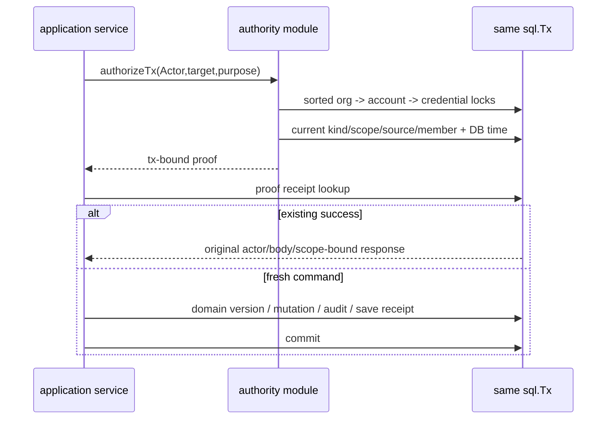

# 当前凭证权威性合同

状态：**1.0.0 当前初始化与权限合同；完整平台及生产验收未完成**。更新：2026-10-27。2026-10-25 的 proposal-1-r1、CCA-PROP-01..04 和 T-P4-013 提交 `0a8308919dd4b2bf5f8836e943118a40f2a1a10a` 为历史设计与取材证据，不代表当前代码或部署状态。本文不改写既有验证事实。

关联：[架构与时序](../docs/architecture/current-credential-authority.md)、[实施与验收计划](../docs/delivery/current-authority-plan.md)。以下 MUST／不得均为冻结实施要求，不是对现有代码的完成声明。

## CCA-001 身份与当前来源

1. `Principal` 必须是纯投影，移除包私有 internal 位，不能当凭证或供交互写应用方法授权。
2. 所有受保护 application command 必须接收封闭 `Actor`；公开 JSON、参数 DTO、header 中不得存在可选择 system／internal／delegation／activation／trusted actor 的字段。resourceID 或 operationID 只引用资源，不是授权能力。
3. Actor 的 kind、实际 credential digest、source/ref、projection 全部私有，零值无效；反序列化不得产生有效 Actor。不得新增 `ActorFromPrincipal` 或缺凭证自动 fallback。
4. `AuthenticateActor(ctx, token) (Actor,error)` 从实际发行记录与 scope 解析上下文；outer auth 的返回不证明后续 mutation 的当前权限。
5. Cookie、Bearer 只是传输方式。Bearer 携带 server-issued browser credential 仍是 browser kind；Cookie 携带 scoped token 仍是其自身 scoped kind，不能升级为 browser。

### CCA-001A 凭证 kind 与 label

服务端 token scope 仅允许 runner／agent／api，并分别映射受限凭证 kind；label 只是长度受限的显示名，不参与权限、来源或 browser 判定。

服务端发行记录必须具有独立 `credential_kind`，限定 browser-session／user-api／scoped-runner／scoped-agent；pool credential、provider credential 与持久 activation 保持各自真实存储，不塞进用户 session 伪造人类身份。

session kind 与 token scope 必须一致：browser-session 没有 scope；其他用户 token 必须具有精确 kind/project scope，行缺失／不一致 fail closed。POST `/auth/tokens` 的公开 scope 只映射三种允许的 scoped kind；不接受 browser-session，不能以 label、cookie 或 source Principal 绕过。来源始终是当前 server-issued browser-session；源或目标权限不足时不发行。

当前 1.0.0 仅初始化当前模型的新库。`Service.Initialize` 在任何领域 DDL 前调用 `store.InitializeBaseline`；没有本组件 1.0.0 声明却已有领域表，或声明版本不匹配时，必须拒绝并要求使用独立空库。初始化不升级、不清库、不改写原记录。`suma_schema_baselines` 只声明 schema，不能证明服务健康、权限有效、业务验收或生产就绪。

`InitializeCredentialAuthority` 只建立当前权限结构，不扫描已有 session 推断身份，不补写 source、family、Grant 或 issuance。`AuthenticateActor` 以及每次事务内当前 proof 都必须核验真实发行记录；仅有 session／scope／label 而无完整可信证明时直接 401，不续写 expiry、不制造批准或成功回执。新凭证只能由真实 password／invitation／bootstrap proof 或当前 browser 明确批准的发行命令产生。

## CCA-002 类型与 interface

Root 首先冻结 `Actor`、`commandTarget`、`commandPurpose`、`authorizedCommand` 及生命周期 DTO/interface。声明见架构 §3；字段私有，命名在进入并行前统一。purpose 由具体服务端应用入口选取，禁止 `commandPurpose(body["purpose"])`。权限矩阵同时检查 kind＋scope＋当前 subject/member/action，缺任意一项不得继续。

```go
// 代表性新应用入口；其余按本合同逐方法表同样替换。
func (s *Service) SaveTeam(ctx context.Context, actor Actor, id string, m map[string]any) (map[string]any, error)
func (s *Service) Create(ctx context.Context, actor Actor, project, kind string, m map[string]any) (Record, error)
func (s *Service) Review(ctx context.Context, actor Actor, project, id string, m map[string]any, engine *dag.Engine) (Record, error)
func (s *Service) SwitchOrganization(ctx context.Context, actor Actor, m map[string]any) (Principal, string, error)
func (s *Service) IssueProjectCredential(ctx context.Context, actor Actor, req ProjectCredentialIssueRequest) (ProjectCredentialIssueResult, error)
// 只能由真实token/持久绑定解析的私有撤销目标；不能用于authorizeTx授予读写权限。
type logoutTarget struct {
    credentialDigest, subjectID, familyID, slotID string
    kind actorKind
}
func (s *Service) Logout(ctx context.Context, target logoutTarget) error

func (s *Service) authorizeTx(ctx context.Context, tx *sql.Tx, actor Actor,
    target commandTarget, purpose commandPurpose) (*authorizedCommand, error)
func (s *Service) commandReceipt(ctx context.Context, auth *authorizedCommand, key string, body any) (string, bool, error)
func (s *Service) saveCommandReceipt(ctx context.Context, auth *authorizedCommand, key, hash string, response any) error
```

`ProjectCredentialIssueRequest` 为 Root 新增私有应用 DTO：ProjectID、Scope、Label、IdempotencyKey，不包含 Actor／Principal／source override；最大 TTL 是服务端 kind policy。结果 Token、ExpiresAt、Label、Scope、ProjectID 保持现有 JSON 字段，operation secret 重放见 CCA-008。公开合同生成由 Root 统一完成。

现有 `(Principal, rawToken)` 专用方法迁移为 Actor；不得留两个并列可冲突身份参数。领域 handler 如需 Principal 读取当前名字／展示角色，通过 auth 的投影取得；不得拿投影再调用旧裸 Principal 写方法。更改所有真实写方法 interface，删除旧无 guard overload／wrapper，编译错误必须列入待迁移，不通过包装构造 fake Actor 消掉。

`authorizedCommand` 只在给定 sql.Tx、固定 target 和 purpose 有效，helper mutation 与 receipt 必须 assertTx。不能持久化 proof，不能跨 tx 或跨另一个项目使用。低层 current-membership helper 只在授权深模块内部和明确 durable adapter 使用，不暴露为交互 application auth。

### CCA-002A 当前允许的 kind

CCA-012逐入口登记是拟冻结的**唯一kind/purpose明细registry**，本表是其领域摘要；二者不得各自演化，差异必须阻断冻结／生成。POST `/tasks`与其他合法record写同样保留browser＋projectAPI；POST `/teams`仍仅browser。confirmed_gap只引用既有browser八案例，不表示API路径已另行复现。

| 能力 | browser-session | user-api | scoped-runner／agent | pool／provider／durable |
|---|---|---|---|---|
| 组织／team／project-access／邀请治理、创建项目、switch、token issue | 按当前组织权限 | 维持当前不允许 | 不允许 | 不允许 |
| record Create/Update/Decompose/Review/intake、planning、workflow/run、dispatch、release-candidate、workspace | 按各自当前角色 | **保留当前 API token 合法 project scope／角色功能** | Runner/Agent 不进入这些 namespace | 仅各自专用内部协议，不能冒用此表 |
| tool-profile、automation/ingress 管理、scheduling 政策、release-worker/环境/计划审批执行、pool 人类管理 | 按现有 browser 限制与当前角色 | 保持当前禁止范围；不借此次扩权 | 不允许 | 仅持久派发或机器独立协议 |
| 账户偏好、组织默认偏好、未来 SSO link | 必须真实 browser，组织偏好仍需当前管理员 | 不允许 | 不允许 | 不允许 |
| Runner 领取、续租、工具进度／结果、制品／release authorization | 不允许以 browser kind 冒用 | 不允许 | runner 的精确 scope/worker/assignment；agent 仅现有读工具 | pool/provider 有独立协议 |
| Agent overview/tasks/search | 按现有路径授权 | 按现有合法 API 能力，不能升级 Agent | agent exact project read | 不从机器 owner 投影借权 |

browser-only purpose 必须检查真实 credential kind 与当前来源，不能以 label 或无 scope 代替 browser 证明；当前角色、项目及用途限制仍须独立满足。

## CCA-003 事务、锁序与数据库时间

统一顺序：组织 ID 排序 → 账户协调 userID 排序 → credential/session 稳定 key 排序 → project/scheduler → 该域既有 pool/environment 细分锁序。完整组织集合必须在持账户／credential 锁前确定。多租户账户操作按架构 §4 的候选集合→锁→当前复核→回滚重试协议；最多 3 次，变化不停返回 conflict，不动态逆序补锁。source／target switch、grant 两方组织、account-wide revoke 与成员变更均在此范围。

拟新增账户协调表且所有 session发行／撤销与成员改动加入协议。Logout/revoke/rotate 不能绕开命令的同一协调点。命令先占锁并通过权限接受点可先提交，logout 等待；logout先提交则后续命令/replay必须拒绝。项目成员与组织角色撤销仍与业务版本／DAG当前依据串行，不能因 session 有效而跳过角色。

数据库时钟统一保守秒精度：expiry.Unix > dbNow.Unix，最后不足一秒拒绝。凭证／scope/current membership 必须是当前读取；Postgres/OceanBase 不能用旧 RR snapshot 替代 FOR UPDATE／协议内 current read。总短事务预算拟为 5 秒，取消／timeout 全部回滚，不做网络、模型或大文件 I/O，不自动续寿。接受点有效允许这一已接受短事务完成；不宣称到 commit 的每一纳秒重新授权。需要副作用的长流程使用持久 operation + 独立可信 effect 能力。

证明“当前读取”的 cross-driver 行为必须真实后端验证才可记该后端通过。只有本地 SQLite 时必须披露 Postgres/OceanBase 尚未验收；不删除后端代码或降级安全合同换取绿灯。



## CCA-004 回执、版本和多事务

每次成功 replay 之前都验证实际当前 Actor，不只是 business membership。receipt 原 key/body hash/tenant/project/actor 与历史正文保持；拒绝时不返回历史对象 ID／原文／成功状态，不产生 business、operation、activity。失败事务的协调锁计数回滚；无业务写的 current-read lock计数单独披露，不混为用户成功操作。

Review early replay transaction 与最终验收 transaction 分别 authorizeTx。证据计算中发生 logout／降权时，最终 tx 拒绝；早期成功回执只可在当时权限有效时恢复。reconcile preview/read、外部 observation 后 final commit 都要重新 proof。Engine `before` 必须在 engine `operation` lookup 前，`after/bind` 使用同 tx proof；publish 新增 authorized callback，不能只保护 create/command。

普通 record Create 的 failure system 例外改为专用可信 FailureIssue 私有入口：从真实 failed run/event 查询归属，固定 operation／scope／issue origin，再用 failureProjector proof 写共享 lower helper。不能接受裸 tenant/project/Principal 作为 system授权事实。普通人 Create 仍只支持其真实 browser/API 当前凭证。index outbox 同样使用可信 persisted revision 来源。

## CCA-005 workspace prepare、finalize 与恢复

prepare 要当前 Actor proof、预期文件内容 hash、真实允许 root／path、固定 operation/body；同 tx 持久化 accepted_at、source ref、root/path、expected/newhash、content 和恢复状态，commit为命令接受点。不得在此之前写文件或恢复原请求的成功结果。

interactive finalize 和 replay 都重查当前 Actor，在各自 tx 构造新 proof；失效不返回成功且不以旧 Principal 完成新命令。已接受 prepared 行的 durable recovery 是单独 purpose，可在浏览器 logout 后由可信恢复 adapter 完成固定已接受文件效果，不能接受新命令，不能改 root/path/body。它复核持久 scope、状态 CAS、路径允许规则、实际 expected/new hash 及幂等 rename。绑定切根先完成／明确阻塞旧 root 操作，不重解释为新 root 文件。

若 prepare 已提交而源后来失效，交互调用可能得到 401 但已接受操作仍由恢复完成；不能把它与“失效先于 prepare 仍接受新写”混淆。当前授权重新登录后查 operation 状态；不允许用已失效 token 获取成功 receipt。测试必须分别覆盖接受点前／后顺序、崩溃、两个恢复者、预期文件已变和新 root，不用测试替代实际文件验证。

## CCA-006 机器、持久 activation 与公共证明

Runner Actor 精确 session/scope/project、当前会员权限、worker绑定、profile、assignment/attempt/fence/current credential和DB expiry；pool Machine Actor 精确独立credential/runner/version/pool/bilateral grant/dispatch/current scope，不构造 owner Principal；provider Actor基于配置token和current ticket/plan/deployment/effect。机器回执同样在其当前 authority callback后恢复。现有 pool artifact/release capability未实现仍拒绝，不因统一Actor宣称支持。

automation/tool 管理用当前人类Actor；派发用从实际 activation row/revision构造的 durable Actor。启用人的当前项目批准／写权限、activation active、固定revision、工具命令／来源依旧复核；浏览器logout独立，不取消持久激活。downgrade/revoke/revision变化要阻断新materialize/admission。已派发回报沿机器当前fence规则。

signed ingress保留server signature、key generation、时间窗、delivery body identity、当前配置和parent activation；duplicate receipt的协议不机械改成browser replay。启用／配置修改命令与public delivery分开。setup/login/invitation acceptance基于原本bootstrap/password/one-time proof，不能要求先有browser；服务端发行明确kind与source。每个真实来源独立测试，不写万能“internal:true”模拟。

## CCA-007 当前 API 与拒绝语义

| 表面 | 当前合同 |
|---|---|
| 交互业务 method | 接收封闭 Actor；所有 mutation 与 receipt 先取得同事务、固定 target／purpose 的当前 proof，不保留裸 Principal 写入口 |
| 浏览器原视图 | 交互 browser mutation 使用 `X-Suma-Expected-User`／`X-Suma-Expected-Organization` 固定客户端已加载视图；缺失 428、错配 403；API 使用自身固定 scope，header 不能构造 Actor |
| auth/tokens | 当前 browser 与目标项目权限、稳定 idempotency key、明确批准、Grant／session／scope／slot 原子发行；独立 TTL 受 kind／tenant policy 限制，不取 browser 剩余 TTL；secret 恢复见 CCA-008 |
| auth/switch | 当前源 browser、两处会员和完整排序锁；同 logical family／slot，expiry 不超过来源，不延寿 |
| auth/logout | 从真实 secret 解析私有撤回目标；browser 撤销本 family，API／Runner／Agent 仅撤销自身 credential／slot；重复或未知请求安全清 cookie，不授予能力 |
| workflow publish／run | 当前 Actor callback 先于 Engine operation lookup，bind／effect 使用同事务 proof；内核方法不等于平台授权 |
| preferences／未来 SSO link | 偏好仅真实 browser 并保留原视图和版本；SSO link 尚未实现，不以 seam 冒称接入 |
| 失败代码 | 缺失／到期／撤销／缺发行证明 401；kind／scope／会员／用途不足 403；原视图缺失 428；版本或幂等正文冲突 409 |
| protected read／SSE | 按 CCA-009 的真实来源登记；SSE 建立、轮换和有界 batch 都执行当前 proof，公开和机器协议分别登记 |

以上是当前 1.0.0 合同，不提供告警后放行、旧字段别名或 Principal 授权旁路。bootstrap、logout、机器及 public 签名协议按自身 proof 处理。

### CCA-008 source、switch 与 secret issuance

source browser必须来自可信发行记录，发行时必须current；kind、subject/tenant、account/authsource generation和目标project发行权限在同tx当前复核，不能从m中的issuer/source_override读取。**独立token TTL不取min(browser剩余寿命)**：以server kind/tenant policy和这次明确批准的持久Grant的TTL／scope／配额上限决定。初始policy拟保留现有24小时默认/上限；以后30天节点等要明确policy与Grant能力，本设计不冒称当前已实现。Grant固化approved_by、当前权限、kind/project/scope、policyrevision、expiry与配额约束；当前发行操作就是显式批准，不允许客户端自报approved。source普通browser logout不撤销已正式发行token。

规范正向示例：发行browser还剩1分钟且当前授权有效，kind/tenant policy明确允许、当前command批准24小时Grant，则独立token得到24小时的Grant期限，不是1分钟；普通browser到期/logout不缩短该独立Grant。相同browser执行switch时目标仍不得超过原family/source剩余1分钟。这一示例同时约束API对照表与生命周期测试，不引入新长期token能力。

browser switch另有严格来源寿命合同：同一持久session-family/generation的authenticated_at与absolute_expires_at固定，目标expiry不得超出原family/sourceexpiry，不能因switch变成新7日登录。真正local-password新login可按现有7日policy建立新family。switch目前source/target两会员及同family必须当前；familyrow不随source secret正常消耗/轮换删除，所以新session不会因旧row作废而立即失效。本提议保留source session至原expiry/logout，replay须该source仍有效；另客户端原视图头阻止cookie漂移。普通browserlogout拟撤销当前family/generation，独立loginfamily不受影响；该family语义作为v1基线冻结。

两类secret响应都不得写入operation receipt。丢失响应恢复：同一当前source Actor＋同body/key，轮换既有logicalslot的secret，旧secret失效，固定switchfamily expiry或独立Grant expiry不变；返回metadata说明replacement。不能回读rawsecret、创建无界活动后代或隐式renew。Grant到期必须新的明确批准operation，不能重复旧key自动延寿。source失效时issue/replay401；已经正式发行的独立token按自身生命周期继续，并不因sourcebrowserlogout而失效。

独立token使用时持续验证自身current、creator或Grant当前权限、Grant状态／TTL／scope／配额上限及account/authsource revocation generation；普通cookie Logout与account-wide/compromise/sourceProvider撤销分开。真实SSO/provider session撤销是否使该Grant失效由明确policy指定，不能私自把所有独立凭证绑到浏览器cookie。durableactivation仍按自身记录与激活人当前权限。不得继承更高scope或无上限寿命。

### CCA-008A 当前初始化与持久证明

| 实际存储 | 当前事实与边界 |
|---|---|
| `suma_schema_baselines` | component／version；由 `store.InitializeBaseline` 在领域 DDL 前校验，只声明当前 schema |
| `suma_sessions`、`suma_token_scopes` | 实际 credential digest、user／tenant、expiry／label 与精确 token scope；单独存在不能证明身份 |
| `suma_auth_sources`、`suma_session_families` | 真实认证建立 source／generation 与固定 browser family／expiry；普通 secret 轮换不延寿，family 注销不撤销独立 Grant |
| `suma_credential_authority`、`suma_credential_issuance` | digest 绑定 kind、source／generation、family、Grant、slot 与实际发行时点／operation；缺失或不一致直接拒绝 |
| `suma_credential_grants` | 明确批准的 subject、tenant／project、kind／scope、approved_by／approved_at、policy revision、expiry 与撤销状态；使用时继续检查当前权限 |
| `suma_credential_slots` | user／tenant／operation 唯一、request hash、当前 digest、固定 expiry、family／Grant 与撤销状态；秘密替换不创建无限后代，不保存 raw secret |
| `suma_identity_authority_locks`、`suma_authority_credential_locks` | 账户与 credential 的排序协调点；sequence 不是业务操作或验收计数 |

`Service.Initialize` 与各 `Initialize*` 只建立当前结构，不执行历史凭证分类、回填、旧接口转换或数据库升级。空库初始化不能凭空产生用户、身份、批准或业务证据；完成真实认证与明确发行后，凭证及其全部证明必须在同一事务写入。已声明的当前库可幂等完成中断的当前 DDL，声明不保证这些 DDL 或业务能力已全部完成。

没有发行证明的 session 或 scope 只能被拒绝，不能从 label、存活状态或已有范围生成有效 kind／source／family／Grant。原执行、attempt／fence／lease／journal 和已接受操作保持事实；凭证拒绝不等于外部效果未发生，不得自动改 failed、重复派发、伪造 ACK，或将新凭证自动绑定到旧 attempt。未知效果继续核对原操作；接入真实已有数据库、数据导入和独立升级方案不在本次新库初始化范围。

### CCA-008B kind-specific Logout

| kind | 同序锁与持久变化 | 不得影响 |
|---|---|---|
| browser-session | 收集本family完整组织集合，排序org→user协调→source/family/session；本family.status置revoked且generation只递增一次；保留各session原row/expiry与旧family_generation作审计，current-proof因family失效拒绝 | 另一真实login family、独立API/Runner/Agent Grant/slot、durableactivation、共享identity source generation |
| user-api／scoped-runner／scoped-agent | 锁其精确tenant/project涉及组织→user协调→自身credential/issuance slot；credential_state=revoked，同slot state=revoked且version只递增一次，阻断旧secret与定义在同slot的replacement | browserfamily、identitysource、其他credential/slot/Grant；不因撤销一个token去全账户注销 |
| pool/provider/durable | 不进入人类auth/logout；按现有独立revoke/rotate/activation命令 | 不能从用户自报kind/family/grant目标操作 |

本节定义当前 browser family 注销行为。`logoutTarget` 为私有、withdraw-only 上下文，只由请求真实 secret 的 digest 和可信持久绑定解析，不接收 JSON family／Grant 选择，也不能生成 authorizedCommand。Logout 专用 HTTP adapter 仅撤回已证明的目标并清 cookie；已撤销、过期或未知目标重复请求均返回 200，known revoked 目标不重复推进 generation／version，不新增成功 operation／activity。无法证明 family 的目标只清 cookie，不推断或扩写权限。该无数据注销响应不是认证成功；其他 auth／current-proof 对缺证明凭证仍返回 401。

本阶段Grant配额模式明确为 `inherit-project-policy`：始终受当前已实现project/scheduler资源／并发／budget限制，记录policy revision，不以缺省quota=null绕过它们；不虚构未实现的独立token按次／离线quota。若某kind/tenant policy要求当前实现无法执行的额外quota，则拒绝该发行，而不是当无限。未来新quota模式、长期离线Grant及其消费协议需要另行完整合同。

OIDC尚未实现；只保留内部sourceID/revision/current-state解析seam。未来OIDC真实验证issuer/audience/nonce/state/PKCE/signature后构造来源，绝对期限、reauth/max-age和revocation必须继承。库选型/工具链升级/企业SSO验收另议；不安装依赖或伪造支持。

## CCA-009 本阶段第二轮 protected read registry

下面全为本阶段范围，不留“以后顺便补读权限”的隐性缺口。全部reader消费Actor，用同current-authority事务读授权数据；确需外部/index/file访问先固化授权scope/ref，接收结果和开始发送前再次current proof。无业务写事务可以为锁协议使用write-capable sql.Tx，不声称完全只读SQL。

| 域 | 已实现受保护读（GET，注明POST例外） | 特殊要求 |
|---|---|---|
| 会话与项目 | auth/session、projects | 真实kind/source/currentmembership，API项目列表精确boundproject |
| 治理 | organizations、organization/members/invitations、teams、team members、project-access | 不把scopeAPI提升组织治理；邀请不回显secret |
| 记录与业务 | requirements/tasks/members/issues/documents/releases/tests/evidence列表详情，overview/capabilities，POST search | scope/role保持，current receipt与对象详情分开；upstream index不信任caller scope |
| 计划 | planning、iterations/milestones、planning/capacity、resource-calendars/{member_id}、baseline列表/详情/pages | snapshot/watermark、真实成员和项目角色 |
| DAG | workflows列表/固定版本，POST workflows/validate，runs列表/详情/events/stream，node scheduling/attempts/tool-events | immutable历史仍需当前读权限；SSE/batch复核；保留cursor/watermark/rawtext |
| 工具与派发 | tool-profiles列表/详情，task-dispatch-plan详情 | 真实kind和当前项目范围；资格显示不等于命令授权 |
| 调度／资源池 | scheduling policy/previews/queue，execution-pools/preview/grants/runners，project-execution grants/route/runners/preview | browser与machine metadata分开；拥有方与使用方project scope不混 |
| automation/ingress | automations列表详情/revisions/occurrences、POST preview；ingress列表详情/revisions/deliveries/单delivery | browser管理读取保持现有范围；rawbody不进入日志 |
| release | release-workers/artifacts/candidates列表详情/blob，providers/environments/actions/plans/deployments；POST preview/rollback-preview；provider inspect/artifact read | 人类读与provider能力分开；bytes开始发送前current授权；preview无businessmutation |
| workspace／偏好 | binding/tree/file，account/organization preferences | 文件root/path scope+当前授权；reading不允许旧proof触发新命令；prefs真实browser |
| Agent／Runner／pool | agent/tools和POSTinvoke三只读工具；artifact upload inspect/resolve/blob；pool-runner/session | kind精确、machinefence/current grant；resolve若落operation按writeauthority |

public health/static/localization、setup/login/invitation proof、signed hook、pool/provider machine protocol单列，不套browser。未知未来route必须在写/读registry明确kind/purpose，未登记不可通过adapter gate。

## CCA-010 验收不变量与实际证据

八个原RED逐一必须变为实际401，且business/operation/activity无增加；replay不得返回原对象。这是修复最低起点而非全部范围。测试维持真实setup→cookie→Handler→第一次body.Read gated通道→第二连接commit→释放body，不手造Principal，不用sleep。expiry用第二连接固定过去值；DB clock边界另测。相反顺序命令先提交→logout→后续401必须保持先前业务。

| 所需拒绝案例 | 已有真实入口／先提交的失效 | 被延迟动作 | T-P4-013 历史观察（原 RED） | 所需拒绝结果 |
|---|---|---|---|---|
| CCA-RED-01 | POST /teams；第二连接Logout | 全新操作key创建team | 201；team/operation/activity各+1 | 401；三类各+0，无成功对象 |
| CCA-RED-02 | POST /teams；第二连接Logout | 同key/body恢复seed回执 | 201；原team；三类各+0 | 401；不得返回seed ID/body；三类+0 |
| CCA-RED-03 | POST /teams；第二连接固定过去expiry | 全新操作key创建team | 201；team/operation/activity各+1 | 401；三类各+0，无成功对象 |
| CCA-RED-04 | POST /teams；第二连接固定过去expiry | 同key/body恢复seed回执 | 201；原team；三类各+0 | 401；不得返回seed ID/body；三类+0 |
| CCA-RED-05 | POST /tasks；第二连接Logout | 全新操作key创建task | 201；task/operation/activity各+1 | 401；三类各+0，无成功对象 |
| CCA-RED-06 | POST /tasks；第二连接Logout | 同key/body恢复seed回执 | 201；原task；三类各+0 | 401；不得返回seed ID/body；三类+0 |
| CCA-RED-07 | POST /tasks；第二连接固定过去expiry | 全新操作key创建task | 201；task/operation/activity各+1 | 401；三类各+0，无成功对象 |
| CCA-RED-08 | POST /tasks；第二连接固定过去expiry | 同key/body恢复seed回执 | 201；原task；三类各+0 | 401；不得返回seed ID/body；三类+0 |

每行必须同时证明真实browserkind/subject/org绑定、第二连接commit已返回、fresh Authenticate拒绝、原membership仍在；用独立SQL检查实际字段/ID与三类行数，replay的+0不是安全拒绝。种子数据在失效前建立且与新操作key分开，hash/beforeafter在每行适用切面记录。表中“当前已观察”仅引用既有014发现，本次没有重新运行。

每一写family需至少真实应用命令的fresh/replay当前凭证撤销案例；guard已有家族还需正向与kind错配。测试须覆盖directservice入口，不允许绕过Actor工厂；预期编译门禁禁止Principal写、Actor字面量、未登记mutation/directSQL和未授权Engine入口。测试这些用户可观察行为与并发顺序，不写只镜像helper实现的无意义断言。

API正向必须包含真实**新模型显式发行**的projectAPI token，对精确project且当前role允许时POST `/tasks` fresh 201与同key/body成功replay（同ID、无重复行）；Runner/Agent和foreignproject API拒绝。该正向与browser失效八案例并列，不用“其他record正向”间接替代tasks。

初始化验收必须覆盖独立空库建立当前 schema、同版本幂等重启，以及未声明的既有领域库在任何领域 DDL 前被拒绝且原数据不变。另以缺失发行证明的 session／scope 验证 auth 与当前协议全部 401，拒绝不得补写来源、Grant、批准、issuance、成功 operation 或 activity。合法 password 登录与明确批准发行后的精确 scope 请求须保持可用，foreign scope 必须拒绝。已存在 attempt／lease／journal 和原回执不得因认证拒绝被自动改为 failed、重复派发或伪造 ACK；未知效果沿原操作核对。Logout 仍分别验证 family、独立 token／slot 和其他 activation 的边界与重复幂等性。

Review两阶段之间、workspaceprepare前/后、reconcile外部读前/后、source switch/mint、同账号两session两org、并发revoke/issue/membership增删、API合法写、Runner/Agent拒绝、人类与pool分离、browserlogout后durableactivation继续而降权/revoke阻断，都必须独立证据。

read registry逐域覆盖logout/expiry后禁止新protectedresult，SSE建立/轮换/batch/重连和分页rawtext语义。保留已有013source-display/domain资格与候选/发布/自动化关键回归。只有实际完整suite和稳定Go输入后可给计数；前端并行变化另切面不合并数字。真实browser/runtime/数据库后端验收不能由单测冒称。

## CCA-011 AI SOP、交付与风险

Root 统一 shared types、用途矩阵、DAG、HTTP、生命周期、schema 初始化、generator 与集成证据，各领域遵守明确文件所有权。交付说明必须列出当前 interface、fresh／replay 权限证据和未验证项；出现漏点补 registry，不以 Principal fallback 或旧无 guard wrapper 消除编译错误。

锁 timeout、缺 source／发行证明、scope 冲突与不可解析 expiry 一律 fail closed；禁止静默 downgrade。日志不带 token／password／cookie／raw signature。原报告和 RED 保留，新证据置项目 .cache 并由 Root 汇总精简事实。没有对应证据不宣称权限基础、P0–P7、SSO 或生产交付完成，也不能关闭 guard 或切回不安全程序恢复运行。

下方 111 行登记保留 2026-10-25 的发现分类与实施责任，属于历史取材矩阵，不是当前未修复清单、当前 API 来源或验收结论；confirmed 仅指当时 teams／tasks 的已复现案例，guarded 不等于全面验证。当前入口仍必须满足本合同的封闭 Actor、同事务 proof 与完整用途登记。

## CCA-012 历史 111 行逐方法实施登记

本表中的“共享/内核”表示主集成Root控制interface，不授权worker改共享源。每行的具体旧源码位置保留在本地map JSON；新签名对所有人类写一律Actor，同tx helper一律proof，机器/持久来源明确variant。method多处出现是不同route/context，不合并丢边界。
| 序号 | 入口／方法 | 当前观察分类 | 拟议真实来源／事务 interface | 实施责任 |
|---|---|---|---|---|
| 1 | `POST /teams` → `SaveTeam` | confirmed_gap | browser；Actor命令 → sameTx authorizedCommand → receipt/mutation | A |
| 2 | `POST /tasks` → `Create` | confirmed_gap | browser、projectAPI；Actor命令 → sameTx authorizedCommand → receipt/mutation；仅browser已实测缺口 | A |
| 3 | `PATCH /teams/{id}` → `SaveTeam` | source_gap | browser；Actor命令 → sameTx authorizedCommand → receipt/mutation | A |
| 4 | `POST /teams/{id}/members` → `SaveTeamMember` | source_gap | browser；Actor命令 → sameTx authorizedCommand → receipt/mutation | A |
| 5 | `POST /organizations` → `CreateOrganization` | source_gap | browser；Actor命令 → sameTx authorizedCommand → receipt/mutation | A |
| 6 | `PATCH /organization/members/{id}` → `UpdateOrganizationMember` | source_gap | browser；Actor命令 → sameTx authorizedCommand → receipt/mutation | A |
| 7 | `POST /project-access` → `SaveProjectAccess` | source_gap | browser；Actor命令 → sameTx authorizedCommand → receipt/mutation | A |
| 8 | `POST /organization/invitations` → `CreateInvitation` | source_gap | browser；Actor命令 → sameTx authorizedCommand → receipt/mutation | A |
| 9 | `POST /organization/invitations/{id}/revoke` → `RevokeInvitation` | source_gap | browser；Actor命令 → sameTx authorizedCommand → receipt/mutation | A |
| 10 | `POST /projects` → `CreateProject` | source_gap | browser；Actor命令 → sameTx authorizedCommand → receipt/mutation | A |
| 11 | `POST /{record-kind except tasks}` → `Create` | source_gap | browser、projectAPI；Actor命令 → sameTx authorizedCommand → receipt/mutation | A |
| 12 | `PATCH /{record-kind}/{id}` → `Update` | source_gap | browser、projectAPI；Actor命令 → sameTx authorizedCommand → receipt/mutation | A |
| 13 | `POST /requirements/{id}/decompose` → `Decompose` | source_gap | browser、projectAPI；Actor命令 → sameTx authorizedCommand → receipt/mutation | A |
| 14 | `POST /tasks/{id}/review` → `Review` | source_gap | browser、projectAPI；Actor命令 → sameTx authorizedCommand → receipt/mutation | A |
| 15 | `POST /tasks/{id}/review` → `reviewReceipt` | source_gap | browser、projectAPI；消费Actor，新短tx authorizeTx，再receipt；不复用最终txproof | Root共享/生命周期 |
| 16 | `POST /issues/{id}/intake` → `IssueToRequirement` | source_gap | browser、projectAPI；Actor命令 → sameTx authorizedCommand → receipt/mutation | A |
| 17 | `POST/PATCH /iterations,/milestones` → `SavePlanningPeriod` | source_gap | browser、projectAPI；Actor命令 → sameTx authorizedCommand → receipt/mutation | A |
| 18 | `POST /planning/schedule` → `ScheduleTasks` | source_gap | browser、projectAPI；Actor命令 → sameTx authorizedCommand → receipt/mutation | A |
| 19 | `PUT /resource-calendars/{member_id}` → `SaveResourceCalendar` | source_gap | browser、projectAPI；Actor命令 → sameTx authorizedCommand → receipt/mutation | A |
| 20 | `POST /planning/baselines` → `CaptureBaseline` | source_gap | browser、projectAPI；Actor命令 → sameTx authorizedCommand → receipt/mutation | A |
| 21 | `POST /workflows` → `Engine.PublishWithOperation` | source_gap | browser、projectAPI；Root authority variant；before捕获Actor并生成sameTx proof | Root共享/内核 |
| 22 | `POST /runs` → `Engine.CreateRunBoundAuthorized` | source_gap | browser、projectAPI；Root authority variant；before捕获Actor并生成sameTx proof | Root共享/内核 |
| 23 | `POST /runs` → `BindDirectRunTx` | source_gap | browser、projectAPI；同tx authorizedCommand helper；不得裸Principal | B |
| 24 | `POST /runs` → `BindRunTx` | source_gap | browser、projectAPI；同tx authorizedCommand helper；不得裸Principal | A |
| 25 | `POST /runs/{id}/commands` → `Engine.CommandWithAuthority` | source_gap | browser、projectAPI；Root authority variant；before捕获Actor并生成sameTx proof | Root共享/内核 |
| 26 | `POST /runs/{id}/commands` → `InvalidateCompensationTx` | source_gap | browser、projectAPI；同tx authorizedCommand helper；不得裸Principal | A |
| 27 | `POST /task-dispatch-plans` → `CreateTaskDispatchPlan` | source_gap | browser、projectAPI；Actor命令 → sameTx authorizedCommand → receipt/mutation | B |
| 28 | `POST /task-dispatch-plans/{id}/start` → `StartTaskDispatchPlan` | source_gap | browser、projectAPI；Actor命令 → sameTx authorizedCommand → receipt/mutation | B |
| 29 | `POST /tool-profiles` → `CreateToolProfile` | source_gap | browser；Actor命令 → sameTx authorizedCommand → receipt/mutation | B |
| 30 | `POST /tool-profiles/{id}/commands` → `CommandToolProfile` | source_gap | browser；Actor命令 → sameTx authorizedCommand → receipt/mutation | B |
| 31 | `POST /automations` → `CreateAutomation` | source_gap | browser；Actor命令 → sameTx authorizedCommand → receipt/mutation | B |
| 32 | `POST /automations/{id}/commands` → `CommandAutomation` | source_gap | browser；Actor命令 → sameTx authorizedCommand → receipt/mutation | B |
| 33 | `POST /automations/{id}/ingresses` → `CreateAutomationIngress` | source_gap | browser；Actor命令 → sameTx authorizedCommand → receipt/mutation | B |
| 34 | `POST /automation-ingresses/{id}/commands` → `CommandAutomationIngress` | source_gap | browser；Actor命令 → sameTx authorizedCommand → receipt/mutation | B |
| 35 | `POST /release-candidates` → `CreateReleaseCandidate` | source_gap | browser、projectAPI；Actor命令 → sameTx authorizedCommand → receipt/mutation | C |
| 36 | `POST /workspace/binding` → `Server.workspace` | source_gap | browser、projectAPI；Actor命令 → sameTx authorizedCommand → receipt/mutation | C（Root集成dispatch） |
| 37 | `POST /workspace/file` → `saveWorkspace` | source_gap | browser、projectAPI；prepare/finalize各自Actor新proof；可信prepared行派生Recovery | C |
| 38 | `POST /workspace/file` → `recoverWorkspace` | source_gap | browser、projectAPI；prepare/finalize各自Actor新proof；可信prepared行派生Recovery | C |
| 39 | `POST /auth/switch` → `SwitchOrganization` | source_gap | browser；Actor命令 → sameTx authorizedCommand → receipt/mutation | Root共享/生命周期 |
| 40 | `POST /auth/switch` → `browserSessionTx` | source_gap | browser；私有proof/source约束发行；kind固定browser，expiry不扩寿 | Root共享/生命周期 |
| 41 | `POST /auth/tokens` → `CreateToken` | source_gap | browser；删除公共任意label发行；IssueProjectCredential(Actor,typedReq)原子发行 | Root共享/生命周期 |
| 42 | `POST /auth/setup` → `Setup` | not_verified | public-bootstrap；实际public proof → 服务端kind/source发行；不要求既有browser | Root共享/生命周期 |
| 43 | `POST /auth/login` → `Login` | not_verified | public-password；实际public proof → 服务端kind/source发行；不要求既有browser | Root共享/生命周期 |
| 44 | `POST /auth/invitations/accept` → `AcceptInvitation` | not_verified | public-invitation；实际public proof → 服务端kind/source发行；不要求既有browser | Root共享/生命周期 |
| 45 | `POST /auth/logout` → `Logout` | guarded | 私有logoutTarget；browser→本family/generation；projectAPI/projectRunner/agent→自身credential/slot；重复200，无新成功receipt/activity | Root共享/生命周期 |
| 46 | `PATCH /account/preferences,/organization/preferences` → `UpdateAccountPreferences` | guarded | browser；Actor命令 → sameTx authorizedCommand → receipt/mutation | Root共享/内核 |
| 47 | `PATCH /account/preferences,/organization/preferences` → `UpdateOrganizationPreferences` | guarded | browser；Actor命令 → sameTx authorizedCommand → receipt/mutation | Root共享/内核 |
| 48 | `PATCH /account/preferences,/organization/preferences` → `updateLocalePreference` | guarded | browser；Actor命令 → sameTx authorizedCommand → receipt/mutation | Root共享/内核 |
| 49 | `POST /scheduling/policy-previews` → `CreateSchedulingPreview` | guarded | browser-unscoped；Actor命令 → sameTx authorizedCommand → receipt/mutation | Root共享/内核 |
| 50 | `POST /scheduling/policy-previews/{id}/commit` → `CommitSchedulingPreview` | guarded | browser-unscoped；Actor命令 → sameTx authorizedCommand → receipt/mutation | Root共享/内核 |
| 51 | `POST /release-workers` → `RegisterReleaseWorker` | guarded | browser；Actor命令 → sameTx authorizedCommand → receipt/mutation | C |
| 52 | `PATCH /release-workers/{id}` → `RevokeReleaseWorker` | guarded | browser；Actor命令 → sameTx authorizedCommand → receipt/mutation | C |
| 53 | `POST/PATCH /environments` → `SaveReleaseEnvironment` | guarded | browser；Actor命令 → sameTx authorizedCommand → receipt/mutation | C |
| 54 | `POST /release-plans` → `CreateReleasePlan` | guarded | browser；Actor命令 → sameTx authorizedCommand → receipt/mutation | C |
| 55 | `POST /release-plans/{id}/approve` → `ApproveReleasePlan` | guarded | browser；Actor命令 → sameTx authorizedCommand → receipt/mutation | C |
| 56 | `POST /release-plans/{id}/execute` → `ExecuteReleasePlan` | guarded | browser；Actor命令 → sameTx authorizedCommand → receipt/mutation | C |
| 57 | `POST /deployments/{id}/reconcile` → `ReconcileReleaseDeployment` | guarded | browser；Actor命令 → sameTx authorizedCommand → receipt/mutation | C |
| 58 | `POST /deployments/{id}/reconcile` → `resolveObservedRelease` | guarded | browser；同tx authorizedCommand helper；不得裸Principal | C |
| 59 | `POST /execution-pools` → `CreateExecutionPool` | guarded | browser；Actor命令 → sameTx authorizedCommand → receipt/mutation | C |
| 60 | `POST /execution-pools/{id}/commands` → `CommandExecutionPool` | guarded | browser；Actor命令 → sameTx authorizedCommand → receipt/mutation | C |
| 61 | `POST /execution-pools/{id}/policy-previews` → `CreateExecutionPoolPolicyPreview` | guarded | browser；Actor命令 → sameTx authorizedCommand → receipt/mutation | C |
| 62 | `POST /execution-pools/{id}/policy-previews/{id}/commit` → `CommitExecutionPoolPolicyPreview` | guarded | browser；Actor命令 → sameTx authorizedCommand → receipt/mutation | C |
| 63 | `POST /execution-pools/{id}/runners` → `RegisterExecutionPoolRunner` | guarded | browser；Actor命令 → sameTx authorizedCommand → receipt/mutation | C |
| 64 | `POST /execution-pools/{id}/runners/{id}/credentials` → `RotateExecutionPoolCredential` | guarded | browser；Actor命令 → sameTx authorizedCommand → receipt/mutation | C |
| 65 | `POST /execution-pools/{id}/runners/{id}/commands` → `RevokeExecutionPoolRunner` | guarded | browser；Actor命令 → sameTx authorizedCommand → receipt/mutation | C |
| 66 | `POST /execution-pools/{id}/grants/{id}/commands` → `CommandOwnedPoolGrant` | guarded | browser；Actor命令 → sameTx authorizedCommand → receipt/mutation | C |
| 67 | `POST /execution-pools/{id}/grants/{id}/commands` → `commandPoolGrant` | guarded | browser；Actor命令 → sameTx authorizedCommand → receipt/mutation | C |
| 68 | `POST /project-execution/grants` → `RequestExecutionPoolGrant` | guarded | browser；Actor命令 → sameTx authorizedCommand → receipt/mutation | C |
| 69 | `POST /project-execution/grants/{id}/commands` → `WithdrawProjectPoolGrant` | guarded | browser；Actor命令 → sameTx authorizedCommand → receipt/mutation | C |
| 70 | `POST /project-execution/grants/{id}/commands` → `commandPoolGrant` | guarded | browser；Actor命令 → sameTx authorizedCommand → receipt/mutation | C |
| 71 | `POST /project-execution/route-previews` → `CreateExecutionRoutePreview` | guarded | browser；Actor命令 → sameTx authorizedCommand → receipt/mutation | C |
| 72 | `POST /project-execution/route-previews/{id}/commit` → `CommitExecutionRoutePreview` | guarded | browser；Actor命令 → sameTx authorizedCommand → receipt/mutation | C |
| 73 | `POST /runner/claim` → `Engine.ClaimWithOperation` | guarded | projectRunner；Root authority variant；before捕获Actor并生成sameTx proof | Root共享/内核 |
| 74 | `POST /runner/claim` → `runnerIdentityTx` | guarded | projectRunner；精确machine Actor/current identity → 同tx proof | C |
| 75 | `POST /runner/heartbeat` → `Engine.HeartbeatWithAuthority` | guarded | projectRunner；Root authority variant；before捕获Actor并生成sameTx proof | Root共享/内核 |
| 76 | `POST /runner/heartbeat` → `projectRunnerExecutionAuthorityTx` | guarded | projectRunner；精确machine Actor/current identity → 同tx proof | C |
| 77 | `POST /runner/progress` → `Engine.ProgressWithAuthority` | guarded | projectRunner；Root authority variant；before捕获Actor并生成sameTx proof | Root共享/内核 |
| 78 | `POST /runner/progress` → `validateToolProgressTx` | guarded | projectRunner；同tx authorizedCommand helper；不得裸Principal | B |
| 79 | `POST /runner/results` → `Engine.CompleteBound` | guarded | projectRunner；Root authority variant；before捕获Actor并生成sameTx proof | Root共享/内核 |
| 80 | `POST /runner/results` → `validateToolResultTx` | guarded | projectRunner；同tx authorizedCommand helper；不得裸Principal | B |
| 81 | `POST /runner/results` → `verifyArtifactResultTx` | guarded | projectRunner；同tx authorizedCommand helper；不得裸Principal | C |
| 82 | `POST /runner/results` → `ValidateReleaseResultTx` | guarded | projectRunner；同tx authorizedCommand helper；不得裸Principal | C |
| 83 | `POST /runner/tool-inventory` → `ReportToolInventory` | guarded | projectRunner；Actor命令 → sameTx authorizedCommand → receipt/mutation | B |
| 84 | `POST /runner/artifact-uploads` → `StartArtifactUpload` | guarded | projectRunner；Actor命令 → sameTx authorizedCommand → receipt/mutation | C |
| 85 | `PUT /runner/artifact-uploads/{id}/blobs/{hash}` → `PutArtifactBlob` | guarded | projectRunner；Actor命令 → sameTx authorizedCommand → receipt/mutation | C |
| 86 | `POST /runner/artifact-uploads/{id}/seal` → `SealArtifactUpload` | guarded | projectRunner；Actor命令 → sameTx authorizedCommand → receipt/mutation | C |
| 87 | `POST /runner/artifacts/resolve` → `ResolveArtifactInput` | guarded | projectRunner；Actor命令 → sameTx authorizedCommand → receipt/mutation | C |
| 88 | `POST /runner/release-authorizations` → `IssueReleaseAuthorization` | guarded | projectRunner；Actor命令 → sameTx authorizedCommand → receipt/mutation | C |
| 89 | `POST /pool-runner/claim` → `Engine.ClaimPoolWithOperation` | guarded | poolMachine；Root authority variant；before捕获Actor并生成sameTx proof | Root共享/内核 |
| 90 | `POST /pool-runner/claim` → `PoolRunnerAuthorityTx` | guarded | poolMachine；精确machine Actor/current identity → 同tx proof | C |
| 91 | `POST /pool-runner/heartbeat` → `Engine.HeartbeatWithAuthority` | guarded | poolMachine；Root authority variant；before捕获Actor并生成sameTx proof | Root共享/内核 |
| 92 | `POST /pool-runner/heartbeat` → `PoolRunnerAssignmentAuthorityTx` | guarded | poolMachine；精确machine Actor/current identity → 同tx proof | C |
| 93 | `POST /pool-runner/progress` → `Engine.ProgressWithAuthority` | guarded | poolMachine；Root authority variant；before捕获Actor并生成sameTx proof | Root共享/内核 |
| 94 | `POST /pool-runner/progress` → `ValidatePoolToolProgressTx` | guarded | poolMachine；同tx authorizedCommand helper；不得裸Principal | C |
| 95 | `POST /pool-runner/results` → `Engine.CompleteBound` | guarded | poolMachine；Root authority variant；before捕获Actor并生成sameTx proof | Root共享/内核 |
| 96 | `POST /pool-runner/results` → `ValidatePoolToolResultTx` | guarded | poolMachine；同tx authorizedCommand helper；不得裸Principal | C |
| 97 | `POST /pool-runner/tool-inventory` → `ReportPoolToolInventory` | guarded | poolMachine；Actor命令 → sameTx authorizedCommand → receipt/mutation | C |
| 98 | `POST /provider/deployment-authorizations/consume` → `ConsumeReleaseAuthorization` | guarded | providerMachine；Actor命令 → sameTx authorizedCommand → receipt/mutation | C |
| 99 | `POST /provider/deployment-authorizations/begin-effect` → `BeginReleaseEffect` | guarded | providerMachine；Actor命令 → sameTx authorizedCommand → receipt/mutation | C |
| 100 | `POST /provider/deployment-observations` → `ObserveReleaseDeployment` | guarded | providerMachine；Actor命令 → sameTx authorizedCommand → receipt/mutation | C |
| 101 | `POST /provider/deployment-observations` → `applyReleaseObservationTx` | guarded | providerMachine；同tx authorizedCommand helper；不得裸Principal | C |
| 102 | `POST /hooks/{id}` → `ReceiveAutomationIngress` | guarded | signedIngress；Actor命令 → sameTx authorizedCommand → receipt/mutation | B |
| 103 | `POST /hooks/{id}` → `ingressAdmission` | guarded | signedIngress；实际activation/revision派生durableActor，当前权限，不依browserlogout | B |
| 104 | `POST /hooks/{id}` → `automationIngressDispatchAdmission` | guarded | signedIngress；实际activation/revision派生durableActor，当前权限，不依browserlogout | B |
| 105 | `periodic TickAutomations` → `TickAutomations` | guarded | durableAutomation；实际activation/revision派生durableActor，当前权限，不依browserlogout | B |
| 106 | `periodic TickAutomations` → `materializeAutomation` | guarded | durableAutomation；实际activation/revision派生durableActor，当前权限，不依browserlogout | B |
| 107 | `periodic TickAutomations` → `dispatchAutomation` | guarded | durableAutomation；实际activation/revision派生durableActor，当前权限，不依browserlogout | B |
| 108 | `periodic TickAutomations` → `automationAdmission` | guarded | durableAutomation；实际activation/revision派生durableActor，当前权限，不依browserlogout | B |
| 109 | `Runner/pool completion and periodic ProjectFailures` → `FailureIssue` | guarded | failureProjector；可信persisted run/event/outbox派生私有精确projector能力 | A |
| 110 | `Runner/pool completion and periodic ProjectFailures` → `ProjectFailures` | guarded | failureProjector；可信persisted run/event/outbox派生私有精确projector能力 | A |
| 111 | `periodic ProjectIndexes` → `ProjectIndexes` | not_verified | indexProjector；可信persisted run/event/outbox派生私有精确projector能力 | Root共享/内核 |
