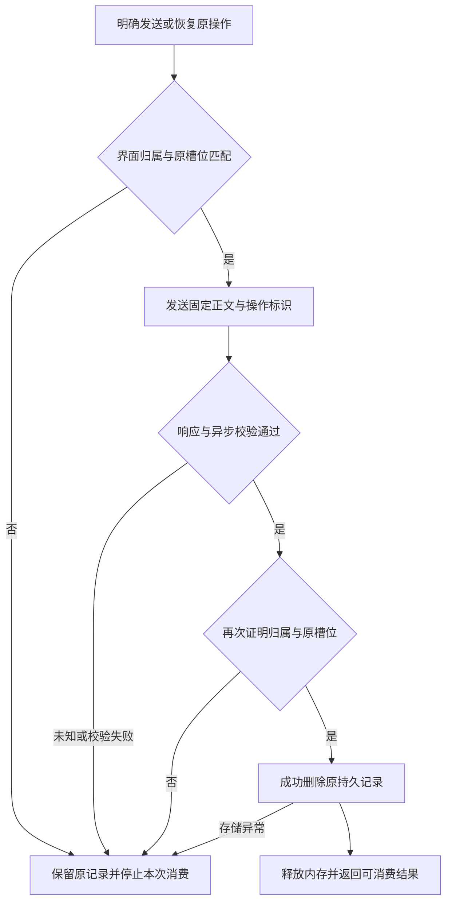

# 工具操作回执归属合同

阶段 T-OPERATION-OWNERSHIP-162，产品 1.0.0。作用于工具注册、节点登记与正式任务派发共用的 `ToolWriteRecovery`／`useToolAction`；复用当前 React 生命周期、原生会话存储及原服务端操作标识，不增加第二套派发器。

## 原操作与消费权

一个未确认操作固定原路径、正文、方法、操作标识和所属账号／组织／项目。恢复只能重发这一份原操作，不把新表单正文拼入旧标识。工具就绪、运行完成、独立测试、人员验收及业务任务状态仍是不同事实；前端消费回执不扩大任何执行权限。

持有操作记录的实例，还须证明当前调用属于仍存活的界面，以及会话存储中的原记录未被替换，才能发送、消费回执或删除记录。普通重渲染不撤销消费权；卸载、替换恢复实例或旧调用结束不能消费新界面结果。新实例可以明确核对原操作，旧实例随后收到的迟到回执不得删除新实例留下的记录。

存储匹配使用最初读取／写入的原始字符串，不通过重新序列化猜测身份。发送前、收到响应后、异步回执校验后以及删除前均核对。新操作先确认槽位为空；原记录缺失、变更、不可读或消费权丢失时，不覆盖记录、不自动创建新标识、不重发旧实例请求，也不返回可供导航的成功。

删除持久记录成功后，才能释放内存中的待核对操作。删除失败继续保留原操作并阻止新操作。首次发送得到明确 HTTP 4xx 拒绝，可以沿原规则结束该操作；恢复得到 401／403／409 等拒绝仍保留原身份。异步校验失败与存储清理失败不能被误判为首次发送拒绝。

图中成功链路不代替上述首次明确拒绝规则。存储故障、权限拒绝和外部执行结果未知分别保留实际依据；恢复不自动批准、启动后续任务或创建新的派发计划。

## 简洁交互与多语言

继续使用现有“核对原操作回执”和“保留标识，稍后核对”入口，不增加常驻设置面板。未知结果不能显示成功或自动关闭恢复入口。原账号／项目下重新打开后，读取原会话记录，再由用户明确核对。存储或归属异常使用准确的中英文提示；请求发送后发生清理失败，不能声称请求从未发送。

同一界面快速重复点击不得并行重复发送。切换恢复实例后，新实例能够独立核对；旧调用的结束回调不能清掉新实例的等待状态。已有离开保护继续生效；异常卸载保护不表示正常关闭必然绕过保护。

## 边界与证据

当前 `sessionStorage` 按标签页隔离。同步匹配与删除不等同于跨标签或分布式 CAS。本阶段不提供浏览器进程退出后的自动持久恢复、跨设备恢复、备份回退识别或跨端口服务实例重绑。后续持久化须单独冻结稳定服务身份、当前授权、恢复代次、原来源及目标绑定合同，不能直接全局替换为共享存储。

本阶段的线性化点是删除原记录前的同步归属核对。删除后到外层 Promise 消费者恢复执行之间，若界面才失去归属，Hook 仍会丢弃导航结果；此窄窗口不保证原记录继续保留。最终界面消费确认及可查询的已确认结果定位符仍须后续合同处理，不能据本阶段宣称“所有尚未展示的结果都可从原记录恢复”。这与删除之前已经失去归属的迟到回执分别记账。

共享 Hook 还用于资源池等恢复对象；本阶段未修改其持久记录实现。对这些消费者的原操作及多语言回归检查，不等于它们也获得了本合同的日志归属保护。

English contract: send and consume only while the exact call still owns the live recovery instance and its original journal bytes. Recheck before sending, after transport, after asynchronous validation, and before removal. Remove durable storage before releasing memory. Preserve unknown operations and newer records on ownership loss or storage failure. This session-scoped guarantee is not cross-window durable recovery or distributed compare-and-swap.

验收聚焦真实恢复类与 Hook 的卸载／换实例、同槽位替换、发送前检查及存储失败，区分定向组件测试和真实浏览器交互。无后端协议、数据库或权限变更，不以本阶段结果代替厂商模型、物理多机、生产或完整平台验收。完整建设范围保持。
