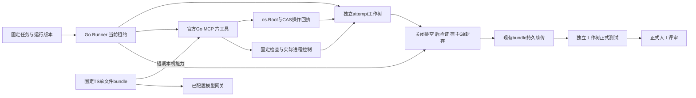

# 原生编码架构、开发设计与 AI SOP

状态：T-P4-020 源码集成中，实际证据见[阶段验证](../quality/native-coding-verification.md)。Owner：执行节点、原生智能体、主集成。产品基线：[PRD](../product/native-coding.md)；规范参数与恢复语义：[冻结合同](../../contracts/native-coding.md)。

## 模块边界

Go控制面仍是唯一平台派发者。原生内核继续管理有限模型轮数／输出额度，工作区操作只在一个平台节点预算内；需要独立审批或恢复的任务仍提交DAG。`internal/nativeworkspacecontract`只放不含秘密的证据；平台不依赖Runner实现包。Runner深模块封装FS／操作日志、MCP传输、固定检查和Git封存；类型与JSON Schema同源生成。

主工作区的人机编辑服务与attempt文件服务分别保留权威：前者需要当前交互式项目写权限，后者仅接受当前Runner本机短期能力。不得将Agent项目只读凭据升级为人机编辑权限。工具服务不使用浏览器Cookie或Runner控制面凭据，不接受模型指定主机或目录。

## SDK、版本及源码闭包

官方Go MCP SDK固定v1.8.0、TS Client固定2.4.0；Go1.26.10、Node22环境分别验证。采用已安装成熟esbuild0.24.2将原生CLI及MCP依赖编译为单文件ESM，manifest记录入口SHA、版本和仅Node内置的外置导入；来源与锁文件保留。SDK协议由官方实现，受控fetch只保留原参数字面及隐藏幂等标识，不建立第二套JSON-RPC。

本机profile摘要覆盖命令定义、Node可执行字节、bundle和manifest字节、工具策略版本、Git可执行字节、引用检查命令配置与实际可执行字节。检查中候选源码属于本次工作区快照，不把可变源码误称为永远固定的管理员脚本。声明不证明模型账户可用或任务成功。

## 文件、检查与封存

本机配置示例见[native-coding.example.json](../../deploy/runner/native-coding.example.json)。先运行 `pnpm --filter @suma/agent-runtime build` 生成bundle／manifest，把示例两个绝对路径改成本机实际产物；Linux/macOS使用对应绝对路径。检查命令与仓库技术栈匹配，模型及Agent凭据通过进程环境引用。Runner还须显式提供可信repository、不可变base commit、隔离worktree目录和allow-exec；单独设置native_workspace不绕过这些要求。例中的test_evidence只在独立test节点产生正式证据，Agent内部调用同一命令仍只是开发反馈。

`os.Root`负责实际打开／替换的根锚定；路径规则另拒绝敏感文件、链接／reparse、大小写别名和Git策略元数据。CAS写、精确编辑和删除先写Source外prepared，再效果，再completed。模型错误不会回显内容、根路径或秘密；重放核对当前旧／新hash，第三种内容阻断。

文件操作与检查串行。检查子进程使用原Runner进程树控制与输出脱敏，绑定执行和RPC取消；检查不递归创建attempt。检查修改源码、无法证明停止或未知效果使作用域进入核对。Windows Job与Unix进程组保证范围分别披露，不将其称为完整文件／网络沙箱。

Native Git在checkout前检查基准属性，拒绝外部filter或未支持编码；准备、封存和捕获禁用用户／系统配置、外部diff／textconv、hooks、fsmonitor及自动维护。源文件使用无filter原始blob和隔离index，标准文本转换只有实际clean才接受；不会通过assume-unchanged掩盖dirty状态。

封存固定机器作者／日期和原HEAD，使用成熟Git ref事务同时更新该attempt detached HEAD与本操作receipt ref。准备后失败返回partial unknown，保留原op及已知candidate。核对必须有本操作ref及正确HEAD，不能仅以HEAD碰巧相等冒认合并。目标分支、用户checkout及人工验收不由封存修改。

Native文件／检查／seal摘要先进入本地raw evidence，再计算evidence SHA；随后沿用原candidate bundle、checkpoint、ACK及跨节点固定导入。正式门禁另外核验native策略和候选绑定，依旧要求独立DAG测试同一SHA。

## AI 开发与维护 SOP

1. 先明确用户工作与正式事实边界，更新PRD、工具schema、版本和模块ownership；不要先增加未接通按钮或模拟成功。
2. 修改共享证据先维护Go公共类型及生成合同；秘密类型只存在本机stdin，不生成浏览器接口，不存平台事件。
3. 修改文件操作，先覆盖受理前后、同key漂移、旧／新／第三种hash、取消及非法路径。复用原子落盘与根锚定，不以检查后字符串路径打开代替。
4. 新增检查只能引用本机固定命令；检查配置变化必须使profile库存和派发不匹配。禁止任意shell、动态argv、递归Agent或把自测升级为正式测试。
5. 修改候选封存要核对事务边界、receipt ref和普通index恢复。绝不强制reset、擅自更新用户已检出目标分支，或在unknown后自动重跑模型。
6. 新增显示消息使用Go权威native目录／前端域词条；原始代码、输出、路径、SHA和历史证据保持。旧46项native语义快照保持，新4项工作区诊断单独增加。
7. 运行变更范围的必要检查，遇到共同类型／依赖变化在集成里程碑执行一次完整门禁；修复后只复验受影响项，不叠加重叠数量。
8. 实际验收区分模型fixture、真实文件／进程／Git／独立测试、厂商模型、人工业务签收和生产。保留失败原证据，产物及秘密留忽略目录，阶段只提交必要源码和精简报告。

部署只在隔离构建和真实纵向通过后更新活动预览；确认无活动执行，保留原件与WAL-aware备份，维护模式核对数据，再恢复正常。后续写入发生后不能用早期数据库覆盖回退。
