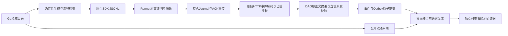

# 原生诊断的完整执行链路

状态：T-P4-011本地实现与验证完成；负责人：Runtime、调度、平台、UED。关联需求：FND-I18N-001。完整平台P0–P7范围保持；本页只描述诊断身份、原文及界面的职责，生产未验收。

## 一份目录与两个投影

`internal/localization/catalog_native.go` 是46条原生诊断的权威定义。每条声明稳定键、两语言、类型参数和完整英文 `SourceTemplate`；`NativeCatalog()` 深复制返回，`IsNativeMessageKey()` 明确限制命名空间。`go run ./cmd/suma-contracts` 确定性生成 `packages/agent-runtime/src/native-catalog.ts`，`-check` 同时检查目录、OpenAPI及TypeScript合同漂移。SDK使用与服务端相同的 `named-dot-v1`，不在运行时读取仓库文件或执行模板函数。

原生JSONL可包含 `display:{message_key,message_params?,locale,localized_message}`，这是SDK／CLI面向调用者的投影。Go平台持久化的第二份投影为 `ToolDiagnostic {schema_version:1,message_key,message_params?}`。它不包含语言和上游译文，来源始终是同一 `ToolEvent.message`。两者都不能证明任务成功、消耗预算、完成测试、授予权限或替代人工验收。

## 接入与安全边界

1. Runner仅从 `suma-jsonl-v1` 的error事件选择键／参数；先对未经清洗的完整选中文本核对规范模板，再对清洗后的消息重新核对。清除ANSI或凭证不能让原来不匹配的文本获得诊断身份。
2. 类型参数必须完整、无额外值，非空文本最多512个UTF-8字节且无控制字符，整数为明确的非负安全整数字面量。JSON字段名区分大小写；不能通过结构体字段别名、重复语义字段或null参数绕过合同。
3. 选中的原文／参数不能经非法UTF-16转义替换后获得新身份。有效代理对、真正的U+FFFD及表示字面量反斜杠的合法JSON保持。未选中的供应商内容、上游语言和译文不会进入诊断身份，也不会因为它们单独无效而改变已有执行终态。
4. 可解析但无法证明的原生显示元数据被丢弃，原始消息和终态／用量分类继续按原协议处理。原有重复JSON、行长度、深度、请求ID和终态一致性规则保持。正式平台事件中的不合法元数据由严格解码／验证拒绝。
5. 已知凭证或通用凭证格式不能藏在键／参数中。Runner在Journal／网络前清洗；DAG再次清洗，并深复制接受的元数据。Journal不能引用调用者可继续修改的参数映射。
6. DAG以原始正式请求生成幂等摘要，随后再清洗。回执重放、原操作正文冲突、租户／项目、worker、attempt、fence、当前profile和授权仍由既有事务规则决定。增加诊断字段不放宽派发或验收。

顶层 `diagnostic:null` 与未提供元数据一样表示没有显示身份，符合可选指针合同；它不表示一次有效诊断。内层 `message_params:null` 不符合类型参数对象合同。

## 界面与交互

界面只对版本、原生协议、error种类及已证明的完整规范原文匹配作翻译。目录尚未加载、未知键、不合法参数、其他工具／模型内容保持原始文本；目录到达只重显，不再执行模型、校验或业务操作。用户可展开“原始原因”查看同一事件的原文。

滚动40条事实窗口中的交互状态必须绑定持久事件身份及原内容。父事件的run／sequence／node／attempt／fence等只作为界面来源信息，不能写回原ToolEvent或改变JSON证据。失去当前窗口的事件不能把已展开、已聚焦的原文窗口移交给下一条。缺少持久身份的直接组件输入只能使用内容和重复序号回退，不冒充可追溯的独立事件。

命令编辑器对 `command/agent/test` 明确要求单个允许的Runner命令标识；实际程序与参数由Runner配置。`task/script` 是自定义执行节点能力，填写可选执行引用不会使本地Runner获得执行能力。异常原数组完整保留，只有用户实际编辑才替换；语言切换不改写草稿。

## AI与人员开发SOP

冻结原始目录和接口后，分别实现目录生成、Runner／DAG、界面；每个切片以原文／权限／状态保持测试为边界。先复现拒绝、未知元数据、别名、无效Unicode、清洗前后来源和滚动证据身份，再修正；审查后只修正有证据的问题并定向复审。完整测试、类型、合同、构建使用同一源码摘要，失败及旧切面分别留档。

真实验证使用独立本地控制面、实际Node原生运行时和实际Runner，对单次回环HTTP429作执行观察；这不是厂商模型或研发成果验收。通过界面启用真实profile、发布流程、启动、查看同一失败attempt的双语及原文、刷新重放，再核对Journal排空及数据库。不可为只读诊断流程伪造候选代码、测试或任务验收。原有研发项目库另作逐表摘要核对。

## 本地验证与后续边界

最终Go1131个通过事件、342输入一致，Web544项／46文件、206输入一致，非Web47项（原生37、桌面7、知识3）；失败／测试跳过均为0，vet、类型、生产构建及生成合同检查通过。目录为网页2804键、后端778键（含原生46），生成215个模型加Error共216个Schema、152条路径、1235处引用。6目标×4程序的24文件批次为`20261024T142006974Z-9eb10cda`；交叉编译不等于各目标系统安装／运行验收。

实际本地独立控制面、Runner与Node原生运行时完成一次HTTP429执行：1个失败运行、1个节点及1个attempt、10条事件与5条工具事实；请求和拒绝各1次，用量为未上报。切换语言、查看原文、刷新至精确attempt后，原run／事件仍相同。失败形成1个问题，两次界面需求回流（中间刷新）仍为1个草稿，来源关联正确；任务保持todo，没有候选开发、测试或人工验收事实。独立审查提出的4项后端边界问题和1项界面证据状态问题已修复并复核。

详细测试命令、环境、失败与最终切面、实际范围及证据摘要见[本阶段验收](../quality/native-diagnostics-verification.md)和[精简摘要](../quality/native-diagnostics-summary.json)。原始目录快照、测试日志、源码清单、进程／协议收据、SQLite及截图只保存在忽略的本地证据目录，不进入Git。

当前运行状态原因仍可保留原始英文；本地配置及其他错误生产者、库内NLS、通知／安装器／导出／渠道与完整双语文档继续迁移。历史attempt面板的原始输出／证据与当前窗口中的类型工具事实不是同一覆盖范围。整体厂商SDK及真实模型、分布式数据库、协作／媒体／Office、安装／计费／规模与完整用户旅程仍分别验收。
