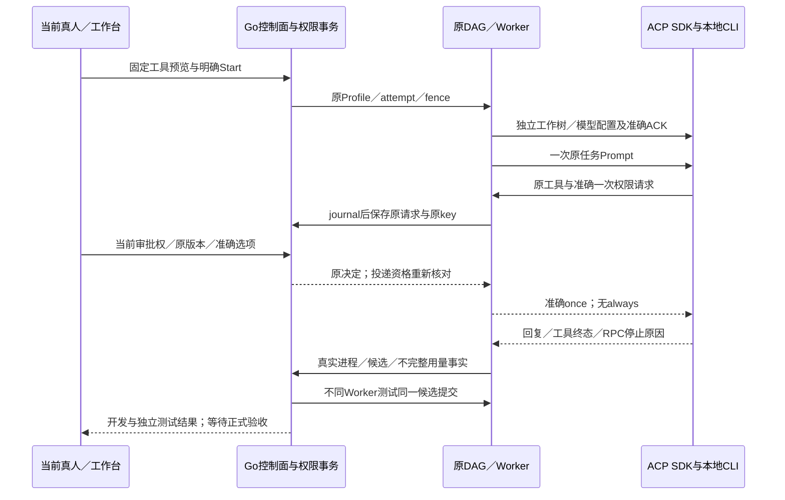

# 本地 ACP CLI：架构与开发 SOP

T-ACP-RUNTIME-170；suma 1.0.0；2026-10-31；负责人：主集成、协议、Runner、权限领域、工作台。状态：实现集成及实际联调准备。需求来自完整31项平台目标中的工具接入、模型管控、团队执行与人工门禁；验收合同见[统一执行合同](../../contracts/acp-cli-execution.md)。

## 职责与数据流

`acpcontract`定义公开固定配置、原会话事实及准确一次性权限对象；`acpstdio`只拥有一个成熟SDK会话和有界协议流；`runner`拥有真实进程、独立工作树、journal、停止证据和候选交付；`platform`拥有当前身份、权限事务、派发与配额。工具或SDK不能自行开启另一个平台任务。

## 不可混淆的事实

固定Profile和版本探测不证明账号或模型健康。模型配置ACK不证明底层供应方身份、全部Token或账单。真人决定已保存不证明Runner已观察，更不证明远端采用。RPC结束、主进程结束、进程树停止、候选、测试、验收与发布保持独立。

本机`ACPExecutionSpec`是管理员策略，公开`ACPExecutionCapability`仅携非秘密固定事实；任务快照准确绑定同一能力和原Profile。原生可执行摘要、精确版本、模型与凭据引用变化会产生新指纹，旧库存／预览不能沿用。Qoder为首个策略，通用SDK会话层供后续已审阅策略复用；任意manifest不能自助启用新执行协议。

客户端文件与终端RPC始终拒绝；受信CLI仍可能使用自己的文件、网络、hooks或插件。cwd及Windows Job仅提供工作目录与生命周期事实，平台不将其称作OS沙箱。正式开发在原独立工作树中进行，候选来自真实clean新HEAD，后续准确同SHA测试由另一Worker完成。

## 权限、恢复与事务

正式权限表同租户／项目、原run／node／attempt／dispatch／fence、Worker、Profile及请求摘要绑定。准入、CAS、决定和原操作回执使用同一事务；所有领域初始结构检查位于DDL之前。读权限不继承操作权，决定使用当前真人写入及审批权，机器沿原private／Pool资格。

Browser的`decided`表示准确决定已保存，结束后保留历史和空动作；machine投递投影独立核对当前来源、租约、暂停与预算，失效批准不交给SDK。精确`permission_id`定位同run／node旧记录，读取历史不授予新attempt权限。所有读取不启动进程，不重新Prompt；原请求正文与key持久保存，未知结果不换key。

SDK解码前验证有界帧及权威字段，不能让大小写别名覆盖模型ACK。敏感内容在journal／网络前过滤；被删改或无法完整展示的权限细节只提供拒绝。排队回复、实际字节写入和回合终态必须正确排序，写失败或断线保留unknown。

## AI 开发 SOP

1. 主集成冻结纯DTO和四类来源：固定配置、真实协议、当前授权、独立质量；为每个代理分配互斥文件。
2. 优先复用SDK、原Worker、进程控制、工作树和receipt；不能新增第二派发器或默认账户、模型、预算。
3. 先证明准确模型选项及ACK，再发一次Prompt；权限按原tool_call／session关联，不按显示名称猜测。
4. 测试覆盖新边界，修复只复验受影响项；相同成功不重复计数，夹具错误与产品回归分别留证。
5. 独立审查模型／权限／敏感内容及写入时序；构建前冻结当前来源摘要，实际界面使用完整生产样式。
6. 阶段源码、设计与紧凑证据commit并正常push dev；缓存、数据库、原请求、凭据、二进制和截图保持忽略。完整P0–P7、真实厂商、跨系统／多机、安装、规模与生产继续独立交付。
