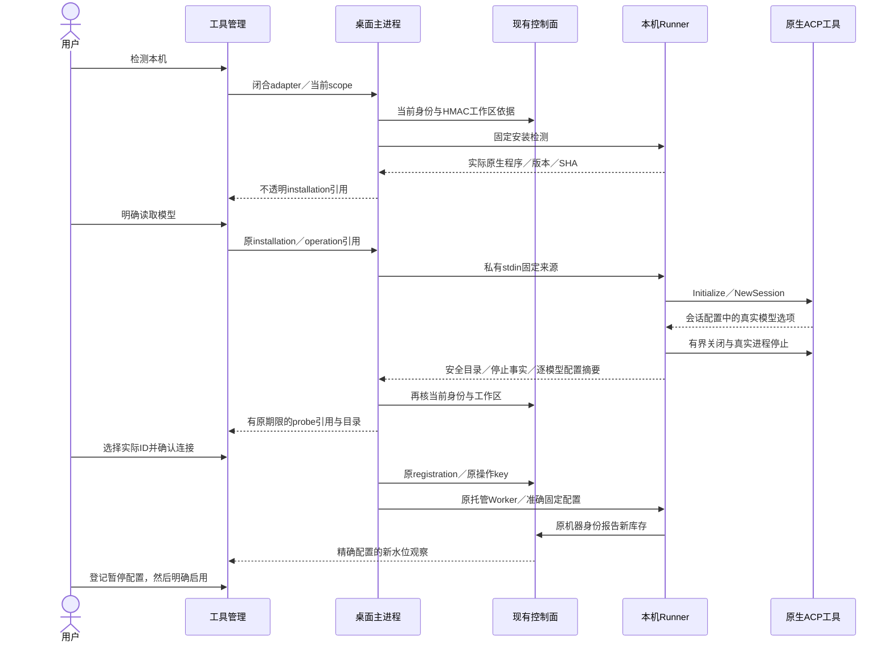

# 原生工具快速连接：架构与 AI SOP

T-ACP-QUICK-CONNECT-171；速码 suma 1.0.0；2026-10-31。负责人：主集成／协议／Runner／桌面工作台。状态：源码及关键实际链限定验证，显式停止按钮和真实厂商仍待验。关联完整31项需求中的工具管理、模型配置、本地工作台、统一权限和任务派发；[验收合同](../../contracts/acp-quick-connect.md)为本阶段边界，完整P0–P7范围保持有效。

## 领域边界

安装观察、模型目录、固定执行配置、运行中的Worker和可派发Profile是五种事实。安装观察没有执行权限；ACP配置选项不是模型健康或价格证明；Worker已连接不会自动启用工具。确认后的固定模型继续使用[原ACP执行](acp-cli-execution.md)，不新增调度器、账号或模型网关。

| 模块 | 所有权与入口 | 禁止承担的职责 |
|---|---|---|
| `acpcontract` | 同源安全目录／生命周期DTO及验证 | 不持有本机路径、会话或凭据 |
| `acpstdio` | 成熟SDK0.13.5、严格帧、独立无目标模型观察 | 不启动进程、不发送Prompt／SetConfig／Authenticate |
| `runner` | 当前原生安装、完整版本／SHA、隔离探测目录、真实停止、配置摘要 | 不把未停止或意外活动解释为成功 |
| `suma-control`／`suma-runner` | 固定`--describe-acp-models-stdin`私有模式，先于服务初始化 | 不从页面接自由命令，不读取业务数据库 |
| Electron main | 当前身份／工作区、私有安装与probe引用、原操作恢复、托管Runner | 不把路径／环境变量值交给renderer |
| Web | 简洁检测、明确目录读取、真实模型选择和连接反馈 | 不自行产生配置摘要或刷新观察有效期 |
| 控制面 | 原HMAC context／registration、库存、paused登记、独立enable、任务准入 | 不在GET／心跳自动创建供应方会话 |

## 一条执行链

`NewSession`可能读取供应方自身设置、创建会话或联网，因此目录读取必须由明确操作触发。零Prompt只证明速码未发送开发目标；不证明供应方零内部动作、零费用或受到OS沙箱限制。初始化即运行hooks、发出工具／权限／正文，或者停止无法核实，都使该观察不可采用。

## 私有配置与同源类型

模型探测stdin严格接收`adapter_id=qoder-acp`、主进程选择的`executable`、`executable_sha256`、`reviewed_version`及可选`credential_env_ref`，上限16KiB。重复键、未知字段、null、额外命令和参数均拒绝。模型目录JSON不超过256KiB，无路径、会话、argv、原始配置或凭据值。

`ACPModelDiscoveryResult`由Go生成TypeScript及Schema。`ready`要求实际宿主停止、进程树停止、已创建会话且Prompt／配置写／权限／意外活动均为0；非ready不带可采用目录。最多256个唯一实际ID，保留精确值、展平分组、拒绝含已知秘密的ID。名称只作安全显示，不作为身份。

每个模型的`configuration_sha256`由Go使用原`ACPConfigurationDigest`，结合实际完整版本、固定模型及明确环境引用计算。主进程不能用另一个JSON哈希实现替代。执行时继续按原配置核准可执行字节和版本。

托管私有输入的`acp_configuration`只允许Qoder，包含原本机程序、SHA、完整版本、精确模型、可选凭据引用及配置摘要。其他adapter不能借此获得ACP执行能力。公用HTTP registration不增加可执行路径或命令字段。

## 一致性与异常恢复

安装和目录引用绑定原user／tenant／project、主窗口／origin、实例、工作区binding／HEAD、原生版本／SHA及私有凭据依据。目录最多60秒有效；普通读取不续期，采用前重核来源。安装自动升级后即使仍使用同一文件名，也必须丢弃旧依据。平台不修改用户的自动更新、PATH或登录设置。

一次明确操作拥有固定operation引用。未知回执只读取原观察，不能重新NewSession；原托管发行／连接同样恢复加密journal中的原body／key／模型，不能被当前草稿替换，也不要求旧目录仍新鲜。目录M1过期后选择M2，不会改变仍待核的M1操作。status／stop不接受编辑配置。

`connected`必须来自真正启动后的新库存，准确匹配adapter、protocol、固定模型、配置SHA、可执行SHA及完整版本。旧fresh报告或同adapter其他配置不算成功。业务派发仍核原Profile、当前权限、预算、attempt和fence；enforce预算仍拒绝观察型ACP工具。

## AI 开发与排障 SOP

1. 先读当前状态及[合同](../../contracts/acp-quick-connect.md)，保留完整31／P0–P7总账和其他代理工作；按协议、Runner、工作台明确文件所有权。
2. 从真实来源复用SDK和原进程／journal／HMAC／库存链。改变私有配置必须同步严格解码和当前来源验证，不能放宽为通用shell。
3. 修改模型提取时同时检查无目标观察和正式执行：正式执行仍需准确模型SetConfig ACK后才能Prompt。保留两种入口不同权限。
4. 故障按安装、目录、托管发行、真实Worker、Profile顺序定位。只展示安全错误码；不得输出CLI原包、原会话、路径、环境值或登录文件。
5. 优先验证新行为和受影响的不变量，复用未变化的通过结果。UI实际验证使用隔离构建、真实IPC和受控CLI；受控成功不等于真实厂商验收。
6. 本阶段完成后以源码摘要、紧凑证据和明确剩余项交付，正常提交并推送dev。缓存、快照、日志、截图、凭据、安装包和临时夹具不进Git。

## 安装与完整平台范围

171优先当前官方推荐的原生`qoder --acp`，不执行`.cmd`／`.bat`／`.ps1`包装器，不自动安装。官方npm仍是当前第三方安装形态，后续需要受审的实际入口与依赖身份支持；它不是平台历史兼容代码。Windows／macOS／Linux的速码支持与厂商原生二进制平台支持分别验收。

当前Multica提交`e8ae72c9dfc1b4474b61a9087f51b33cbee6a048`用于运行时适配与渐进交互参考，受附加许可约束的源码不直接复制。Cursor、Zed、Codex、Claude Code、WorkBuddy及其他工具按照各自真实协议和权限逐项交付，不因共用入口就宣称具备所有厂商能力。

依据：[官方安装](https://docs.qoder.com/cli/installation)、[模型目录](https://docs.qoder.com/cli/model)、[ACP](https://docs.qoder.com/cli/acp)；实际验证与厂商账户／模型／费用、跨平台、多机及完整平台验收分别记录。
