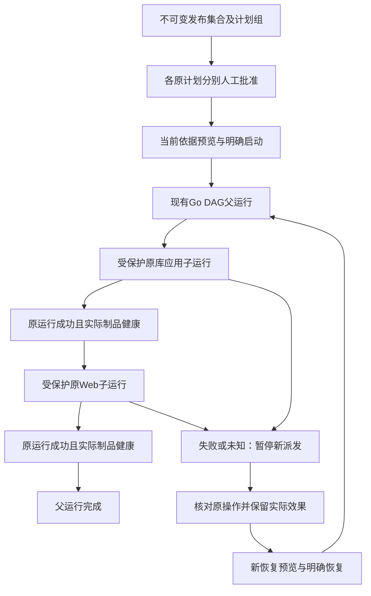

# 应用有序发布架构

状态：1.0.0，T-ROLLOUT-125当前合同；负责人：应用、发布、调度领域；关联需求25。实现为`application_release_rollout*.go`与`dag/bound_subworkflows.go`。实际验证范围由[质量记录](../quality/application-release-rollouts-verification.md)维护，本文不代替生产验收。

关联：[发布集合](application-release-sets.md)、[操作与AI SOP](../development/application-release-rollouts.md)、[接口合同](../../contracts/application-release-rollouts.md)、[English](../en/application-release-rollouts.md)、[领域词汇](../../GLOSSARY.md)。

## 领域决定

发布集合固定应用版本与候选，计划组固定成员与原发布计划；`ApplicationReleaseRollout`单独记录一次明确授权的有序推进。它冻结准确集合、计划组、原计划版本／摘要、依赖和父子运行身份。三者不是同一个状态对象。启动编排不会批准任何计划，也不新增发布提供方、独立派发器或部署协议。

当前最多16个应用。顺序来自不可变版本中已审阅的准确依赖，边方向为依赖目标先于使用方。存在依赖循环时明确阻止自动执行，保留发布集合中的循环事实；不得为使图可运行而静默删边。无依赖分支可由同一Go DAG并行推进，仍受原资源、环境和权限约束。

所有原计划必须先分别完成有效人工批准。启动前核对当前账号、组织／项目权限、发起者和批准者资格、集合依据、计划摘要与审批、目标环境代数，以及计划尚未被其他编排或执行占用。预览摘要绑定这些当前输入；启动时同事务重核，旧预览不产生新授权。

## 单一调度与逐步创建

父运行使用现有持久化Go DAG；成员使用受保护的绑定子流程。绑定ID由领域事务登记并关联原父节点、attempt、fence及原计划预留的准确子运行ID。普通流程中复制一个`service_binding_id`不能获得部署权限；Runner无法领取父绑定本身，也不能构造另一个子运行。

仅当成员真实就绪时，调度事务解析并重核它的原授权，创建准确原发布子运行、部署操作、环境占位及受保护关系；未开始成员保留原预留身份，没有实际部署操作和环境屏障。禁止在启动父流程时提前占用所有下游环境。

依赖完成须同时具备原子运行成功与当前原部署的匹配效果、制品和健康依据，不能仅凭模型消息、提供方HTTP 200或父图节点名称推进。原提供方授权、真实制品下载、激活、fencing、健康及结果回写继续采用已有协议。

## 暂停、核对与恢复

人工暂停停止创建或派发新成员，运行中子任务继续排空。暂停不是取消、实际停止或回退。原执行失联、失败、健康不匹配或结果未知自动暂停父流程，逐项保留原运行、操作、效果及环境屏障，不把暂停状态解释为已停止所有进程。

未知结果先沿原部署核对协议查询真实提供方，同一操作取得当前、准确、可验证的效果和健康依据后恢复原托管运行。原未知回执保留为历史，不创建第二次部署来掩盖它。核对事实本身不恢复父流程；操作者必须获取新的恢复预览并明确恢复。

恢复重核当前权限、未开始计划与环境及已完成子运行。已健康成员保持原运行和原部署，不重复授权、派发或激活；全部成员已健康但父流程仍暂停时，明确恢复可只完成父流程收尾。已知失败不执行通用DAG盲重试；修正后需要新的审阅和批准计划。自动协调回退、跨环境原子发布及任意改变中途计划不在当前合同内。

取消沿原父子取消传播与真实停止／效果核对语义处理，取消请求不等于提供方已停止。已经激活的事实不能因父流程取消而消失；需要回退时使用对应环境的原回退预览、批准和新代数操作。

## 一致性与可维护性

启动和生命周期命令复用原权限、操作回执、预期版本和调度事务。父节点、绑定关系、原计划预留身份与子部署创建保持同事务，不允许独立重试造成双创建。对原子运行或父运行的通用命令入口继续检查受保护归属，不能绕过有序发布的恢复预览。

界面展示父执行状态与每个应用的原计划、子运行、操作、效果及健康，保留等待原因、暂停原因和未开始事实。整体完成必须所有受选成员当前事实满足；部分健康与未知不能汇总为全绿。业务标签和用户理由保留原文，机器码统一从中英文目录翻译。

当前实际提供方仍限`static_site_v1`。本领域提供准确依赖下的有序推进，不宣称完整灰度流量管理、容器平台发布、生产变更窗口或自动全组回退能力。
