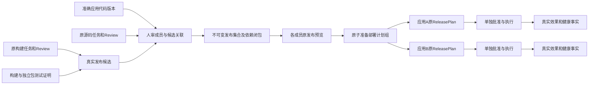

# 应用发布集合与原发布计划架构

状态：1.0.0当前实现合同，T-RELEASESET-124，关联需求25。负责人：应用、质量、发布与部署领域。实际运行范围由[质量入口](../quality/verification.md)记录，本文不代替生产验收。

关联：[应用版本](project-applications.md)、[操作与AI SOP](../development/application-release-sets.md)、[合同](../../contracts/application-release-sets.md)、[English](../en/application-release-sets.md)、[术语](../../GLOSSARY.md)。实现入口为`internal/platform/application_release_set*.go`和`internal/releasecontract/deployment.go`。

## 集合的职责

`ApplicationReleaseSet`是人审阅并登记的不可变关联：每个成员指向准确应用代码版本ID／摘要和真实发布候选。它保存依赖闭包、兼容性确认、源码与候选的两组验收事实、构建／包测试证明及选择理由。登记不会批准、派发、部署或改变环境。

同仓库的多个应用可以共享一个源码提交。因此，提交相等只能证明源码内容一致，不能自动证明任意制品专属于某个应用。当前成员到候选的映射是明确的人为审阅决定；集合不制造新的应用专属build attestation。界面须让用户查看原构建配置、实际制品和测试依据，再确认关联。

## 成员与闭包门禁

每个应用代码版本继续通过原应用领域核对当前依据。当前单个成员的全部源码范围必须能归到同一个治理目标身份和同一提交；无法表示的多来源／多提交成员明确阻止。不同应用成员可各自保留其已授权来源，不能依包名推断代码归属。

候选须通过原发布候选校验：原构建和包测试对应同一实际制品、清单及源码提交，准确attempt与固定配置仍有效，候选自己的构建任务有当前正式验收。集合额外要求包测试与构建来自不同Worker，候选提交与该应用代码版本提交一致，禁止把同一候选或制品对象重复放入多个成员。

应用原源码任务与候选构建任务可以是不同任务、不同运行。`SourceTasks`与`CandidateTasks`分别保留，不能通过改绑原任务运行来制造共同依据。源码质量、包质量、人工验收、部署健康各有独立证据。

同一构建运行可以包含源码JUnit与固定包测试。发布的测试计划至少绑定一个支持报告的静态JUnit节点；包测试仅在准入时以私有`PackageTests`快照固定准确工具版本／摘要、Worker、同名发布`package_test`配置及真实构建祖先后，才不参与JUnit报告采集。包测试仍须实际成功，并以当前原`ArtifactProof`证明同一制品、清单及源码；未固定的无报告测试、失败或缺证明都不能因有其他JUnit通过而变绿。此快照只保存质量执行依据，不新增公开开关或豁免权限。

闭包沿所选应用版本中已经明确固定的依赖展开：所有被引用应用必须作为成员出现，目标版本ID及摘要必须完全匹配。缺少成员或版本冲突直接阻止；明确不兼容不能由确认框覆盖；未知兼容性必须明确确认，确认不等于已验证兼容。真实循环保留为强连通组，不伪装成自动可执行DAG。

## 部署计划组与原权威

`ApplicationReleaseSetPlanGroup`固定集合、成员、候选／制品、环境和原计划ID／摘要。部署预览要求所有成员各有明确环境及预期代数，禁止重复环境或相同provider／site占位；不会自动选择生产环境。

准备在同一事务中重新核对集合、候选和各环境，创建每个成员的原`ReleasePlan`、计划组、关系和操作回执。任一失败整体回滚；成功只产生`pending_approval`计划，不预留环境代数，不创建运行，也不产生集合级批准或执行权限。

原`ReleasePlanContent.ApplicationReleaseSet`保存集合与成员的准确版本引用并进入原计划摘要。原单计划批准、执行、授权及效果门禁通过既有当前依据检查继续核对集合和成员关系。集合引用不是授权凭据，不能绕开撤权、过期计划、质量变化或环境代数变化。

每个计划继续使用现有Go DAG、Runner `ReleaseExecution`、提供方授权、真实制品下载、激活、健康检查和结果回写。当前实际提供方覆盖`static_site_v1`；这不是容器部署、npm发布或通用全栈生产部署的完成声明。

## 状态、恢复与历史

集合与计划组均为不可变内容，当前适用性和逐项推进从原事实投影。`BasisCurrent`反映当前成员依据；每个rollout item保留原计划状态、操作ID、部署状态、效果状态和健康状态。一个成员健康不能把其他待批准、未执行、失败或未知成员显示成完成。

原环境隔离和代数分别生效，准备组不是跨环境原子发布或自动编排顺序。部分成功时保留各原操作及已发生效果；失败与未知不会触发隐式全组重试或回退。核对和回退沿原单计划／操作执行，取得真实停止或效果依据后再决定后续动作。

预览不持久化业务决定；登记／准备使用稳定幂等键。回执丢失恢复原对象及原计划关系，不能换键创建另一组。历史集合、制品、批准和部署事实不因当前依据失效而改写；新范围、新版本或新决定形成新的集合／计划。

当前限定范围不包含自动影响规划、跨项目集合、复杂多来源应用构建溯源、集合级批准／执行、灰度顺序编排、跨环境原子提交或自动协调回退。这些能力继续沿完整平台范围独立交付。
