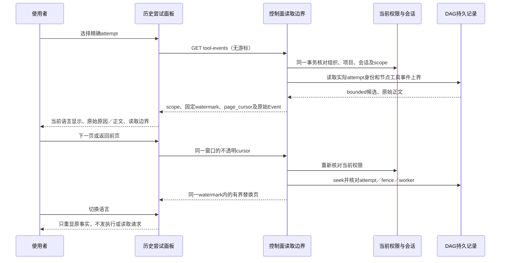

# 精确执行尝试的持久工具事实

状态：T-P4-012 限定范围本地验证通过。负责人：调度与控制面、工作台、主集成。关联需求：执行进度回写、故障追溯、测试验收依据、FND-I18N-001。接口以[冻结合同](../../contracts/attempt-tool-history.md)为准；本页不代表完整平台或生产验收完成。

## 用户目标与事实分层

开发者、测试负责人和运维人员需要从某次失败或重试的attempt回到当时的工具事实，核对实际执行者、fence、时间和原始原因。当前节点已经进入attempt2时，attempt1仍是独立持久事实。实时窗口、当前节点、某次结果、测试证明、人工验收和发布状态分别展示；任一工具消息不能替代后几项。

工作台沿用项目→开发协作→工作流→运行→节点→历史尝试的入口。精确链接保存project／run／node／attempt，刷新或前进后退恢复选择；分页位置是本地不透明读位置，不是授权或可执行命令。历史面板独立于实时窗口，不以实时300条／16MiB保留上限或工具40行展示上限证明完整历史。

## 架构与读取过程

权限与选择在同一数据库事务中线性化，复用组织治理读保护；事务不等待网络。治理协调计数可更新，业务意义仍为只读。它不能取得调度器全局事件锁、创建运行或尝试、写入事件／Outbox／操作回执、占用资源／额度、调用模型、产生问题或批准任务。单独的读取前权限检查不足以证明撤权与选择间的安全边界。

`dag_attempts`实际行和已授权run决定完整身份。结果中的run／node／attempt／fence／worker必须与该行一致，才能作为该次Runner结果呈现。人工核对、子流程和独立托管观察保留各自来源，不混作本地进程成功。读取遇到已保存身份不符不能偷偷换成当前节点或修复原文。

## 原始证据与可解释显示

| 层 | 内容与约束 |
| --- | --- |
| 持久Event信封 | sequence／run／node／type／at，排序依据为sequence而非时间字符串 |
| data投影 | 兼容的已解析对象；归属必须从原始JSON证明准确的attempt／fence／worker |
| raw_data | 本读取专有的原保存UTF-8正文；保留重复内层键、数值字面量及转义，不翻译或回写 |
| typed工具显示 | 已支持协议／种类才使用共享事实行和原生规范来源证明；未知内容保留原始呈现 |
| 结果／用量 | 来自该attempt独立结果，不对分页消息求和来制造完整用量；未上报不显示成0 |

父数据缺少归属、大小写别名、重复归属键、null／字符串／小数／指数或非法选中Unicode不能取得身份。内层工具数据未知或不满足typed显示不删除已证明的父事件；使用原始正文核对。`raw_data`与data的语义对应由界面再验证，但原始文本不被规范化；其他运行事件及SSE仍省略该可选字段。

Go与浏览器对旧JSON内孤立Unicode代理项的解析不同。兼容比较仅对临时字符串token采用Go一致的解释，再解析对象，保留键规范化碰撞的原始先后次序；不修改原始正文或选中身份。原工具帧若发生替换，只提供原文，不把替换后的内容当成已证明的原生诊断。合法代理对、真实U+FFFD和字符串开头U+FEFF保留。该边界通过真实Engine→Go JSON→浏览器校验器的跨层回归核对，不能只让两端各自测试通过。

## 有界分页与持久一致性

首次读取固定节点工具流的最高sequence为watermark，空流为0。返回page_cursor表示本页开始位置，包括初始位置0；下一页和返回首页都使用已保存位置，不把“返回首页”变成另一次最新快照。明确“读取最新”或调整每页数量才清空遍历并创建新窗口。即使原窗口为空，后来新增事实也不会进入旧位置；新窗口才看见它们。

每页1–100条，默认50；界面提供5／25／50／100，适合查看展开的原始正文。每请求最多检查1000个候选，最多取1001作前看；单个序列化Event不超过2MiB，返回Event数组不超过4MiB，包含raw_data。候选扫描经过其他attempt或未证明的父数据时，允许空页加继续游标；不能显示成“该尝试没有记录”。超过本页字节预算的下一条有效记录留待下一页，不跳过或截断。

UI只持有一页和最多100个本地返回位置，继续向后读取没有全局页数上限。较早返回位置不再保留时提供明确重新开始入口。没有完整总数、百分比或ETA；scanned_through是已消费候选位置，不是已完成业务数。最后一页只证明该固定范围内可归属事实已遍历。

索引`dag_events_node_type_sequence`覆盖tenant／project／run／node／event_type／sequence，复用现有定义检查和竞争创建后重读规则。保留原运行事件索引及原数据，不引入各数据库不一致的JSON查询。该版本仍可能跨同一节点的其他attempt扫描；规范化投影／历史回填、同步建索引在大库中的阻塞时间以及OceanBase／PostgreSQL实际DDL和负载需要另验，不以本机小库结果替代。

## 交互状态与可访问性

历史面板与“当前尝试”实时事实分别标明范围。区域aria-busy与简短状态提示说明初次读取、翻页、刷新、旧页未重新确认、空中间页及范围末尾；错误保持具体HTTP／诊断身份。401／403／404清除已失效的敏感记录和遍历；暂时网络失败可保留上一页，但明确标为未确认，重试仍读取失败的原位置。

项目／账号／组织／运行／节点／attempt变化、刷新和较新请求使旧响应及旧错误失效。外部AbortSignal只取消读取，原30秒超时和现有写入回执流程保持；原始读接口与业务记录的归一化分离，不能把旧事件中恰有version／title／data的对象当业务记录展开。

行身份包含持久来源和完整原内容。换页移除已聚焦原文时回到页标题或操作控件，不能把展开或焦点转交给另一事件；同页重读、目录到达、语言切换保持仍存在的披露和焦点。原生details／summary及按钮支持键盘，窄屏操作不小于44px，标识与正文换行，使用既有深浅主题令牌。局部实测不能等同完整WCAG或全尺寸体验验收。

## AI与人员开发、排障SOP

| 步骤 | 输入与操作 | 必须保留的依据 |
| --- | --- | --- |
| 冻结合同 | 核对已批准旅程、身份、状态和分页语义；发现首次返回与原始正文问题先修合同 | 原版本、决策理由、并行文件归属 |
| 并行实现 | 后端事务与数据、UI状态与本地化、隔离验证脚本独立负责；共享类型统一生成 | 真实RED、GREEN、源码摘要，不覆盖旧失败 |
| 接口诊断 | 按project／run／node／attempt核对；先判权限／会话，再查游标所属窗口和持久身份 | HTTP分类、当前身份、marker，禁止把读错当无事实 |
| 原文核查 | 对比raw_data与SQL原正文；typed显示无法证明时打开原文及运行历史 | 原事件、未上报用量、独立结果，禁止补造归属或成功 |
| 竞态验证 | 故意延迟旧请求再切换attempt／翻页／刷新／语言，检查最终页面与焦点 | 请求顺序、响应scope、GET／POST次数和DOM结果 |
| 实际验收 | 真正Node原生CLI＋Runner＋本地429重试；另用明确合成协议活动测试大页 | 两类夹具分开，原文、模型／执行计数及Journal ACK |
| 交付 | 冻结全量输入、运行适当完整检查、独立审查及复审、核对实际运行字节 | 设计／合同／精简验收进入Git；凭证／原库／日志／截图／程序留忽略目录 |

独立原生429是本地传输与重试事实，不是厂商模型或研发成果验收。独立协议夹具的活动内容是合成的，仅证明实际进程、Runner、持久分页和界面；不冒充原生SDK真实工具执行。正式开发、测试、质量门禁、人工验收、部署授权和问题去重链路仍使用原合同并继续完成全平台验证。
