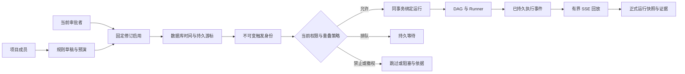

# 持久自动化与运行事件

状态：T-P4-002 本机功能验证通过，完整范围继续实施；实际通过项见[专项报告](../quality/automation-verification.md)。负责人：平台集成；关联需求：P4 自动化、事件回放及 P2 持久运行。合同入口：[自动化与事件合同](../../contracts/automation-events.md)。

## 领域与信任边界

规则决定何时请求一次固定版本运行；DAG 决定节点是否可以执行。触发记录、运行进展、测试成功、人工验收与部署授权继续作为不同事实保存。规则启用绑定具体规格修订及启用人；重新编辑会暂停规则，不能悄悄改变已批准的自动化。过去触发仍指向原修订。

本轮提供人工触发和五段 cron，采用现有数据库与 Go 调度进程。Webhook、Git、CI、监控接入需要独立签名、来源身份及输入合同；不能通过把网页按钮命名为“接入”替代。工作流中的审批节点仍等待对应人员，自动化没有全局审批凭据。

## 一致性与恢复

写入按组织治理锁、规则行与调度锁的顺序串行化。当前授权在操作回执之前验证，已撤权用户不能通过旧回执继续读取特权结果。触发身份去重与运行创建处于同一提交边界；提交成功但响应丢失时恢复原操作。等待网络、cron 时间或下一个事件时不持有数据库锁。

cron 以 UTC 时刻标识一次触发，以指定 IANA 时区解释本地日历。不存在的夏令时分钟不触发；重复本地分钟对应两个不同 UTC 时刻。仅数字的分钟、小时、日、月、星期支持列表、范围及步进；明确拒绝秒、宏、命名月份和无效时区。预演展示未来五次 UTC 与当地时间，不能仅显示客户端时区。

停机恢复必须保留错过窗口及选择策略：跳过、合并最新或有界补跑。队列是业务状态，不能依赖内存定时器；暂停、修改和撤权在派发前再次核验。运行暂停、等待审批或效果未知仍占据“尚未终结运行”的重叠判断范围，避免在核对期间再次发生副作用。

## 事件与界面

事件来源是数据库提交后的 `dag_events`；SSE 只提供读取通知。全局序号在其他运行之间可能有间隙，不能把间隙当丢失；重连游标按完整收到且合法的当前运行事件推进。半个 JSON、半个事件帧、错误租户或运行的数据均不能推进游标。初次快照与事件流重叠允许重复，客户端按序号去重。

服务端连接有时间、数量和写入截止限制，每批重新验证会话、凭证范围和当前项目授权；不能把首次认证永久缓存在线上连接中。撤权结束读取，不能以“重连中”无限掩盖无权限。正常短连接轮换与网络失败分别显示；突发事件合并刷新正式快照，布局、选中节点和用户视口保持。

写入截止仅约束正在发生的写入：每次写入前 2 秒，成功 Flush 后恢复到连接总截止及结束宽限。5 秒心跳期间不能保留已经过期的 2 秒截止；20 秒正常结束必须写出完整 HTTP 分块尾部。读取时把持久空元数据规范为对象，原始数据库 `null` 保留，避免合法终态事件被严格客户端误判为协议错误。

客户端规则详情使用确切规则 ID 深链，不依赖当前列表页是否包含该条。触发列表下钻真实 run；队列、跳过、受阻及结果未知均有可读原因。提交结果不明时保留原始正文和操作标识，恢复完成前禁改依赖字段；确定冲突后读取新版本再由人重新提交。

## 核验依据与范围

接口从 Go 域类型生成到 OpenAPI 和 TypeScript；生成检查不代替权限、事务和故障测试。数据库首轮在真实 SQLite 上核验，多连接测试不能冒充 OceanBase 集群验收。事件吞吐与客户端千节点性能仍按完整计划单独验收。

实现参考：[WHATWG 事件流解析规范](https://html.spec.whatwg.org/multipage/server-sent-events.html#parsing-an-event-stream)、[Go HTTP 响应控制](https://pkg.go.dev/net/http#ResponseController)、[Go 时区加载](https://pkg.go.dev/time#LoadLocation)、[cron 上游日历语义](https://github.com/robfig/cron/blob/master/doc.go)。这些资料用于协议与日历行为核对，本轮不会因此添加新调度依赖。
