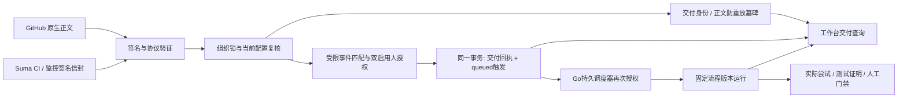

# 签名事件入口架构

状态：T-P4-003 实施中；负责人：主集成与控制面。关联需求：P4 外部事件自动化；接口依据：[入口合同](../../contracts/automation-ingress.md)；操作：[接入手册](../integrations/automation-ingress.md)。完成证据以阶段验收报告为准。

## 信任与职责

GitHub 来源只提供正文 HMAC；Suma 通用来源提供绑定入口、名义时间、稳定投递身份和原文的 HMAC。它们是入口级写入能力，不能代替项目会话、执行节点凭证或生产授权。管理接口独立要求当前组织会话的项目写入及审批权限。数据库的密文由环境主密钥或独立本机密钥文件保护；主密钥不放进业务表。

规范化来源只保存事件、仓库身份、ref、SHA、外部结论及身份。来源上下文和固定执行定义分开保存；执行已有经审批的流程，不把外部字符串插进命令、仓库路径或环境配置。外部 CI 的 success 不产生 Suma 测试证明。

## 原子接收与派发

验签使用首次读到的加密配置；进入组织锁后重读 generation、状态与规格，避免密钥在两步间轮换仍提交旧验签结论。数据库时间用于通用签名窗口及接收预算。新交付身份和 occurrence 同事务写入，提交后才返回202。ACK丢失时，原ID与正文重投恢复相同回执。GitHub新Delivery-ID但同正文恢复原交付，并保留受配额约束的别名墓碑，防后来复用该别名送不同正文。

派发拥有单一入口：Go 调度器的既有原子 run 绑定。它在组织锁内重新检查入口和规则两位启用人的当前权限；入口修订、停用和撤销精确阻止自己的排队项，规则修订阻止规则全部排队项。任何已经发生的运行事实保留，暂停来源不等于已经停止执行。

## 存储与恢复

入口元数据、不可变规格历史、秘密指纹墓碑、交付与投递别名均属于正式事务数据。秘密密文的 AAD 绑定租户、项目、入口和代数，拷贝到其他行不能成功解密。指纹全服务唯一且不因撤销删除，防原生正文签名跨共享秘密入口重放。接口与活动只返回非秘密元数据。

备份需要分别保全数据库与主密钥；单有数据库不能恢复来源密钥。本机密钥错误或不完整时失败关闭，不能生成新密钥覆盖历史；分布式数据库必须显式提供所有控制面共享的环境主密钥。既有数据库驱动路径不表示本阶段已在OceanBase/PostgreSQL完成并发恢复验收。

## 明确限制

原生GitHub对未见过的旧有效正文没有可验证新鲜度，永久去重只覆盖已见摘要。即时轮换会暂停来源，没有旧密钥宽限；发送端配置和恢复必须显式进行。本阶段不解析任意告警正文，不访问外部URL，不签收厂商公网接入、生产CI身份、完整配额体系或目标吞吐。
