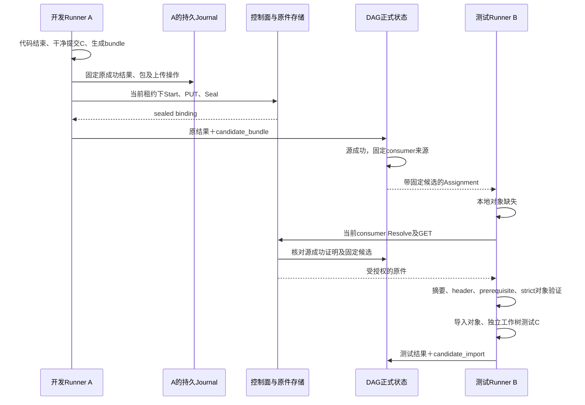

# 候选传递架构、恢复协议与 AI SOP

状态：T-P4-018 已实现，限定本地验证；负责人：平台集成。关联：[PRD](../product/candidate-transfer.md)、[类型与合同](../../contracts/candidate-transfer.md)、[既有候选固定](../scheduler/candidate-handoff.md)。[专项验证](../quality/candidate-transfer-verification.md)记录实际源码与运行切面，真实厂商验收独立进行。

## 模块归属

`internal/candidatecontract` 是普通Runner和资源池机器共享的传输类型与边界。控制面的 `candidate_transfer_store.go` 管理当前权威、封存元数据、操作回执和来源证明；`candidate_transfer_blob.go` 处理锁外原件I/O及末次授权；`candidate_transfer_http.go` 保持普通与机器入口分离。

Runner生成、严格导入和持久上传恢复分别由候选传递模块实现，通过既有Execute／Journal／Worker／PoolReplay接入。DAG的 `candidate_from` 和 `dag_candidate_revisions` 仍拥有唯一候选派发依据，不新增由用户任意指定提交的后门。网页只消费实际workspace证据中的传递事实，不参与机器授权或Git导入。

## 事务和信任

新表 `suma_candidate_transfers` 按tenant／project／source run／node／attempt／fence唯一，保存服务端ID、真实凭据摘要、Binding和原件存储定位。Binding包括base/head、原workspace evidence SHA256、包SHA256、精确字节及完整来源身份。凭据摘要和内部路径不进入公共响应。

普通请求复用当前Actor及项目Runner执行权威，禁止用普通scope读取资源池运行。机器请求在人员认证前使用独立PoolRunner proof，保留tenant、project、pool、runner、slot、双边grant、机器credential、版本、dispatch与租约身份；当前批准和资源池状态额外约束新代码I/O，不能借用允许排空旧事实的撤回规则。

当前权限、租约和fence验证先于成功回执恢复。长文件读写在事务锁外进行，提交或回传前再次核验身份、来源和存储引用。来源seal早于最终结果，因此消费读取还必须证明source当前成功、原attempt/fence及原结果中的Binding、base/head/evidence摘要全部匹配。消费者必须持有同一DAG固定候选。

包路径只由管理员DataDir和服务端随机ID组成，使用既有安全文件根；限制长度、实际字节、SHA、链接和文件身份。不可用、变更和损坏明确失败，不能静默拉取远程仓库补齐。事务提交回执未知时必须保留可能已被正式元数据引用的原件；后续按原操作核对，不能为了清理暂存而造成已提交引用丢失。 因提交未知保留的已验证孤立原件应先按正式引用与操作回执核对，再回收；当前不自动删除这类不确定原件。

## 恢复与副作用

Journal的CandidatePending保存原成功Result和固定本地包，区别于尚不知道代码结果的inflight执行。重启只恢复同一包上传与原结果回写，不调用Execute；上传失败的临时错误不得覆盖原结果。恢复前、传输期间和结果提交前沿用当前心跳与取消检查。原代码结果未知时仍走原有核对协议，不能用传递检查点伪造成功。

包已经封存而ACK丢失时，恢复Start可识别同一封存，不重复开发或传递。结果回写仍使用原有持久ACK协议。租约丢失、撤权或取消时保留检查点，阻止新增工作；核对与后续新计划分别记录，不把续传当成新的代码执行。

## Git导入

使用Git原生bundle而非同步数据库或复制仓库目录。生产者只发布固定HEAD及管理员base前置条件；消费者核对有界包、单HEAD、base prerequisite和对象格式，运行bundle verify，再对pack执行明确的strict对象检查和导入，最后重新校验提交与管理员基线祖先关系。对象导入不修改refs或用户检出；测试保持独立工作树。

Git官方文档说明了[bundle的前置对象校验](https://git-scm.com/docs/git-bundle)和[index-pack的strict及输入限制](https://git-scm.com/docs/git-index-pack)。包摘要正确不等于对象结构正确，二者分别验证。源代码传递与测试、人工验收、发布授权保持独立事实。

## 运维与AI开发SOP

1. 先定位run／node／attempt／fence及Journal检查点，区分代码未结束、已知原结果待传、封存待ACK、消费未导入和测试失败。
2. 包缺失或损坏时核对正式Binding及服务端原件，保留原结果。不得修改SHA、替换head或自动重跑已完成开发来让流程变绿。
3. 403／旧fence先检查当前凭据、双边批准、资源池和租约。无需也不得把机器身份转成人员身份绕过当前授权。
4. 消费端缺共同基线时由管理员修正仓库配置或重新制定计划。不要通过下载未知URL、执行项目脚本、修改远程配置或自动合并来完成导入。
5. 新增字段同步共享类型、生成合同、两种身份处理和双语目录；UI只显示正式事实。日志记录操作ID、来源版本、摘要和阶段，凭据及代码原件不进入公开日志或Git。
6. 日常运行受影响的传递、恢复、权威和消费者回归；正式分布式、跨数据库、存储、容量及厂商验收独立记录，保持完整平台待办。
