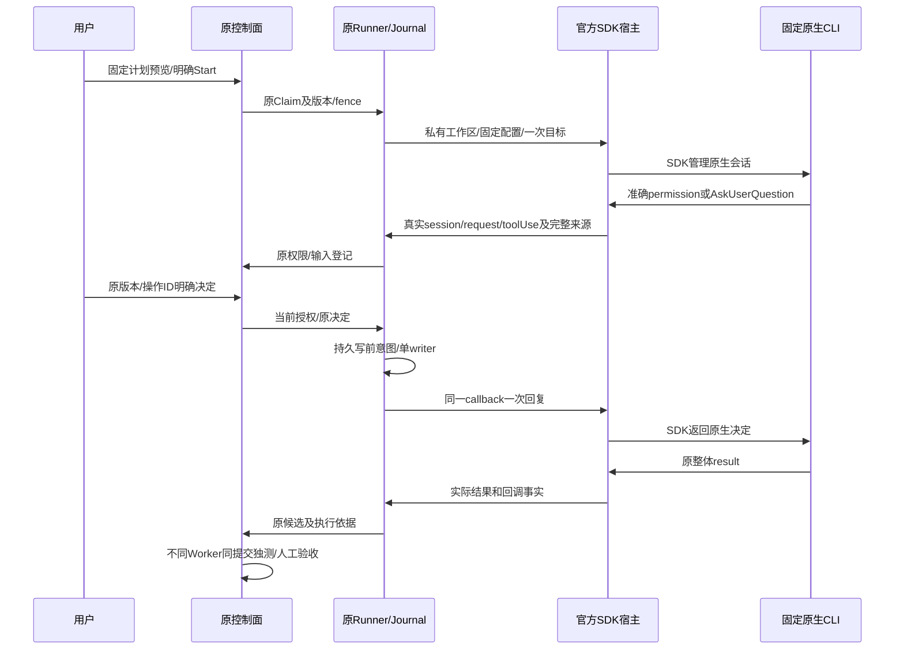

# Claude SDK 边界与 AI SOP

状态：限定实现与验证通过；suma1.0.0；T-CLAUDE-SDK-192。负责人：主集成代理；关联[合同](../../contracts/claude-sdk.md)、[PRD](../product/claude-sdk.md)、[采用记录](../integrations/multica-claude-sdk.md)与[验证](../quality/claude-sdk-verification.md)。

采用官方TypeScript SDK处理原生CLI协议，Go继续拥有任务派发、当前授权和正式结果。另写一套Go native control协议会复制成熟SDK的相关请求、回调和终态行为；直接搬入Multica自动许可策略则不符合速码现有门禁。因此复用其团队执行交互思路，SDK宿主走原Runner深模块，不新增调度器、业务表、HTTP路径或质量权威。

SDK包、全部宿主资产、Node与原生CLI摘要进入本机固定配置。原生CLI路径外置；依赖安装不选择或隐式下载任意平台CLI。明确API key只进被授权宿主的进程环境；无OAuth文件复制或未授权账户接续。SDK资源和许可随构建清单定位，厂商代码不复制入源码。

Callback Source保留native request ID、toolUse ID和真实session；宿主callback ID是单独的本机身份。参数SHA绑定准确原UTF8 JSON。共享合同从同一Go类型生成Schema和TS，平台、Runner和界面分别检查来源与决定，不能只检查模型名称或配置hash。

原数据库事务、CAS、当前权限、租约／fence和操作回执保留；先持久意图再写单一stdin。未知写不能自动重发；终态与写前IO竞争时闭合原请求并保留unknown。进程停止与SDK成功不同；在终态输出前仍需重查晚到取消／源改变。

本机callback拒绝次数与原SDK最终拒绝总结独立记录，缺失总结保持未知。正式成功还需原保存的许可为allow_once、问题为answered、观察闭合以及准确SDK原结果。依赖缓存、配置、候选、测试、验收和部署分别治理，不以连接或许可决定代替交付事实。

AI SOP：

1. 明确CLI／SDK／MCP方向和目标执行机器，选择当前已审SDK、CLI及管理员准确模型。
2. 生成并运行私有准备命令，原Go目标检查及O_EXCL先于效果；已有／链接／包内目标拒绝，不清空原文件重试。
3. 明确describe／report→原fresh库存暂停登记→单独启用；之后才预览及启动原计划。
4. 对原请求查看完整内容并一次决定；回答与权限不互相替代，永久规则和新会话均不由模型或页面生成。
5. 断线先核对原Journal和回执；发生未知效果不重发目标、许可或答案。
6. 收集准确候选、不同Worker同SHA测试及验收，失败按原问题回流流程处理；源码或配置改变后旧依据不能继续使用。
