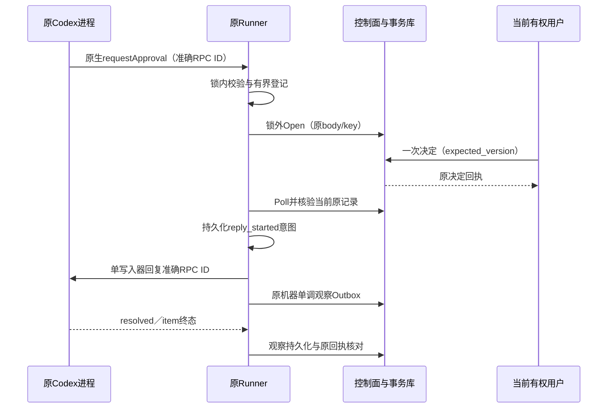

# 统一工具确认与 Codex 原生人工请求

T-CODEX-HUMAN-REQUESTS-174；suma 1.0.0；2026-10-31。负责人：权限领域、Runner、协议、工作台及主集成。状态：实现与定向检查完成，实际交互验证见[专项记录](../quality/codex-human-requests-verification.md)。关联[执行合同](../../contracts/codex-human-requests.md)。完整31项需求、P0–P7及58／34／92台账范围保留。

## 领域边界

人工工具确认回答“是否允许这个原生请求的一次操作”，不能代替需求验收、正式代码候选、独立测试或生产审批。复用原权限表、当前账号、普通／Pool Runner身份、原Assignment、租约及fence；Go控制面仍拥有唯一平台派发权。

| 模块 | 责任 |
| --- | --- |
| `internal/strictjson` | 有界闭合JSON、必需字段与显式false、Unicode及重复键校验 |
| `internal/toolpermissioncontract` | 平台统一请求、决定、来源摘要、可操作集合和完整记录校验 |
| `internal/acpcontract` | ACP原生session／tool-call／options；SDK不携平台Actor或幂等标识 |
| `internal/codexcontract` | 精确RPC ID、原生命令／文件请求与执行观察 |
| `internal/platform/tool_permission*` | 当前权限、事务、CAS、原操作回执和机器观察 |
| `internal/runner` | 原进程与工作区、异步原生请求、持久写入意图及观察Outbox |
| `ToolExecutionPermissionPanel` | 同一紧凑确认界面、原提交恢复、历史只读及事实分离 |

公共请求为显式协议联合类型，不把Codex thread/item伪装成ACP session/tool-call，也不保留旧wire别名。初始表使用`source_session_sha256/source_request_sha256`；原生身份参与唯一约束，请求正文另外核对。同一item的不同RPC可分别确认，字符串ID与数值ID保持不同。当前初始schema不匹配时在任何DDL前拒绝；不修改用户旧库，不回填或自动重置。

## 固定执行与确认范围

当前Codex配置统一固定为`on-request`，配置摘要版本3明确包含该策略；真实thread／turn ACK必须相符。稳定原生schema由当前已安装程序离线导出，`experimentalApi=false`。只支持命令执行与文件修改的两类原生审批。

RPC数值ID以有符号64位规范十进制字符串跨越浏览器，避免JavaScript精度损失。请求绑定当前thread、turn、已观察item、开始时间、原配置及未脱敏原文摘要；公开正文在持久化／传输前脱敏，路径限定为工作区相对位置。删改或截断的正文不能批准。

仅允许`accept/decline/cancel`一次决定。网络策略、永久目录授权、规则修改、会话级授权、writeStdin和未知扩展不升级为可接受范围。平台按钮是当前人权限、来源完整性与原生可用选择的交集。原生请求被接受不证明OS隔离有效，也不增加预算控制能力。

## 异步与恢复时序

stdout读循环和取消不会持有互斥锁等待用户、HTTP或磁盘。不同请求可并行等待，stdin仍只有一个写入器。真正完整Write成功才记录`reply_written`；入队、局部写入和未知响应不能当成成功。取消拦截尚未开始的回复；已经开始的写入保留结果未知，重启不重放原生回复或turn。

人类决定、Runner看到决定、写入开始、完整写出、供应方清理与item结果分别保存。`serverRequest/resolved`既可能是答复也可能是清理，不能单独证明操作成功。早到消息保留，满足因果条件后提交；Finish在锁外有界等待，不制造人类决定。原生`inProgress`不是终态。

观察以原命名空间、原Assignment和稳定key提交，序号可跳号但事实只能单调前进；事务同时保存记录和回执。重放返回当时保存的原快照，不把新观察伪装成旧决定响应。观察Outbox优先于Result回放；永久4xx进入明确核对，保留原正文，不无限重试或假确认。缺少Open回执时只用原body/key核对。重启不伪造父配置ACK。

成功结果须覆盖全部已登记请求并与平台原记录、最终观察一致；其他attempt、旧fence及伪造人决定均拒绝。运行结束、代码交付和质量验收继续由各自领域裁定。

## AI开发与运维SOP

1. 固定当前工具、原生schema、模型、策略、独立工作区和原Assignment；缺任一依据即停止派发。
2. 收到准确原生请求后只登记原请求，不把请求自动转换成人批准。
3. 界面先展示命令／文件影响、正文完整性及一次选择；当前用户明确决定，未知响应保留原提交。
4. Runner重新核对原记录，持久化开始意图；单次写出，观察优先回传。
5. 超时、断线、取消或永久拒绝进入原操作核对；不得换key重试、重新Prompt或扩大授权。
6. 操作完成后沿既有候选、同提交独立测试、人工验收及问题回流继续；工具确认不替代这些门禁。
7. 变更协议先更新闭合合同，再改原生适配／领域／生成类型／界面；只运行受影响检查，证据分别标明受控协议、真实厂商、模型和生产范围。

采用[官方app-server协议](https://learn.chatgpt.com/docs/app-server)，参考Multica团队执行和HelixHarness可恢复执行原则；固定提交见[合同](../../contracts/codex-human-requests.md)。本轮新增上游源码复制与依赖均为0。
