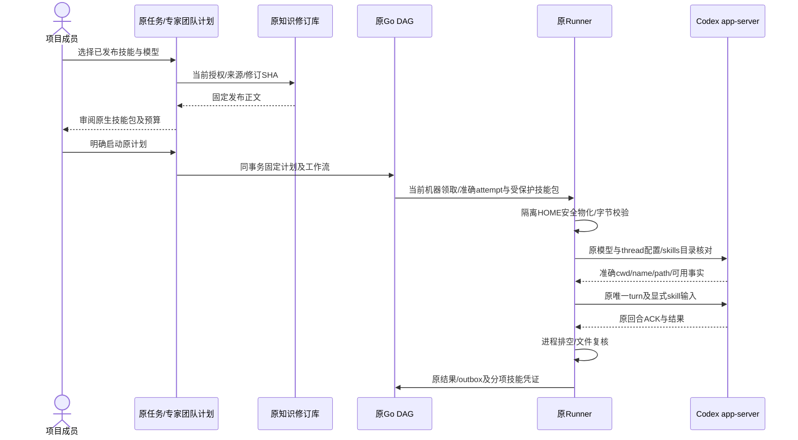

# Codex原生项目技能：架构与AI SOP

T-CODEX-SKILLS-173；suma 1.0.0；2026-10-31。负责人：主集成、知识领域、Runner、工作台。状态：限定实现、定向合同、本机目录及代表组件视觉已验证。关联[执行合同](../../contracts/codex-native-skills.md)与[证据](../quality/codex-native-skills-verification.md)，完整31／P0–P7范围不变。

## 领域接缝

知识域负责发布、来源资格及准确修订；执行域负责本次固定计划、当前身份、机器资格和租约；Runner负责独立工作区、文件字节、原进程与结果；Codex负责自己的技能目录和回合协议。原生技能是一种执行输入，既不是新插件权限，也不是质量结论。

TaskDispatchPlan及专家团队item.plan保留完整Knowledge和ExecutionSkills；workflow固定节点包含同包，认证Assignment从原持久计划重新派生，不能单凭任意config生成文件。预览／Start复核当前发布；已经启动的运行固定原快照，领取不会自动升级技能。未选择原生技能或其它适配器仍须符合各自当前合同，不引入旧版本自动回填或放宽门禁。

## 数据与安全边界

原知识修订SHA、正文SHA、SKILL.md字节SHA、技能包SHA分开记录；包摘要包含固定文档顺序。ID仅用于生成稳定摘要名称，不被当作路径。元数据以安全标量写入前言，正文保持原始字节；上限同时约束技能文件和原任务总输入。原生Codex文本只引用已附加技能，避免把正文再发一遍；memory/spec仍走原文字上下文。

文件仅位于attempt已有的codex-home/skills内，与Git源码和用户配置分开。Root锚定目录与文件，拒绝链接、错误类型和不匹配已有字节，不覆盖陌生文件；启动前与正常收尾复核。文件权限位不构成不可篡改承诺。写入、目录观察、调用请求、回合ACK、最终文件复核分开，任何一项都不证明模型实际使用或改善质量。

无新增表、迁移、依赖或派发器；同一原计划、Journal、取消／未知核对、预算观察、候选、独立同提交测试和人工验收继续有效。目录失败发生在发送Prompt之前；未知Prompt不自动重放。其他CLI、系统自带或仓库发现技能不因出现于目录就获得平台发布资格。

## AI开发与排障SOP

1. 先确认问题属于来源发布、计划、Assignment、文件、目录还是回合，不用模型自述补缺失事实。
2. 逐级核对原知识修订、包SHA、文件SHA、run/node/attempt/fence/Worker；不从goal正文或外部路径反推授权。
3. 缺少原包、Config不符或正式来源在Start前变化，重新预览；已启动输入保持固定，不用“取最新”修补。
4. 目录不支持或读取失败，保留真实错误与已物化事实，不悄悄降级后标原生成功。
5. 回执未知沿原key与attempt核对，不新建Prompt；终端成功、文件复核、测试、正式验收分别排障。
6. 改动只验证对应边界；复用未变的独立测试及验收证据，原始失败、跳过与实际厂商范围单列。

## 参考与后续

采用[官方app-server技能协议](https://learn.chatgpt.com/docs/app-server)和[原生技能结构](https://learn.chatgpt.com/docs/build-skills)，复用原成熟Codex进程协议。Multica与HelixHarness参考提交和许可边界见[合同](../../contracts/codex-native-skills.md)；新增上游代码复制0。

其他适配器原生格式、带支持文件的技能包、签名安装、完整Codex人工请求／持续会话、自动技能效果评测、跨设备同步、物理多机、数据库与正式安装／生产验收继续实施。
