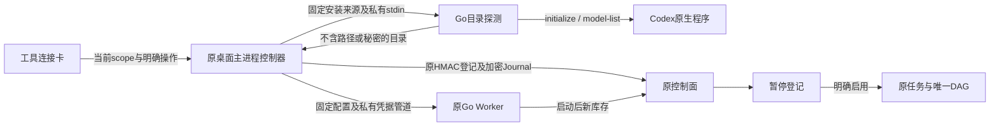

# Codex快速连接架构与AI SOP

T-CODEX-QUICK-CONNECT-175；suma 1.0.0；2026-10-31。负责人：主集成、Runner、桌面及工作台。当前实现和证据见[合同](../../contracts/codex-quick-connect.md)及[限定验证](../quality/codex-quick-connect-verification.md)。

## 模块与信任边界

| 模块 | 职责 |
| --- | --- |
| `internal/codexcontract/discovery.go` | 共享闭合结果、状态与配置绑定校验；复用原CodexCatalog |
| `internal/runner/desktop_managed_codex.go` | 私有配置／输入、安装复核、固定spec、零目标目录探测 |
| `internal/runner/local_tool_discovery.go` | 原被动安装检测扩展，不把未配置工具当可派发 |
| `apps/desktop/src/local-codex*.cjs` | 当前窗口调用者、来源、60秒探测、原操作恢复及私有环境 |
| `managed-local-runner*.cjs` | 原机器凭据、加密Journal、启动／停止／新库存和停止后重配置 |
| `internal/platform/desktop_runner.go` | 原HMAC登记增加准确adapter，不接提供方配置、路径或任意env |
| 工作台连接组件 | 简洁配置、准确来源、原操作核对、当前库存登记及独立启用 |

不新增IPC权限、调度器、身份系统或模型目录服务。原`manageLocalTool`按明确adapter和action路由探测，ACP仍保留自身协议语义。Root仅在控制CLI添加两个私有入口代码块；原主进程窗口文件不需要修改。

## 配置与一致性

提供方配置摘要复用现有版本3／`on-request`语义；跨Go／JavaScript保留字段顺序及Go JSON转义。原目录独立校验排序、模型／档位和摘要，不猜默认模型。

renderer只提交非秘密配置与安装／探测标识，实际路径和秘密值由主进程掌握。来源绑定当前项目工作区、安装、提供方配置及凭据HMAC；60秒期限不会因查询延长。主进程只把明确环境引用带入私有子进程，原值不写入renderer、日志或Journal。

目录探测没有仓库、worker、goal、thread或turn输入；私有CLI模式先于服务／数据库初始化并与其它模式互斥。真实目录与原生程序停止核实后才允许ready。ready不是账户健康、模型响应、价格或OS隔离证明。

连接复用原worker及登记body/key。未知／运行中／停止未确认时不得用新草稿替换原配置；只有已确认停止及用户明确提交新selection，重新核对当前探测后才更新。连接本身不启用工具；主进程核对启动后库存的文件、版本、配置及有效目录，平台仍先暂停登记，随后明确启用。

## AI开发与运维SOP

1. 先被动检测实际安装；shim、缺Node或异常版本给具体指引，不自动安装或执行未知启动器。
2. 只采用当前有权用户明确配置；提供方需要凭据时确认环境引用，不能把机器或Agent令牌作模型密钥。
3. 明确读取目录，保留同一操作ID和请求正文；未知只查询原操作，不重新启动探测或模型。
4. 将原探测转为固定私有配置，通过原Worker发布新库存；未匹配准确来源时保持starting或明确失败。
5. 新配置暂停登记并单独启用；任务固定模型／档位／代码与技能版本，继续原一次确认、独立测试、人工验收及问题回流。
6. 配置更换先正常停止；原操作、历史执行证据和来源保持可追溯。
7. 按变更边界验证，复用174未变的执行与质量证据；不为非功能环境审计重复构建或阻塞交付。

复用本项目现有成熟原生协议、加密存储、进程控制和界面组件，无新增上游源码复制。Multica、HelixHarness固定参考与许可边界沿[接入优先级](../integrations/multica-priority-map.md)保持，完整平台范围不缩减。
