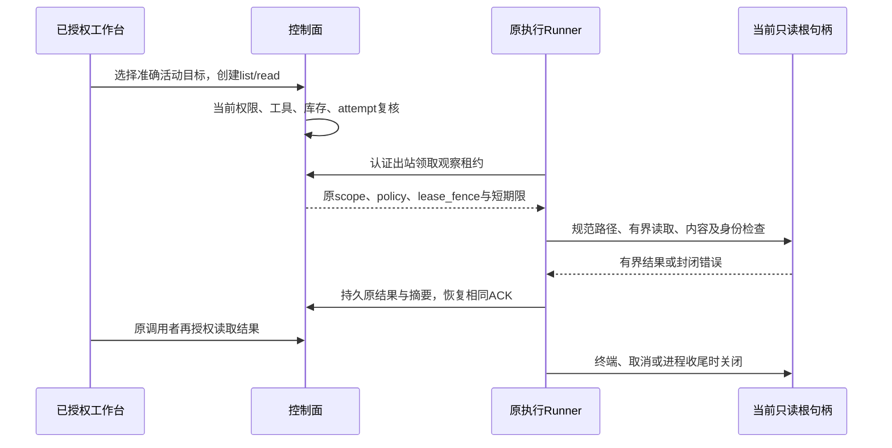

# Codex 执行工作区观察

状态：1.0.0 当前实现；负责人：Runner、控制面、工作台；关联需求9、12、21、22。[观察合同](../../contracts/workspace-observation.md)、[传输能力](../../contracts/workspace-transport-capabilities.md)与[原生保存](../../contracts/workspace-write.md)分别定义读、能力与写权限。完整平台范围保持在[实施计划](../delivery/implementation-plan.md)。

## 模块与权限

平台复用既有观察通道，增加准确 Codex app-server 执行中的目录／文件读取。读取权限来自当前调用者、项目、批准工具、机器库存及准确活动 attempt；工具名称、模型目录或 UI 标记不能单独授权文件访问。

| 模块 | 单一职责与接口 |
| --- | --- |
| `toolcontract` | 识别可观察的原生／Codex profile，独立识别仅原生可保存的 profile；库存校验还要求有效完整档案、当前可用和准确协议，Codex 必须带有效模型目录 |
| `liveWorkspaceRead` | 已打开的 `os.Root`、根身份、执行身份、上下文及秘密过滤；提供有界 list/read 与关闭，不持有 MCP 服务、写操作账本或文件更改能力 |
| `nativeWorkspace` | 组合同一读取句柄，保留原生 MCP、CAS 写入、检查、合并和封存职责；不复制第二套文件路径与读取逻辑 |
| `WorkspaceObservationRegistry` | 每个执行槽位登记一个当前读取句柄；可写原生句柄独立存放，Codex 只有 reader。读轮询和原生写轮询分别取各自能力 |
| 控制面 | 复用持久请求、租约、fence、原调用者、私有／Pool双边授权、结果摘要及到期正文规则 |
| 工作台／CLI | 继续使用相同目标和观察接口；界面按 `can_write` 显示编辑入口，原生草稿存在时阻止切换目标，不从ID猜工具类型 |

## 生命周期与并发

Codex Runner 在已经准备好的独立 attempt 源目录打开句柄，继承准确 profile 摘要和秘密过滤。它不启动原生 MCP，不建立原生写账本，也不以历史路径恢复句柄。上下文取消立即使读取失效；Codex 终端事件在发布终态进展和捕获 Git 证据前撤销登记／关闭句柄，进程失败与退出路径同样收尾。结果关闭失败保留需要核对的事实，不能隐去。

外部 CLI 不共享原生互斥锁。共享读取会检查规范路径、文件身份、前后大小／模式／修改时间，并再次读取比较字节；替换或变化返回 `file_changed`。分页须固定原文件 SHA，目录游标固定原列表摘要。该检查不承诺目录树的原子快照，也不能证明后续时刻文件仍相同。敏感路径、凭据正文、宿主路径、Codex home和已知秘密不能进入公开结果。

Codex 不声明 `workspace-write-v1`；即使请求伪造写协议，库存校验、控制面创建／领取和 Runner 的独立 writable 句柄均不能授予保存能力。写 broker 不为只读句柄发送新写领取。未来增加协调保存需要处理外部进程并发写入与效果核对，不能仅切换UI按钮。

## 开发与排障 SOP

1. 修改能力时同时检查 profile、当前库存、控制面资格与实际句柄；增加协议字段必须有真实实现，不能用管理开关模拟支持。
2. 读取空列表时检查准确run/node/attempt/fence/worker、工具档案、60秒库存和当前机器／Pool授权。能发现目标不证明句柄已经打开或模型已获授权。
3. `file_changed`须明确重新读取，不能拼接不同 SHA 的分页。关闭／旧fence失败保持原事实，不打开旧工作树。
4. 原生编辑草稿和待确认保存绑定原scope/key。不能通过切换到Codex、刷新目标或替换组件丢弃未知保存。
5. 只运行受影响的合同、控制面、共享读取／原生写回归，以及一次真实本机出站链路。协议子进程、实际安装版CLI、模型推理和正式业务验收分别记录；不为每个入口重复付费推理或完整套件。

没有新增路由、表、协议版本、SDK、依赖或历史兼容层。远程协调保存、Git、PTY、LSP／DAP、真实厂商及物理多机仍需独立实现与证据，当前读取能力不替代完整 IDE。
