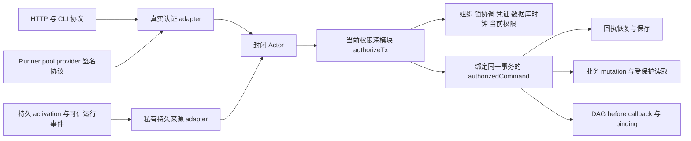
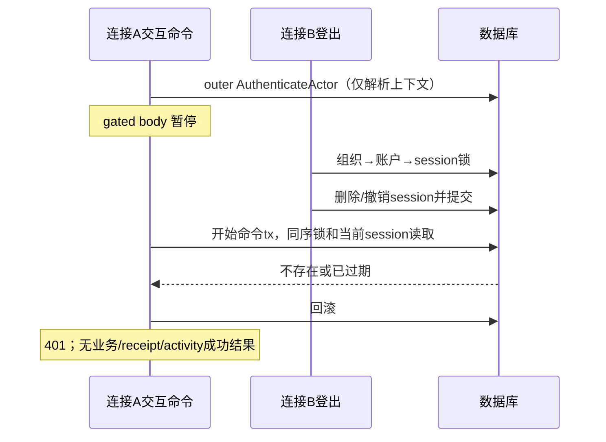

# 当前凭证权威性：应用命令深模块设计

状态：**1.0.0 当前初始化与权限设计；完整平台及生产验收未完成**。更新：2026-10-27。2026-10-25 的 proposal-1-r1 与 T-P4-013 提交 `0a8308919dd4b2bf5f8836e943118a40f2a1a10a` 为历史发现和设计取材，不代表当前源代码、运行预览或生产状态。

关联：[当前合同](../../contracts/current-credential-authority.md)、[实施与验收计划](../delivery/current-authority-plan.md)。历史发现保留于忽略目录 `credential-authority-stage-014/` 的 discovery、summary 与 command-authority-map；这些是历史证据，不是当前初始化或权限合同的替代来源。

## 实现落点与当前边界

当前 1.0.0 在独立空库初始化真实发行与当前权限模型；`suma_sessions`、scope、来源、family、Grant 和 issuance 分别保存事实，任何单表或显示 label 都不能替代完整证明：

| 模块／表 | 职责 |
|---|---|
| `command_actor.go`、`command_authority.go` | 真实来源解析、私有 Actor、事务／目标／用途证明 |
| `authority_read.go`、领域 `*Tx` 读取 | 当前授权与完整响应查询同一事务；SSE 每个持久批次和发送前重新检查 |
| `suma_auth_sources`、`suma_session_families` | 认证来源、固定 7 日浏览器家族及撤销代次 |
| `suma_credential_authority`、`suma_credential_issuance` | credential digest 的真实 kind、来源绑定、发行证据和撤销标记；缺失或不一致直接拒绝 |
| `suma_credential_grants`、`suma_credential_slots` | 独立批准、固定到期及同操作秘密轮换；不存秘密正文 |
| `suma_identity_authority_locks`、`suma_authority_credential_locks` | 排序参与者与来源协调；SQLite 专用 writer guard |
| `internal/store/baseline.go` | 领域 DDL 前的当前 1.0.0 schema 声明与拒绝边界；不解释已有历史结构 |
| `internal/store/transaction.go` | 连接归属、事务结束、SQLite 本连接等待时限恢复；不修改全局设置 |
| `apps/web/src/api-context.tsx`、CLI 原视图参数 | 请求闭包固定原页面账户／组织，重试不自动更换身份 |

短事务使用首次 5 秒总预算，重复证明不重启计时，锁外进行提供方／文件 IO；交互完成返回前建立新证明。记录、审批、发布、工具、自动化、资源池与 Runner 共享该边界，各域保留自身业务门禁。可信 failure projection 和机器／持久 activation 使用封闭的真实来源证明，不转成通用系统用户。

`Service.Initialize` 先通过 `store.InitializeBaseline` 校验本组件 1.0.0 声明，再执行当前领域 DDL；未声明却已有领域表或版本不匹配时，在领域 DDL 前拒绝，要求独立空库，不升级、不清库。各 `Initialize*` 只初始化当前结构，`InitializeCredentialAuthority` 不从已有 session 回填身份。schema 声明不是 DDL 全部完成、服务健康、业务验收或生产就绪证明。当前源代码和已运行预览分别记录；本轮文档同步没有升级预览或接入已有数据库。PostgreSQL／OceanBase 并发、规模目标、外部厂商、物理多机和生产验收仍须独立证据。

## 1. 历史发现与当前目标

两条真实 HTTP 路径已被确定性复现：POST `/api/v1/teams`、POST `/api/v1/tasks`。请求先完成真实 Authenticate，再在第一次读取正文时暂停；另一数据库连接先提交 Logout 或固定过去时间的会话 expiry；随后原请求仍以缓存 Principal 新增业务对象、operation 和 activity，或返回原先的成功回执。两端点 × logout/expiry × 新写/replay，共八个所需拒绝案例。fresh Authenticate 已拒绝，原成员关系仍存在；这是凭证存活与成员权限的区别。现有强校验偏好命令同时拒绝了同一失效凭证。

仅上述两端点的这八个时序标记为已证实缺口。其余源码缺少当前凭证输入的调用点均为待迁移／待验证的 source gap，不能把矩阵直接升级成全库漏洞结论。现有 Characterization 通过只是重复观察缺口，必须保留原 RED，不是修复后的 GREEN。

T-P4-013 历史源码中的 `Principal` 在 `internal/platform/types.go` 包含身份／组织／角色投影和包私有 internal 位，没有 credential 标识。`liveOrganization`、`authorizeProjectTx` 复核账号和当前成员权限，却不能辨别先前认证的 session 已删除。团队治理 helper 与通用记录 Create 因而无法在事务内补查原凭证。

T-P4-013 历史源码中部分路径已有更强实现：Runner 的 `currentRunnerCredentialTx` 采用 session/scope 当前行锁和数据库时间；pool 人类命令复用 `currentSchedulingSessionTx` 并另查 browser label；偏好、releaseBrowserTx、artifactAdminTx 也查询实际会话，但时间与行锁语义不一致。必须保留一个精确事实：**`currentSchedulingSessionTx` 自身检查 actor/tenant、无 scope、expiry、数据库时间和支持后端的 FOR UPDATE，不检查 label=browser**。不能把已有注释或调用者约束当作 helper 自身保证。

目标是让所有已实现应用写入和回执恢复只使用当前、真实、允许该用途的凭证，并保留当前项目权限、幂等、版本和持久委派语义。任务范围覆盖矩阵的 111 个逐方法／入口行；它们包含机器、内部及重复方法行，**不是 111 个人类写端点**。完成判据是所有交互写入口被封闭迁移，并逐项登记机器／系统／委派差异。

## 2. 范围与不变条件

本阶段拟分两轮集成：第一轮覆盖全部已实现交互写命令、凭证生命周期和共享机器／委派适配；第二轮覆盖全部已实现受保护读、敏感回执、原文、文件与 SSE 的同一当前凭证规则。两轮都完成才可称本设计的当前权限基础完成。不能把第一轮两个端点的 GREEN 当作整体完成。

纳入现有浏览器 opaque session、project API、Runner／release worker、Agent、独立 pool machine、provider machine、signed ingress、持久 automation/tool activation、FailureIssue 和 index projector。CLI／Runner client／agent-runtime 仍经现有真实 HTTP 协议。现有 Agent tools 仅 overview/tasks/search；POST invoke 是读取。MCP／A2A 等扩展须按各自真实来源、协议与实际接入证据验收，权限基础不能代替完整外部集成或生产支持证明。

保持业务表、历史回执正文、actor/body/scope 绑定、版本、执行 fence、原始工具事实和语言显示不变。旧回执无需重写，恢复之前必须通过新的当前权限。公开业务 JSON 不增加 actor、system、delegation、凭证种类或可信标记；客户端不能选择内部能力。

当前 Go SQL／store／已配置驱动继续使用。设计不引入新依赖，不升级 Go 工具链，不安装 SSO 库。OIDC 及企业 SSO 协议、库选型、目录同步、设备治理和真实厂商集成另有设计与验收，P0–P7 所有其余范围继续开放。

## 3. 深模块与 seam

拟在 `internal/platform` 建立当前权限深模块，外部 interface 仅为“解析真实来源成 Actor”和“在指定事务内为用途授权”。凭证表、scope、当前成员／项目角色、数据库时钟、锁序、source lifetime、机器及委派差异隐藏在 implementation 中。不是在每个 handler 复制一段校验，也不是把 Principal 透传改名为 Actor。



拟议文件责任：`command_actor.go` 管封闭类型和真实来源构造；`command_authority.go` 管交易内授权与 proof；`credential_lifecycle.go` 管 logout/revoke/issue/switch；`authority_clock.go` 管现有三 SQL dialect 的 DB clock；`authority_read.go` 管受保护读／SSE；`command_authority_contract_test.go` 和领域测试验证跨 adapter 行为。文件名是拟冻结接口，Root 可复核调整。领域业务规则继续留在现有文件，避免另建平行 RBAC 系统。

### 3.1 封闭 Actor

以下为设计声明；对应源码已经进入实现，最终以同名私有类型和应用接口为准，完整集成尚未验收：

```go
type actorKind uint8 // 未导出；零值无效
type Actor struct {
    kind actorKind
    credential credentialRef
    delegation delegationRef
    projection Principal
}
type credentialRef struct {
    digest, subjectID, tenantID, projectID string
    sourceID string
    sourceRevision int64
}
type delegationRef struct {
    recordID, tenantID, projectID string
    revision int64
}
```

字段、variant 常量和持久来源构造函数不导出。`Actor` 不实现从 JSON 得到有效值；`UnmarshalJSON` 总是返回错误，`MarshalJSON` 同样拒绝，避免 accidental secret/ref 导出。只允许零值构造，授权时拒绝零值。不能提供 `NewActor(Principal)`、`NewSystem(tenant)`、`WithInternal(bool)` 或默认 Principal fallback。Go 包内部仍能访问私有字段，因此还要禁止业务文件构造 Actor 字面量／写 variant 的源门禁，允许位置仅限 Root 所有构造文件和明确测试 fixture。封闭类型是编译迁移工具，不能夸称对同包恶意代码的安全隔离。

Actor中projection是outer解析时的显示／关联提示，不得从其Role做当前授权。authorizeTx必须从当前SQL行生成proof内的currentPrincipal／当前machine权限；业务输出与角色判断以该结果为准。新增kind/source/family/grant引用也来自真实persistedrow，不能因已经封装进Actor便跳过事务内复核。

`Principal` 是纯投影，只用于显示／当前角色结果，不能用于交互 mutation 授权。`AuthenticateActor(ctx, rawToken) (Actor, error)` 基于真实 session、scope 与发行来源取得封闭上下文；缺少 issuance、source、family 或所需 Grant 时直接拒绝，不分类或回填旧行。outer 解析不证明后续权限，每次命令事务仍须重新取得当前 proof。生命周期、pool、provider 和持久来源各有专用构造，不能把机器伪装成资源拥有者。

| variant | 可接受来源与用途 | 不得继承 |
|---|---|---|
| browser | 真实 session、server-established browser kind 与完整 source／family／issuance；允许的人类命令／读 | 用户 JSON label、无 scope 本身、缓存角色 |
| projectAPI | 真实 session + kind=api/project scope；仅现有允许的 project 命令与读 | 组织治理、browser-only、机器权限 |
| projectRunner | session + runner scope + 精确项目，必要时 release worker 当前绑定/profile | 任意 worker、browser/Agent 权限 |
| agentRead | session + agent scope；现有三个只读工具 | business mutation 或通用 API token |
| poolMachine | 独立 pool credential/runner/version/grant/dispatch | owner/requester 的人类 Principal |
| providerMachine / signedIngress | 真实配置凭证或验证后的签名 + 当前 revision/generation/operation | 交互 session 或一般项目写 |
| durableAutomation / durableToolActivation | 私有 adapter 从当前持久 activation/ref 重建，检查激活人当前权限 | 发起浏览器 cookie 生命周期、调用者提交的激活人ID |
| failureProjector / indexProjector / workspaceRecovery | 私有 adapter 从可信持久 event/run/outbox/prepared operation 派生精确 scope | 任意 tenant/project、自由选择 system 标签 |

### 3.2 事务 proof 与命令 interface

```go
type commandTarget struct { tenantID, projectID, resourceID string }
type commandPurpose uint16 // 只有服务器固定常量；禁止从 JSON 直转
type authorizedCommand struct {
    tx *sql.Tx
    actor Actor
    target commandTarget
    purpose commandPurpose
    checkedAt time.Time
    // 当前读取的身份、scope/revision、权限结果；不含 raw secret
}

func (s *Service) authorizeTx(ctx context.Context, tx *sql.Tx,
    actor Actor, target commandTarget, purpose commandPurpose) (*authorizedCommand, error)
func (a *authorizedCommand) assertTx(tx *sql.Tx, target commandTarget, purpose commandPurpose) error
```

所有写入应用方法由 `Principal` 改为 `Actor`，领域输入 DTO 和结果类型保留。当前 token-string 专用方法改为消费 Actor，不保留同时传 Principal 与 raw token 的双权威参数。authority helper 当前行校验、角色与 purpose 的组合集中处理；domain-only 当前成员检查保留为私有实现供持久委派使用。

平台 `receipt`、`saveReceipt`、`activity`、记录写入／失效／binding helper 应接收同一事务的 proof，或封闭事务工作对象，不能裸 Principal 越过。proof 内保存 tx 指针、scope 和 purpose，并逐次 assert；不允许跨 Review 两个事务、reconcile 的读／final tx、workspace prepare／finalize 复用。证明不持久化，不存 context.Value 全局值，不用 HTTP 已认证标志代替。

业务 Entry 调用 `authorizeTx` 后才能查询成功回执，重放也不例外。receipt 自身只能核对 actor/body/route/scope 幂等，不承担当前 credential 校验。历史 JSON 正文保持原样，响应前若凭证无效返回统一拒绝，不读取成功正文再返回。

Engine Create／Command／Claim 等 before callback 保持现有 sql.Tx seam；callback 捕获 Actor，生成本事务 proof，后续 bind／effect helper assert 同一 tx。`PublishWithOperation` 当前没有 before callback，拟新增 `PublishWithAuthority`；平台路由必须使用新入口。底层 Engine 无身份的内核方法不自动代表应用授权，保留的内核入口仅给明确内部调用，源门禁禁止平台 adapter 直接使用未授权 variant。

## 4. 一致性、锁序与凭证生命周期

### 4.1 拟冻结锁顺序

所有参与权限更改的数据库 transaction 遵循：**完整组织集合按 ID 升序 → 账户权限协调行按 userID 升序 → credential/session 按稳定 key 升序 → 项目／scheduler（及池／环境既有细分顺序）**。账户协调行属于 credential 层，不在组织层之前。进入后一层后不得再扩展组织集合。`authorizeProjectTx` 等旧 helper 不能隐式重新拿锁并逆序；改为私有“锁已持有后的当前 role 检查”。

`suma_identity_authority_locks(user_id PRIMARY KEY, sequence)` 是 session issue／revoke、成员变更、switch 与 account-wide revoke 的账户协调点；人类短命令取得该行及当前 credential 锁。它使同账号跨 session／组织短命令保守串行，不代表吞吐目标已验证；pool／provider 独立身份使用其当前专用协调与凭证协议，不从 owner 借权。

account-wide revoke、跨组织 switch 和影响多组织的成员／凭证命令：先读候选组织集合（非授权读），按序锁所有相关组织，再锁账户协调行，使用当前读取复核该账户的 membership/session 源／目标组织集合。集合有扩展则回滚，重新收集后最多重试 3 次，仍变化返回可重试 conflict；不能边持锁边补一个更小 ID 组织。所有新增／删除 membership、session issue 也参加该账户协调协议，因此复核之后集合不能悄悄变化。多账号治理先按组织再按全部 userID 排序；邀请注册要先确定现有或新 userID，禁止 password/source 变更绕开协调点。

### 4.2 授权线性化点与数据库时间

在线性化点持有组织／账户／实际 credential 行的锁，完成 actor/tenant/kind/scope/source generation、当前 membership/action 及 DB-time expiry 校验，之后才能读 receipt、拿 scheduler 锁或写业务。支持的 SQL dialect 必须使用当前读取；PostgreSQL/OceanBase 使用明确行锁，SQLite 使用既有写事务序列化。不可把 RR 快照普通 SELECT 当 current read。

采用事务内权威数据库时间，统一 UTC 与已有秒精度保守判断：expiry.Unix 必须大于 DB clock.Unix；最后不足一秒不扩寿。`time.Now()` 只用于诊断耗时，不作为授权判定。应用读取缓存 Principal 的时间、服务器时区和客户端时间不参与。

拟定义短事务预算 5 秒：authority lock／检查到 commit 之间不得做网络、文件流读取、模型调用或长 CPU；driver lock wait/context deadline 不超过命令剩余预算。语义是**凭证在受锁保护的接受点有效即可提交这一已接受短事务**，不承诺 expiry 每一纳秒到 commit 仍有效。若预算到期，回滚不交付成功；禁止续租或自动延长凭证来救事务。长副作用必须先持久化明确已接受 operation，再用专用可信 effect/recovery 能力推进。具体后端 statement/lock timeout 由 Root 适配，不偷偷执行全局设置。



反向顺序：命令先获取同一权限锁并通过接受点，logout 必须等该短事务结束；命令先提交，logout 再提交。之后任何新命令／成功 replay 均拒绝；已提交业务保持。两个方向分别验收，不使用 sleep 抢概率。

### 4.3 Logout、revoke、rotate、issue 与组织切换

Logout按真实kind分开：browser撤销当前完整session family/generation，另一loginfamily和独立Grant/durableactivation保持；API/Runner/Agent只撤销自身credential及其同一issuance slot，不撤销browserfamily、共享identitysource或其他Grant。browser先收集family所有组织排序锁，独立token锁精确scope组织，之后账户→family/credential/slot同序。family.status/generation或本credential_state/slot.state/version只在首次撤销改变，session原row/expiry留审计。重复／已撤销／过期／未知目标200并清cookie，不增加成功operation/activity，不反复递增generation/version。私有withdraw-only logoutTarget由真实secret及持久绑定解析，不能授予command/read proof；其他current-auth对legacy仍401。pool/provider/durable只走自身revoke协议，详细行变化见合同CCA-008B。revoke/rotate、成员移除、项目授权撤销和账户级注销也参加同序协议；不能只给guard加锁而生命周期不参加。

token issue 从源 browser Actor 在同一 tx 校验当前 org/project authority，将这次明确发行批准固化为 Grant，然后原子写入 grant、session、scope 与 logical issuance slot；scope 插入失败整个事务回滚，取消旧的“已先发 session 再补 scope”的窗口。scope 必须是固定枚举 runner/agent/api，project 由当前 domain 校验；人类输入 label 仅展示，绝不等于 credential kind。独立 token 的 expiry 由 kind/tenant policy 和明确 Grant 的期限／配额／scope 上限共同约束，**不 cap 到发行浏览器剩余寿命**。本阶段初始 policy 保留现有24小时默认／上限；未来30天节点等需明确 policy/Grant 支持，不能伪称现在已实现。replay 只能轮换同一 Grant/slot，不能延长原 Grant 的绝对期限或提升范围。

switch 锁 source+target 的完整排序组织集合、账户、session family 和 source session，再检查两处当前 membership 与 browser kind。目标 session 继承同一 server-issued family 的 authenticated_at、absolute expiry、source generation；有效期最多原 family/source 剩余寿命，不再固定新增7天。family是独立持久row，不能因source token正常轮换／消耗而消失。旧source row可按固定策略保留或作废，本提议选择保留至expiry/logout以允许原source的确定性恢复；当前客户端cookie改到目标session，原视图header防止跨标签页漂移。

switch receipt存非秘密元数据；响应丢失replay只在source Actor和family仍当前时轮换同一logical derived slot，固定family absolute expiry不变，旧slot secret失效，不留下无界活动session。browser Logout拟撤销当前family/generation，使这个登录family的所有switchsession失效；另一次真实login建立独立family。精确family logout行为是Root已冻结的公开兼容选择，不能只删旧source row再假设新session已正确撤销。source普通轮换不提升family generation，family revoke则提升或标revoked；账户/compromise级撤销是更高层协议。

已正式发行user-api／Runner／Agent token不依赖发行browser row或family仍登录；使用时验证自身credential、当前creator/Grant权限、Grant状态/expiry/scope/quota、account/authsource revocation generation。普通browserlogout不会撤销它们或durableactivation。底层local-password／未来SSO identity source可按明确policy阻断关联独立凭证；是否强制source provider session持续在线由独立grant policy决定，不能默认依赖cookie。family多组织撤销先收集该family涉及组织排序锁，账户级撤销另收集完整账户集合；所有source/family/credential锁在组织层之后且按稳定key排序，没有父row递归查找。

## 5. 特殊共享路径

Review 先短事务检查成功回执，再计算／读取证据，再最终事务提交。两个 tx 都从同一 Actor 重建 proof；最终还需现有 DAG/current evidence/version 复核。早期 proof 只证明早期 replay，不能给最终验收写授权。

workspace/file 拟明确 prepare commit 为“命令已接受”点：受当前 Actor proof 保护，固化 operation、root/path、expected/new hash、正文、原 actor/source引用和 accepted_at；不可存 raw token。交互 finalize 及成功 replay 必须再次当前校验，失效就不向该请求交付成功；不能拿 prepare proof 跨 tx。已接受准备记录的崩溃恢复是单独 durable workspaceRecovery 能力，从持久 prepared 行构造，验证绑定、预期文件哈希和状态 CAS 后允许完成既有操作，浏览器 logout 不追溯取消已接受工作。返回失效的原请求不代表已接受文件操作永不执行；UI／合同需披露 unknown/accepted 状态与当前授权后的查询。未越过 prepare 的八案例时序必须零业务／journal／文件变化。binding 改根前先处理原 root 的已接受准备，不能重解释到新 root。recovery 只能完成固定 operation，不能以原人的身份接受新文件命令。

FailureIssue 不再构造 `Principal{internal:true}`。私有 failureProjector adapter 从同事务或持久查询得到的可信 failed run/event 推导 tenant/project/run，复核 durable ownership 与 state，给 issue mutation 精确 `failure:<runID>` purpose。公共 `Create(ctx, Actor, ...)` 对普通 actor 继续走当前凭证；内部失败投影改为专用私有入口，共享 lower-level insert/helper 和 receipt，不开放任意“system create”。index projector 同理从 outbox/revision 重建能力。

automation/tool activation 属于持久授权。管理 Create/enable/pause/revise 命令必须用当前 browser Actor；dispatch 从实际 activation/rule revision 派生 durable Actor，复核激活人当前批准／写权限、启用状态、revision、工具／项目范围，独立于 browser logout。signed ingress 保留 signature/current generation 与 duplicate receipt 专门协议；不是 browser 交互 replay。降低审批权限、撤销激活或改 revision 后阻断新派发；已派发 attempt 的回报遵守固定机器 fence 及当前 grant 规则，不临时变成 browser-required。

## 6. 受保护读与 SSE：本阶段第二轮

将全部现有受保护应用数据读取登记在 read registry，签名消费 Actor，使用短 current-authority transaction 取得投影／结果；不能只在 outer HTTP 再查一次 token，然后在别的事务读取成功 receipt/raw data。写入回执恢复在第一轮必须完成。第二轮范围包括 auth/session/projects、组织／成员／邀请／team／grant、pool／route／machine metadata、所有 record 列表／详情、planning/capacity/baseline、workflow/run/event/attempt/tool history、automation/ingress 配置／历史／delivery、tool profile、artifact/worker、environment/plan/deployment/provider inspect、workspace binding/tree/file、preferences、overview/search/agent read tools。

与当前约定一致，读取只获得当前权限下的该次 snapshot；命令提交后已经交付的字节无法撤回。大文件先在受授权事务固化 immutable reference/size/hash，再流式返回；开始发送前重新验证当前 Actor，逐块暂停/超时/复连另有明确 streaming budget，不持 DB 锁等待慢客户端。敏感配置与原文不允许靠过时 outer Principal 才开始传输。需要驱动写权限的 credential 行锁不得放进 SQL `ReadOnly:true` transaction；称为“无业务写入的权限事务”，允许专用协调锁计数变化，不能冒称完全无 SQL 写。

SSE 每次建立、轮换、重连及有界批次读取都重用 current read authority；失效后停止新批次，结束流而非发送保存的成功数据。已缓冲并实际交付的前一批不追溯作泄漏判断。保持现有事件 cursor、20秒轮换、raw tool event、分页 watermark 和语种原文证明；权限变更不能重置 history 或重复 operation。浏览器 logout 后 run 不取消，持续播放停止，重新登录后依当前 scope 恢复 cursor。

公开 health、静态页面／资产、公开 localization catalog、setup/login/invitation proof、signed hooks、pool/provider 独立协议分别列 registry；不盲目强加 browser。前端事件重连/401交互只在 Root 集成阶段按必要范围修改，不覆盖并行 013 变体修复。

## 7. API／数据／库与后续 SSO

当前 1.0.0 route／DTO、scope kind 和 token issue／switch 均按当前合同设计，不提供旧字段别名或无 guard 入口。浏览器原视图使用 `X-Suma-Expected-User`、`X-Suma-Expected-Organization`，与真实 Actor 分开验证。缺失／到期／撤销／缺发行证明返回 401；kind／scope／会员／用途不足 403；原视图缺失 428；版本／幂等正文冲突 409。scope 错配不能泄露外租户对象存在性。

当前持久结构见合同 CCA-008A。空库初始化只建立 schema，真实 password／invitation／bootstrap proof 才能发行 browser 来源；当前 browser 明确批准后才原子发行独立 Grant／credential／scope／slot。初始化和认证均不能从已有 session 或 scope 推导一次未发生的认证、批准或发行，也不续写 expiry。

任何缺失发行证明的凭证均拒绝 401，不新增分类状态或自动配置替换 token。仍在进行的 run／node／attempt／fence／lease／journal 和原回执保持原事实，不能因凭证拒绝自动 failed、重复派发或伪造成功／ACK，不能将新 token 自动绑定旧 attempt。未知外部效果沿原操作核对；真实已有库的导入／升级、凭证重新配置和运行接管必须有独立运维方案，本次初始化不执行这些操作。

OIDC 只预留真实变化点：内部 source 当前状态解析函数输入持久 sourceID/revision，输出 enabled、subject binding、期限约束、revocation generation 与 authentication context。现有实际认证是 auth.go 本地密码与 session/scope；本文新的 Actor/local-password source adapter 已进入实现，尚未完成整体集成验收。没有第二个真实 SSO adapter 时不引入一整套空泛插件框架。未来 OIDC callback 经成熟维护库验证 issuer/audience/nonce/state/PKCE/signature 后才构造来源，本设计不选择未考证库、不写假 token verifier，也不把 SDK 配置成功当真实 SSO。

## 8. 风险、回滚与观测

主要风险是入口登记遗漏、同包任意 Actor 构造、跨事务 proof、锁序死锁、账户串行热点、RR 快照误用、来源派生扩寿、workspace 已接受效果误取消、durable activation 被 browser guard 误伤，以及读权限调整破坏原分页／原文。各项须有具体边界与实际证据，不能以存在 helper 宣称完成。

日志只记录 purpose、scope、actor kind、去敏 credential/source reference、拒绝 code、授权时间与锁等待时长；不记 raw token、密码、cookie、secret、签名正文或完整受保护结果。拒绝不得留下成功 operation/activity。协调计数不是业务操作计数。失败／timeout 不得静默 fallback 到旧 Principal 路径。

未完成所需权限验证时，不得部署为“已完成权限基础”。运行恢复不能关闭 guard、切回缺少当前 proof 的程序或隐式重解释已有数据库；可维持当前安全版本或停止服务，按独立恢复方案处理。保留原记录、备份与证据；schema 声明和初始化成功都不能替代实际权限、数据库后端、业务或生产验收。

## 9. AI SOP 与证据界限

Root 先复核冻结合同、类型和写／读 registry，再下发三域互斥文件所有权。实施 worker 只能在自己的生产／测试域改动；共同 types、auth/lifecycle、http、DAG、schema、contracts generator 和集成证据归 Root。无法匹配新 interface 时报告缺口，不能保留旧无 guard wrapper 或伪造内部 actor 让编译通过。

验证使用真实本地数据库／Handler 与现有驱动，TEMP/TMP、数据库与 raw logs 置项目 `.cache/`，不建盘根目录、不触及正式 `.suma`。每次证据切面记录实际命令、exit、环境、Go／adapter 相关输入哈希、失败／跳过和数据库变化；前端与文档并行合法变化不算 Go 漂移。RED、characterization、GREEN、真实浏览器、runtime byte cut 分开报告。原 013、当前证据与 P0–P7 状态由 Root 决定更新，本文没有更新权限。

源证据绑定清单见本文末尾的 Go／adapter manifest。它仅证明本草案取材的源码切面，不证明方案已经实施、编译或通过测试。三文档由静态复核生成；本次没有运行 tests/services/browser/DB/API/Git/network。

关键验收采用相同深模块 interface，避免只断言helper被调用：

| 用户／并发事实 | 拟议真实验证 | 证据最小项 |
|---|---|---|
| 失效凭证晚到的新写与replay | 合同CCA-RED-01..08；真实Handler＋第二连接gated body | HTTP实际码/body、SQL实际ID/字段、business/receipt/activity变化、顺序信号 |
| 有效API能力与真实browser差别 | label=browser的API仍API，Bearer browser仍browser；真实新发行projectAPI对tasks fresh/replay正向，Runner/Agent/foreignproject拒绝；preferences拒API | 实际发行kind/scope、currentguard结果、业务状态；不记secret |
| 锁序与账户多租户 | 两种logout winning order；2org/2session并发issue/membership集合变化 | lock取得/commit次序、重试、timeout、最终活动凭证集合 |
| Review与文件多阶段 | 两tx中间logout；prepare前/后logout＋可信恢复 | 各txproof、receipt、文件hash、prepared/final状态和actualeffect |
| browserfamily与独立Grant | switch不延authenticated_at/expiry；source正常轮换新session有效；browser临近expiry发行policy允许独立token | family/generation/Grant固定期限、旧secret拒绝、独立token与另一family正向 |
| kind-specific Logout 与缺证明拒绝 | browser family 注销而独立 family／token／activation 保持；scoped 仅撤销自身 credential／slot；缺发行证明的 session／scope 均 401 | 重复 200 无二次 generation／version 变化；无凭空补写 source／family／Grant／issuance，无 fake ACK 或 duplicate dispatch |
| 持久activation与System | logout后Tick一次，降权/revision阻断；可信failedrun只投影其scope | actualrun/occurrence/issue与operation唯一性，无任意tenant授权 |
| 全protectedread/SSE | 登出/expiry后无新batch/rawfile/result；cursor/原文分页保持 | currentguard和实际返回字节/事件、watermark/rawSQLTEXT、业务哈希保持 |

上述是未来必须产生的证据，不能把本草案静态自审或既有局部guard测试计作这些验收已经通过。

## 附录：2026-10-25 历史取材的 Go／adapter 源码哈希

生成时间UTC：2026-10-25T08:45:46.8954783Z。仅绑定下列102个实际文件；不包含前端、文档、memory、忽略报告或并行013展示修改。没有复制源文件，没有运行编译或测试。未来实施必须重新建立其自己的before/aftermanifest，不能复用本表冒称修改后验证。

| 实际文件 | SHA256 |
|---|---|
| `cmd/suma-control/main.go` | `1fc4ee83d46077088711abf2c8052433281138765073308b2889602c12eb6560` |
| `go.mod` | `58c96ed62ce2eebeafa64aa707add13f186fa690f7dcab86d75bd9fff98b9388` |
| `go.sum` | `c9a9bb366a0c4b84c84851e640ee85310fbf33ebbe6c8739e62e54194ec2be9d` |
| `internal/cli/cli.go` | `dd6dfacf66750bdece2bf218e6aa4b349e99c8997650e78150a73da51431e791` |
| `internal/cli/client.go` | `b121b420237319b4fd5738af0c48cbb2419e036ba51b52b7b5df668975e98063` |
| `internal/cli/webhook.go` | `09b646ddced15a4a1c3ac6dc84e85d217501141bd3d77c49077e9f24c2d2d943` |
| `internal/dag/commands.go` | `55b817907413f7c5cbf05e09194bcfa4ce1519b32cb9888065ad3fbd099e4e88` |
| `internal/dag/engine.go` | `7daf47b8344f196db22b57eded002439a38ec053090bd26e5758a2b7f1a8023c` |
| `internal/dag/managed.go` | `80548c968bff6de687f49c55f2afc51912ad76cbaf72a9205784365447222431` |
| `internal/dag/pool_claim.go` | `5ec4af71a3d1a0fdbdbbc760b9b272106806c6b53a6f8abfa7aa069086e93731` |
| `internal/dag/progress.go` | `26995e4e414311855ee36da07dbbaaa74654e7dcc811d58b35eace1c8b287b1d` |
| `internal/dag/scheduler.go` | `377c885410feef0f3a496faab5030bad87da8e6fa661406e0502540c0046002b` |
| `internal/platform/artifact_http.go` | `27dec62f03bad69422a90d2001f152c95d84791462a980a517e1d0cbf9b9648e` |
| `internal/platform/artifact_proofs.go` | `71393080df67bee8be94cfd0daca8ae1c347f50d95a5764652ddaaae1bdc1d31` |
| `internal/platform/artifact_schema.go` | `e23c605334964dded1b3a8b5eadad5c7c8c086558b00e3d530948b1f87724929` |
| `internal/platform/artifact_storage.go` | `f90a34ef25e4cf8b51b5335361c63db01859fccada470604b46be812f712f507` |
| `internal/platform/artifact_workers.go` | `736fdf598dd9dbf699233a7fe090bce24510ce8531bf50ae690ebd9e527931f5` |
| `internal/platform/attempt_tool_history.go` | `336d9c133247e2a3a03cd7161e6af901c48f29fd131be66b4f097d43823684a5` |
| `internal/platform/auth.go` | `f65a3ed99ca4bfde304bc6ebb32888f444c3943de6c91d37a5255fa95cfecbb7` |
| `internal/platform/automation_ingress_history.go` | `3b39ebc4f4d8d21756b5a7bb03b3ff24fa5f4308ed77ca14f8cc16480d286c67` |
| `internal/platform/automation_ingress_http.go` | `7d0e3bd563dec1c66f1d467a7674c625c463c010a404b2179a143ea8755f54bb` |
| `internal/platform/automation_ingress_json.go` | `f8d393f30c40b9f2e43b9b1c8f2d2521e8075087e71c01842d4f112c9bae573f` |
| `internal/platform/automation_ingress_key.go` | `a4cdad3541daed2b3b161608bc5fd661b9720d86e175c9cc929c01f797e4ef31` |
| `internal/platform/automation_ingress_receive.go` | `77671a2e7185322db3ba0e492fb21a3290a815cd5156ea12aafbd11ebb8fc587` |
| `internal/platform/automation_ingress_types.go` | `724e2b34dbdb455478e3b762cdcbb7a6092a152750aa09fbd3407c7b2cb737a2` |
| `internal/platform/automation_ingress.go` | `c1a1761dfdfb7eba152e329c526ea2057efcc23bef83f1fb50ad531afbbfea4c` |
| `internal/platform/automation_scheduler.go` | `48908d778c3835771bbb82840116e05dabfc3737ab1af5ee3beb8ebfd6599ad5` |
| `internal/platform/automation.go` | `9bc1e73a6ca9b3da29776259019e89750fb504826c324bd833efddd93b7c22fe` |
| `internal/platform/baselines.go` | `360450cb07d9e821e25e6d929ebf1a26b59fb979c1a8e7c7648f9691ef0081a6` |
| `internal/platform/database.go` | `0967467104a88f1cdebb3ee2d53e1e405b38d05564e6272dafaecfd2049bce3f` |
| `internal/platform/delivery.go` | `c88b681255d42d32e68d356d3b6daa52c624e70c23becb8862879c1dc886fc7e` |
| `internal/platform/diagnostic_error.go` | `cae1ed0a46eec650821bb614b9fa35fdc3497527d2a2709902a39a7f91bcf439` |
| `internal/platform/evidence.go` | `306eafa6eb2fe619ae701f9d96799da5969225ba09b1170a9d0979c898f48519` |
| `internal/platform/execution_pool_credentials.go` | `215ec1b906e61a6a5200eafc1c1a1ad83a5e8118c840eb8f4bdb934504eb4d24` |
| `internal/platform/execution_pool_diagnostics.go` | `b58d6ddde392fe1245b5ce86b1f003e2d606387a6fe694db4dcbf1a7efe0279e` |
| `internal/platform/execution_pool_grants.go` | `cbda9b6dd30516d0dbfd3eb52b63350fc6d61d474495d88f4bc4d413190deb15` |
| `internal/platform/execution_pool_http.go` | `e1a17e90a5ffc734d3c12218711ca39541e61627072e48aac1ff371860facc77` |
| `internal/platform/execution_pool_legacy_boundary.go` | `32b697909f0b3f6cc1aa3703e2fb32adc15c24ac901a27f8f5bd35fd5628fe09` |
| `internal/platform/execution_pool_lists.go` | `a16243de59d8e7b58947e8167c25a9d315f2d88bdf807ac0ddc38325b197be0b` |
| `internal/platform/execution_pool_machine_authority.go` | `25bcbfa7d689229338bd50a511337b3d97cc6c71e2d63840895392d046bde3da` |
| `internal/platform/execution_pool_policy_previews.go` | `d03b682dd35e4f1d417261cdb7cd8938ecdc10c0511e19fda8921abf75f678e6` |
| `internal/platform/execution_pool_preview_store.go` | `00c1a5b2cade66801a03ea334ef066821f21547bb859f7a04a158a8a346e6913` |
| `internal/platform/execution_pool_routes.go` | `011b7716014a85396417912880753c0a6b3cda7ac6352e750149e4566970e69f` |
| `internal/platform/execution_pool_store.go` | `2f6eda291d8349b75d007c4ed2821b5d0f7eb42d3f76857093acd8ecd5a461f3` |
| `internal/platform/execution_pool_types.go` | `c77a0a2d28985f81150cb1076d2505e29c31c42c2652492978d7030e9c0a7da0` |
| `internal/platform/execution_pool_validation.go` | `c7924d0be854830b83d2621264a59fa9bfb78ff5317dc18ddef6f92d02875426` |
| `internal/platform/execution_pools.go` | `929ab55c4cf02a9cae75603c6fcfaba4bf2fa63f3dd54da3e784d5fec16e061c` |
| `internal/platform/execution_route_dispatch.go` | `d95cce8afb318ca774d599228b12bb42722f8ea9709cf1d198ad991297df21ca` |
| `internal/platform/failure_projection.go` | `b5909bb8a0d2945014f4ff87cab5a423e15844b793b41c41b14e6f5e3aa7521c` |
| `internal/platform/governance_invitations.go` | `b52de6c3a82ba6a49a119ece78b864e212382b17eab303ca01a371cd3f7134f6` |
| `internal/platform/governance_teams.go` | `344b4d454cfc584c62747543f5a1643ae7aaa59900b95535acacca01ba004a56` |
| `internal/platform/governance.go` | `b241d2d969c32610d20016d6c25ef49c45c011ad2d2db96862fac481952bdfd1` |
| `internal/platform/http.go` | `1a7afad57be12c7f62ea6bb56322ef1c8d9a98a9a77fad8a8f24ea1ca5b09c97` |
| `internal/platform/locale_preferences_http.go` | `a4223508dad9777a1b21a5958d950c5fe0f68c66747c09f4b9eba641035ff441` |
| `internal/platform/locale_preferences.go` | `f28de986dec3d1f900d53ca532ffb4826756e402c22ed4d4ae7cd58f1f16eacc` |
| `internal/platform/localization_catalog.go` | `2f6758d31e1a6a397d7497b9aa02ab9602512663bd7fe28ca295c8f77764cb6d` |
| `internal/platform/localization_http.go` | `a06a2c65cf2e7751a586d5d4f9839e2d9c1f8b319ed47f7ed9bb97775e1c31d3` |
| `internal/platform/localization_projection.go` | `39fcce8c56dc1be60b15e6490fa8f626a7cea093b30bf6f9aca1b7c674537846` |
| `internal/platform/pagination.go` | `c57968174439c9b4618dbc26eadd58516f4b15188ce616766e678bc879875158` |
| `internal/platform/planning_http.go` | `7239323e4e23fd4cb7416832aabae683ecd1a9894d03898c62d7fde8e40913be` |
| `internal/platform/planning_invalidation.go` | `9975c413b123b283b14696cd75652e7aba4b1f05dc59096d569f0c738a0de8ed` |
| `internal/platform/planning_read.go` | `86ee2578c607ef7dcf1ead4fb330a8984b39f0d4a58cbfbb7834a4fe70e2e1f7` |
| `internal/platform/planning.go` | `8aa930228f17a3872671d33432930dd1161644941d9a9f3b0c51ff42e777d241` |
| `internal/platform/pool_runner_http.go` | `82a821cc48ac144508f649b3b5fde1e3ed9ca9e1c29d18bc25e23505df2a037d` |
| `internal/platform/pool_runner_tools.go` | `405fc8c9e9d107aa108d0f7b75f2259012e116e2a0a039a26a91acd966069c14` |
| `internal/platform/pool_runner_types.go` | `bc89d6b4830cedb8d1d251accbb8f27e8210b0e68c6ee9be2455d6de71390ab8` |
| `internal/platform/projection_schema.go` | `5afeae258a6f8a588dc5987f8bac8a848a05f996b346181daffff7926e7c44bb` |
| `internal/platform/projector.go` | `04ae12b3cdd0b4f45d4256aed8ebdc372b9bfebd0d8a0bf0d85e3bf96ca36804` |
| `internal/platform/records.go` | `e250da2d09f8db82e1c82d3afe4050af6665a1fcb39f3c0e9dbdf711d46c1446` |
| `internal/platform/release_candidate_service.go` | `1ac675e32550b368492d2e13dcb9bea84d748aa09e35d6b4b614687ab8525a32` |
| `internal/platform/release_candidates.go` | `98e3652b62e13122911f49d121f3752b5b5ecdf694a8cbfcabf81439b1408838` |
| `internal/platform/release_deploy_authorization.go` | `2208269247d73e11267421c8db17eb32b174a5419dd2062615e9dced54d58d0d` |
| `internal/platform/release_deploy_http.go` | `3ebce5ea5572402c2c9ff66f5130f573645572dc7e5e202c6f86a37d693ee669` |
| `internal/platform/release_deploy_observations.go` | `248e50df0ecda3138c98b575dfacf8668f0db304d508a855df2c68d054cc13a3` |
| `internal/platform/release_deploy_plans.go` | `eb277fa069f66d2d10d272c23555f3035e36b5492af6bff26e4a7e49a57e2d9a` |
| `internal/platform/release_deploy.go` | `fc9c75e0cedfef76abe6b7ff5230955cc01ee738719e7d0dda5126adc02e5edf` |
| `internal/platform/release_failure_projection.go` | `86bd742b67c3b31ccc7adba726d6b24599aa2e818d39bfaed398b364a844ef75` |
| `internal/platform/release_provider_config.go` | `bd41ada35dff0d89a4ead1ef5ce62a1490503d173fe2d0c85742ee5f2d8a2683` |
| `internal/platform/run_stream.go` | `a7731605294866d5b2720f087316f99b9306eae759e83160531f4c190456c40a` |
| `internal/platform/runner_progress_decode.go` | `a92f5e9d56a2674c659370a0a50b372601f1e7b79922a0d95775bb690b240e5b` |
| `internal/platform/scheduling_http.go` | `ede428c348aabeb85ba34adf7675a76dcd3c680b7ef0ace728bdbd466fd3b477` |
| `internal/platform/scheduling_types.go` | `fa6ed91a65fda7bdb7fd027f95168522cdbf63296c8720d08cb43595c4d69b47` |
| `internal/platform/scheduling.go` | `b23cbdd969daca7ff3034d616bbb7fa3ae89cc093c1935ed0f6d86532c34f15e` |
| `internal/platform/search.go` | `17675cf252329611ee8471eb36dcf0973682ffe74171de65f9b751ce13ed7eeb` |
| `internal/platform/task_dispatch_build.go` | `abddaf2a8486a17c1365a9ddc52233f46d6a6b3d62794f5806ce031c1a02f04f` |
| `internal/platform/task_dispatch_direct.go` | `23c1ba662c3444b6d4546fc470f788e897ee4b49ad04e803e1b215c39db89d3a` |
| `internal/platform/task_dispatch_http.go` | `342b3a698d6cf68dfb87613083f2e69f271807f09b1364004e50b237bbe65481` |
| `internal/platform/task_dispatch_types.go` | `eb54596ad7e19791567971c46cb6ab5bdfe06081fe02b2145da0f95b674a7a66` |
| `internal/platform/task_dispatch.go` | `f5e49045866b423bff71f5694592f4432c47a95d1f37dc14c957c9cd2b48bfa4` |
| `internal/platform/tool_http.go` | `546007cd9c1e1ec2ceb11dc8b174f7ddd65bed678f19666f03738fcb2e88f9aa` |
| `internal/platform/tool_inventory.go` | `c37750ac5cd9bba86367b65069f70fcd3efcc769edaa2d635a8d21aeb95f46b1` |
| `internal/platform/tool_profiles.go` | `f8bfdc0af3295c98b38a394c9f31035d479838cf955af7c6d5994dde1e898d18` |
| `internal/platform/tool_types.go` | `38374a96c6502941cf943ebee3b8da435182f20bbc147ddae816310df9847bef` |
| `internal/platform/transaction_authority.go` | `2278fde988ef219b71c262171af27d2fb864713c3775b624a3827d2129a2b127` |
| `internal/platform/types.go` | `cc7750b1b808ec695d2b31283ae688ec5be691f6502b54ec417512cdfaed8c58` |
| `internal/platform/workflow_diagnostics.go` | `1958efb54c0cb4a6442c86fb36a6fd3b829917ee50e1e30cd39041e3d3753d23` |
| `internal/platform/workspace_evidence.go` | `de2d62b53c0a212e682df17b8564ee0d3ae604a5f8e20ed78c31bd5dec4c7124` |
| `internal/platform/workspace.go` | `3bb22cbd1ae1cda11928880c602b158670813621eade0e57d37c99373d62e221` |
| `internal/runner/client.go` | `94501d25765b979f362f1839868e926e7c1eb52854f4297a582b34d6e2bdf6b5` |
| `internal/runner/pool_client.go` | `3b09397592aed7f576d6231674dfb91b165691896578cd088bd12b3de64022d4` |
| `internal/store/store.go` | `e0b78a071c6409afaf3e8746a664aadbc7fbfbbbb530811e7c699ac86f3a730d` |
| `packages/agent-runtime/src/index.ts` | `b2dbabbc91607b3f99b14455f5e3ef7322d2bdcf817f158ed416f31b8d95523c` |

静态完成复核UTC：2026-10-25T08:57:22.9772512Z。上表102个实际Go／adapter输入逐项复算，较草案取材manifest变化0；合同111行顺序完整，原八个RED逐项列出。此为文档与源切面核对，未执行编译、tests、服务、浏览器、DB/API、Git或联网；正常前端／文档并行变化未作为Go漂移。
