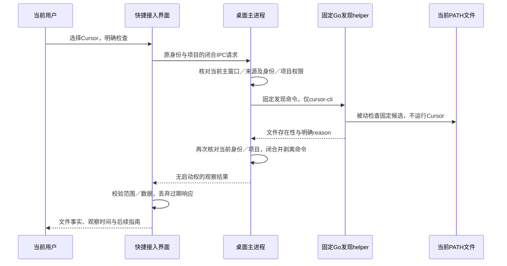

# Cursor 接入核验架构

阶段：`T-CURSOR-CONNECTION-166`；速码 **1.0.0**；2026-10-31。状态：被动连接核验限定完成，**真实执行适配仍为 planned**。本页描述冻结合同与模块边界，不提供测试或可执行能力的验收结论。依据[Cursor接入合同](../../contracts/cursor-connection.md)，交互见[接入说明](../design/cursor-connection.md)。

## 1. 产品路径与当前交付边界

用户从工具工作台的快捷接入选择 Cursor：浏览器显示官方安装／接入指南；具有当前桌面桥的客户端可以明确点击“检查当前电脑”。观察范围仅是**这次桌面进程的当前PATH**，不代表服务器、远程Runner、其他设备、用户全盘或全部安装位置。

Windows的UNC共享及设备命名空间在文件访问前拒绝并标记检查不完整；本机检测不应因PATH出现远程位置而触发隐式共享访问。当前目录、相对路径及链接也不能成为新的扫描授权。

编辑器入口、Agent候选文件和可正式派发的执行资格分别呈现。本阶段只形成文件观察，不安装、登录、运行Cursor候选、读取Cursor配置或调用模型；不登记Runner、不创建执行Profile、任务或执行模板，也不通过高级配置绕过planned状态。不存在新的HTTP业务接口。



“无spawn”针对**Cursor的Agent／编辑器候选**：不能为获得版本或帮助而运行其 `--version`、`--help`、脚本或Node入口。既有桌面发现通道本身可以运行管理员固定的速码Go helper；不能把这一层误写成整个客户端绝无子进程。helper输出也不是Cursor的执行授权。

## 2. 被动文件事实与闭合结果

发现入口复用 `suma-installed-tools-v1`，Cursor固定 `adapter_id=cursor-cli`、`product=Cursor`、`launch_supported=false`，结果不含 `command` 或 `version`。`installed=true`仅表示候选文件存在，不能证明其厂商身份、版本、安装完整性、登录状态、协议或健康。

| reason_code | 文件观察 | 界面应表达 |
|---|---|---|
| `not_installed` | 未发现固定Agent或编辑器入口 | 此次PATH检查未发现，不推断整机未安装 |
| `cursor_editor_only` | 仅发现 `cursor`／`cursor.cmd` 编辑器 | 编辑器不是Agent；无可启动路径 |
| `cursor_agent_unverified` | 原生Agent候选存在 | 显示绝对路径，身份与执行尚未核验 |
| `cursor_launcher_unsupported` | 启动脚本候选存在 | 显示绝对路径，尚不支持平台执行 |
| `cursor_scan_incomplete` | 文件访问失败或观察不完整 | 不能判断为未安装，说明检查不完整 |

只接受规范化绝对PATH目录和固定 `agent`／`cursor-agent` 名称；Windows检查 `.exe/.cmd/.bat/.ps1`，其他系统检查原生名称及脚本候选。相对路径、非正规文件和不可信符号链接不进入候选。多个候选优先未验证原生文件，其次脚本；一个普通文件恰好名为agent并不使其可信。取消、截止时间或检查失败保留失败事实，不能借空数组转成“未安装”。

Cursor输出按reason与字段组合校验：两种候选状态才可带安全绝对路径；其余状态不带路径，所有状态均不带版本与命令。比如一个脚本候选的线协议形状为：

```json
{
  "protocol": "suma-installed-tools-v1",
  "items": [{
    "adapter_id": "cursor-cli",
    "product": "Cursor",
    "installed": true,
    "launch_supported": false,
    "executable": "D:\\tools\\cursor-agent.cmd",
    "reason_code": "cursor_launcher_unsupported"
  }]
}
```

示例路径仅说明DTO，不代表本机已发现此文件，也不构成配置或执行命令。

## 3. 桌面两次当前授权与IPC隔离

沿用桌面 `suma:discover-installed-tools` 通道与现有受信主进程边界。renderer只能提交固定字段的项目、user、tenant、adapter及locale；不得传命令、参数、环境、扫描根、下载地址或工作目录。主进程拒绝非当前主frame、错误sender或偏离固定本地服务origin的调用，并限制同时活动检查与截止时间。

发现**前后各执行一次完整当前授权核对**。既有核对过程使用当前桌面session读取实际auth/session、指定workspace项目，再读auth/session确认身份／组织未漂移；expected-view headers是核对提示，不能代替认证。这两组核对既保护启动检查，也防止检查过程中项目／账号被切换后返回旧事实。

Go helper只接受固定发现模式及adapter，使用当前PATH与进程局部临时目录；不从renderer借用任意环境或供应方密钥。共享发现器中的命令定义在主进程IPC边界剥离，renderer永远没有进程启动权；Cursor合同更严格，本身不产生command或version。闭合报告必须验证协议、数量、adapter／product、reason、布尔值和路径组合，不能把未知字段或其他工具结果透传成Cursor状态。

桌面关闭／销毁、取消和超时沿既有控制器处理。实际停止以子进程close等正式观察为准，不能用发出kill或取消请求宣告已停止。前后授权或结构校验失败只返回明确失败，不回退到较弱的免授权结果。

## 4. 前端状态与防止planned升ready

前端仍对IPC返回独立做闭合校验，不能只因来自preload便信任。只接受一个Cursor结果，固定 `launch_supported=false`，拒绝不合reason的installed／路径组合以及command／version等额外字段。安全路径仅按文字放在渐进技术详情中，不作为链接、shell或执行输入。

每次重查先撤下旧观察，显示正在检查；结果关联此次请求的原账号、组织、项目、adapter及请求代数。上述范围变化、组件卸载或较新检查使旧成功和旧失败都失效。失败／不完整／无桌面桥分别展示，不能把未返回误判为未安装。语言切换只改变说明，原路径、观察事实与执行资格不变。

Cursor是本阶段专用指南分支：没有普通登记／启用／派发按钮，也不能从不存在的库存创建高级模板。能力目录中的planned、固定 `launch_supported=false` 和共享执行门禁共同保持，不由客户端文件存在性升级为ready。当前电脑的发现结果不等于远程执行节点资格；未来仍须从目标Runner取得当前有效证据。

## 5. 已取得的本机材料与参考来源

本机 `Get-Command` 仅发现Cursor编辑器，未据此声称Agent已安装。经管理下载取得官方Windows ZIP `2026.10.22-27dcf5f`：**80,207,693字节**，SHA-256 `864a8f6a22f8c5ebedef8e0ceba529eae9a59b3d7f6fccb75e43e0f5efc3c147`。只静态审阅包目录及5个顶层文件：未发现Agent exe，入口为cmd→ps1→打包Node／index。未执行、安装、登录或调用模型；包摘要不证明CLI协议、账户权限或隔离能力。

参考Multica锁定 `e8ae72c9dfc1b4474b61a9087f51b33cbee6a048`，只参考发现、协议组织与统一接入思路，不复制当前Cursor实现。旧Apache参考提交没有后来新增的Cursor源码，不能将旧许可用于这些新文件；现有历史来源记录不扩大。官方链接由冻结合同集中维护，本页不基于旧搜索摘要承诺“Windows不支持”或猜测安全参数。

## 6. 配置与人工／AI操作SOP

1. 明确当前客户端与项目；浏览器只读指南，桌面点击检查前说明“当前电脑／当前PATH／不运行候选”。
2. 使用已有桌面固定helper配置与当前进程PATH，不修改机器／用户环境、不遍历下载包或任意目录；检查请求不能设置扫描路径。安装或调整PATH由用户在独立流程完成，新进程中的再次检查是新观察。
3. 按reason解释文件事实。只发现编辑器时引导阅读官方CLI指南；发现脚本或原生候选时显示“尚未核验”，不尝试执行来补版本，不建议盲目开放权限。
4. 如当前授权、请求范围或连接变化，丢弃旧结果并明确重新检查；保留原工具登记和未知操作的正式恢复边界，不通过新建Profile绕过限制。
5. 后续执行开发先冻结独立合同、管理员配置和真实验收条件。AI只能提交可审阅方案，不能把下载、文件存在、参数字符串或只读建议输出当成“可开发”。

## 7. 下一阶段写执行的准入条件

| 条件 | 必须取得的事实 |
|---|---|
| 固定入口与依赖 | 明确受审版本、实际入口／Node／index及依赖完整性、固定参数与更新行为；不发明native exe |
| 配置与外部能力隔离 | 全局／项目配置自动发现边界，MCP、hooks、第三方配置导入与网络权限均可控；没有已核实的安全参数前拒绝启用 |
| 真实文件隔离 | 仅本attempt独立工作树可写；共享Git元数据及工作树外读取／写入需专门验证，sandbox声明不能代替事实 |
| 模型与预算 | 请求模型与观测模型身份分开；未上报usage保持unreported，CLI绕过网关时不能虚称平台可硬性控制成本 |
| 协议与终态 | 独立NDJSON解析、session与tool-call配对、实际退出／缺终态／截断的确定语义；原始证据保存，未知不重发新会话 |
| 停止与恢复 | 当前租约／fence、进程树停止、Journal／outbox和原operation核对；不以信号ACK当停止证明，不任意resume |
| 代码与验收 | 实际干净新提交才形成候选，同提交独立测试和人工验收各自完成；退出0或文本结果不能代替这些事实 |

正式执行复用现Go调度器、授权、Profile、隔离工作树、Journal／outbox、fence与候选链路，不引入第二调度器。禁止盲抄 `--yolo`／`--force`、自动批准MCP或用弱只读配置替代真实开发执行验收。完整31项要求、P0–P7、58项限定／34项待办／92项总账保持不变；本页不提供当前阶段质量结论。
