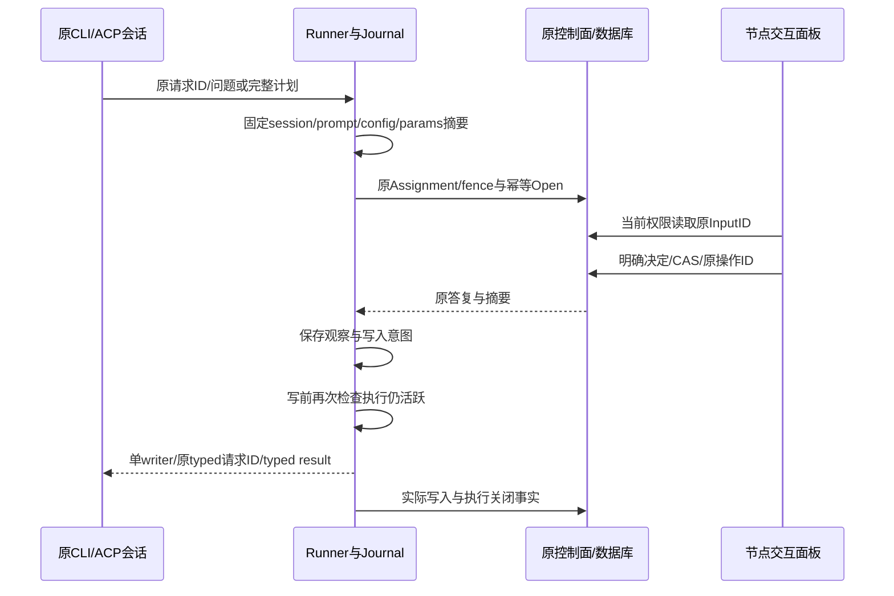

# 原执行交互架构与 AI SOP

状态：限定实现与验证通过；suma1.0.0；T-CURSOR-INPUTS-190。负责人：主集成代理；关联[产品](../product/cursor-inputs.md)、[合同](../../contracts/cursor-inputs.md)、[源码入口](../../internal/toolinputcontract/types.go)和[证据](../quality/cursor-inputs-verification.md)。

复用原工具输入深模块，在协议适配处分开真实Codex与Cursor来源。`cursorcontract`只校验原生问题、计划、typed ID及重建响应；`inputdelivery`只描述有序送达事实；`toolinputcontract`验证独占来源、答案、摘要和投影。控制面管理当前人／机器资格与回执，Runner持原生进程、Journal与单writer。没有第二套审批或派发器。

Cursor参数没有session字段；适配器从真实活SDK会话与原Prompt ID绑定。不得把原生ToolCallID当RPC请求ID，也不得伪造Codex thread／turn／item。参数摘要覆盖校验后的规范化完整payload，保留CR／LF／TAB及原内容；答复摘要绑定该参数摘要与重建原生响应。

`cursor/ask_question`与`cursor/create_plan`不满足SDK的underscore扩展handler规则，因而只在现严格帧入口精确处理这两个方法，核心SDK和原会话不fork。通知、权限和交互请求仍共用当前live ID约束及总量限制；未知方法不扩大能力。

控制面沿原`suma_tool_inputs`、权限共享计数和`suma_operations`回执，无新业务表或HTTP路径。Codex原生持久观察按真实`turn_closed`编码，经明确投影提供通用`execution_closed`；Cursor没有Codex resolved事实。原记录不能因通用JSON解码而丢失真实关闭字段。此为两种当前协议的存储编码，不是历史版本fallback。

答案保存不保证写入，完整写入不保证供应方接受。Close／撤权／预算或lease变化后停止新写；写入意图未知时保留原Journal，只重放原HTTP回执和观察，不重发原生响应。计划拒绝用正常typed result；等待失败停止原进程而不是发送会触发fallback的RPC error。强制结束仍是unknown，不能改成成功。

AI SOP：

1. 先核对当前节点、模型、配置、租约及原typed请求ID，不从日志猜测新的会话。
2. 只有原持久请求可进入面板；计划完整展示，保留参数摘要，不改写或截断后请求接受。
3. 当前用户明确提交，服务端检查版本／资格并保存操作回执；原回执恢复先于新的执行资格判断。
4. Runner持久保存答复、观察与写前意图，最终状态复核后才由原writer写出。
5. 原生完成、停止、交付候选、同提交测试、验收与问题回流分别取证；交互不提升任何质量状态。
6. 新增／直接受影响检查及代表中英交互一次收口；厂商账号、物理多机与生产分别验收。
