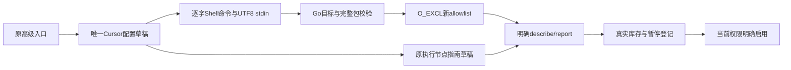

# Cursor 配置与生命周期架构、AI SOP

状态：限定实现与验证通过；suma1.0.0；T-CURSOR-SETUP-191。负责人：主集成代理；关联[合同](../../contracts/cursor-setup.md)、[PRD](../product/cursor-setup.md)及[限定验证](../quality/cursor-setup-verification.md)。

配置采用原Go深模块：目标检查→私有闭合输入→BuildCursorACPCommand→全包摘要／固定参数→DecodeCommands→新allowlist文件。原自动工具准备复用同一受审writer，保持先拒绝已有／危险目标，再进行读取或发现的顺序。没有第二套配置JSON权威、派发器、业务表或HTTP接口。

私有stdin仅含adapter_id、固定Node executable、reviewed_version、model和credential_env_ref。Node／index.js及依赖闭包由本机核对；public profile不暴露路径、argv或密钥。准备阶段不读取凭据值、不执行CLI／SDK、身份登记或控制面请求；共同的语言环境读取不能被误称为读取token。stdout只保留原ToolPreparation文件事实。

生命周期由原Driver单一判断成功RPC与无悬而未决请求，再由Runner核ctx、包／配置以及真实进程控制结果。host_process_exit_code始终是OS事实；host_stopped_after_rpc只表达Cursor准确RPC后已证实的受控停止。业务Result成功与宿主自然退出是两种事实，不能通过抹去Wait／Stop错误来制造成功。

模型目录使用session_cancel_requested／session_cancel_written记录标准cancel通知；不再称session close或native ACK。发现仍需合法目录、零Prompt／配置写／权限／意外活动、真实停止；执行仍需end_turn、准确模型ACK、工具完成、所有原输入已写且关闭以及原候选／质量门。Windows Job全树停止实证与Unix当前Stop返回的约束错误分别处理，后者不能获得成功例外。

AI SOP：

1. 明确当前项目、工具方向和执行节点，选择准确官方包与管理员模型，不从编辑器脚本生成执行资格。
2. 复制完整准备命令到目标机器；保留原OutputEncoding，不能用JSON转义替代Shell引用或持久修改系统环境。
3. Go先拒绝危险／已有目标；失败保留原文件，不以清空、覆盖或替换路径重试掩盖未知结果。
4. 文件成功后明确describe／report，按当前权限／原身份／fresh库存登记暂停配置，再独立启用。
5. 执行中分别查看RPC、输入写入、host真实退出和树停止；无法证明时保留unknown，不重发有副作用请求。
6. 候选、同提交独立测试、验收和问题回流仍沿原链。变更验证只覆盖新增及直接影响，真实账号、规模／安装与生产另验。
