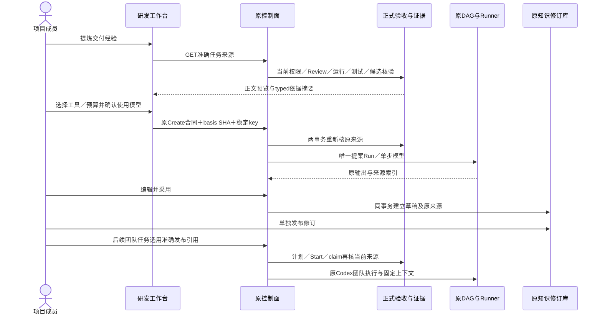

# 已验收交付经验：架构与 AI SOP

T-DELIVERY-KNOWLEDGE-172；速码 suma 1.0.0；2026-10-31。负责人：交付领域／知识领域／工作台／主集成。状态：限定源码、业务合同和代表只读界面已验证。关联[共享合同](../../contracts/delivery-knowledge.md)与[验证记录](../quality/delivery-knowledge-verification.md)，覆盖项目知识、记忆、技能、门禁、团队开发和效率要求；完整31／P0–P7范围继续有效。

## 问题与设计

普通任务来源只有描述与验收条件，不能证明成果已经正式验收，也没有绑定准确测试和代码依据。新增`accepted_delivery`将这些正式事实作为知识来源，沿原提案、草稿、发布及任务上下文复用。成功运行、模型自评和验收申请不被转成正式接受。

控制面是业务权威：同一数据库事务保存来源、原操作和修订；DAG负责唯一派发；Runner沿原专用只读模型Profile执行。HelixHarness的Propose→Apply→Archive和固定证据思想用于这条闭环，不替换现有存储、权限、调度和预算。

## 模块职责

| 模块 | 职责 |
|---|---|
| `delivery_knowledge` | 正式来源、测试／候选事实、规范摘要、只读预览 |
| 既有验收／设计／质量门 | 保持唯一接受规则；共享纯读取函数不产生新授权 |
| `project_knowledge_delivery` | accepted来源独立解析、同事务去重和当前性核验 |
| 既有知识服务／提炼 | 原回执、CAS、模型预算、原输出、草稿采用及单独发布 |
| `knowledge_prompt_projection` | 内部保完整依据，仅给模型必要正文和摘要计数 |
| 工作台 | 当前正式接受入口、明确来源预览、主来源与追加来源分离 |
| 原团队／Codex适配 | 直接消费已存在的发布引用，不重造逐任务选模和调度器 |

## 数据与一致性

复用`ReleaseTaskBasis`绑定任务、版本、运行和Review。Review记录验收前版本，必须满足`Review.task_version + 1 == Task.Version`。测试依据来自持久节点、attempt、fence、worker和结果字节摘要；可选测试计划／报告及代码提交仅按真实记录提供。候选明确区分`workspace_revision`与核实封包后的`sealed_bundle`；纯测试交付允许没有代码候选。

`DeliveryKnowledgeBasis`按稳定身份排序，清空自身SHA后计算Go规范摘要。原来源SHA继续标识完整规范正文，分析和知识修订摘要包含整个typed来源。客户端只提交预览的`basis_sha256`，不能提交自己的交付证明。普通来源不能携带交付依据，也不能被新来源分支误当作`suma_accepted_delivery`表。

源资格检查发生在创建的两次事务、领取、采用、发布和下一次任务消费；旧输出、草稿和修订保留其历史来源。撤权后不得恢复私有操作；来源变化阻止新采用，原操作恢复仍返回原结果。评审者后来退出登录不抹掉当时有效事实。

共享技能目录只检查原发布文本及资格，不把来源项目成员权限、原quote、Review细节或工具能力分享给消费者。知识、记忆和技能仍是审阅数据，不会自动成为插件、脚本或命令授权。

`current=false`只控制本次新增或支持该参数的读取方式；复用的候选、合成和质量门可能保持强读取。不宣称整个调用图无行锁。SQLite定向检查与OceanBase／PostgreSQL实际并发、锁行为分别验收。

## 模型与资源边界

完整依据保存在来源、修订和TaskContext。模型文本仅使用原顺序的正文、标识、版本、来源SHA及`delivery_summary {basis_sha256,test_count,candidate_count}`；不重复所有节点／测试元数据，也不把精简对象的摘要冒充原来源SHA。普通无交付来源路径保持原字节行为。

继续使用原单步知识提炼、最多8192输出tokens、上下文边界和项目预算。新来源没有第二模型接口、后台自动提取或自动重试；导航／刷新只读，采用只建草稿，发布需独立明确操作。大来源明确拒绝，不静默截断完整验收依据。

## AI 开发与排障 SOP

1. 读取当前状态、合同与本模块，确认共享DTO、来源解析和UI所有权；保留原21项工作。
2. 优先复用正式验收、设计、测试计划和候选门。需要纯读取时由原授权包装器委托共享读函数，不构造Actor、不复制一套较弱门禁。
3. 先辨认错误属于当前权限、任务版本、Review、运行、测试、候选还是知识发布引用，再核对应原摘要；不要用任务状态或模型文本补证据。
4. 回执未知时保持原body／key。来源漂移只改变新操作资格；保留已发生输出，不重复模型或删除历史。
5. Source、ContextSource、SourceInput转换、目录共享、生成Schema及中英文验证一起维护。特别检查所有“当前来源”路径，accepted来源使用专门GET，不拼普通Record路由。
6. 仅运行新增与受影响检查。界面采用一次隔离构建、真实授权只读HTTP和代表视口，未变化的模型／Runner旅程复用原证据。
7. 交付时记录源码、受控结果、真实界面和实际厂商覆盖范围。正常提交／推送dev；缓存、凭据、数据库、截图和临时驱动不进Git。

## 参考与完整范围

HelixHarness固定提交`44ffc536f73d8af525b4795ad10384c516898576`，本阶段借鉴流程和证据思想，没有复制其启动器／Python存储／process pool。官方原代码Apache2及NOTICE与改编材料许可分别记录；不搬沙箱／审批旁路，不将hooks启用、mock实验或本机进程池当作分布式门禁。

Multica固定参考`e8ae72c9dfc1b4474b61a9087f51b33cbee6a048`，其附加许可边界保持。完整Codex账号／插件宿主信任／持续会话、多机器执行、技能优化评测、跨设备同步、全部数据库／部署及平台目标继续实施，不能以这条经验闭环代替全功能完成。

来源：[HelixHarness固定源码](https://github.com/didi/helixharness/tree/44ffc536f73d8af525b4795ad10384c516898576)、[Multica](https://github.com/multica-ai/multica)。
