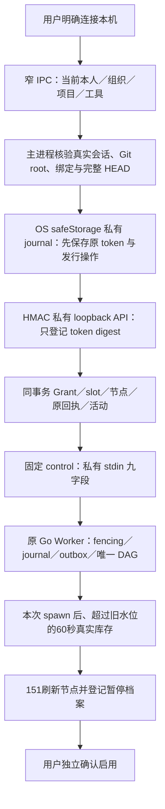

# 桌面托管 Runner 架构

T-MULTICA-DESKTOP-153。复用现有 Electron 主进程、Go control 二进制、当前授权事务及正式 Worker；桌面只管理本机生命周期，不增加调度器、授权源或运行账本。准确字段见[合同](../../contracts/desktop-managed-runner.md)。

## 三个接缝

**页面到主进程。** `DesktopToolConnector`按原 API view、本人、组织、项目和 adapter 隔离结果，丢弃迟到响应；只呈现安全连接事实。`managed-local-runner.cjs`核验准确窗口／frame／origin，使用父窗口真实 Session；身份标识不是凭据。`status`不发行或启动；未知结果保留原记录。连接回调按确认状态转换去重，同一节点停止后重连也会重新读取库存。

**主进程到控制面。** `managed-local-runner-journal.cjs`用 OS 加密、独占锁及原请求摘要保持稳定凭据与操作。Linux 无安全后端时失败，不退回明文。`desktop_runner.go`与`desktop_runner_http.go`仅开放机器 HMAC 保护的 loopback 浏览器管理路径，且要求 SQLite 和当前项目管理权限；私有 context 才返回路径。新发行比较当前实例、绑定及完整 HEAD，再同事务登记摘要；回执恢复先检查当前管理资格，不重做历史发行。

**主进程到 Worker。** 固定打包 control 进入 `--desktop-managed-runner` 分支，在业务服务初始化前解析16KiB以内的准确九字段私有 stdin。`internal/runner/desktop_managed.go`重新核验仓库和工具，以原 `Worker.Run` 启动；token 不在参数、继承环境或页面结果中。节点的真实执行、租约／fence、取消及结果重放继续由原 Runner 和 DAG 负责。

## 活性与恢复

启动前记录旧库存水位；只有本次 spawn 后接收的新报告、仍在原60秒期限内且准确匹配工具固定 Profile，才成立 `connected`。启动成功返回或旧 journal 状态不能替代该事实。重启读取旧 `starting/connected` 记录会降为可明确恢复的准备状态，不自动拉起旧 Worker。

主进程每15秒核对真实会话、当前绑定和节点资格；失权、目录身份或完整 HEAD 变化走停止路径。正常停止通过关闭私有 stdin 通知 Go 上下文；强停、超时或未获清理确认保留 `stop_unconfirmed`，不据此判断业务任务结论。退出按原记录完成有界清理，保留 journal／outbox 供核对。

原独立 Grant 有效期24小时。历史发行回执与当前授权有效性分开：到期回执可保存历史，但不能启动或续期；不自动替换 token。完整续权、不可恢复节点处置与远程 SaaS 接入仍待交付。

## 稳定地址与来源

`local-service-port.cjs`默认使用4319，允许进程局部 `SUMA_DESKTOP_PORT` 明确指定1024–65535；占用即失败。journal 固定原 origin 和实例身份，换地址不能复用原记录；不随机选新端口掩盖地址变化。

Multica仅作为生命周期、发现分层和恢复交互参考。最新核对 pin 为 `890628511e423864d21c694231277805ce9f113c`，参考工作树保留 `4157f5b26e3acbbd53ae5abbb659c579dc7320eb`；五个关键参考源及 LICENSE blob 一致。新增复制产品源码为0，沿用 Suma 现有成熟依赖；来源边界见[复用记录](../integrations/multica-reuse.md)。

Windows软件离屏 Electron35.7.5已实际贯通 DPAPI、生产IPC、摘要发行、正式 Go Worker、启动后新鲜库存、暂停／启用、正常停止／重开及退出登录停止。始终只有一个节点和一个发行操作，五次注册传输保持原正文／摘要／操作，五个正式子进程均观察到 exit0／close；业务任务、运行及模型调用均为0。来源与17项实际检查见[验证记录](../quality/desktop-managed-runner-verification.md)。

首次 GUI 暴露页面只接受整秒而 Go 已报告小数秒的跨层缺陷。最终 Web 采用严格UTC 0–9位小数、Gregorian日期回校及纳秒整数期限比较；仅替换解析器相关两文件重建Web，沿同一节点／journal续验，Go及原生二进制未重编。原失败与两个运行源码摘要分别保留，不把后续文档更新回写为历史编译输入。

合成探测不证明真实供应方；系统目录对话框固定返回自有 Git root，只实际验证生产签名与绑定。强制崩溃恢复、macOS／Linux系统存储、安装包、多主机、规模及生产验收仍待办。
