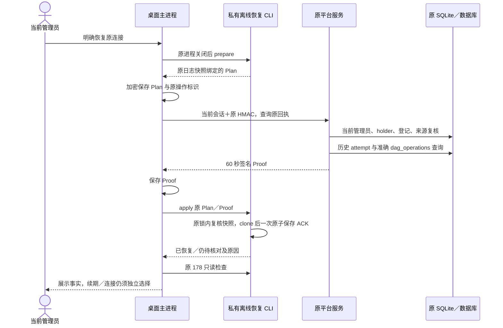

# 原结果回执恢复架构

T-DESKTOP-RESULT-RECOVERY-179；suma 1.0.0。以[冻结合同](../../contracts/desktop-result-recovery.md)为准，配套[产品流程](../product/desktop-result-recovery.md)与[交互设计](../design/desktop-result-recovery.md)。本文说明实现边界，不替代桌面／CLI 整链验收证据。

原 Runner、DAG 和凭据授权链保持单一。恢复复用当前浏览器管理员、桌面 HMAC、原登记与工作区来源，只读核对已经提交的结果，再在本机补齐 ACK。不增加 Actor、凭据、票据表、调度器或机器授权到期例外。

## 共享边界与身份

[共享包](../../internal/desktoprecoverycontract/contract.go)定义 `Scope`、`Plan`、`Proof` 和恢复 `Result`。每批最多 32 项，私有输入最多 256KiB。`fence` 使用规范的正十进制 int64 字符串，避免 JavaScript 精度变化。renderer 不接收这些私有对象。

[平台端点](../../internal/platform/desktop_result_recovery.go)为私有 `POST /desktop-runners/recovery/receipts`，闭合请求是 `{scope,recovery_operation_id,plan}`，HTTP 200 返回 `Proof`。[原 HTTP 接线](../../internal/platform/desktop_runner_http.go)保留 loopback、当前浏览器与单值 HMAC 头校验，并直接严格解析原始 JSON；原私有接口的 8KiB 限制不变。

授权先于历史查询。当前管理员、原 holder、原登记回执、当前 Worker 的原凭据摘要、instance、binding 和 base 都要匹配。HMAC action 为 `recovery-receipts`，签名依次绑定 Scope 的十个字段、恢复操作标识、Go `PlanSHA256(plan)`、nonce 和期限。旧 token 不参与授权，过期后仍不能 Claim、提交或发送心跳。

回执准确键为 tenant／project／`result:<run_id>`／operation_id；另核历史 node／attempt／worker／fence，允许当前 head 已推进。查询区分 `matched`、`missing`、`mismatch`、`source_changed`。服务端不调用 Complete，不提交业务或审计变更；原授权协调锁在事务退出时回滚。

## 本地原子确认

[离线恢复实现](../../internal/runner/desktop_result_recovery.go)通过 `prepare/apply/status` 处理已有主日志。`body_sha256` 绑定本机原 Callback；`result_sha256` 由共享 `ServerResultSHA` 复现原 `dag.Result` 指纹。完整快照保留 `json.Number`，只将计划目标的 `acked` 规范化为 false。

Proof 绑定原 Scope、计划摘要和逐项状态，使用工作区私钥及独立 domain 签名；期限为数据库授权检查时间起 60 秒。它仅证明提交事实，不授执行权。apply 在原锁内重核完整快照、正文、身份和未过期签名，clone 后一次保存，只允许准确匹配项 `acked:false→true`，不调用 OpenJournal 或循环 Ack。原计划可识别 ACK 写入后的响应丢失；其他变化必须阻止应用。

缺失回执不产生新写入；sidecar 不变，`unknown` 不升级为成功，178 排空检查继续有效。实际验证应分别记录平台事实查询、本机原子写入和代表界面，不能由其中一层推定完整平台或厂商执行已验收。
