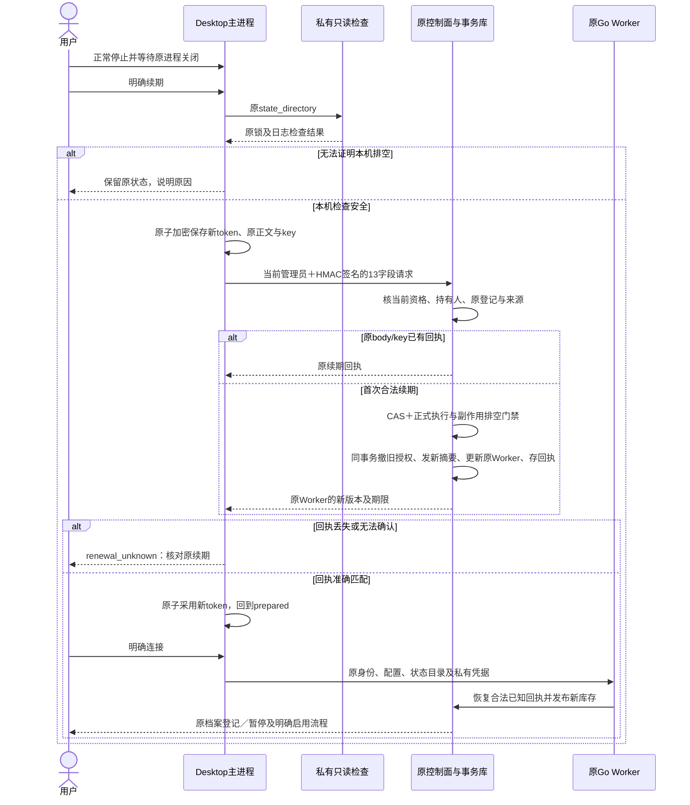

# 本机凭据续期架构与 AI SOP

T-DESKTOP-CREDENTIAL-178；suma 1.0.0；2026-11-01。状态：源码、定向、真实私有CLI与代表合成组件验证通过，完整桌面与生产待验。负责人：主集成代理；关联[合同](../../contracts/desktop-runner-renewal.md)、[产品流程](../product/desktop-runner-renewal.md)和[交互设计](../design/desktop-runner-renewal.md)。本页描述实现与操作约束，不声明本阶段真实集成或生产验收通过。

## 原身份上的原子续期

复用原 Desktop 主进程、加密 journal、当前浏览器管理员、HMAC 来源证明和 Go Worker。没有新的派发器或任务恢复通道。关键实现为 [Desktop 续期辅助模块](../../apps/desktop/src/managed-local-runner-renewal.cjs)、[原托管生命周期](../../apps/desktop/src/managed-local-runner.cjs)、[控制面续期事务](../../internal/platform/desktop_runner_renewal.go)和[Runner 只读检查](../../internal/runner/desktop_renewal_check.go)。



## 请求、事务和回执

`POST /desktop-runners/renew` 只接受合同的 13 个字段：

```text
project_id, user_id, tenant_id, worker_id, adapter_id,
instance_id, expected_binding_sha256, base_commit,
registration_operation_id, expected_worker_version,
previous_credential_sha256, credential_sha256, idempotency_key
```

原登记 key 为 `desktop-runner-<32hex>`；续期 key 为 `desktop-runner-renew-<32hex>`。secret 由主进程产生并先原子加密保存，HTTP 只发送摘要；renderer、命令行参数和公开回执不携带 secret。配置和原登记请求持续保留。

控制面先核当前管理员资格、原 HMAC 来源与登记持有人，再恢复同正文／key 的历史回执。首次操作才核旧摘要、预期版本、未撤销的 authority／slot／grant／来源、当前工作区及排空事实，按原组织授权先于调度器的锁顺序进入事务。新事务保留 Worker 的 ID、worker_id、profiles、deployment 和 created_at，CAS 更新版本与 24 小时期限，同时撤销旧 authority／slot、发行新摘要并保存回执。任一失败整笔回滚；过期可以续期，撤销不能借续期复活。

本机已关闭不能替代服务端门禁。服务端核原 Worker 的 running／reconciling、云执行等待与未结观察、仍有效执行／副作用资源、制品与候选传输、工作区操作及授权票据。历史已封存或终结记录与当前未结事实分开处理；租约过期不能清空旧 fence 或推断副作用完成。

## 私有只读检查

主进程调用 `--desktop-runner-renewal-check-stdin`，输入只有 `{state_directory}`；路径由主进程构造。输出固定为 `suma-desktop-runner-renewal-check-v1`、`safe` 和最多六个去重原因。`safe=true` 必须对应空原因数组。

| 原因 | 含义 |
| --- | --- |
| `active_worker` | 原执行锁被占用 |
| `pending_execution` | 原 inbox 或执行尚未收口 |
| `pending_receipt` | 领取、库存、进度、制品或权限等回执未完成 |
| `unknown_outcome` | 结果、写入或观察仍未知 |
| `invalid_state` | 日志损坏、未知文件或结构不一致 |
| `unreadable_state` | 来源、文件身份或读取无法核实 |

检查以原 `journal.lock` 为协调点，整个读取期间持锁；不用会创建文件并转换重启结果的 `OpenJournal`。Windows 使用 `OPEN_EXISTING`、只读访问及 `FILE_SHARE_READ`，允许检查自身的元数据读取，同时拒绝原 Worker 所需写访问；原 Worker 的独占共享模式也可能使 `Lstat` 返回 sharing violation，按活动锁处理。其他读取错误归不可核实。Unix 使用只读打开和非阻塞 `flock`；跨平台实际证据须另列。

检查锚定目录和文件身份，读取有界、闭合的主日志及 claim、inventory、工作区读写等 sidecar，核权限观察、云／发布、制品／候选、模型和终端未结事实。未知文件、非托管 pool 状态或缺少原锁的非空目录保守拒绝；从未创建执行的缺失／空目录可以安全返回。检查不删除、改写、创建日志，不访问数据库、SDK 或模型，也不把 unknown 当作 done。

## AI 开发与运维 SOP

1. 先核当前身份、项目、工具、工作区绑定和原操作，不从新草稿重建 Worker。
2. 正常停止并等待实际关闭；停止未确认时保留状态，不凭历史 PID 宣称排空。
3. 运行原私有只读检查；进程未确认退出、输出不闭合、不可读或 `safe=false` 都阻止续期。
4. 先加密保存新 token 与原正文／key，再发送 HMAC 请求。结果未知只恢复原请求，禁止换 key 或重复发行。
5. 对已知拒绝显示闭合原因，完成原执行／权限／来源核对后继续；不要清日志、改 fence 或跳过撤销状态。
6. 精确回执确认后只回到 `prepared`。明确连接、新库存、档案登记／启用、任务执行与质量验收分别留证。

本片服务于已排空的空闲 Worker。旧凭据过期且仍有旧 token 绑定副作用时，专用恢复票据尚未实现；不能借新凭据重发旧 Prompt 或绕过该边界。完整 31 项／P0–P7 范围继续交付。
