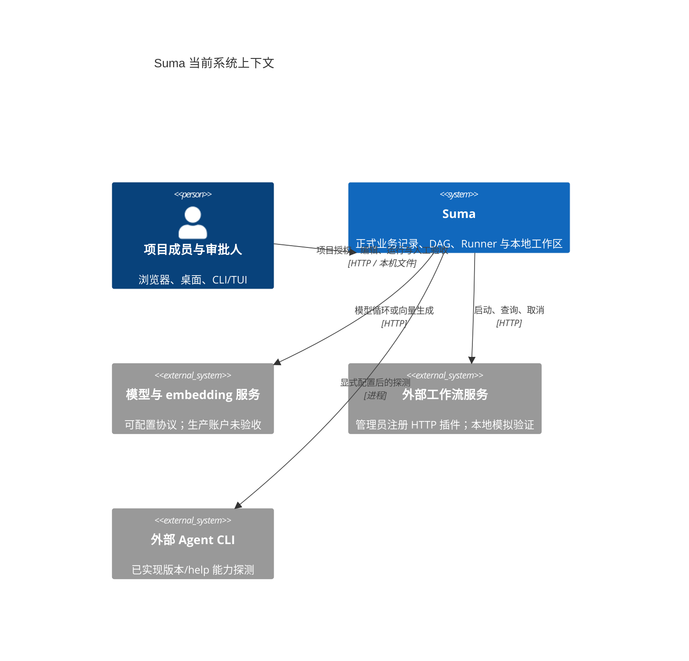
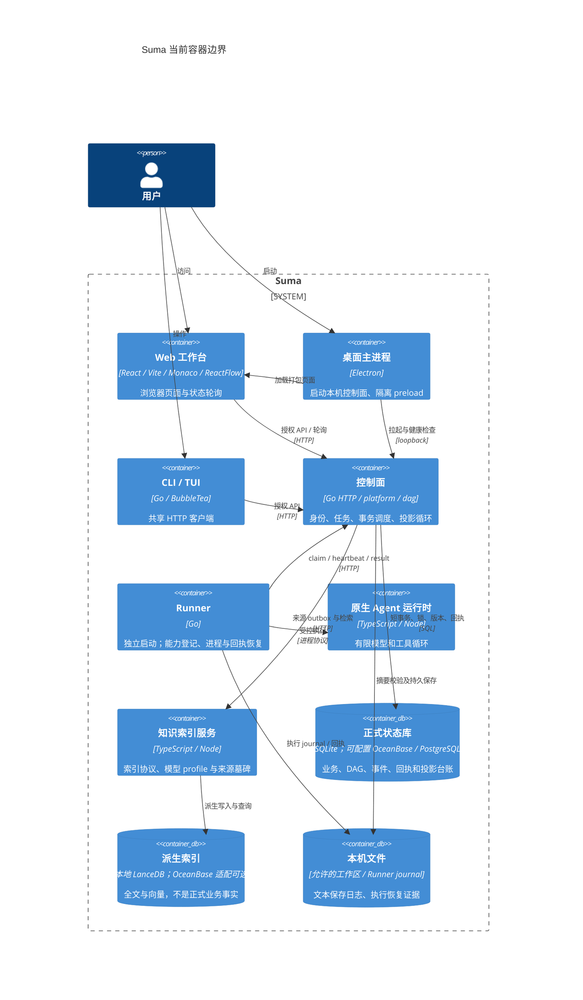
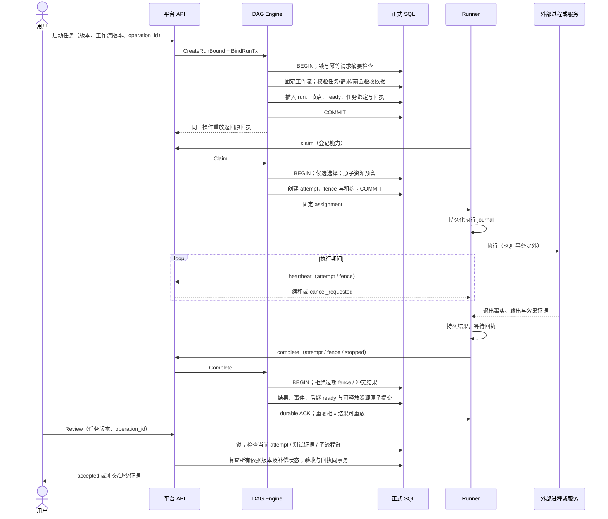
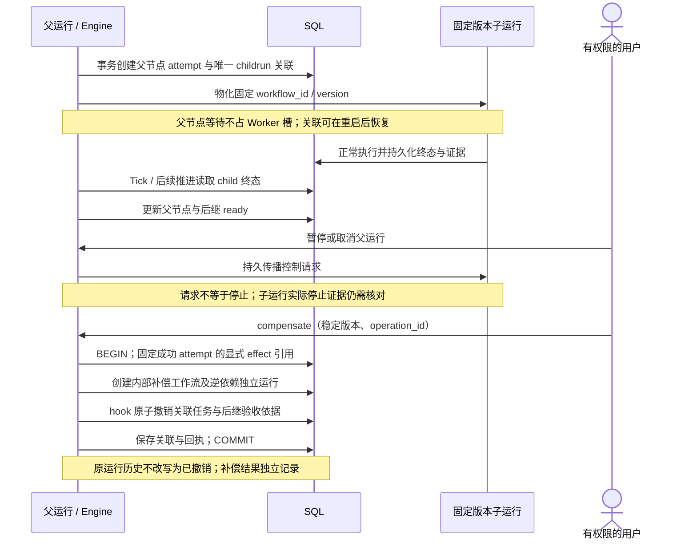
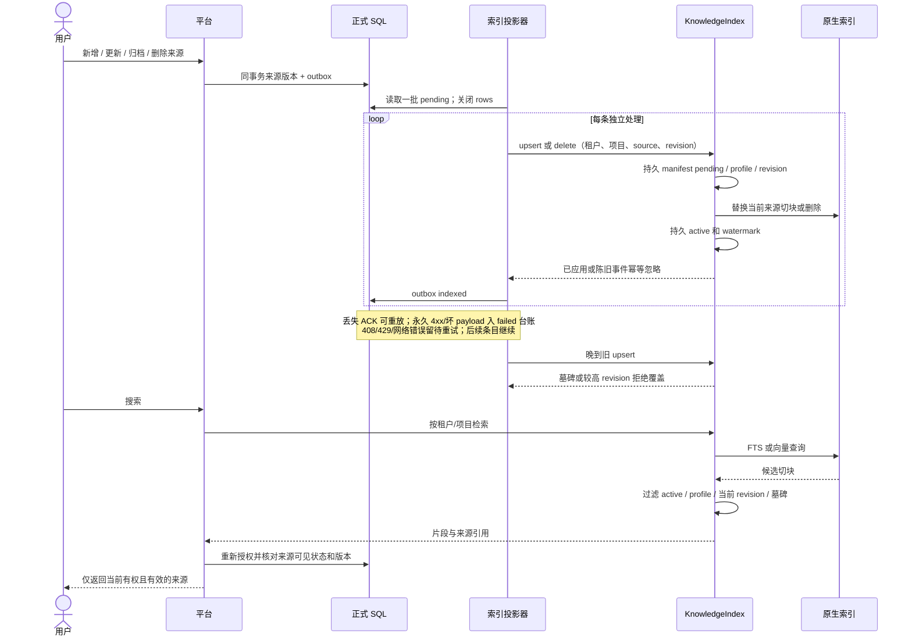
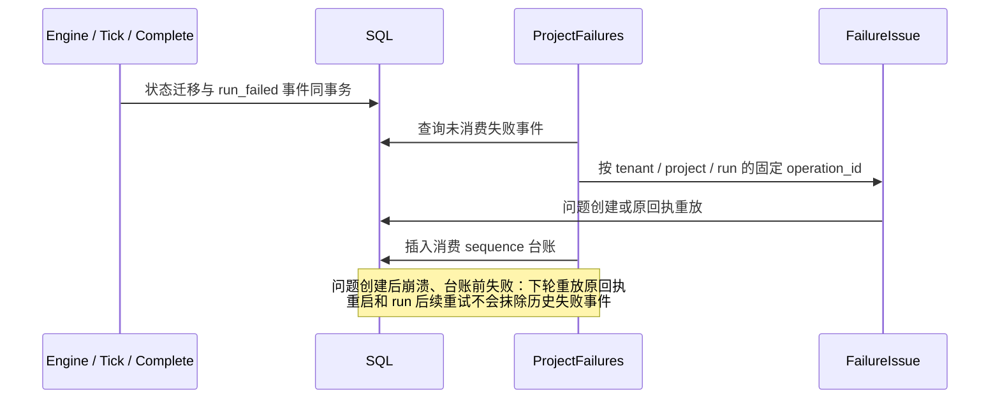

# 架构与事务时序

状态：当前源码边界图，非完整目标平台的部署验收。日期：2026-10-23。Owner：架构与执行引擎负责人。

关联：[P0–P7 计划](../delivery/implementation-plan.md)、[能力矩阵](../product/capability-matrix.md)、[验证报告](../quality/verification.md)。图中的外部服务均需要配置；显示连接不表示真实账户或生产集群已验收。Yjs、LiveKit、S3、支付与通用办公仍在目标范围，未画成已运行组件。

## C4：系统上下文

依据：[平台入口](../../internal/platform/http.go)、[Runner 外部协议](../../internal/runner/external.go)、[Agent 目录](../../packages/agent-runtime/src/catalog.ts)。

## C4：容器与持久边界

SQLite 是实际本地验证环境。OceanBase/PostgreSQL 的驱动与适配路径存在，真实集群尚未验收。桌面不会自动启动 Runner 或知识服务；它们需要按[运行手册](../operations/runbook.md)配置。全局 SQL 调度锁是当前一致性策略和吞吐限制，不能据此声称已实现分片高容量调度。

## 任务绑定、执行与人工验收

未知结果进入 reconciling，不自动推断失败、停止或安全重试。只有停止事实成立才能释放对应执行资源。SQL 回执只能保证状态提交和重复命令处理；它不能让任意外部副作用自动获得 exactly-once 语义。

依据：[任务绑定](../../internal/platform/delivery.go)、[验收](../../internal/platform/evidence.go)、[调度](../../internal/dag/scheduler.go)、[Runner journal](../../internal/runner/journal.go)。验证：[安全回归](../../internal/platform/security_evidence_test.go)、[引擎回归](../../internal/dag/engine_test.go)。

## 子流程与显式补偿

补偿只执行显式配置的受控动作。未配置的副作用没有自动撤销能力；内部补偿图禁止公共启动、覆盖发布或作为普通子流程引用。依据：[子流程](../../internal/dag/subworkflows.go)、[补偿](../../internal/dag/compensation.go)、[事务 hook](../../internal/dag/commands.go)；验证：[子流程测试](../../internal/dag/subworkflow_test.go)、[补偿测试](../../internal/dag/compensation_test.go)。

## 来源、索引与删除墓碑

索引网络调用不占用 SQL 写事务。归档/删除的文档产生 delete 事件，关键词回退同时过滤这些来源。索引 manifest 与数据之间通过 pending/active 防止暴露中间态；未完成写入依靠 outbox 重放，当前方案并非跨存储分布式事务。

依据：[projector.go](../../internal/platform/projector.go)、[search.go](../../internal/platform/search.go)、[KnowledgeIndex](../../packages/knowledge/src/index.ts)。验证：[投影测试](../../internal/platform/projection_test.go)、[原生索引测试](../../packages/knowledge/tests/index.test.ts)。

## 失败事件恢复

投影表在 [Service.Migrate](../../internal/platform/database.go) 通过 [MigrateProjections](../../internal/platform/projection_schema.go) 安装；两个运行循环只执行数据操作。验证：[失败投影测试](../../internal/platform/failure_projection_test.go)。

## 图表验收边界

本页对照源码和本地测试编写，Mermaid 为可维护源码。文档链接检查不代表图形渲染、部署拓扑、外部账户或容量验收；最终交付需在使用方文档渲染器中确认显示，并按能力矩阵补齐未验收项。
