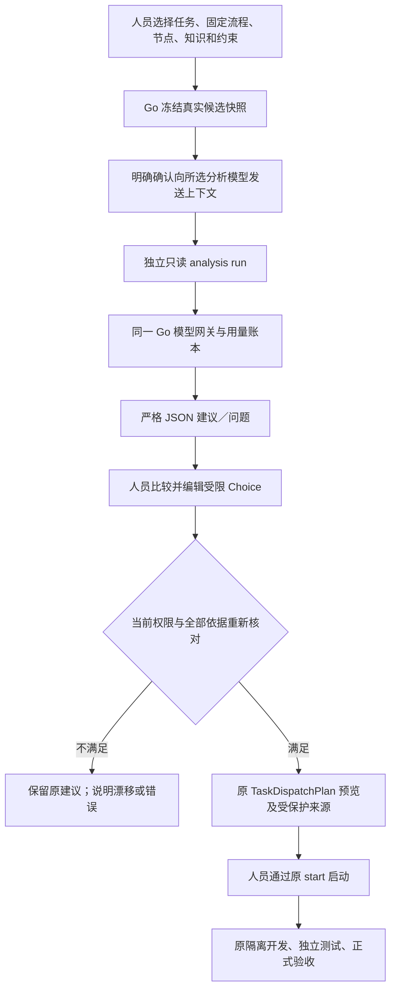

# 智能派发推荐：设计、SPEC 与操作规程

状态：T-ROUTING-122 实施中，产品版本 1.0.0。更新：2026-10-29。负责人：控制面、模型网关、Runner、工作台。关联实现：`internal/platform/dispatch_recommendation*`、`internal/dispatchrecommendationcontract/`、`internal/toolcontract/dispatch_recommendation.go`；共同执行权威见[统一模型网关](model-gateway.md)。本文记录当前设计及边界，不作为测试通过或供应商验收声明。

## 1. 交付目标与术语

针对一个真实任务及人员已选定的流程版本、智能体开发节点，比较当前可执行的工具和模型组合。模型生成有依据的建议；人员可以修改受限选型，再明确生成原有 `TaskDispatchPlan` 预览，最后通过原启动入口执行。

| 中文 | 代码／英文 | 含义 |
| --- | --- | --- |
| 候选快照 | `DispatchRecommendationSource` / candidate snapshot | 当前任务上下文、流程、路由、真实库存及预算约束的固定依据 |
| 执行候选 | `DispatchRecommendationCandidate` / candidate | 一个已获准工具与一个模型或固定配置的组合，使用服务端摘要标识 |
| 只读分析 | `DispatchRecommendation` / analysis | 独立的一次模型运行，不占用目标任务的开发运行身份 |
| 受限选择 | `DispatchRecommendationChoice` / choice | 候选 ID、对应类型可编辑参数和理由，无命令、供应商 URL、密钥或任意环境字段 |
| 明确采用 | adoption | 有当前写权限的浏览器用户生成原派发预览，保留模型原文及人工修改依据 |
| 原执行入口 | original dispatch/start | 复用既有唯一 Go DAG、Runner、预算、测试与验收，不新增派发器 |

固定一个流程／开发节点是当前范围。推荐不自动拆解需求、选择其他流程、改流程模板、启用工具、创建工作区、启动开发或批准质量验收。

## 2. 纵向流程与权威



平台是候选、权限、配置、预算及派发权威。模型只能返回固定候选的选择、理由和待确认问题。模型没有工作区工具、CLI、MCP 写工具、派发权限或供应商配置权限。

只读分析使用独立 capability：`suma-dispatch-recommendation-v1`。分析工具必须是启用的原生 Suma 只读档案，声明 `suma-model-execution-v1`，无工作区能力、测试／修复能力或其他智能用途。模型、部署修订、参数、费率与预算来自唯一 `ModelSelection → ModelBinding`，供应商密钥仍由 Go 持有。

## 3. 候选来源与 SPEC

候选构造读取真实任务、关联需求、受保护设计／代码基线、人员明确选择的已发布知识，以及准确流程版本和开发节点。工具必须符合当前私有节点或 Pool 路由、当前授权、固定档案和有效库存；仅声明工具名称或注册过节点不等于当前可用。

| `kind` | 实际来源 | 可编辑内容 | 计费／预算表达 |
| --- | --- | --- | --- |
| `model` | 原生或 Octop 当前真实 `ModelDeployment`、修订、摘要、上下文窗口及匹配费率 | `max_steps`、总 `max_output_tokens` | 统一 Go 网关准入；报价可为 `quoted` 或 `unpriced` |
| `codex` | 当前 Codex `model/list` 目录及配置摘要 | 目录实际支持的 `reasoning_effort` | `observe_only`，配置确认不等于供应商计费身份 |
| `fixed` | 当前受支持工具的固定配置；OpenCode 保留其固定模型事实 | 无独立模型参数 | 未证明独立可控预算时为 `observe_only`／成本未知 |

合法的 Codex 空推理选项表示官方默认值，使用显式空字符串选择；它不能被替换成虚构的努力等级。所有候选的历史性能均保持 `unknown`，不根据名称、列表顺序或上下文窗口生成速度／质量分数。

当前最多检查 32 个工具档案、提供 24 个工具／模型候选，跨档案轮转收集，避免一个工具的大目录占满范围。`coverage` 返回检查数、候选数、排除数、上限及完整性；`bounded_candidates` 明确表示受限范围，不代表已比较全项目所有工具。模型必须分析这组候选，原列表中的“第一个可用项”不被包装为智能推荐。

快照摘要包含任务／需求／设计／知识、流程、路由、工具与模型版本、目录／固定配置、费率、约束和覆盖内容。组织／项目预算政策只暴露摘要，不向模型或 UI 展开组织配额。相同内容的周期库存续报不改变语义摘要；每次准入仍重新验证库存时效及资格。

完整流程快照保存供 Go 重核。模型输入仅投影流程 ID／版本、节点 ID／类型／依赖和边的端点，不发送原始命令、配置、条件或管理员工作流名称。任务与知识正文作为授权后的数据发送，不能覆盖系统用途。平台提示正文上限为 64,000 UTF-8 字节，超过时明确拒绝，不静默截断用户正文。

### 选择与输出约束

`recommendations` 为 1–3 项不同候选，`questions` 最多 5 项。每个 Choice 都显式携带以下五个字段：

```text
candidate_id, max_steps, max_output_tokens, reasoning_effort, reason
```

三个参数允许显式 `null`，但不能省略或使用大小写别名。`model` 必须有整数 steps／output、推理努力为 null；`codex` 必须 steps／output 为 null、推理努力属于固定目录；`fixed` 三项参数全部为 null。预算始终来自快照，不接受模型新增预算字段。输出最多 32,768 UTF-8 字节；额外键、重复键、外来候选、结构化评分／命令字段和不符合闭合 Schema 的结果均拒绝。

目标执行参数上限为 128 次模型请求、累计输出 131,072 tokens，另受当前用户约束与预算限制；默认候选在可行范围内采用最多 8 次／4,096 输出额度。采用时重新用原 `ModelBinding` 规则验证，不能只检查表单上下限。

## 4. 分析预算、生命周期与恢复

分析本身仅允许一次模型请求，默认输出 4,096，最多 8,192 tokens；它有独立的真实模型选择和预算，复用 Go 网关、原 attempt／fence、预留、逐次回执、用量及结算。开发选择预算与分析调用预算分别固定，不能把推荐过程描述为免费或混入目标任务的消耗。

任一显式执行 `Budget`、`require_hard_budget` 或组织／项目强制政策都会排除观察模式候选。只有 token 约束时可以存在未定价原生模型；成本上限必须有匹配币种与费率。费率是配置报价，平台许可及预留不是供应商账单最终硬上限；未知用量不能按零释放 hold。

| 状态 | 事实与允许操作 |
| --- | --- |
| `running` | 原独立分析已登记，尚无可采用建议 |
| `reconciling` | 原执行结果未知；保留原运行和费用事实供核对，不盲发新请求 |
| `failed` | 进程、严格输出或当前依据不满足；不生成开发计划 |
| `ready` | 原建议有效；只有当前有权人员且依据仍有效时显示采用入口 |
| `adopted` | 已唯一生成原派发预览，保存人工选择和 Plan ID；仍需原 start |

建议采用有效期为 15 分钟，原派发计划沿用其独立的 30 分钟预览期限。`MaxRetries=0`，同一分析禁止通过原 DAG 人工重派变成第二次模型请求。稳定操作 ID 恢复原分析／原计划，不重复调用模型或生成第二份计划。

原 still-live attempt 的未知观察与迟到已知结果分别保存原JSON、摘要和时间；同一请求的完成核对不再派发模型，重复事实幂等，已有closed网关事实不能被改写。来源漂移由结果投影转为failed并保留已发生用量，当前创建者／工具／路由权限不足仍阻止自动完成核对。

失联、取消、SDK／模型错误、结果未知和账务覆盖分别记录。源或创建者资格在实际调用后发生变化时，保留原输出、过程和已消耗用量，投影失败／待核对；不能为了拒绝采用而抹去已发生费用。恢复只核对原操作，不能从未知推断供应商未执行。

原未知 attempt 仍有有效租约、未停止且当前凭据／工具／路由权限有效时，允许同一只读原操作的迟到完成回执核对。它必须维持同一绑定、已记录请求摘要、额度及已知用量事实；已经关闭的 Go 模型事实不能被替换。未知观察与完成结果按各自摘要和时间独立保存，重复完成回执不新增事实或费用。Source 版本变化不会抹掉已接收的完成／用量，而会使建议失败并阻止采用；其他 attempt、不同原请求、过期或停止的执行不走此自动路径。未知部分正文不被展示为已完成的模型原文。

## 5. 权限、隐私与采用一致性

创建与采用要求当前浏览器项目写权限；采用只是原 preview，不额外变成质量审批。GET 详情／历史可由当前项目读权限访问，API 只读；Runner、Agent 和模型不充当人工选择者。

历史响应在 freshness 比较前，独立按当前读取身份验证原任务／需求／设计与知识的项目归属，以及准确知识修订和原件。任务版本冲突不能跳过其他资产授权。当前有权人员可以读取合法旧修订；本地采用依据更新、退役或直接来源版本变化阻止新采用，但不能自动伪装为授权撤销。跨项目共享知识采用后形成的独立本地已发布副本，沿原知识领域的正式权限语义管理，不因原目录退出共享而自动撤销本地发布。

原创建者在执行准入时使用保存的真实凭据重新核对 source／family／expiry 和当前目标项目权限。限定项目的 proof 工厂只在已取得该租户治理锁的 Runner／Pool 事务内使用，不扩大到创建者其他组织，不从用户 ID 合成身份。库存、路由、知识及原依据继续在同一事务中重核。

采用先验证当前权限，再恢复原操作回执；新操作需要准确版本、Source SHA、受限 Choice 和理由。成功采用在同一事务内调用原派发快照构造／持久化，写入 `TaskDispatchPlan.Recommendation`，保存原建议版本、Source／Output／Choice 摘要、采用人和理由，并把分析标为 `adopted`。公开预览输入不接受这份来源证明。原 start 再验证受保护采用关系及正常派发条件。

## 6. 人员与 AI 操作规程

1. 先确认真实任务、需求和验收范围，选择已有流程版本及开发节点；审阅知识选择和硬预算要求。
2. 获取候选快照，检查当前路由、库存、模型配置、成本未知项及覆盖截断。没有合格候选时修正实际配置，不使用虚构工具占位。
3. 选择单次分析模型与预算，明确确认发送上下文，保留原 operation ID。运行期间通过原 run 查看事实，不派发目标开发任务。
4. 对照候选检查建议与待确认问题。人工编辑只能在原快照内换候选、修改其受限参数并说明理由，不能写入 CLI、URL、环境或新预算。
5. 明确采用，审阅返回的原 Plan、上下文、报价及来源。若依据变化，保留草稿并重新取得当前快照；不要自动消费旧建议。
6. 人员通过原 start 开发，后续仍由既有隔离工作区、独立测试及正式验收完成。看到建议或准备好 Plan 不能标记任务已执行／已验收。
7. 网络失败先用同一操作恢复原结果；未知执行进入核对，保留费用与日志。不得更换操作 ID 盲重试原分析来规避未知状态。

## 7. 当前边界与验证归属

本阶段不提供历史性能自动排名、供应商账单担保、任意 CLI 参数生成、新工作流自动发布或无人确认的开发启动。候选是否实际可调用仍依赖当前机器配置、账号和服务；目录／离线探测不能证明供应商健康或所有厂商实例均通过。

Go／Schema／原生 SDK／真实 HTTP 网关／界面旅程的执行结果由阶段质量报告分别记录。协议夹具、实际进程、供应商实例和人工生产验收必须区分，不以本文或代码存在替代运行证据。
