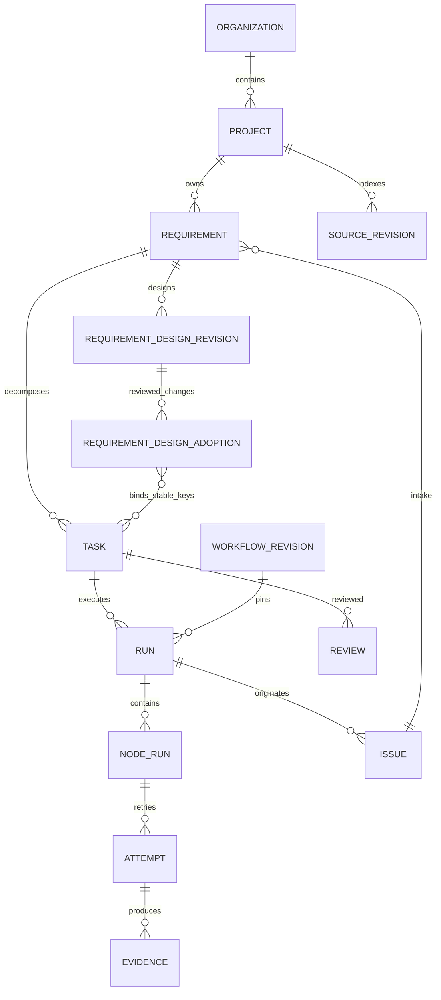

# 领域模型与一致性

状态：实现合同。JSON 使用 snake_case；时间为 UTC RFC3339，版本为正整数。

| 领域 | 权威实体 | 版本/约束 |
|---|---|---|
| 身份 | Organization、User、OrgMember、ProjectMember、Session/Token | 组织身份与资源目录分离；撤权影响后续请求 |
| 规划 | Project、Requirement、Task、Member、Milestone、Sprint | 任务关联需求及验收条目；依赖属于同一项目并且无环 |
| 执行 | WorkflowRevision、Run、NodeRun、Attempt、EdgeResolution | 发布版本不可变；重试增加 attempt，旧 fence 无权覆盖 |
| 质量 | Test、Evidence、Review | 手工登记不是执行器测试；审查绑定当前任务、需求和运行 |
| 发布 | Release、Environment、Deployment | 登记版本与真实部署分别建模 |
| 运维 | Incident/Issue、Diagnosis、Remediation、RequirementIntake | 去重来源；回流后原问题仍需独立解决 |
| 知识 | SourceRevision、ArtifactRevision、IndexGeneration | 原件不可变；投影可重建；删除墓碑不允许旧事件复活 |
| 项目知识 | ProjectKnowledgeRevision | 记忆、规范及文本技能的已审阅引用；不是执行权限 |
| 需求设计 | RequirementDesignRevision、RequirementDesignAdoption | 固定需求来源、产品／体验／技术设计及任务提案；保存、发布、任务采用分别记录 |

## 业务状态

任务待开始→进行中→待审查→已验收；受阻和要求修改可回到进行中。当前状态不能由普通字段更新写成已验收；由审查命令核验执行与测试。范围变化永久作废旧通过依据，恢复相同文本不会恢复旧验收。

## 数据边界

`internal/platform` 使用正式业务表保存身份、需求、任务、问题和审查；JSON data 仅保存领域附加字段。DAG 节点、尝试、事件、就绪和回执独立保存。规划业务 Task 与 NodeRun 不是同一对象。业务链接和运行创建在同一事务提交，避免先执行后发现任务依赖不满足。

所有创建/修改需要明确操作ID；更新同时要求原版本。幂等标识不能用于不同内容；冲突保留客户端草稿。GET 不推进流程或创建业务活动。

## 需求设计术语

**需求**是当前交付目标及验收条件；**需求设计基线**是基于具体需求版本审阅发布的产品、体验、技术设计和任务提案。通用项目知识中的SPEC是可复用约定，不能替代这份需求设计基线。

**任务提案**是尚未应用到正式任务的完整计划；**任务采用**是人员审阅具体新增、更新、保持和移出范围后，对正式任务作出的一个原子变更。保存提案、发布设计和采用任务都不表示开发已完成。

**稳定任务键**识别设计迭代中的同一项交付责任；显示顺序不是身份。移出设计范围保留正式任务及历史，不能按同名任务猜测关联。**固定设计上下文**是某次执行所采用的批准正文和版本，后续设计编辑不能重写它。

实现进度与验收以[需求设计合同](../../contracts/requirement-design.md)和交付台账为准；模型提案、UED原型编辑等完整产品能力分别实施。
