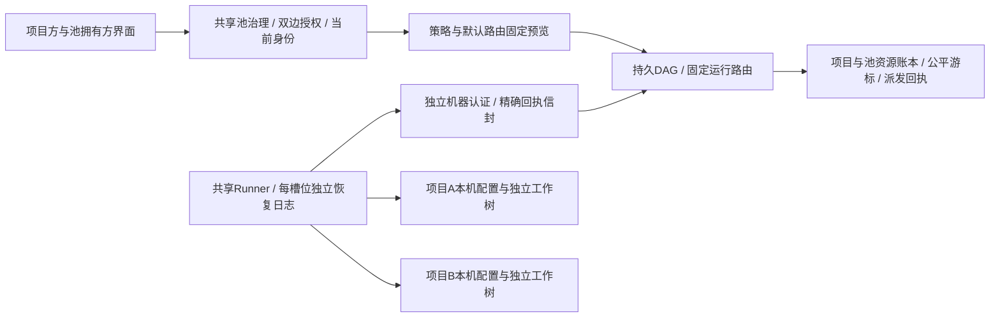
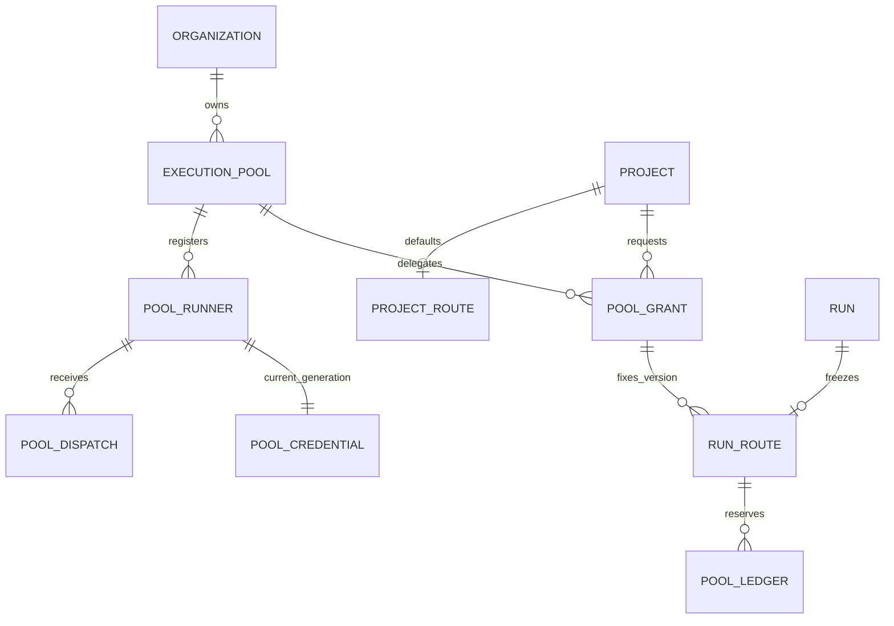

# 多组织共享执行资源架构

状态：T-P4-006源码集成，真实产品旅程和最终交付正在验收；负责人：控制面、调度、Runner、UED。关联：[领域合同](../../contracts/execution-pools.md)、[Core合同](../../contracts/execution-pool-core.md)、[交互规范](../design/execution-pools.md)。本文描述已进入源码的边界，不把SQLite回归等同于OceanBase集群、生产发布或规模验收。

## 领域和责任

项目管理交付责任、需求、工具启用与验收。资源池由一个组织拥有，统一配置共享准入额度和独立机器身份。项目管理员明确申请一份项目范围授权，池管理员批准后形成双边委托；双方均可终止新增派发。委托是机器执行授权，不授予拥有方项目需求、代码、日志或用户业务记录的读取权限。

控制面 `execution_pool*` 管理拥有权、双边授权、凭证、当前权限及审阅；`dag/pool_*` 管理固定路由、共享资源账本、竞争、公平和派发回执；`pool_runner_*` 是不经人类会话认证的独立机器协议；`runner/pool_*` 管理每个槽位的日志和每个项目的本机执行配置。Runner报告的能力范围只是本机配置，不能代替正式授权。

## 持久模型

| 归属 | 正式记录 | 约束 |
|---|---|---|
| 控制面 | `suma_execution_pools` | 拥有组织、元数据版本和active/paused；不把暂停等同于停止进程 |
| 控制面 | `suma_execution_pool_grants` | 项目明确同意共享的名称快照、固定权重和授权版本；终态不重开 |
| 控制面 | `suma_execution_pool_runners` / `credentials` | 服务端生成worker ID、槽位及凭证代数；只存摘要，一次原文不进入操作回执 |
| 控制面 | `suma_execution_pool_previews` | 固定依据、摘要、有效期和单次采用CAS；预览不预留资源或消费额度 |
| 控制面 | `suma_task_dispatch_route_bases` | 任务预览的路由代数，避免换路由后误用原工具计划 |
| 调度 | `dag_project_execution_routes` / `dag_run_execution_routes` | 项目默认与不可变运行路由分离，子流程和补偿继承原路由 |
| 调度 | `dag_execution_pool_policies` / `accounts` / `ledger` | 项目及共享池同时准入，attempt/fence绑定账本；累计单位不当作金额或token账单 |
| 调度 | `dag_execution_pool_scopes` / `fairness` | 授权镜像与持久分层服务份额，镜像与业务授权同事务修改 |
| 调度 | `dag_execution_pool_dispatches` / `slots` / `scans` | 稳定领取回执、每机器槽位唯一和有界扫描续点 |

## 原子性和恢复

相关写入按组织标识排序取得治理锁，再按池→项目→运行族/领域→事件尾部顺序推进。涉及旧池与新池的路由变更按池标识排序；领取涉及多个项目时按租户／项目字典序取得锁，不能按动态公平排名取锁。不能在先取得项目锁后进入会取得共享池锁的Core路径；发布及任务派发的跨层测试实际追踪此顺序。只读定位用于识别锁范围，最终依据仍在锁内重查，不能以定位读充当确认授权。

新运行固定当前默认路由。任务派发同时固定所选工具的执行身份与路由代数，正式run绑定回调复核实际不可变路由；工具属于另一资源池或原本地节点时，整笔操作回滚，不留下永远无人领取的ready运行。默认路由更改不修改旧运行，原操作重放恢复原结果。

`TaskDispatchPlan.execution_route` 只展示创建预览时保存的正式路由。GET与操作重放保留原快照，默认路由变更使 `valid=false`；历史缺字段明确为未记录，不能补成当前路由或冒充显式本地 version0。客户端不得提交该字段；启动授权只认事务内私有依据和实际运行路由，公开快照不能授予权限。

每次领取在同一事务重验当前独立凭证、双边授权和能力指纹，然后共享池及项目同时预留资源、记录公平份额、创建attempt与fence、绑定槽位并保存派发回执。空领取也有原回执；回执丢失不能随意生成新操作。旧worker迟到、已关闭或待核对派发不能重启。授权撤回阻止新派发，已经派发的原尝试仍能在当前有效机器凭证下排空回写；凭证撤销不是进程停止证明。

未知副作用继续保留核对状态与排他效果锁，确认停止才释放进程占用。轮换凭证前必须先排空执行或核对失联结果；重放登记只恢复元数据，不能恢复原始秘密。项目节点的 `pool-` 命名空间保留，避免另一套项目凭证遮蔽资源池身份，大小写折叠同样拒绝。

共享 Runner 收到宿主停止信号后，取消领取，等待各槽位和独立库存管理活动退出。每个槽位在原锁内验证本机结果和领取检查点，然后释放所有权。已定案结果的网络回执可等原节点重启后继续，未知执行与未完成的本机操作保持待核对。聚合退出结果保留槽位或库存范围诊断。 [值班手册](../agents/execution-pool-runner.md#停止与核对) · [阶段验证](../quality/pool-shutdown-verification.md)

## 公平和查询

共享池先按组织，再按项目执行持久加权虚拟服务轮转，单位为成功准入次数。量子为1，空领取、授权/能力不符、资源不足不扣份额。竞争范围是本次本地支持且当前有资格的工作；能力供给不相交时不能承诺整个池的严格份额比。等待龄和0–9优先级只影响当前被选运行内部，不能突破组织或项目份额。该算法不代表按CPU、时长或显存的DRF公平。

返回候选、范围与运行头数量有界并保存扫描游标；已就绪节点使用持久优先级排序投影，避免每次扫描全部运行和临时排序。这不是数据库内部扫描步数的上界，能力不匹配仍可能过滤更多索引条目。单SQLite的SQL计数和目标测试是局部证据，不能替代1000槽位、真实OceanBase竞争、P95与持续负载验证。

## 展示和支持范围

组织管理员看本组织池与明确共享的项目标签，项目成员通过独立只读接口选择本项目当前路由授权的执行身份；拥有方注册列表和凭证管理不下放给项目。登记active与真实在线可执行分别表达。节点诊断在同一读取事务组合Core资源事实与当前池暂停、授权变化，不泄露其他项目任务或日志。

共享池当前不支持制品上传及独立生产部署协议；新生产计划和执行明确阻断。已固定本地发布仍可恢复原操作、心跳及回写失败结果，不能因新默认路由改变而被重新解释为资源池发布成功。

界面与API采用[国际化合同](../../contracts/localization.md)。只翻译明确显示投影的副本、固定错误键及参数；不改原计划、版本、审批摘要、幂等回执或执行输出。阶段报告分别保存源码完成、协议夹具、真实本机运行和生产验收，避免混用。
