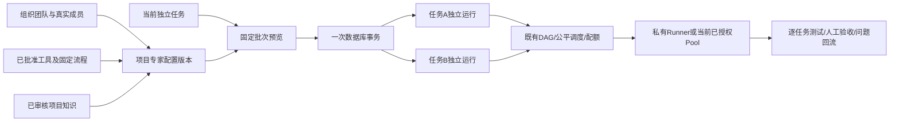

# 项目专家配置、原子派发与 AI SOP

状态：T-P4-027 限定本地已验证；产品版本：1.0.0；负责人：平台集成／领域／Core／工作台。
关联：[PRD](../product/expert-team-dispatch.md)、[合同](../../contracts/expert-team-dispatch.md)、[原任务派发](tool-execution.md)、[团队交接](task-handoff.md)。

## 领域边界

`Team` 和 `TeamMember` 继续表达组织编组；项目资源表达真实人、智能体或工具，不能等同于流程节点。
新增 `ExpertTeamConfiguration` 把项目中一项专业职责绑定到这些实际资源及固定执行合同。
它保存项目执行模板，不承担身份、凭据、调度或任务验收。

`ExpertTeamPlan` 保存一次已选任务列表及配置依据。每项复用 `TaskDispatchPlan` 的固定任务、
需求、设计、知识、工具和路由，再由同一事务创建彼此独立的 `Run`。
原有任务责任、测试证据、人工验收、发布范围与问题回流继续分别建模。



## 持久化与不可变依据

| 表 | 事实 |
|---|---|
| `suma_expert_team_configurations` | `(tenant, project, team)` 当前版本、状态和快照 |
| `suma_expert_team_revisions` | 同范围加版本的不可变历史快照 |
| `suma_expert_team_plans` | 固定配置、任务子计划、有效期、CAS 和批次状态 |
| `suma_expert_team_plan_items` | 子计划、批次、独立运行的唯一归属，防止单项绕过批次启动 |

角色固定资源／成员关系版本、流程版本、工具版本与摘要、审核知识引用。
显示时当前资格与历史内容分开计算，不能用当前名字或状态覆盖旧决定。
新版本保存进入草稿；发布与退役各形成新版本。未配置为版本0的读取视图，无伪造历史行。

## 原子创建与恢复

预览内部提取原任务计划生成函数，复用同一事务和授权证明；不从服务中调用另一个公开 HTTP 接口。
所有子预览、路由依据、批次、归属和操作回执一起提交。

启动通过 `Engine.CreateManagedRunsBound`：

1. 当前主体、项目权限、稳定操作标识与批次 CAS；正式发布状态及全部固定来源仍有效。
2. 全部任务仍可执行，前置任务已经验收；知识、需求、设计、工具和路由仍与预览一致。
3. 同一事务内冻结全部托管工作流，逐任务插入独立运行根、绑定与就绪节点。
4. 更新子计划及批次状态，写入完整领域回执；任一校验／绑定／提交失败全部回滚。
5. 提交后既有 Runner 领取，网络、模型、Git 与进程执行不进入该事务。

Core 的批次合同最多16项，顶层节点总数最多10000。稳定指纹包含有序请求、预留运行标识和归一化流程。
复用既有操作表保存每项原运行标识；不把长 JSON 塞入短运行标识列。
重放仍核对当前权限，加载原运行并跳过新建、绑定和领域提交。
每项创建前隔离 `transaction.familyRoot`，避免后续独立任务意外变成第一任务的子运行。

已有单任务 API 不改变语义；批次所有权明确阻止绕过批次的单独启动。
若回执不确定，查询原批次和操作，不生成新 Key 来“重试”。若原操作已成功，即使运行已经进展，
恢复返回原始身份及实际状态，不再次扣除预算或创建工作。

## 权限与锁序

草稿、预览及启动使用当前项目写权限，可由浏览器或当前项目 API 写入者完成；发布／退役需要浏览器批准者。
Agent、Runner 凭据不能调用这些管理写入；资源被加到团队不增加其可读范围或机器执行权。
组织治理、资源池、项目、调度与任务锁序继续复用既有路径；不得在回调中使用另一个数据库连接。
已经开始的运行固定原定义，当前实际执行仍检查 Runner、profile、Pool grant、租约和 fence。

## 专业执行事实

职责资源、流程 Agent 节点、工具 profile、注册机器与实际领取机器分别展示。
预览通过表示当前能够派发，不表示机器已经领取；批次已启动表示全部运行已持久化，不表示同时执行或已完成。
测试、任务验收与发布状态分别显示。多个任务沿原质量路径，不因同组而共享一次验收。

本阶段不引入通用前序文本注入、自动生成未测合并代码或新的候选读取权限。
这些仍需受控产物交接合同及固定输入证明；保留完整目标，禁止由更多并列 CLI 推断为完整自主协作。

## AI 开发与排障 SOP

1. 从项目和真实团队开始，查询当前成员、资源、已批准工具与固定流程；不根据自然语言名称推断身份。
2. 使用当前版本保存配置草稿，核对每个知识和执行引用，再交正式批准者发布。
3. 选取独立可执行任务，逐项指定职责与预期版本；前置未验收时先完成原交付门禁。
4. 检查预览的固定依据、有效期和实际目标路由，保留操作标识后明确启动。
5. 断线／409 先恢复原批次并读取当前状态；成员、工具或来源变化需要新预览，不能自行改 JSON 版本号绕过。
6. 定位问题依次查看批次、子计划、任务、运行／节点／attempt、实际机器、日志和候选测试证据。
7. 运行失败继续原重试、未知核对、取消及问题回流合同；专业角色不是放宽门禁的理由。
8. 新阶段只执行受影响权限、事务、幂等与交互检查；保留失败事实，复用不变证据，不重复付费模型。

阶段证据：[限定验证](../quality/expert-team-dispatch-verification.md)。源码、必要检查、实际本地协议与生产范围分别记录，完整平台继续实施。

## CLI／API 消费示例

沿用已有 `suma api` 客户端；下列 PROJECT／TEAM／PLAN 使用实际标识，凭据由进程环境 SUMA_TOKEN 提供。
JSON 文件需依据生成合同填写固定版本及稳定 idempotency_key。这里没有新增一套 CLI 权限。

```sh
suma --control http://127.0.0.1:4324 --project PROJECT api /expert-teams
suma --control http://127.0.0.1:4324 --project PROJECT api /expert-teams/TEAM/revisions/2
suma --control http://127.0.0.1:4324 --project PROJECT api /expert-team-plans --method POST --file preview.json
suma --control http://127.0.0.1:4324 --project PROJECT api /expert-team-plans/PLAN/start --method POST --file start.json
```

Draft, preview and start use current project write authority; publication/retirement require browser approval.
Keep the original operation key after an uncertain response and read the original plan before retrying.
The examples reuse the existing CLI transport; they do not assert new vendor or remote-machine acceptance.
