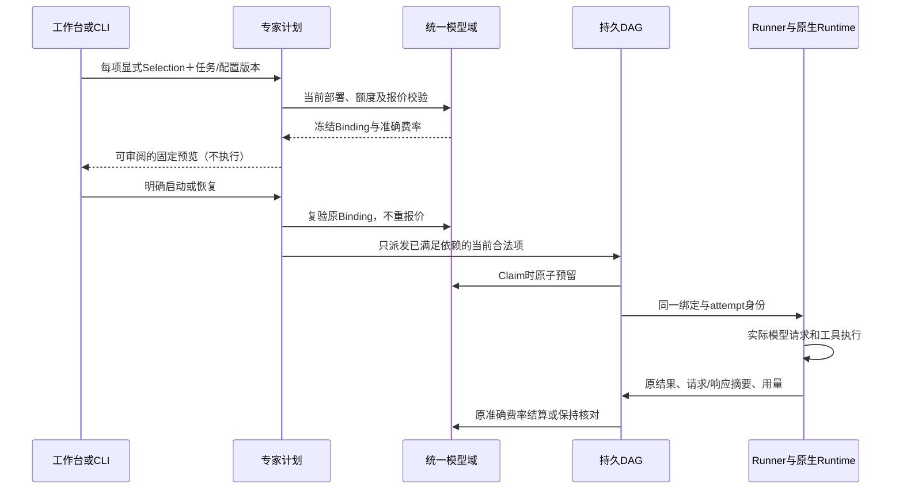

# 专家计划与统一模型执行设计

状态：T-P4-040／1.0.0。负责人：控制面、模型域与工作台。关联：[合同](../../contracts/expert-team-model-execution.md)、[PRD基线](../product/platform-foundation-prd.md)、[验证](../quality/expert-team-model-execution-verification.md)。

## 领域与交互决定

模型选择属于一次具体任务的执行计划。Role配置管理专业职责、资源和固定工具，不承担可变的任务额度。每项显式选择进入现有TaskDispatchPlan，避免团队域再实现模型和预算引擎；单独的 `model_execution_source.go` 处理原冻结模型的当前重验证，普通派发和团队编排共用。

默认交互为“选团队／逐项职责 → 按职责选模型与额度 → 可选单任务覆盖 → 固定预览”。高级预算和依据收进现有折叠区；模型未定价明确显示未知。角色共享仅是填表便利，落库时逐项独立，不会在后来修改Role时改变已有任务。修订仅列未开始项，必须明确选当前模型；旧Binding留在历史。

等待依赖不占机器进程；预算在真实领取时争用，多个就绪任务仍受组织／项目并发和共享额度约束。报价变化不重写历史，部署撤回不被当作自动迁移许可。单项失败和未知结果保留原运行；测试和正式验收仍独立。

## AI开发与运维SOP

1. 确认当前项目、发布团队配置、每项任务版本、准确工具版本及当前库存。读 `/model-execution/options`，不要从工具名字推断模型身份或在线健康。
2. 按任务选择部署、允许参数和本次预算；并行任务分别预留，不能把每项20,000误当整个团队共20,000。费用未知不填零价。
3. 审阅预览的模型版本、参数、费率和图依赖，之后才明确启动。依赖等待期间如改模型或额度，使用未开始来源修订，保留旧记录。
4. 当前部署／凭据／来源失效时停止新派发；修正当前依据并明确恢复，不改已经开始的定义，不通过环境变量换模型继续。
5. 回执丢失保留原完整请求及key；即使HTTP200，计划／任务／模型不对应也继续核对。不要用新key重复启动。
6. 检查原attempt的模型证据与用量覆盖状态。估算结算不等于厂商扣费；用量不完整时不擅自释放未知预留。
7. 代码输出仍要绑定准确候选、独立测试和人工验收。此阶段的本地协议运行不构成产品交付验收。

## 外部CLI后续合同边界

已离线检查本机Codex生成的官方app-server协议。thread/start返回effective model等当前配置，线程类型明确这不是逐turn执行遥测；当前协议没有原生平台相同的max_steps／max_output_tokens／费用硬cap。后续适配采用独立能力合同，先验证配置被接受与观察用量，不套用已证明提供方身份或硬预算保证。不能把没有rerouted事件当作模型身份依据。

该调查不是已实现适配器；没有安装SDK、读取现有登录、请求厂商模型或保存密钥。物理多机／TLS、完整IDE、部署安装、独立模型权限、完整报价与P0–P7全部范围仍待持续实现。

原Create／Command／Start回执恢复保留原固定计划、任务、模型和配置快照；仍按当前项目写权限读取。当前head已改变时，原快照禁止Start和其他动作，界面另取当前head；不能用后续修订替代原请求结果。Start并发恢复遵循同一规则。
