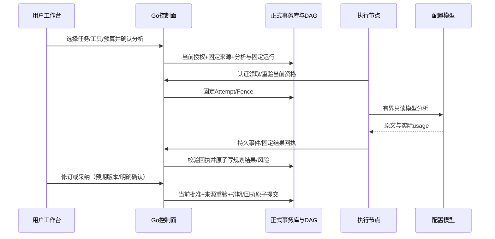

# 模型规划、编排依据与主动风险预警

状态：T-P4-023 实施中；负责人：控制面／执行／工作台；产品1.0.0。关联需求13、14、9–12、FND-I18N-001。接口：[规划合同](../../contracts/intelligent-planning.md)，实现：`internal/platform/intelligent_planning*`、`internal/runner/planning.go`、`packages/agent-runtime/src`、`apps/web/src/PlanningIntelligence.tsx`。

## 产品边界与操作流程

项目开发排期保留原时间线、容量与里程碑，在一个默认折叠面板中创建模型分析。用户选择1–20项正式任务，填写目标，选择执行节点真实观察且已启用的只读规划工具，并确认内容会交给固定模型和产生调用用量。未配置工具显示接入入口，禁止用静态规则伪装模型建议。

分析先封存任务、排期、关联需求、当周容量与摘要，再通过现有Go持久化DAG派发一个固定agent节点。Runner主动领取，原生运行时调用节点本地配置的模型并报告真实使用量；浏览器不保管密钥、不执行任意命令。任务进度、模型调用结果、规划方案有效性是不同事实：模型成功返回无效JSON时，执行事实仍保留，分析标为失败。

结果显示摘要、理由、收到的模型正文与摘要（执行节点既有凭证脱敏／控制字节清理后）、当前可编辑结构化排期、固定来源和风险建议。用户可修订；采纳需要当前批准权限、影响确认、未变更来源及预期版本。正式任务排期与分析状态、操作回执在同一事务提交，不因为模型文字直接更改任务负责人、验收状态或权限。未知写入复用原操作，不能盲目再调用模型。

风险以模型建议标识，持久化为站内预警，支持筛选、确认和解决；决策记录当前操作者、原因与版本。同一分析的风险key唯一，重复回执不重复生成；不同分析之间的语义去重未实现。站内风险不代表已确认故障，也不授权外部消息发送。

## 分层与扩展接口

- 领域层：正式来源、输出Schema、状态机、审批、幂等、排期事务和风险决策。数据库是正式状态。
- 应用层：现有浏览器／项目接口授权、严格HTTP DTO与分页、统一错误目录。Agent四个只读项目工具不扩权为写接口。
- 编排层：复用Go DAG、Run／Node／Attempt／Fence、持久事件与资源槽位；没有新的后台派发者。
- 执行层：只有明确配置`planning:true`、Suma适配、只读且无工作区桥的本地工具可声明规划能力。模型与基础地址固定在spec，纳入工具摘要；密钥从受控本地环境读取。
- 展示层：共用生成类型、现有写入恢复和运行事件刷新；中英文宿主标签与错误可扩展，模型／用户原文保持原内容。

## 执行与恢复语义

创建冻结真实发起凭证摘要，不保存原始凭证；领取和心跳从正式凭证记录、当前成员权限、来源、启用工具与执行路由重验。分析不会获得超出该真实凭证的长期权限。撤权、来源改变或profile变化停止新执行资格；已发生的认证Runner完成事实仍保留。结果未知进入核对状态，不能视为成功或自动重跑。

单分析最多4步、8192输出token、120秒，默认3步／4096输出token；DAG重试为0。完整prompt最多32000 UTF8字节，超限明确拒绝。规划器禁止工作区文件写入桥；工具仍严格限制在既有项目只读目录。仅限支持的OpenAI兼容模型协议，不据此声称所有厂商或账户已验证。完整预算余额预留、计价账本及跨租户配额仍属后续交付。

正式业务存储使用既有TransactionalStore方言，本轮迁移新增分析、结果身份、站内风险表及索引。SQLite实际验证与OceanBase/PostgreSQL真实验收分别记录，DDL存在不能冒充后两者已经验收。索引和模型检索仍使用既有知识权限边界。当前来源摘要保守扫描项目容量相关正式任务／资源，成本与现有容量聚合相同；无关任务排期变更也可能使方案过期，大项目需后续增量水位优化，尚无规模性能结论。

## AI／人员开发与运维SOP

1. 确认当前项目、任务版本、验收条件和数据可发送范围；模型目标避免包含密钥。配置接入可视化模板只生成本地文件文本，真实库存导入与启用仍须原权限。
2. 查看规划工具模型、固定地址、只读属性、版本及观察时间；探测只证明安装和协议，不代表模型鉴权成功。
3. 提交一次有预算的分析，记录分析ID、runID和操作ID；中断后刷新或核对原操作，不新建重复模型调用。
4. 等待真实事件；失败检查原诊断、模型usage、Attempt与Fence。无效JSON不自动重跑；结果未知先核对执行。
5. 核对原始输出、来源及人工改动。来源变化重新分析；采纳只提交已审阅的正式排期，不绕过任务验收和发布门禁。
6. 确认／解决模型风险要填写原因。真正故障和修复需求沿已有问题闭环处理；外部通道、自动策略执行与独立移动端另行交付和验收。
7. 开发只运行影响权限／事务／回执／协议的必要检查与代表性交互，复用未变更证据。阶段提交必要源码、合同、文档；密钥、数据库、日志、截图、构建与缓存留在忽略目录。

## 后续完整能力

本轮是模型规划与站内建议的纵向交付。专家组自主拆解、长期自动规划授权、策略调优自动采纳、预警外发、完整成本配额、模型平台SDK、消息入口与独立移动App保持待实现；完整P0–P7目标持续进行。
