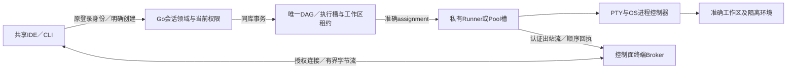

# 原生交互终端：完整架构与AI开发SOP

状态：**设计，尚未实现或验收**；产品1.0.0，2026-10-29。负责人：控制面、DAG、Runner、工作台及桌面领域。关联需求9、12、17、22、23和完整P0–P7；58项限定实现／34项待办／92项总账不变。当前T-COLLAB-127推进任务协作记录，不能据此声称已提供持续智能会话或PTY。本文件是完整真实终端的后续实施基线，所列新类型、路由、协议和默认限额均为**拟定合同**，尚未注册为可用API。

相关：[完整工作台交互](../design/reference-workbench.md)、[本地工作台](local-development-workbench.md)、[远程读取](remote-workspace-broker.md)、[远程保存](remote-workspace-write.md)、[资源池](execution-pools.md)、[传输能力合同](../../contracts/workspace-transport-capabilities.md)、[参考产品缺口](../product/reference-platform-parity.md)。

## 已有事实与实际断点

| 现有依据 | 能够复用 | 不能据此推断 |
| --- | --- | --- |
| `internal/runner/worker.go`的`runAssignment` | 准确assignment、心跳取消、事件journal、活动根注册及出站读／写broker | 可交互stdin、PTY、终端会话恢复。 |
| `internal/runner/pool_worker.go` | 私有范围和Pool双边授权、分槽journal、派发后再次心跳核验 | 终端已计入机器并发或具有跨项目工作区写锁。 |
| `internal/dag/scheduling_reads.go`、`scheduling_resources.go`及`pool_resources.go` | 节点资源原子预留、execution_slots、项目／Pool配额、process与effect释放规则 | 当前资源账户已按物理工作区身份全局排他。 |
| `internal/runner/process_windows.go`及`process_unix.go` | Windows启动前挂Job、停止树核对；Unix进程组停止及未能证明隔离时的unknown事实 | Job或进程组是文件／网络／账号隔离；任意shell受到`os.Root`约束。 |
| `internal/runner/native_workspace.go`、`workspace_write.go` | 文件效果账本、同一互斥锁、generation、检查与封存依据 | 进程在锁外修改文件仍受上述账本精确控制。 |
| `apps/web/src/IDE.tsx`及任务上下文 | 当前账号／项目、真实文件、未保存保护、双语和延迟展开 | 已有xterm、全双工连接、实际shell或语言服务。 |

当前Go及前端依赖清单未声明PTY、xterm或WebSocket库。现有`duplexInput`只提供一次执行信封及一次取消，不能当作用户输入队列。`workspace_tools_version`及read/write传输声明也不授予shell能力。

## 决策与模块边界

采用**独立受控终端会话＋唯一Go DAG派发＋Runner真实PTY＋共享工作台终端组件**。不在HTTP处理函数或Electron渲染页直接启动shell，不增加第二个派发器；本地独立部署和远端部署采用同一合同。

新领域`WorkspaceTerminalSession`固定租户、项目、原创建凭据引用、任务及版本（可选）、工作区身份、终端Profile／摘要、环境策略、DAG run／node／attempt／fence／worker、创建与到期时间。`TerminalAttachment`管理查看者和单一输入控制者；`TerminalInputReceipt`、`TerminalOutputChunk`及`TerminalStopReceipt`分别记录输入、输出和停止事实。正式状态、操作回执及outbox同事务持久化；大量短期字节正文独立有界保存，不放通用审计日志或索引。

新增明确worker节点种类`terminal_session`，进入原图编译、能力匹配、资源预留、私有／Pool领取、重试与取消状态机；它不是把普通command无限延时。交互会话不得自动重试或重新启动shell来“恢复”。终端退出0只说明该进程结果，不自动生成独立测试、人工Review或任务验收。

## 工作区、资源与OS执行

默认使用该终端attempt的独立工作树。需要本机人工目录时，明确固定原目录绑定及版本、OS目录身份和终端专属许可，按“受信本机开发”模式展示；该目录不自动成为正式代码候选。浏览器提交的任意路径、上一个任务选择或历史attempt路径都不能成为启动依据。

终端占用execution_slots、机器槽及配置的CPU／内存／运行时上限。当前DAG的`budget`单位是admission_units，不能把它冒充模型Token消费；终端调用模型仍走原模型网关与账本。单次最大时长、空闲时间和断开保留时间由项目与Runner策略取更严格值。

工作区新增`WorkspaceWriterLease`，以**机器身份＋规范OS目录身份**为键，固定owner／epoch／用途；派发和领取在同一控制面事务内核验。现有项目／Pool资源账户不足以防止两个项目指向同一个物理目录，因此还需要该准确租约及Runner本机排他证明。别名、大小写或符号链接不能得到第二把写锁。

持续shell可能启动后台进程；不能把“本次输入已写入”当作写锁释放。终端整个可能写入的进程树生命周期持有写租约，停止树确认及最终工作区核对完成后才释放。模型写入、远程保存、Git变更、checks及封存必须参与同一工作区写入仲裁。终端活动时禁止封存；终端完成后重新生成来源摘要、增加generation并使旧检查失效。不能仅在每个按键前获取原生文件锁。

向正在执行的Agent工作区交接交互控制，必须先取得其实际暂停／停止回执，再取得明确的新写租约；不能让两个写入者并行操作同一工作树。其他任务可继续在自己的工作树执行。

PTY不是安全隔离。SaaS和不受信工作区必须具备已配置的容器／专属低权限OS身份、目录挂载及网络策略；Windows Job的树停止不等于访问隔离，Unix进程组也不能证明已逃逸后代停止。未配置要求的隔离时不宣称SaaS终端可用。本机受信模式须由本机用户明确开启，不能由远端组织管理员替用户授予整机shell权限。

环境复用当前白名单构造，显式隔离HOME、TEMP／TMP、工具私有配置与工作目录，不继承整个Control／Runner环境。终端不获得Runner凭据、平台会话、模型网关的可转授秘密或宿主MCP任意能力。

## 拟定API与全双工合同

前缀`/api/v1`。写操作携带原操作ID、预期版本及准确账号／组织视图；服务端检查当前权限、任务／目录依据和Profile，而不是信任前端的can_write标记。

| 拟定接口 | 必须语义 |
| --- | --- |
| `POST /workspace/terminals` | 固定项目、工作区来源／版本、可选任务版本、Profile摘要、终端尺寸和预算。持久化会话及DAG创建操作后返回queued事实；同key恢复原会话。 |
| `GET /workspace/terminals`、`GET /workspace/terminals/{id}` | 当前授权的有界列表／准确状态、工作区来源、进程与连接状态、输出水位和缺口；不返回环境秘密。 |
| `POST /workspace/terminals/{id}/attachments` | 当前查看／控制权限；固定会话版本和控制者epoch，签发短期、单次连接许可。取得连接许可不启动或重新派发会话。 |
| `GET /workspace/terminals/{id}/stream` | Cookie身份、严格Origin及已签发连接许可共同核验后升级WebSocket；恢复输出游标，不接受任意命令URL。 |
| `POST /workspace/terminals/{id}/stop` | 明确请求停止，CAS会话及原操作回执；返回stop_requested，不提前返回stopped。 |
| `POST /runner/terminals/connect`及Pool对应入口 | 实际Runner认证出站连接，固定准确assignment、机器凭据代次及Pool双边授权。控制面只路由已派发会话，不把浏览器直接接到机器端口。 |

浏览器WebSocket连接使用原同源Cookie，不把票据或Bearer放查询字符串／日志。单次许可由前一个受保护POST生成，在升级后的首帧消费，并再次核验原会话和当前权限；协议名拟定`suma-terminal-v1`，不是秘密。现有HTTP Origin保护针对写方法，WebSocket握手为GET，必须在该升级入口独立核验Origin，不能假定现有中间件已覆盖。

帧种类封闭为`attached`、`output`、`output_ack`、`input`、`input_receipt`、`resize`、`state`、`stop_receipt`、`gap`和`error`。所有帧含session_id及会话／控制epoch；Runner帧另绑定派发attempt／fence。未知字段、超限尺寸、非规范序号及迟到epoch拒绝。二进制输出按原字节顺序传递，UTF-8与ANSI增量解析由终端组件处理，不用HTML渲染输出。

输入携带input_id、递增序号及payload摘要。Control持久化接受状态后才派送，Runner在写PTY前持久化意图，写后记录实际字节数；原ACK重复可幂等排空。`delivered`只表示字节交给PTY，不表示shell执行成功。崩溃在写字节与回执之间时标记`delivery_unknown`，**不自动重放输入**；部分输入同样不能重发剩余字节假定原命令完整。用户查看未知状态后明确选择下一步。

每个会话只有一个输入控制者。多人可在各自当前权限下查看，取得控制权递增epoch，旧标签页立即失去输入权；新连接不继承旧用户身份。断线后恢复同一个会话和输出游标，不新建shell。撤权／心跳失败停止发新输入并请求原进程停止；短期已发许可存在明确到期窗口，不承诺远端瞬时撤权。

## 输出、停止与恢复

输出使用递增chunk序号及byte_offset，先持久化有界输出／水位，再确认Runner；浏览器确认的水位只表示终端解析完成。xterm写入非阻塞，因此需要从`write`回调产生消费ACK，并由端到端高低水位控制Runner读取PTY。浏览器慢、隐藏或失联时停止无限缓存；保留区淘汰后返回明确gap及起始游标，不把缺失历史当空白成功。

拟定默认值：每输入帧8KiB、每输出帧32KiB、内存未消费输出4MiB、滚动回放2MiB；均需配置上界与实际压测后冻结，当前没有性能验收结论。原始输入可能包含口令，不写通用日志，不默认长期录制；临时队列正文需限定保留期、访问范围及清除规则。审计保留身份、原对象、操作、序号和结果摘要。

进程状态`queued → starting → running → stop_requested → stopped|exited|reconciling`；连接状态connected／detached单独表达。`cmd.Wait`返回不证明后代已停；必须经过PTY-aware进程树控制器确认。退出码、Ctrl-C信号、关闭标签、断开WebSocket及实际停止分别记录。断线保留是有限策略，不让浏览器关闭自动等于业务成功。

租约过期、Runner重启、停止回执丢失或旧fence迟到，进入核对。Runner存活时可核对原进程句柄与原journal，输出可以按已固定序号重传；不能凭历史PID、当前相同目录或数据库running标记重新附着未知进程。进程已停但效果未知时可释放process资源，effect／写租约保留到核对完成；缺少实际停止证明不能释放机器槽并并行启动替代shell。明确结束后关闭所有输入输出句柄、排空已接受事实、核对工作区，再封存最终会话证据。

## 成熟组件与跨平台实现

下列是已读取官方资料的候选，不表示已安装、最新版结论或当前可用：

| 组件／来源 | 已核实 | 采用要求 |
| --- | --- | --- |
| [go-pty v0.2.3 API](https://pkg.go.dev/github.com/aymanbagabas/go-pty@v0.2.3)、[固定许可](https://github.com/aymanbagabas/go-pty/blob/v0.2.3/LICENSE) | MIT；支持Unix PTY及Windows ConPTY，提供ReadWriteCloser、Command及Resize。文档提示它不一定是最新版本。 | 实施时重新核实并锁定选定版本／摘要，优先复用该接口，不自制VT解释器。 |
| [go-pty固定Windows源码](https://github.com/aymanbagabas/go-pty/blob/v0.2.3/cmd_windows.go)、[Cmd](https://github.com/aymanbagabas/go-pty/blob/v0.2.3/cmd.go) | Windows使用自己的CreateProcess与伪控制台属性，Cmd不是exec.Cmd。 | 新PTY进程适配器必须保留“挂起启动→加入Job→恢复→停止核对”；不能直接调用现有`startProcess(*exec.Cmd)`或默认只Kill主进程。 |
| [Microsoft ConPTY会话](https://learn.microsoft.com/en-us/windows/console/creating-a-pseudoconsole-session) | 主机先创建伪控制台及通信管道；输入／输出须避免阻塞死锁。 | 每方向独立服务循环及有界队列；验证关闭、窗口调整和进程树退出。 |
| [xterm.js 6.0.0许可](https://github.com/xtermjs/xterm.js/blob/6.0.0/LICENSE)、[流控](https://xtermjs.org/docs/guides/flowcontrol/)、[安全](https://xtermjs.org/docs/guides/security/) | 该tag许可为MIT；官方明确非阻塞write需要流控，终端不是OS授权隔离。 | 本地打包终端与必要官方addon；实施时锁定实际包版本，不从CDN加载。链接／剪贴板／文件传输能力分别授权，不把ANSI当HTML。 |
| [coder/websocket](https://github.com/coder/websocket)、[AcceptOptions源码](https://github.com/coder/websocket/blob/master/accept.go) | ISC；默认禁止跨Origin，可使用OriginPatterns；本次未固定发布版本。 | 实施时选定并锁版本；复用当前会话／Origin校验，不启用InsecureSkipVerify或全域通配。 |

Windows需要将当前Job管理抽出可共享控制器，并为go-pty.Cmd实现挂起启动后附Job和恢复；任何步骤失败都要销毁PTY及原进程，不能留下悬挂进程。Unix PTY需要session／controlling-terminal语义，不能直接套用当前Setpgid参数；保持原结果未知表达，并结合实际容器／cgroup或平台支持的后代追踪证明。库提供跨平台API不等于速码已经通过三系统验收。

## 简洁界面与交付顺序

IDE底部按需打开“终端”，默认不挤占文件编辑区。顶部只保留会话、准确目录、连接状态及停止；模型、预算、权限、原依据和历史放到详情。支持多会话标签、调整尺寸、只读查看和明确接管；390宽度使用单会话全宽面板。中文／英文完整覆盖状态、未知输入、断线、回放缺口、到期与操作结果，后续语言复用字典及格式器。

暂停显示为实际运行状态；滚动回看不强制跳底，出现新输出时提供返回最新位置。失败恢复动作说明恢复的是连接、输出还是进程核对。没有真实PTY能力、机器库存或当前权限时提供明确接入原因，不能显示可输入却不执行的装饰终端。

1. 冻结会话／帧／资源／工作区租约合同及权限，注册当前初始化组件合同；保持单一1.0.0设计，不添加历史回填、兼容路径或静默数据重置。
2. 先实现PTY-aware进程控制器与真实本机交互：提示符、输入回显、中文、窗口调整、Ctrl-C、后台子进程、准确退出及停止失败。实际子进程验证，不用模拟输出替代。
3. 接入原DAG及Runner出站会话，打通同库会话创建、配额、租约、精确fence、私有及Pool路径；故障只核对原进程，不重发未知输入。
4. 接入工作区写入仲裁、generation与封存门禁，再开放控制输入。没有该闭环前不将Agent写入与终端写入并发到同一树。
5. 集成xterm、双语和键盘交互，用一个真实端到端旅程检查输入、输出ACK、断线重连、停止、刷新及目录／任务依据变化；只补受影响检查，不重复付费模型或无关完整测试。
6. 独立验收Windows、macOS、Linux的安装包、PTY依赖、目标OS能力、更新／退出恢复，以及单机、私有、Pool和多机TLS部署。源码、协议模拟、本机实际、三系统实际及生产分别记录，全部通过前不关闭完整终端交付项。

AI开发必须先阅读原会话及工作区依据，再调用原平台命令；不能把聊天文本自动作为shell输入，不能把input_ack升级为任务完成，不能用自动重开进程修复未知效果。日志只保留必要的可追溯元数据；当前字段与错误从同一合同生成，并更新中文／英文与实际证据索引。

*English: This is a planned real PTY architecture, not a delivered feature. Terminal sessions use the single Go DAG, current authority, exact Runner attempts and exclusive workspace writer leases. Input receipt, process exit, confirmed tree stop, independent testing and human acceptance are separate facts. Reconnect restores the same live session and output cursor; ambiguous input is never replayed automatically. Local, private Runner and Pool paths require the same contracts, with actual Windows/macOS/Linux and deployment acceptance recorded separately.*
