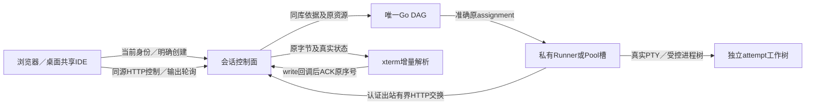
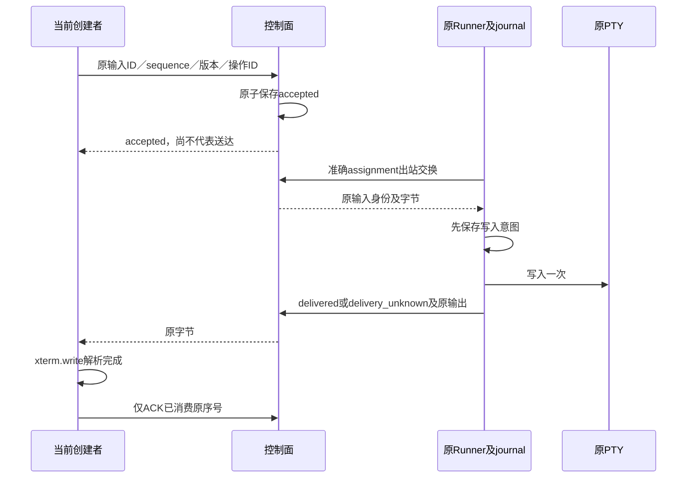

# 受控交互终端与开发交接架构

状态：**T130限定实现，完整终端与跨平台验收继续交付**。产品1.0.0；2026-10-29。负责人：控制面、DAG、Runner、工作台领域。关联需求9、12、17、22、23及完整P0–P7／需求1–26；58项有限实现、34项待办、92项总账保持不变。

本文件说明当前代码与明确边界；T130的[合同](../../contracts/terminal-recovery-candidates.md)、[交互](../design/terminal-recovery.md)、[验证报告](../quality/terminal-recovery-candidates-verification.md)和[摘要](../quality/terminal-recovery-candidates-summary.json)分别记录原执行核对、明确候选授权与实际证据。T129的Windows ConPTY／Job和讨论开发交接证据保留在[原报告](../quality/interactive-development-verification.md)／[原摘要](../quality/interactive-development-summary.json)，不推断为所有恢复故障、其他OS或生产验收。操作见[开发与AI SOP](../development/interactive-development.md)。

## 当前决策与边界

采用**受保护会话、唯一Go DAG、独立attempt Git工作树、Runner真实PTY、共享xterm工作台**。专用`terminal_session`节点不能由普通command、只读助手文本或客户端自由命令替代。终端本身不调用模型，不取得编码智能体的模型绑定。

本阶段使用**同源HTTP控制和有界轮询**，没有WebSocket升级、附件票据或WebSocket帧实现。浏览器不连接Runner监听端口；机器沿原私有／Pool凭据、TLS、双边授权和准确派发身份主动出站。不另建Shell派发器或模型计费权威。

| 模块 | 当前职责 |
| --- | --- |
| `internal/terminalcontract` | 唯一`suma-pty-v1`会话、原字节、输入／输出与交换合同；生成公开类型。 |
| `internal/platform/workspace_terminal*` | 当前身份、任务／需求依据、工具指纹、执行路由、版本、原操作回执、输出水位和控制权限。 |
| `internal/dag` | 受保护节点、原队列、资源、租约、私有／Pool领取及准确attempt／fence结果。 |
| `internal/runner/terminal_session*` | 固定Shell、原assignment、独立工作树、环境隔离、出站交换与原停止事实。 |
| `internal/terminalruntime` | go-pty、真实进程生命周期、输入意图／回执journal和有界原始输出。 |
| `TerminalPanel`／`TerminalViewport` | 按需xterm、同会话重连、真实消费ACK、未知输入、停止与双语状态。 |

## 固定执行与工作区

创建固定当前任务版本、任务原运行、需求快照、Profile版本／摘要和路由；启动及交互继续核验当前权限、库存、原节点和机器。终端不自动重试，不以新Shell冒充恢复；活动会话与历史读取分开管理。

Runner使用管理员固定的`terminal_session: true`专用Shell配置，公开能力为`terminal_session_protocol: suma-pty-v1`。可执行文件及参数由配置决定，请求不能提供任意路径、参数或脚本。Profile不混用原生编码、测试、制品、模型网关或规划用途，不接受EnvFrom及自定义Env转授秘密。

独立attempt工作树使用专属HOME、USERPROFILE、XDG及临时目录，不继承Runner／提供方／模型秘密。IDE共享目录、任务选择或历史路径不是启动依据。当前不向活动Agent工作树交接Shell共写，也没有宣称完成跨机器／目录别名的通用物理根写租约。

活动终端沿原出站broker提供**只读实时文件检查**，该入口不开放远程保存或授予验收。Shell修改不自动成为正式交付候选；停止后可按下述独立授权流程预览、检查与封存，再沿原独立测试和人工Review链路交付。

独立工作树和Windows Job不是文件／网络安全沙箱。Shell仍按Runner的OS账户权限运行；不受信多租户SaaS所需的容器、专用身份、挂载与网络隔离尚不能宣称完成。

## 当前HTTP合同

前缀`/api/v1`；当前授权、预期版本和原操作ID由服务端核验，项目API凭据不能被查询参数改到另一项目。

| 接口 | 当前语义 |
| --- | --- |
| `GET /workspace/terminal-sessions?project_id&task_id` | 最近最多20个会话、受控Profile、当前任务版本和can_create；profiles_complete表明有界配置目录覆盖，不称完整历史。 |
| `POST /workspace/terminal-sessions` | 明确授权，固定任务／Profile、尺寸及60–3600秒时限；已持久化不等于Shell已经启动。 |
| `GET /workspace/terminal-sessions/{id}?project_id` | 当前授权的原运行、目录、机器、状态、水位和允许动作。 |
| `POST /workspace/terminal-sessions/{id}/commands` | 原会话CAS／epoch下的input、resize、ack或stop；回执含当前会话与可空输入回执。 |
| `GET /workspace/terminal-sessions/{id}/output?project_id&after` | 最多64块原序号base64输出；gap明确早期输出缺失。 |
| `POST /runner/terminal-sessions/{id}/exchange`及Pool对应入口 | 绑定原run／node／attempt／fence／worker／dispatch，机器事实先持久化再确认。 |
| `GET /workspace/terminal-sessions/{id}/recovery?project_id`／`POST .../{id}/recover` | 读取原身份、停止证明和未知输入；当前审批人逐项确认后只允许按失败关闭原运行，不重放或制造成功。 |
| `GET /workspace/terminal-sessions/{id}/candidate-plans?project_id`／`POST .../{id}/candidate-plans` | 读取最近最多20项原会话计划，或明确授权创建停止快照的固定预览；历史读取不受新建资格约束。 |
| `GET /workspace/terminal-candidate-plans/{id}?project_id`／`POST .../{id}/start` | 当前授权读取原计划，再单独启动原保留运行；当前业务依据变化不抹去已启动事实。 |

当前尺寸20–500列／5–200行，输入最多8KiB，输出块最多32KiB，有界输出保留2MiB。界面有输出时短轮询、空闲退避；控制命令串行，输出读取独立。这些限额不是规模或延迟压测结果。

## 输入、消费与恢复

当前创建者身份控制输入、resize及消费ACK，`control_epoch`固定为1；当前项目有写权限的人员可请求停止。多用户接管、控制租约切换和跨标签独占附件尚未实现。

**accepted、delivered和命令完成分别表达**。next_input_sequence在控制面接受后即递增，不能证明PTY送达；delivered也不证明Shell解析、命令成功、独立测试或业务验收。输入状态只有accepted／delivered／delivery_unknown，没有输入queued别名；会话可以处于queued。

写意图与写入之间崩溃、部分写入或传输未知时，不自动重发原字节、补发余量或重建Shell。浏览器不把输入存入持久写恢复区；核对后输入新内容仍受原允许动作约束。日志和公开摘要不得复制输入或环境秘密。

输出保留原字节及序号，不按UTF-8字符串截断、不用HTML渲染ANSI。xterm.write是异步操作，只有解析完成的原序号才能ACK。折叠／断线恢复同一会话及游标；新页面没有旧缓冲区时按真实保留范围回放，缺失保持gap提示。

## 真实停止与平台范围

会话状态为queued、running、stop_requested、exited、stopped或reconciling；连接状态独立。断开查看、Ctrl-C、自然退出、请求停止和确认后代停止分别记录。stop_requested不提前变成stopped，未知不能通过重新派发解除。

Windows采用ConPTY和Job：专用bootstrap子进程挂起启动、加入禁止breakaway的Job后恢复；只在该受控子进程清除继承的Ctrl-C忽略策略，不修改长驻Runner或用户环境。中文、resize、Ctrl-C及前后台进程停止已有底层实际证据，具体范围见专项报告。

Unix进程组不足以证明已逃逸setsid／双fork后代停止。当前Probe拒绝把未证明的完整containment登记为可用终端。Linux／macOS实际PTY、隔离、安装包、退出恢复，多机／Pool端到端及生产矩阵仍待验；成熟库提供跨平台API不等于产品已完成三系统交付。

## T130原执行核对、候选与后续基线

原执行核对固定原会话、run、attempt、fence及dispatch，要求已有持久进程树停止证明、当前审批权限和全部未知输入身份的逐项确认。唯一Go DAG只能按失败结束原不确定运行；人工确认未知不等于PTY送达，也不重发字节或启动新Shell。没有停止证明仍保持阻塞。当前恢复实现及剩余故障形态按[专项报告](../quality/terminal-recovery-candidates-verification.md)限定，不宣称全部失联恢复已完成。

停止快照固定原基线、文件清单摘要与原attempt。用户明确授权创建候选预览，再另行确认启动。当前固定流程包含原Worker的普通可写command/text-v1检查节点和另一Worker的候选独立测试节点；宿主核对原缓存和快照，复制允许文件到新独立工作树，检查成功后封存真实提交。独立测试通过原bundle导入同一SHA，沿既有JUnit、逐例门禁、Review及唯一问题回流处理，不依赖模型调用或终端输出判定成功。

当前正式验收仍绑定该候选运行时，可将其精确候选显式绑定为另一未启动任务的代码基线。基线请求只允许composition来源对或terminal_candidate_plan来源对之一，版本和原操作身份继续由现有命令核验；绑定不启动后续任务，也不继承原验收。界面按需读取真实历史计划，刷新或选择不重执行；受保护事实、候选授权、启动和验收各自独立。

## 讨论到正式开发

`TaskDiscussionDevelopmentPlan`保存准确助手消息、reply版本和source_sha256出处。用户审阅说明及补充检查，重新选择流程、可写原生智能体、平台模型和预算，先创建**原TaskDispatchPlan预览**，再单独启动原保留run。当前交接执行器限定原生suma-jsonl-v1编码宿主，不由其他工具登记名称推断能力。

说明和补充检查不PATCH任务／需求，不替代正式标准或测试计划，也不直接变成Shell输入。旧回复模型预算不继承给新开发；请求、费用和预算仍由原Go网关管理。开发继续原独立工作树、封存候选、同SHA独立测试及人工Review；创建不是启动，启动不是验收。

## 完整后续目标

保留多控制者／附件租约、WebSocket及更完整流控、共享物理根写入仲裁、容器／cgroup隔离、Unix停止证明、多会话工作台、LSP／DAP／预览、跨物理机器的终端修改交接、三系统安装、真实分布式和SaaS验收。当前切片不关闭这些待办，不缩减完整平台范围。

成熟组件：[go-pty v0.2.3](https://github.com/aymanbagabas/go-pty/tree/v0.2.3)、[xterm.js 6.0.0](https://github.com/xtermjs/xterm.js/tree/6.0.0)与FitAddon0.11.0。[官方流控说明](https://xtermjs.org/docs/guides/flowcontrol/)解释为何不能在网络到达时立即ACK。本地打包及许可沿现有流程固定，不从CDN临时执行组件。

*English: T130 adds failed-only reconciliation of the exact original attempt after persisted tree-stop proof and individual acknowledgement of unknown inputs. A stopped snapshot requires separate preview and start consent before fixed-command checks, sealing and same-SHA tests on another Worker; current formal acceptance can authorize an explicit baseline for an unstarted follow-up task without starting it. Original session, input delivery, candidate, test and human acceptance remain distinct. T129 runtime/discussion evidence is retained; unsupported recovery scenarios, Unix containment, physical multi-host execution and production remain separately scoped.*
