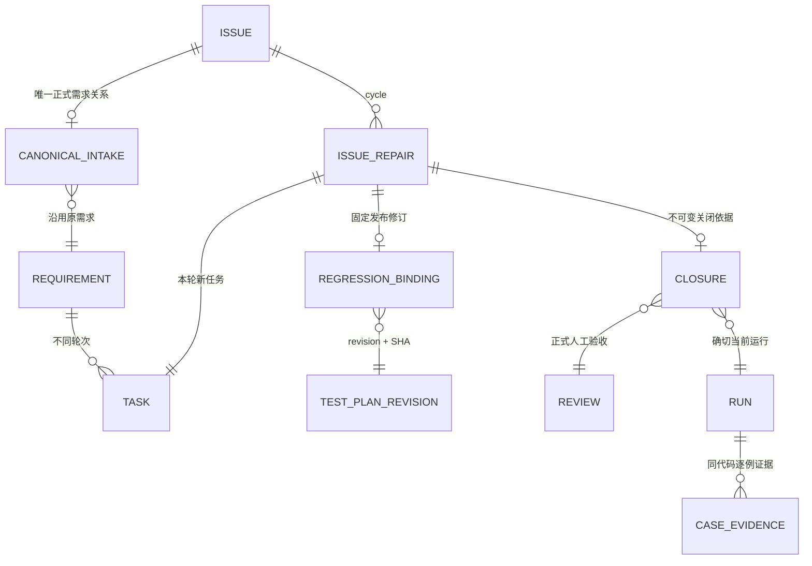
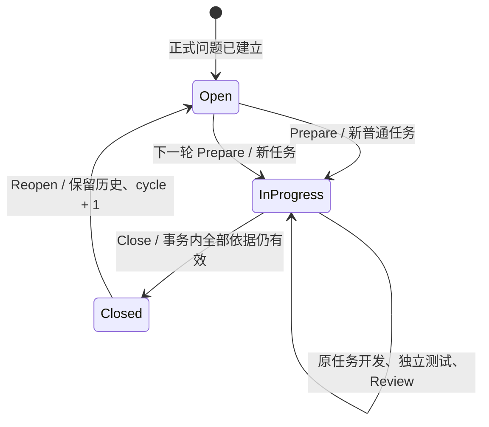
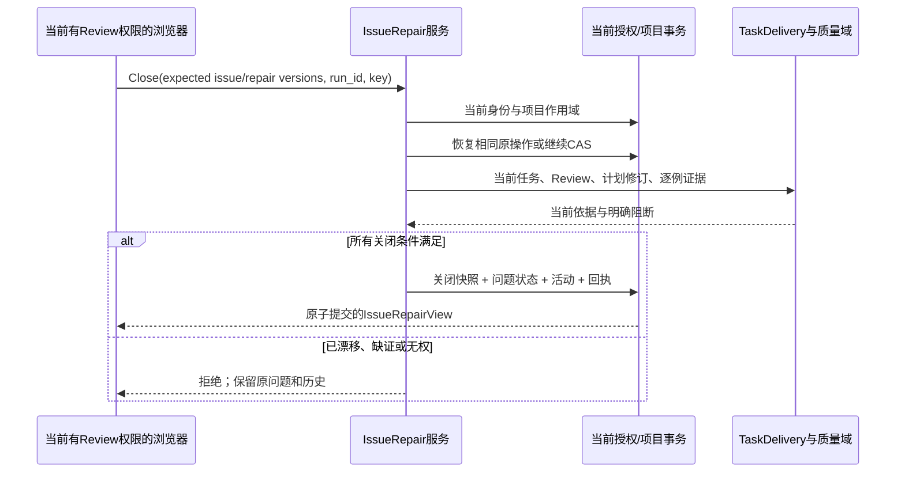

# 缺陷修复与回归关闭架构

状态：suma **1.0.0**／**T-QUALITY-119** 当前领域设计与实施合同。负责人：质量领域、任务交付、工作台。关联：[接口合同](../../contracts/issue-repair.md)、[开发与操作 SOP](../development/issue-repair.md)、[English](../en/issue-repair.md)、[测试计划](../../contracts/test-plans.md)、[任务交付](../../contracts/task-delivery-chain.md)。实现入口为 `internal/platform/issue_repair*.go`；本文不代替主集成代理记录的实际验证与交付证据。

## 1. 问题与领域边界

既有失败运行投影、人工验收退回和失败用例能够形成正式问题；`issue_intake.go` 已保证一个问题只回流到一个正式需求。它们没有证明后续修复已经通过独立回归。直接编辑问题状态、模型声称“已修复”或原失败运行变成成功，都不能建立关闭依据。

本领域连接 **正式问题 → 唯一回流需求 → 本轮新修复任务 → 固定回归计划 → 当前独立测试和正式 Review → 人工关闭**。它复用现有账号、权限、项目协调事务、任务、DAG、模型绑定、候选封存、报告和审批，不增加执行器或问题管理系统。

| 模块 | 负责的正式事实 | 不拥有的权限或事实 |
| --- | --- | --- |
| Issue／Record | 问题身份、当前版本与 `open/in_progress/closed` 状态 | `Data` 不能建立修复关系、复测通过或关闭证明 |
| IssueIntake | 原唯一 `issue → requirement` 保护关系及原操作回执 | 不自动批准需求、不改写既有需求正文 |
| IssueRepair | 每轮修复任务、回归绑定、关闭快照与重新打开记录 | 不派发任务、不执行测试、不代替 Review |
| Task／TaskDelivery | 当前任务、运行依据与正式验收事实 | 运行成功不等于全部用例通过 |
| TestPlan／质量证据 | 已发布修订、selector、精确受测代码、逐例结果 | 手工状态和 Agent 开发检查不是独立报告 |
| Runner／模型与 Agent | 按原工作流开发、生成候选、采集真实执行事实 | 不持有问题关闭或重开权限 |

项目技能、知识和设计仍沿用已审核的固定任务上下文。修复任务派发后可以使用原生 Suma、Octop 等已批准工具；工具品牌不会改变任何质量门禁。

## 2. 聚合与保护关系

`IssueRepair` 是领域拥有的修复轮次，不通过可编辑 `Record.Data` 推断。它记录 `issue_id/cycle/version`、唯一需求、该轮新任务、准备人、回归绑定及关闭记录。一个问题可有多个历史轮次；同一轮不会因重放创建第二个任务。

`IssueRegressionBinding` 固定 `plan_id/plan_revision/plan_sha256/case_keys` 和绑定人、时间。请求只选择已有计划与用例，服务在事务内固定其当前已发布修订，不接受调用方指定正文、selector 或通过状态。

`IssueRepairClosure` 保存本次关闭实际使用的 `run_id/task_version/review_id`、回归修订与用例、受测 `source_commits`、关闭人、时间和原因。重新打开保留这份关闭快照；不把新任务或新测试覆盖到旧轮次中。

图中关系表示领域不变量，不声明必须拆成同名物理表。实际存储使用当前数据库合同与 `issue_repair` 实现，不为旧数据设计解释或兼容分支。

## 3. 状态与用户阶段

问题正式状态只使用 `open`、`in_progress`、`closed`。准备、绑定回归、等待开发、等待测试、等待 Review 等是从真实领域事实派生的界面阶段，不再增加第二个可手工编辑的状态机。

关闭后仍由 `current` 返回本轮及其关闭快照；重开后新 `cycle` 在准备前没有 `current` 修复对象，原轮次才进入历史并保留关闭与重开记录。GET不创建轮次、任务、需求、测试或运行。`history` 最多返回最近10个非current旧轮次，`history_total` 也不计current，`history_complete` 明确表示旧轮次覆盖范围，不把截断历史当成全部历史。

## 4. 事务与并发

每条写命令复用当前授权事务和项目协调锁。先核验当前浏览器／项目 API 凭据及项目作用域，再以同一稳定操作 key 恢复原回执；新命令才检查 CAS 与当前依据。相同 key 不同载荷返回冲突，不换 key 掩盖未知结果。

Prepare在同一事务内解析原正式 IssueIntake：已有回流需求就沿用；没有则经原唯一入口创建需求草稿及规范回执。随后创建本轮普通任务、保护修复关系、问题状态变化、活动和命令回执。中途失败整体回滚。任务准备没有自动派发、预算预留、需求批准或 Review。

Bind同事务校验问题、修复版本及 `expected_plan_version`，核验计划属于本轮任务、当前来源有效、存在可用已发布修订，并固定非空用例集合。对测试用例来源的问题，必须从 `suma_test_plan_defects` 等既有保护关系读取原失败定义，包含原 `case_key` 及完全相同的 `selector.class_name/name`。改问题的描述或伪造 `Data` 不会改变这个来源。

Close同事务重新读取当前任务、确切运行、正式 Review、当前回归发布及独立质量证据。通过后才写关闭快照、问题状态、活动与幂等回执。不能把早先 GET 的 `can_close:true` 当作批准凭据。

## 5. 关闭条件与证据分层

关闭至少需要本轮任务存在且已经正式验收、请求运行仍是该任务当前运行、回归计划仍为绑定的准确发布修订与 SHA、当前来源可验证、所选每例均有当前独立测试的 `passed` 证据，并存在相应正式 Review。按质量域规则核对全部纳入关闭依据的代码头；旧 attempt、旧候选、跳过、缺失、模糊匹配和未知结果不能代替当前通过。

所选用例的每条报告证据还须回溯到当前测试节点的 `candidate_from`、调度器持久化候选 pin、对应生产节点的当前 attempt／fence／成功结果及工作区证据摘要。生产者为正式 command 或 agent，测试由不同 Worker 身份在独立工作树执行，受测 head 必须等于原候选提交。只有测试节点的流程、同一 Worker 自测及缺少完整候选来源的 `test_from`／复杂来源均不能关闭问题；不能以人工 Review 填补候选证明缺口。

确定命令生产者保持 `command` 节点，只允许绑定 `command/text-v1` 正式工具档案，并复核当前授权库存和原执行指纹；不能把通用命令伪装成Agent或省略档案来绕过派发门禁。map／subworkflow 等尚无等价固定来源证明的流程由当前 readiness 阻止。专项真实闭环可使用自有确定命令修复和真实JUnit，不能据此声称调用过AI模型。

Agent `workspace.check` 是开发反馈；独立测试报告是执行事实；Review是有权者的正式验收；Close是对该问题的显式关闭决定。四者分别记录。相同 selector 只固定报告项身份，不能自动证明测试内容具备足够业务覆盖。

修改需求／任务范围、重新发布计划、切换运行或发生新代码候选后，旧依据不再授权新关闭；保留历史正文与结果，界面显示具体 blocker。关闭不改写原失败报告，也不自动改变其他问题、需求、发布或生产环境。

### 独立包测试问题

问题来源查询使用包测试失败事务保存的受保护关联。读取原执行尝试和构建证明时，使用当时的发布计划和应用登记版本。这样原计划退役、应用推进版本或问题正文被编辑后，原失败仍有可审计的来源。

关单使用本轮修复任务的已发布计划、当前运行和人工 Review。沿质量投影读取已核验包测试，通过封存清单找到本轮构建，再对照原测试命令摘要、应用、代码范围、Git 目标、提供方、目标引用和配置摘要。完整匹配后，将本轮制品、清单、尝试和证明 ID 写进原关闭快照，重开时保留。未登记应用范围的制品只能核对同一提交、原构建 Runner 和原构建档案。

## 6. 权限、旁路与恢复

- Prepare／Bind：当前浏览器或项目 API 写权限；成员、计划和任务都限制在当前项目。
- Close／Reopen：当前浏览器身份及 Review权限。Runner、Agent及项目 API凭据不能获得这两个动作。
- 通用记录创建／更新不能制造受保护的修复轮次、来源、回归绑定或关闭状态；不能使用伪造 `Data`、状态字符串或内部操作前缀绕过领域命令。
- 版本冲突保留表单，重新读取当前视图后人工核对；回执丢失恢复同一 key，随后GET当前事实。重新读取不等于自动重新执行。
- 重开只记录原因、保留关闭历史并增加cycle。新轮次必须显式准备新任务；不复用已接受任务作为可变容器。

观察应沿现有活动、命令回执、问题／任务／运行详情定位身份和阻断，不向普通列表复制报告XML、命令、环境或秘密。受控标签、状态、错误与操作说明支持中文和英文；用户正文和原始证据不自动翻译。

## 7. 后续分开验证

本轮范围为自动化测试及现有正式任务验收支持的缺陷闭环；手工、应用及生产专项验证按各自证据合同扩展。完整安装、规模、外部厂商和生产验收不由本文声明完成。

Go工作区真实操作日志投影为运行时间线的建议单独保留：Octop供应商ACP工具更新存在完成事件配对限制，后续宜复用宿主操作日志及现有事件链，独立实施与验证，不并入本轮缺陷命令。
