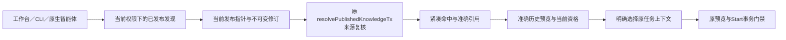

# 已发布知识发现架构与 AI SOP

状态：限定实现与验证完成；负责人：主集成代理；T-KNOWLEDGE-DISCOVERY-196。[PRD](../product/knowledge-discovery.md) · [合同](../../contracts/knowledge-discovery.md) · [交互](../design/knowledge-discovery.md)。

## 领域边界与数据流

发现复用当前业务数据库、事务权限和不可变发布修订。数据库取得当前项目候选，Go对解析后的发布标题、说明与正文进行Unicode字面子串匹配。管理目录的latest字段和原始JSON序列化不参与命中判定；原文保存在原修订中。

每个命中通过原发布解析重新核对修订、摘要及来源。retired／source_changed等候选不进入新结果；权限、数据库与内容完整性错误按原错误传播。Agent使用原只读作用域，发现结果本身不扩展能力。原project.search四类正式记录和外部语义索引保持各自真实覆盖。

## 有界工作量与分页语义

按aggregate.created_at降序、id升序进行keyset遍历。游标固定原调用者、组织、项目、规范查询、类型、页上限、上界和实际消费位置；每页重新核验当前授权与发布。编辑草稿或重新发布不改变创建排序，避免已扫描资产因为updated_at变化重复出现。

这是当前读遍历，不能推导跨请求快照一致性。刷新重新开始；并发新建、发布、退役和来源变更按合同的当前读边界处理。每次最多200个候选、20命中和48KiB编码预算，扫描位置沿实际消费候选推进。有继续游标的空结果表示还有候选可查。

## 预览与执行交接

命中携带原ProjectKnowledgeReference。准确历史API读取immutable snapshot，当前详情核对发布指针与资格；历史仍可读不代表能采用。已选引用独立保存，翻页、改词和关闭预览都不偷偷升级引用。原任务预览／启动事务再次解析当前发布及原来源，保留原执行版本和上下文上限。

## AI 开发和排障 SOP

1. 先区分管理草稿、发布修订、发现命中、明确选择、固定计划及模型实际使用六组事实。
2. 关键词未命中时检查实际发布正文与exhausted／next_cursor，不用latest草稿或前200候选替代全项目结论。
3. 命中不可采用时核对当前发布指针、原SHA、原来源及当前账户／项目资格；保留准确引用，不自动换成最新版本。
4. 查看详情和任务派发分别验证当前权限；失权后清理界面受保护内容，晚返回不能恢复旧内容。
5. 后续语义投影沿原outbox、领域来源、幂等投影、墓碑和分代重建；知识保留独立领域身份。
6. 仅验证新增断点与直接受影响消费者；数据库、GUI、模型消费、原生工具及生产证据分别记录。
