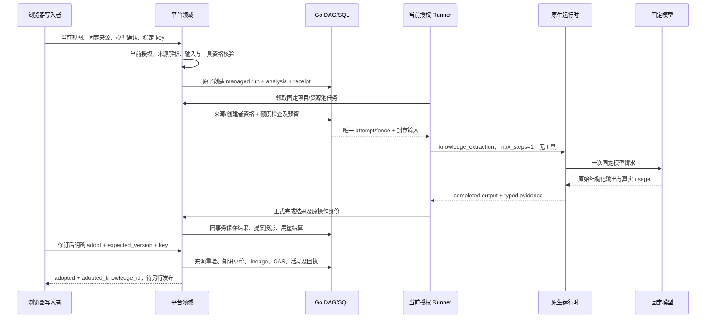

# 模型辅助知识提炼架构与 AI 开发运维 SOP

阶段：T-P4-026；产品版本：1.0.0；状态：本地实现及限定验证，完整平台继续开发。
设计依据：[领域合同](../../contracts/knowledge-intelligence.md)、[产品说明](../product/knowledge-intelligence.md)、[原项目知识合同](../../contracts/project-knowledge.md)。

## 模块与事实边界

平台领域负责固定来源、严格提案、分析状态、采用事务与不可变溯源，数据库保存正式事实。
Go DAG 继续拥有 Run／Node／Attempt／Fence、领取、租约、操作回执和资源预留，没有第二调度器。
Runner 与原生运行时只执行显式 `knowledge_extraction`；界面不接收模型密钥或任意可执行参数。
提案工件不是第二套正式知识正文版本；采用后仍由现有 ProjectKnowledgeRevision 管理草稿与发布。

主要实现为 `internal/platform/knowledge_intelligence*.go`，共享接线由 HTTP、DAG 和原生工具模块承担。
专用能力为 `Profile.KnowledgeExtraction{protocol,model,endpoint_origin}`，协议为 `suma-knowledge-extraction-v1`。
仅启用的 Suma 只读、无工作区 profile 可参与；该能力与 Planning 互斥，不借普通代码工具声明能力。
离线 probe 证明本地协议支持，实际库存、当前身份、项目批准、路由和额度仍分别核验。

## 持久化模型

| 新表 | 正式职责与约束 |
|---|---|
| suma_knowledge_intelligence | 分析聚合、version/state、固定 run 与私有创建凭据摘要；run_id 唯一 |
| suma_knowledge_intelligence_outcomes | 按 analysis/attempt/fence/result_sha256 保存原正式结果，允许同一未知尝试后续已知停止观察 |
| suma_knowledge_intelligence_adoptions | 固定分析版本、来源摘要、原模型摘要与目标知识修订；每 analysis 最多一次采用 |

新增显式分页索引 `suma_knowledge_intelligence_page(tenant_id,project_id,created_at,id)`。
主键与唯一约束之外不新增来源正文表；既有知识、用量和 DAG 表各保留自身职责。
列表按当前项目、created_at/id 降序 keyset 分页，默认 20、最大 100，before 必须属于同一项目。

## 固定输入与输出

来源复用 ProjectKnowledgeSourceInput 与服务端解析器，限定真实 documents／requirements／tasks／issues。
服务端固定 kind/id/version/title/quote/SHA；quote 必须属于当前正文，空值取完整正文。
来源数组顺序固定，数组快照计算整体 SHA；采用时再次检查完整数组的版本、正文摘要、可见状态与引用。
完整输入最多 32000 UTF-8 字节；单节点 `extract`、120 秒、MaxRetries=0、非幂等模型执行。
原生 max_steps 唯一为 1，输出预算 1–8192，默认4096；此 purpose 没有任何工具调用。

`KnowledgeIntelligenceOutput` 只接受 schema_version/title/summary/content/source_indices/rationale 六个字段。
来源索引严格为不重复整数子集，不接受外部 ID、版本、SHA、权限或任意命令。
结构、重复字段、空必填值、索引、字节上限或原件上限失败时，分析不能进入 ready。
原件与 SHA 独立于可编辑 proposal；超 64 KiB 不公开截断件，原正式结果与完整摘要仍保存。

## 主要时序

## 当前权限与阶段来源检查

GET 使用当前 ProjectRead，支持真实固定项目 API scope；Runner／Agent 不能进入管理读取流程。
创建、修订、关闭和采用要求当前浏览器 ProjectWrite；采用复用正常知识写入 proof，不合成 Actor。
正式 publish 仍要求 BrowserProjectApprove；采用确认不等于发布批准，也不等于组织共享授权。
创建凭据只保存摘要，后续从实际凭据发行、会话及当前成员关系回源，不能凭用户 ID 伪造浏览器身份。

| 阶段 | 来源与执行身份处理 |
|---|---|
| 创建／新领取 | 核验创建者、当前项目写权、完整来源、固定 profile 及路由；过时来源不消耗新 attempt |
| 已开始后的心跳 | 重核创建者与执行资格，保留已封存来源；来源版本变化本身不撤销原输入 |
| 完成结果 | 核验当前执行身份、固定工具证据及 run/node/attempt/fence；原结果落库与来源当前资格分离 |
| 明确采用 | 当前浏览器写权、analysis CAS、确认及完整固定来源全部重验 |

单次无工具模型执行的完成接口只记录已发生事实，不因创建者退出或撤销而抹掉结果、令费用永久未知。
旧 worker、错误 fence 或不符合 Core 状态规则的已停尝试仍拒绝；创建者撤权通过心跳及后续领取门禁阻止继续执行。
结果回写不创建新执行、不采用草稿，也不批准发布；后续人工操作重新取得当前权限。

来源变化后，有效提案仍为 ready，但 basis_current=false，原件和提案保留而采用被拒绝。
无效模型结构仍为 failed；不能用“来源过时”掩盖无效提案或把执行成功当成知识正确。
历史命令回执保留原文和版本，当前 head 不同时清除操作资格，避免旧 ready 回执再次宣称可采用。

## 未知结果、费用与采用溯源

原稳定操作恢复丢失响应，重复完成不重复投影、计量或创建草稿；未知不能通过重新调用模型来猜测结果。
reconciling 禁止 adopt/dismiss；未知观察独立保留在正式结果事实中，分析原件与摘要在首个已知结果时固定。
自动核对只接纳同一未停止尝试、仍有效的原租约、未取消运行和相同 worker/fence，且必须经过当前执行授权与平台专用核验。
平台仅允许单次、无工具、无工作区的只读知识提炼，并重核创建者与固定 profile／路由；正式 completed 证据可恢复已知执行，不重跑模型。
提案 JSON 不作为执行事实恢复授权：格式有效才 ready，格式错误仍保存原件与真实 usage，分析标 failed。
Stopped、过期租约、旧 worker/fence、取消运行、普通 CLI、Planning 或缺少核验钩子的路径仍拒绝；未知原事实和费用记录保留。
租约过期、停止和业务核对不自动把费用视为零，未知保留沿原额度合同处理。
领取时固定模型、origin、费率修订及组织／项目额度，完成在同一个 Core 事务记录实际 usage 与估算费用。
来源过时不取消已经发生的计量；progress 事件不与最终 usage 重复累加，币种分别计量。

采用调用现有知识草稿事务，method=model_assisted，Sources 由固定索引解析，不信任模型提交的来源。
model_adoption 保存 analysis/version/run/profile/source/original-output 摘要及目标第一草稿 revision/SHA。
人工后续编辑和发布沿原修订链进行；原模型工件及采用关系不覆盖、不自动升级，也不自动共享到组织目录。
任一来源、lineage、CAS 或回执写入失败时整个采用事务回滚，不能泄漏半个正式草稿。

## AI 开发与运维 SOP

1. 先按合同划分平台、运行时、界面和共享接线所有权，DTO 及 phase source guard 冻结后并行实现。
2. 用真实凭据、真实来源、原生协议和正式 Runner/Pool HTTP 验证闭环；模型边界夹具必须明确标注。
3. 只运行必要 Schema、授权、幂等、未知、事务、来源及费用切面；修复后只复验受影响组。
4. 维护英文／中文状态和诊断目录，保留用户原文；质量报告记录真实命令、失败与修复边界。
5. 工具密钥只留执行节点。数据库、原始输出、日志、截图和构建均留忽略目录，日志不得输出秘密。
6. 活动预览与验证构建隔离；未知执行保留原 run/attempt/op，先核对现场，不重建数据掩盖失败。
7. 发布前核对迁移、生成合同、配对构建和当前预览状态；本地协议通过不等于厂商、生产或全部 P0–P7 验收。

阶段证据：[限定本地验证](../quality/knowledge-intelligence-verification.md)。源码完成、本地协议及代表性界面验证分别记录；厂商、生产及完整平台继续实施。
