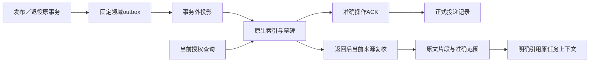

# 知识索引投影架构与 AI SOP

状态：本阶段限定实现并验证；负责人：平台集成；T-KNOWLEDGE-PROJECTION-197。[需求](../product/knowledge-projection.md) · [交互](../design/knowledge-projection.md)。接口以本阶段正式合同和生成Schema为准。

领域身份由租户、项目、来源类型和来源ID组成。`sequence`表达业务事件顺序，`revision／sha256`定位准确发布正文；二者不混用。知识草稿编辑可增加业务版本而保持原发布有效，退役事件保留原发布依据并增加顺序。

业务事件在原CAS、审核、审计与回执事务内生成。原回执重放恢复原操作，不新增事件。投影通过原有后台入口执行远程IO，核对准确事件、来源、动作、处理代次与结果后保存投递事实。远端HTTP成功状态本身不能代表事件被准确接纳。

索引按领域隔离来源，保存单调来源状态、不可变输入及删除墓碑。重复与乱序事件有明确处理结果，同顺序冲突不能替换原内容。代次绑定后端、嵌入配置和分块规则；重建沿准确保存输入与受控资源预算完成，处理中和失败都不能显示为已完成。

查询先验证当前作用域，再执行网络读取，返回后在当前事务重新授权。知识通过原发布解析与来源资格核验，文档按当前正式原件核验；片段与范围从正式内容重建。当前发布可采用资格、历史可读取性和任务Start依据分别处理。

范围统一为`unicode_codepoints`半开区间；TypeScript使用`Array.from`，Go使用`[]rune`，预览绑定同一准确引用。处理服务的局部水位与业务事件顺序不可直接相减，投递计数也不证明当前代次覆盖完整。

## AI 开发和排障 SOP

1. 先定位正式发布、固定事件、远端ACK、实际处理代次和当前授权五类事实。
2. 投递异常先核对原操作和准确ACK，保留固定事件；业务事务内不执行远程调用。
3. 旧命中不返回时核对来源类型、发布指针、摘要、退役和当前权限；不得用最新草稿或远端片段替代。
4. 空结果先检查实际模式、代次及重建／失败状态；关键词与索引模式由用户明确选择。
5. 重建按固定输入、预算和截止推进，保留处理位置与墓碑，完整完成后再开放新代次。
6. 仅验证新增及直接受影响边界，分别记录真实原生索引、协议夹具、商业嵌入、数据库矩阵、GUI与生产覆盖。

限定实现与实际边界见[验证报告](../quality/knowledge-projection-verification.md)。
