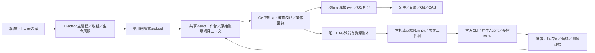

# 电脑本地一站式智能开发工作台

状态：1.0.0，需求23完整架构与实施基线；负责人：桌面、控制面、Runner、智能体和工作台。与需求9／12／15／17／21／22合并实现，完整P0–P7与需求1–25全部保留。[原生目录合同](../../contracts/desktop-workspace.md)、[完整计划](../delivery/implementation-plan.md)、[当前能力](../delivery/status.md)。

## 产品目标与信息架构

电脑上打开速码后，用户在同一项目上下文完成想法与需求、设计与规范、代码与工具、Agent／专家团队、测试与审查、基线／版本与交付。桌面提供操作系统集成和本地服务管理；业务界面与浏览器共用，不能另建一套项目数据或绕过平台权限。

主导航仍为概览、需求、开发、质量、发布运维和资料。开发工作空间采用文件／Git／运行上下文，编辑和比较区居中，终端／问题／执行输出位于按需展开的底部区；Agent计划、工具调用、当前模型、用量及操作依据放在可展开侧区。常用动作保持直接，低频配置与证据折叠，不堆放大量并列卡片。当前已实现与待办分别见下表。

| 模块 | 完整目标 | 当前状态与后续交付 |
| --- | --- | --- |
| 桌面服务 | 本地独立、服务器连接、启动诊断、正常退出和恢复 | 已有Electron／Go生命周期；本阶段增加项目目录原生授权；远端连接管理、完整诊断和自动恢复继续实施 |
| 项目工作区 | 多项目、多目录、最近打开、分支／独立工作树、当前任务 | 已有项目与attempt隔离、目录分页、固定基线；本阶段接入本机选目录；最近项、完整多根工作区、文件打开／保存的绑定版本上下文及设备同步待办 |
| 专业编辑器 | 文件树、多标签、拆分、查找、诊断、快捷键、冲突保护 | 已有Monaco文本／草稿／CAS保存和只读差异；创建／删除、多标签、全局查找与全部内置国际化继续实施 |
| 终端／语言／调试 | 有权限和资源上限的PTY、LSP、DAP、预览与端口授权 | 仍待完整实现；命令节点和Monaco语言Worker不能当成真实PTY／LSP／DAP |
| 工具和模型 | CLI／IDE能力发现、安装版本、连接、模型参数／预算、流式会话和恢复 | 当前原生／Codex／OpenCode及限定外部合同已有独立证据；完整工具／模型目录、等待输入、恢复及安装管理逐项推进 |
| 智能开发 | 目标→可编辑计划→DAG→并行工作树→反馈修订 | 已有受控规划、专家派发、候选合成／修复和基线交接；完整自主策略、持续会话、智能模型／技能选择待办 |
| 质量与交付 | 当前代码差异、同SHA独立测试、验收、集成、发布与故障回流 | 当前限定闭环见各专项报告；生产CI／部署、完整合并策略及远端恢复待办 |
| 扩展与同步 | 插件／技能／MCP／A2A、知识／记忆、项目规则和多端同步 | 当前固定资产、授权检索与部分MCP；可执行插件隔离、完整知识索引、离线同步和跨工具一致性待办 |

## 分层架构与信任区

桌面原生能力只负责用户明确选择的操作系统资源，控制面负责项目授权与正式状态，Runner负责受限执行和回执。原生选择证明不授予组织角色、执行权限或验收权限。不存在第二个桌面调度器、共享任意命令入口或通过渲染页读取秘密的通道。

本机数据、目录私钥及桌面服务使用专属应用用户目录，工具CLI的私人配置保持其原有来源。开发验证通过三个仅开发模式可用的绝对路径覆盖指定独立数据、控制程序和Web资产，不覆盖活动预览或真实桌面数据。默认桌面本机服务固定SQLite，避免继承终端中指向共享数据库的环境配置；服务器连接作为独立显式模式继续实现。

## 本阶段纵向链路

1. 已登录用户在当前项目的工作空间点击“选择项目文件夹”。Electron检查准确窗口、主frame与本机服务origin后打开原生目录对话框。
2. 选择完成后生成仅120秒有效、绑定原账号／组织／项目／路径／操作标识的HMAC证明。取消不触发绑定；选择也不自动提交。
3. 用户明确绑定，控制面复核当前批准权限、角色、原绑定CAS和证明。相同原操作恢复原回执，不生成新绑定。
4. 控制面保存项目专属目录身份与服务端证明。目录浏览、打开、保存、Git及原写恢复使用同一当前许可，坏证明或目录替换不降级为更宽根。
5. 共享IDE读取实际目录与代码，后续任务继续走已有工具／DAG／Runner与独立测试合同。目录可用不表示工具、模型或运行健康。

## 参考与采用方式

Multica固定参考提交`a47a1ced0c71bdb113a43facce4675442acb9001`的[daemon-profile](https://github.com/multica-ai/multica/blob/a47a1ced0c71bdb113a43facce4675442acb9001/apps/desktop/src/main/daemon-profile.ts)与[daemon-manager](https://github.com/multica-ai/multica/blob/a47a1ced0c71bdb113a43facce4675442acb9001/apps/desktop/src/main/daemon-manager.ts)强调桌面专属配置、服务身份与用户切换隔离。本次只研究这些已固定源文件和仓库布局，未修改参考仓库或复制其源码；完整跨机能力继续独立验收。

OpenWorkBuddy、Octop、OpenCode、Zed、Codex与Harness／DSH的采用点和差异沿用[参考能力表](../integrations/development-platform-reference-extensions.md)与[实际交付矩阵](../product/platform-capability-delivery-matrix.md)：共享能力合同与上下文，分别实现原生Agent、工具适配、语言服务、团队任务和会话，不能把名称集合当成功能完成。

原生对话框和IPC采用Electron官方接口。[dialog](https://www.electronjs.org/docs/latest/api/dialog)提供主进程目录选择；[安全建议](https://www.electronjs.org/docs/latest/tutorial/security)要求隔离渲染进程、限制暴露能力并校验IPC发送者。本次保留既有沙箱、contextIsolation和nodeIntegration边界。运行时升级、签名及目标系统安装仍在正式桌面交付验收中。

## 质量与AI开发SOP

先冻结跨端签名／DTO／错误，再按桌面、后端、界面三个所有权并行实现。主集成者统一生成合同、串行执行Go、维护完整范围与证据；禁止模块自建另一个授权或派发中心。只运行变更涉及的签名、当前权限、幂等／CAS、重启、界面及代表性桌面旅程，保留原失败并按影响复验，不重复无关模型或全套测试。

源码、模拟、实际Electron、安装、签名、物理多机与生产逐层记录。阶段提交必要实现和精简记录，密钥、数据库、测试原件、截图、原始日志、依赖和二进制不进入Git。完整第23项目标必须由工作台、执行链路和目标系统实际验收共同证明，不能因原生选目录闭环完成而关闭。
