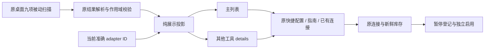

# 本机工具发现展示架构

阶段：T-TOOL-DISCOVERY-202；suma 1.0.0；负责人：主集成代理。状态：限定实现与验证完成，见[验证报告](../quality/local-tools-discovery-experience-verification.md)。依据[合同](../../contracts/local-tools-discovery-experience.md)、[PRD](../product/local-tools-discovery-experience.md)和[现有工具管理设计](../design/tool-management.md)。

## 模块与数据流



扫描和解析仍由现有桌面桥接、`local-tools-scan-model.ts` 与 `tool-quick-connect-model.ts`负责。本阶段新增 `local-tools-scan-presentation.ts`，由原 `LocalToolsScanPanel.tsx`消费；不改变扫描合同、网络请求、凭据、进程生命周期或正式派发权。

```ts
projectLocalToolsScan(
  items: readonly InstalledToolFact[],
  selectedAdapterID?: string,
): {
  primary: InstalledToolFact[];
  other: InstalledToolFact[];
  detectedCount: number;
  attentionCount: number;
}
```

投影一次遍历，时间 O(n)、分组空间 O(n)，返回原条目引用，不修改输入。仅未安装、原因为 `not_installed` 且不是当前选择的条目进入 `other`；其余进入 `primary`。原序、协议和完整检测事实保留，统计不依赖展示位置。投影不校验或修补外部 JSON；原严格解析器仍是事实入口。

## 状态与权威

折叠属于局部展示状态，复用原生 `details/summary`；不进入服务端、Journal 或业务配置。原组件的身份/项目/调用者代次隔离、缓存到期和迟到响应保护保持。作用域重建同时重置展开状态；用户选择导致跨组时，只恢复仍属于原明确动作的焦点。

原配置动作只接受合法唯一适配描述符。安装发现不能升级为已连接、已授权、模型可用或可派发；即使同一原生程序支撑多个协议，也不合并为一个入口。展开不触发 I/O，强制重检只沿原明确扫描动作。未知操作继续原操作标识、请求体和回执恢复，不建立第二恢复器。

## 本地参考与许可

参考本机 `D:/codes/github/multica`，锁定提交 `5a2cc891ac338eed1919aa11a1eef5957cd82cec`，本次只读观察工作区干净，未拉取或修改。具体可对照模式如下：

| 参考源位置 | 观察到的模式 | suma采用边界 |
| --- | --- | --- |
| `packages/views/onboarding/components/use-runtime-picker.ts` | 人工选择不会被随后刷新覆盖 | 保留准确选择，未安装选中项也保持可见；不引入参考项目的轮询策略 |
| `packages/views/onboarding/steps/step-runtime-connect.tsx` | 扫描、发现、空态分别表达；刷新是明确动作 | 复用原扫描状态和重检入口，不用折叠制造扫描 |
| `packages/core/runtimes/derive-health.ts` | 从服务端观察派生展示健康状态 | 展示派生与权威分离；不把安装观察映射成运行健康 |

本次精确分组和默认折叠规则是 suma 的独立交互合同，并非宣称 Multica 存在相同实现。其 `LICENSE` 为 Apache 2.0正文与附加条件共同构成，包含 hosted/embedded 条件；沿[既有许可记录](../integrations/multica-claude-sdk-connect.md)只参考模式，本阶段不复制受限源码、品牌或资源，不将全仓库表述为无条件 Apache。

## AI 开发 SOP 与验收

1. 先读本阶段合同与原扫描解析器，确认唯一事实来源和文件所有权。
2. 投影代理只实现纯分组与数量；交互代理消费它，复用原生折叠及现有操作，不改解析器或后端。
3. 双语目录成对维护；异常、过期与无桥接继续原状态，不能为了简化首屏删除恢复出口。
4. 仅运行新增投影、直接受影响组件及集成代理安排的类型/国际化和代表界面检查；未变化的 SDK/厂商链不重跑。
5. 原始证据放忽略缓存；主集成代理核对源摘要后更新验收报告并提交必要源码/文档，不提交缓存。

投影、焦点、作用域及双语代表组件验证已完成，原证据和实际边界见报告。全局表单选择器采用控制高度令牌且优先级较高，本组件通过局部`--control-height:44px`供给其目标尺寸，不修改全局密度。完整平台与真实设备矩阵仍分别推进。
