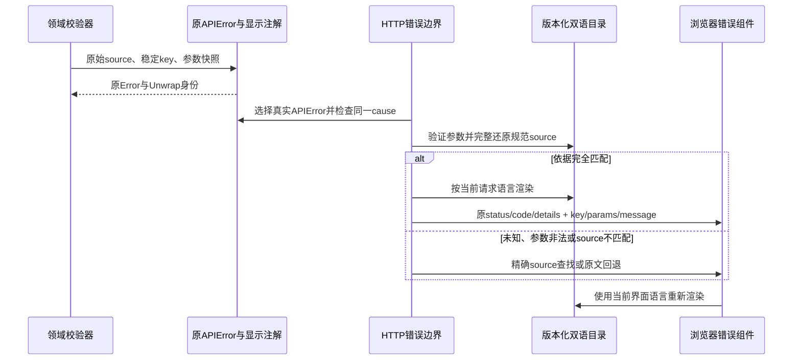

# 受控诊断国际化架构

状态：T-P4-009本机实现已验证，验收结果见[阶段报告](../quality/backend-diagnostics-verification.md)；完整平台继续实施。负责人：平台集成、控制／执行／发布领域代理。关联需求：FND-I18N-001。接口依据：[语言与消息合同](../../contracts/localization.md)、[偏好合同](../../contracts/locale-preferences.md)。

## 领域边界

诊断属于产生它的业务领域，目录分别位于`internal/localization/catalog_control.go`、`catalog_execution.go`、`catalog_release.go`，参数化生产者使用`catalog_validation.go`。稳定键表达具体原因；相同HTTP错误码可以对应多个键。维护目录时同时核对完整中文原文、真实业务条件和英文译文，特别保留未知副作用、固定版本、独立测试及人工验收的区别。

目录由`combineCatalogs`复制组合，初始化检查键、原文歧义及模板合同。模板只支持具名纯文本参数，不执行用户模板、函数或条件。目录包含两种语言，浏览器取得并验证后可重新显示已存在的错误，无需重复业务写入。目录版本摘要绑定全部内容和解释格式。

## 原因与显示分别保存

`diagnosticAPIError`只包裹一个原APIError。参数复制后不可被调用方映射修改；`Error()`仍返回原消息，`Unwrap()`仍能取得原错误。HTTP同时检查cause和规范source，避免一个格式合法但含义不符的key隐藏真实原因；组合错误中的其他注解也不能改写被选中的拒绝状态。

显示失败不反过来改变业务结果。翻译缺失、非法参数或不匹配时保留已经公开的原文，标记回退且不输出未经验证的参数。资源范围、租约、审批摘要、版本、签名、幂等身份、回执、原始工具输出和用户内容均不参与翻译。结构化details保持原值，包括false、零值和未知结果。

## 覆盖门禁与变更流程

`internal/localization/platform_coverage_test.go`使用标准Go AST检查平台非测试源码中的约定诊断构造，识别完整字面量、常量／括号／相加、具名和位置APIError字段以及发布wrapper的消息参数。新的完整中文原文必须有精确目录项；动态中文必须使用具体参数化键及声明参数，不能登记前缀或用通用错误键绕过。

合成解析样例故意引入未知文字、模板片段、错误参数位置、额外参数及误用注解，以验证门禁会拒绝真实遗漏。真实源码门禁聚合报告覆盖数，不把每条目录计为独立业务验收。它不宣称所有英文错误、原始动态错误、全部Go包或所有展示字段已经国际化。

领域修改顺序：先读业务条件，写有效失败回归，再补稳定目录或显式参数生产者；定向HTTP验证状态／details和拒写保持，独立审查语义；最后在固定输入上完成全量、运行程序和真实界面验证。具体计数、运行包和残留范围进入质量报告，所有P0–P7未完成项继续保留。
