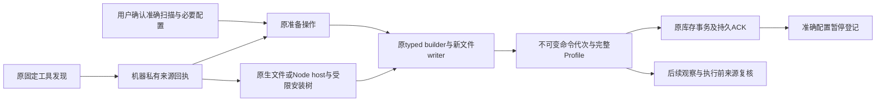

# 已安装CLI来源、配置与执行边界

速码1.0.0 · T-MANAGED-CLI-PREPARATION-225 · 负责人：执行平台组。关联[合同](../../contracts/managed-cli-preparation.md)、[PRD](../product/managed-cli-preparation.md)、[交互](../design/managed-cli-preparation.md)、[验证报告](../quality/managed-cli-preparation-verification.md)。沿[原准备架构](managed-tool-preparation.md)扩展，无新业务派发器、表、API或外部依赖。

## 模块职责

| 模块 | 当前责任 |
|---|---|
| toolpreparationcontract | 六类能力、三种配置模式、准确扫描资格、完整Profile与固定模型一致性 |
| toolcontract | Claude唯一固定模型规则、原协议／版本／能力，不推断账号或模型健康 |
| Runner发现与私有回执 | 保存原解析命令、准确安装根及来源证明；公开扫描没有私有路径或依赖树 |
| Runner受限准备 | 消费原扫描，不再搜索PATH；只生成一个新命令，复用独占writer、Journal与代次接纳 |
| Runner运行边界 | 来源pins进入正式配置摘要，后续观察、恢复与执行重新核对安装，不把旧摘要当当前资格 |
| 控制面 | 原当前身份／授权、claim/fence、配置与Profile精确匹配、关联库存同事务完成 |
| 原工作台 | 单helper选择必要字段，未知操作优先恢复，准确完成来源回原Quick保存暂停 |

## 准确安装来源

原生CLI绑定原文件路径和完整SHA。Node入口需要额外覆盖原脚本与解析安装范围，不能以Node可执行文件或单个入口摘要替代整个工具来源。受限rooted树沿原普通文件、目录和链接策略核对；准确resolver根包含必需hoisted／sibling解析范围。安装树上限沿原Cursor核的10,000个文件、10,000个目录及1GiB，超限、树外或链接来源缺乏证明时明确拒绝自动准备并保手工入口。

只在明确允许远程准备的持续扫描收集必要强pins；原普通本机手工准备不为本轮反复扫描全部安装目录。来源证明为本次安装观察，不包含工作区、CLI账号、用户插件内容或整个操作系统。用户／模型不能提交机器路径、依赖列表、argv或Env值。依赖漂移触发重新核对，不自行下载、npm安装或改机器环境。

准确来源和受限依赖摘要进入生成CommandSpec与其Profile摘要。当前安装改变后，Describe、Execute和重启恢复均不得把旧Profile继续称为当前；还在途的attempt保持原冻结定义，当前执行处置沿原核对协议。不以读取时间变化给旧回执续期。

## 不同工具的配置语义

Configuration始终恰好两个字符串。ACP保原模型／凭据引用；Claude CLI采用唯一原模型token规则，原CLI参数builder以用户明确模型替换预设，凭据引用必须空；其他三种原生CLI的两个字段必须为空，拒绝静默忽略覆盖值。API Schema按adapter生成六个互斥分支，服务端与界面各自验证，不能只靠表单隐藏字段。

Profile匹配仍保原commandID、程序SHA、版本、完整摘要和真实停止证明。原生三项必须是其原plain Profile，不能追加其他执行能力；Claude必须原完整claude_execution及本次model。ACP与generic的真实协议差异不是历史兼容分支。Cursor检查package时，第二返回值按真实Node路径处理，版本由原扫描提供。

## 恢复与正式完成

generic typed intent与ACP intent按准确adapter互斥。原started、接纳receipt、head和完整snapshot语义沿用：先持久再发布，未确认期间关闭scope新领取门；prepared仅等待库存，原关联库存与completed同事务。未知副作用保留原请求并核对；既有文件、相同hash或重新生成的操作标识不构成接纳证据。

允许维护节点如实保存available=false完整配置；当前准确完成来源可以形成paused档案。enable只表示独立授权状态，实际Preview／Start仍核当前可用、模型／工具约束和预算。没有准备动作可以替代开发提交、同提交独测、人工Review或部署门禁。

## AI开发与运维SOP

1. 从当前准确节点读取能力和原扫描，解释实际配置模式；无来源时先重扫，不推断默认模型或SDK资源。
2. 只形成允许的配置草稿；模型／账号不变的工具不显示无效输入。用户明确确认后提交原地址与稳定key。
3. 观察原持久状态。超时或丢ACK先核对原操作，不能换key重writer、重探测或自动启用。
4. 完成后读准确库存、完整Profile和原prepared来源，回原Quick保存暂停。需执行时再走原启用和任务预览／Start。
5. 安装漂移或依赖边界失败，说明准确原因并保留原证据；修复安装后重新明确扫描／准备，不把清除日志当恢复。
6. 后续代码开发继续原独立工作树、候选、同提交测试、人工验收和后续基线交接；真实厂商／SDK、多机、其他数据库／系统／规模与生产单独取证。
