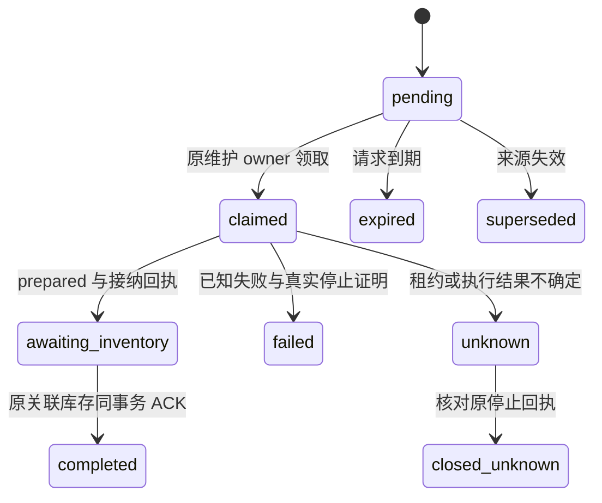
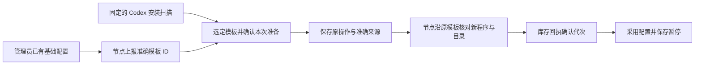

# 远程工具受限准备与配置接纳

T-MANAGED-TOOL-PREPARATION-224，速码 1.0.0。唯一接口依据为[受限准备合同](../../contracts/managed-tool-preparation.md)。本阶段接通已有维护通道，完整 31 项／P0–P7 目标继续推进。

## 能力与权限边界

当前自动 factory 只有 `qoder-acp` 和 `cursor-cli`，复用原静态 ACP 准备器。其余七项保留现有手工接入，不能从九项工具目录推导自动准备能力。

`--allow-tool-preparation` 默认关闭，必须同时明确允许 `--allow-installed-tool-discovery`。持续普通 Runner 和 Pool 才声明、消费该能力；一次 `--report-tools` 不取得准备权限。`--maintenance-only` 不领取业务任务；准备不会打开 `AllowExec`。

浏览器只提交准确扫描、预期代次、固定模型、凭据环境变量**名称**和本次配置写入确认。可执行路径来自该节点原扫描的私有不可变回执；缺失则要求重新扫描。当前原生字节及 Cursor 包完整闭包须重新静态核验。没有任意 shell、安装、更新、登录、凭据值上传或模型调用入口。

普通节点沿原登记身份、项目权限和操作员来源核验。Pool 沿原机器身份、消费项目 route 与双边 Grant 核验，不因池管理权限扩大项目权限。原 inspection、scan、准备及未确认库存共享排他维护 owner。

## 不可变代次与两阶段确认

1. 先保存原 claim nonce、准确来源、typed intent，再由原准备器创建全新私有文件。命令 ID 由准确操作稳定派生，不覆盖原命令。
2. 构造完整快照，通过原工具观察及真实停止回执核对。文件 SHA、原 Profile／ACP 配置 SHA、generation SHA 和本机接纳回执 SHA 是独立事实。
3. Journal 在发布内存快照前，持久保存新 head 和**原待上报库存正文**。普通节点及 Pool 同 scope 的所有 slot 读取同一快照；在途尝试继续使用已捕获的旧快照。
4. `/results` 的 `prepared` 只进入 `awaiting_inventory`。原库存携带准确 `Preparation` 关联；服务端在同一事务核身份、来源、代次、完整 Profile 和回执，保存库存并转为 `completed`，ACK 精确回显关联。
5. 本机持久确认原 ACK 后才释放该 scope 的新领取门。恢复旧 ACK 不续库存 TTL，当前周期观察单独恢复领取资格。

磁盘 generation 只保存新增 ACP 命令和非秘密 base 摘要，不重复原手写配置中的环境值。恢复时从当前 base 与 managed delta 合并完整内存快照。base 绑定配置与必要本机资源，排除执行开关、维护模式及运行时凭据值，允许在不更换工具内容的情况下切换原运行模式。

`completed` 证明准备和关联库存已确认，不证明可执行。维护节点可如实上报 `Available=false` 的完整 Profile；准确完成来源经当前读核对后，可按原接口保存为 `paused`。启用与派发仍是独立动作，继续受原权限、当前可用性及执行配置门约束。

## 故障与重启恢复

claim、结果与库存均恢复原 nonce／body／key／fence，不重跑 writer 或原生探测。已提交但未收到 ACK 时不能回滚可能已被平台接纳的代次。

重启先以 head **原 claim nonce** 回放核当前认证 scope，不用新 nonce 顺手领取其他待办。发布快照前校验 scope、base、不可变 manifest、本机接纳回执、制品字节及所有 managed 原生 SHA；Cursor 还须通过完整包闭包校验。head 已落盘而库存 mirror 写失败时，同进程下一轮也必须完成该恢复和快照发布，不能只补网络回执。

started 缺可靠接纳或停止证明时保持 `unknown` 占用。`closed_unknown` 只记载原效果未知但停止已核实，不代表配置已回滚或取得派发资格。保留原文件、Journal 和明确节点隔离／重配对路径，不让用户删日志或换 key 猜测重试。Pool 各项目隔离 head 和领取门，单 scope 故障不取消其他仍获授权的 scope。

## AI 开发 SOP 与限定实跑

- 变更先对齐唯一合同和共享类型；不增加通用远程命令、第二 dispatcher 或隐式权限。
- 新 provider 先证明固定输入、原生来源、停止事实和恢复闭环，再加入实际 capability；目录存在不等于已实现。
- 只检查直接受影响的权限、原回执、持久化和快照分支。共享修改统一集成，记录初始失败及定向修复，不重复无关 SDK／模型套。
- 界面保持“准备、接纳、库存、暂停登记、启用”各自事实；未知原操作优先，迟到读和跨来源选择不得覆盖当前意图。

本阶段完成一次真实普通 HTTP／SQLite／内嵌原 Worker 维护链：自有 4 KB Windows 版本程序扫描 → 原静态 factory → 持久 generation → 关联库存同事务确认 → 原 HTTP 登记一个暂停档案。各丢失一次已提交的结果和库存 ACK，按相同正文恢复；两个原生进程均只执行 `--version`，未重复准备探测，三个制品哈希一致，0 启用／派发／ACP 初始化／模型调用。原记录位于本阶段忽略目录，供应方字符串不作为真实性证明。

这验证了接线和恢复，不是 Qoder 厂商协议或账号验收。Pool 实机、多机、其他系统／数据库、其他七个自动 provider、供应方模型和规模验收仍待按完整矩阵完成。

## Codex App Server 的安装换新

原准备操作冻结扫描、节点、代次和确认。Runner 从该作用域的基础命令加载模板，按原操作的 ID 复核固定协议，将该模板的本机参数和扫描路径固化为独占新命令。机器用原文件、记录和程序 SHA 核对重启恢复。当前运行继续使用原快照。

同一原库存事务必须接纳该新命令和有效的 Codex 模型目录。完成前不提供准确配置交接。未确认结果仍按原回执恢复。新档案和正式启用沿现有权限与版本规则，Codex App Server 与 Codex JSONL 资格分别声明。
