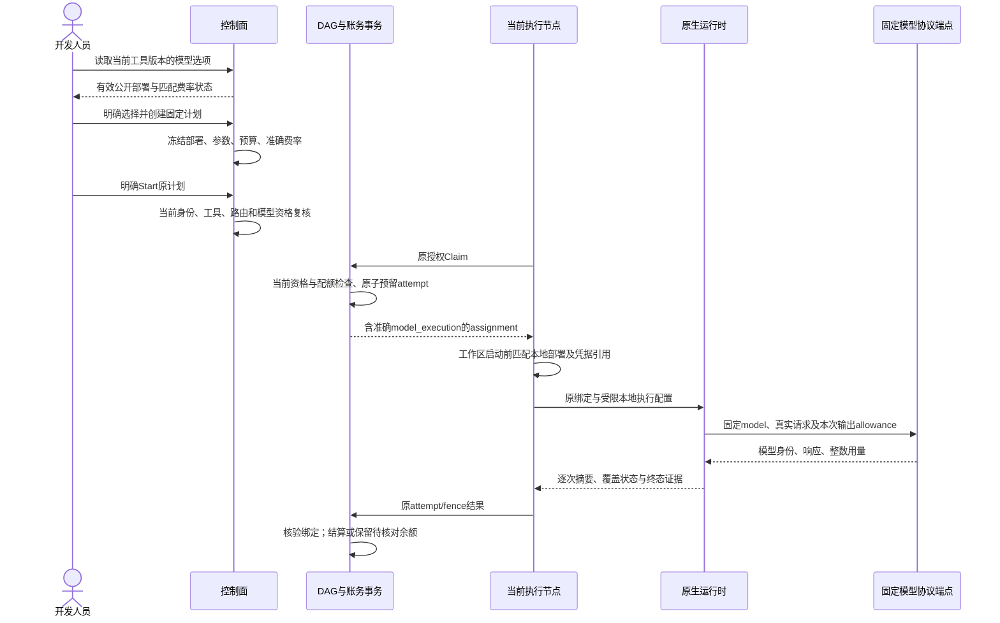

# 原生模型执行绑定架构

状态：T-P4-036／1.0.0，限定本地实现及验证通过。当前设计以已落盘合同及实现为准；[035设计输入](035-model-selection-design.md)保留历史背景，不能把其中后续模型注册／独立报价方案当作本阶段已实现能力。[实际证据](../quality/model-execution-verification.md)由阶段集成统一记录。

## 模块及权威来源

| 边界 | 当前职责与接口 |
| --- | --- |
| [modelcontract](../../internal/modelcontract/model.go) | `Deployment`、`Selection`、`Binding`、`Evidence`；封闭字段、摘要、安全整数及预算验证，Go／原生运行时使用一致的结构化摘要规则 |
| [模型选项服务](../../internal/platform/model_execution.go) | 当前项目身份、准确工具版本及有效 worker observation；`GET /api/v1/model-execution/options` 返回公开库存、默认限额和当前匹配费率，不探测提供方 |
| [任务派发](../../internal/platform/task_dispatch.go) | `model_execution_selection` 转为计划 `model_execution`；同一绑定写入复制后的 agent 节点及其限额，Start 重新核验当前部署和准确历史费率 |
| [DAG 模型合同](../../internal/dag/model_execution.go) | 非法／不完整绑定不能退回普通执行；节点工具身份、参数与模型绑定必须一致，成功结果必须有对应模型证据 |
| [Runner 本地模型配置](../../internal/runner/model_execution.go) | 解析管理员 `--model-deployments` 允许清单；校验本地协议能力，准确匹配部署，启动前解析独立凭据引用，拒绝节点提供方覆盖 |
| [ProviderAdapter](../../packages/agent-runtime/src/provider-adapter.ts) 与 [Runtime](../../packages/agent-runtime/src/index.ts) | 固定实际请求模型和端点，记录请求／响应摘要及用量覆盖；复用受限、可取消、不自动重试的 HTTP 传输 |
| [attempt 账务钩子](../../internal/platform/usage_accounting_hooks.go) | Claim 同事务检查／预留组织与项目余额；冻结费率与模型绑定，按当前 attempt／fence 接收用量并结算或保留核对余额 |

公开部署是当前已批准工具所在 worker 的允许清单观察，不是独立全局模型注册表。平台沿用原项目、工具启用、节点／Pool 及路由授权；私有和 Pool 领取均检查模型资格，本地 Runner 再次匹配自己的准确部署。工具库存有效期及暂停／撤销继续沿用原合同，目录读取不证明厂商认证成功。

`endpoint_origin` 只公开源地址；`endpoint_config_sha256` 固定包含 API 路径的规范化完整 base URL。`deployment_sha256`、`parameters_sha256` 和 `binding_sha256` 分别标识部署、参数和含预算／可选费率的完整绑定。密钥及其环境变量引用仅在管理员本地配置和子进程启动上下文中使用，不进入计划、公开库存或结果。

## 关键时序

## 参数、预算与计价语义

只支持 `max_steps` 与 `max_output_tokens`。普通任务派发允许 1–16 步、1–32768 累计输出；底层合同容纳既有受控修复的更高边界，不因此在普通入口授予修复能力。Runner 与 Runtime 校验节点限额、请求绑定和本地配置一致；`model`、URL、API key、环境、`temperature`、`top_p`、`reasoning` 等节点覆盖均拒绝。

入场预留：`I = context_window × max_steps`，`O = max_output_tokens`。可选 Token 预算覆盖 `I+O`；费用预算需要同币种的冻结费率，并覆盖 `ceil((I×input_rate + O×output_rate)/1000000)` 微货币。计算使用整数与溢出检查，费用按运营方输入／输出两档费率估算；缓存、推理等报告字段不形成独立报价或厂商账单。

每次实际请求 `max_completion_tokens` 取剩余累计输出额度、普通每次 4096 及部署上下文窗口的较小值。完整用量可归还本次未用的输出 allowance；缺失或部分用量继续占用保守 allowance。上下文窗口是管理员声明的入场预留依据；运行时还核对提供方报告的输入／输出是否越界，当前没有模型专用 tokenizer 或提供方费用硬网关。

当前 `suma_usage_rates` 按项目／工具维护修订，选项查询只读取该工具最新一份费率，再精确匹配其中一个部署。冻结后按费率 ID／版本读取原修订；后来新增报价不会自动替换旧计划／attempt。无匹配报价保持 `unpriced`，费用预算及 enforce 政策按现有门禁处理。此结构不提供多模型同时报价、币种折算或自动最低价路由。

## 证据与恢复

Runtime 通过现有受限 fetch 调用 OpenAI 兼容 `/chat/completions`；ProviderAdapter 固定请求字节及 SHA256，现有传输保存响应摘要与精确用量数值依据。工作区工具继续使用官方 MCP SDK。没有新增官方 OpenAI／Agents SDK、厂商目录查询或账单连接。

提供方返回 `model` 必须精确等于部署模型；缺失或别名映射拒绝，不自动翻译或换模型。Runner 先保留已收到的用量，再阻止错误身份完成；控制面核验完整绑定摘要、部署／参数摘要、逐次身份、响应摘要与覆盖状态。缺失、部分、越界或未知结果不能释放为已确认零成本：保留原事实与未解余额，沿原 attempt 核对；现有具来源的人工用量确认不代表代码执行成功或业务验收。

## 实现与集成计划

| 顺序 | 当前实现检查点 | 阶段集成出口 |
| --- | --- | --- |
| 1 | 合同、公开库存、准确选择与固定计划 | 读选项不调用模型；非法、旧版本或非原生工具不能建立绑定 |
| 2 | Runner 本地匹配、真实原生 CLI、ProviderAdapter 与回执 | 实际请求使用所选定义；篡改、环境覆盖、别名与错误身份被拒绝 |
| 3 | attempt 预算、原费率、组织／项目配额与未知核对 | Claim 原子预留；真实整数用量按原费率记录，未知不伪装为零 |
| 4 | 原任务界面／CLI、双语与交付证据 | 代表性原入口及实际闭环统一记入[验证文档](../quality/model-execution-verification.md)，按结果更新阶段状态 |

远程访问仅增加[开发工具 MCP 真实诊断](../integrations/developer-connection-check.md)。[远程工作区出站 broker](remote-workspace-broker.md)仍为后续设计，未建立 Runner 文件访问、PTY／LSP／DAP 或完整远程 IDE。
