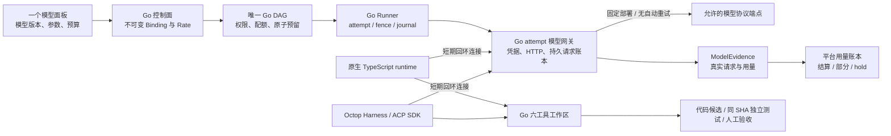
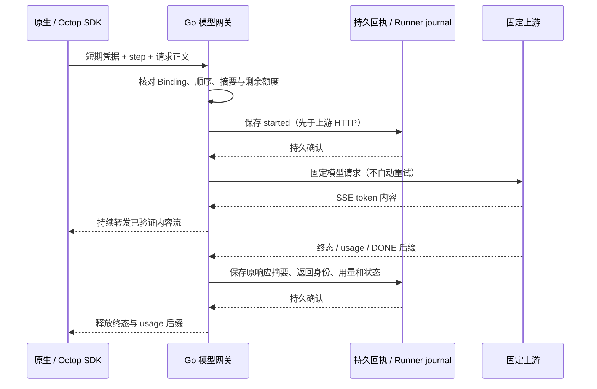

# 统一模型网关架构

状态：suma 1.0.0／T-MODEL-118 当前设计与实现合同。责任：控制面、调度与账务、Runner、原生运行时、Octop runtime 和工作台。关联：[模型合同](../../contracts/model-execution.md)、[Octop 合同](../../contracts/octop-harness-acp.md)、[统一绑定入口](model-execution.md)。本轮实际测试、真实协议运行与未验范围以[专项验证报告](../quality/model-gateway-verification.md)为准，本文不预先声明通过。

## 当前持久数据合同

产品版本仍为 **1.0.0**；当前唯一持久数据合同为 **`suma-initial-gateway-v1`**，由 `internal/store/baseline.go` 的 `InitialDataContract` 定义。它包含当前模型网关 JSON／请求证据语义，与产品版本、SDK 版本、流程修订和 API 协议分别管理，不构成历史兼容分支。

初始化先只读检查 `suma_schema_baselines` 的完整 platform／dag 声明。旧合同、未知组件、混合声明或已有但未登记的领域表必须拒绝进入当前写路径；一个正确组件不能掩盖另一个不匹配组件。程序不迁移、不改写声明、不清空旧目录，也不能靠删除用户数据库使初始化“通过”。

部署当前代码须使用**单独的新空数据目录／空数据库**，由当前初始化声明合同；原目录、凭据、业务原件与历史证据完整保留供原环境核对。当前合同已声明的库可重启，并按幂等初始化完成本次合同内被中断的建表，这不是升级旧库。新实例的身份、配置及验收由其自身建立，不把保留的旧库直接当成当前可写数据。

## 1. 设计与权威边界

原生 Suma 编码与 Octop Harness／ACP 使用同一 `ModelSelection → ModelBinding → Go 模型网关 → ModelEvidence` 链路。Go 控制面仍是唯一平台任务派发者；Go Runner 是当前 attempt 的模型 HTTP、供应商凭据、请求准入及持久回执权威。TypeScript/Python SDK 负责模型交互与 Agent 协议，不能自行选供应商端点、取得供应商密钥、追加预算或直接完成平台任务。

| 层次 | 权威事实 | 明确边界 |
| --- | --- | --- |
| 控制面与 DAG | 当前身份、工具／工作池资格、不可变计划、attempt／fence、预算准入 | 模型建议不增加第二个 dispatcher |
| 模型合同 | 部署、参数、费率、预算、预留与完整绑定摘要 | 配置目录不代表供应商健康 |
| Go 模型网关 | 真实上游请求、响应摘要、返回模型／请求 ID、逐次用量、关闭事实 | SDK 自报 usage 不覆盖宿主事实 |
| Runner journal | 与原 assignment 绑定、单调推进的模型检查点及结果 outbox | 重启不授权再次请求原供应商 |
| SDK／runtime | 受限本地连接、真实 token 流、工具调用及 Agent 生命周期 | 不能管理供应商密钥或确认账本结算 |
| 工作区宿主 | 六工具、真实操作日志、检查和候选封存 | 模型回复、ACP cwd 不是代码隔离证明 |
| 平台账本 | 原子预留、已知用量、费用估算、结算与剩余 hold | 代码失败、取消或进程退出不抹去消耗 |

Go 网关是受管运行时的模型边界，不是对任意被篡改解释器、原生扩展或主机网络的操作系统沙箱证明。管理员仍须保护解释器、运行包、配置及宿主；容器／网络隔离有独立部署与验收范围。

## 2. 模块及数据流



实现入口：`internal/modelcontract/` 定义闭合类型与整数预算；`internal/modelgateway/` 处理真实 HTTP 和 SSE；`internal/runner/model_gateway.go` 建立 attempt 网关，`model_gateway_journal.go` 把回执镜像到 Runner journal；`internal/platform/model_execution.go` 与用量钩子处理目录、计划和账务；两个 runtime 仅使用受限连接。

## 3. 部署选择、参数与预算

管理员通过现有 Runner `--model-deployments` 允许列表维护不可变部署。公开部分包含部署 ID／修订／摘要、协议、模型、`endpoint_origin`、完整端点配置摘要和声明的 `context_window`；完整 `base_url`、凭据环境引用及其真实值留在 Runner 管理范围。公开库存、任务、模型上下文和浏览器不携带供应商密钥。

模型选项服务按项目、工具 ID、准确版本与摘要读取有效观察，返回默认参数、匹配费率和 `parameter_limits`。原生编码与 Octop 均声明 `suma-model-execution-v1`；可选择上限为 `max_steps ≤ 128`、`max_output_tokens ≤ 131072`，具体界面使用当前响应的上限。不能把底层上限当作每个工具自动获得的能力。

`max_steps` 是一次 attempt 的最大模型请求次数；`max_output_tokens` 是整个 attempt 的累计输出额度，不是每一轮各有一份额度。模型、URL、供应商密钥、任意环境、温度等未开放参数不能通过任务覆盖。一次请求使用总剩余额度与上下文上限约束后的输出许可；只有完整原始用量证据才回收未使用部分，partial／unknown 不按零返还。

冻结的 `ModelBinding` 同时进入已保存计划和唯一生产节点，包含部署、参数、预算、准确 `Rate` 版本及输入／输出预留。预览、启动、领取和 Runner 各自重核当前授权与原依据。原生修复任务继续使用其专用准入，Octop 不因此取得原生冲突修复能力。

入场预留采用整数：

```text
I = context_window × max_steps
O = max_output_tokens
Token reservation = I + O
Cost reservation micros = ceil((I × input_rate + O × output_rate) / 1_000_000)
```

上下文窗口为管理员声明的保守依据，不是精确 tokenizer 计数。费率是冻结的运营方输入／输出两档费率，不等于厂商最终账单、完整缓存／推理报价或绝对费用保证。未匹配报价保持未定价，不显示免费，也不能以虚构金额通过费用门禁。组织／项目策略与 attempt 预算在原领取事务中共同检查和预留。

## 4. 真实流式请求与持久化顺序



网关不把整轮 token 流改为结束后一次返回。普通内容逐事件校验并刷新；终态、usage 与 `[DONE]` 后缀保留到权威回执持久化之后才发给 SDK。持久化失败、中断流、身份错配或异常返回不能让 SDK 仅凭先到达的终态宣布完成。原生与 Octop 仍分别报告自己的生命周期，Runner 最终用 Go 网关记录覆盖模型身份与账务字段。

请求在上游网络写入前先保存 `started`。接口只接受当前 attempt 的 loopback 连接、短期 token、固定路径和有界正文。供应商密钥只由 Go 加到上游 HTTP；SDK 不能用本地 token 调控制面、工作区 MCP 或其它 attempt。

## 5. 幂等、未知结果与重启

私有请求 `step` 从 0 连续递增，公开回执保留相同索引；界面按第 1 次显示。网关同时保存 SDK 原正文摘要与实际规范化上游正文摘要。同一 step、相同原正文且已有 completed 原响应缓存时，只返缓存，不再发上游；不同正文、未完成 step、缺缓存或顺序跳跃均拒绝，不换身份重发。

原响应缓存使用 attempt 私有、按摘要校验的文件，不把最多 128 轮的完整响应长期堆积在进程堆内。当前默认请求正文上限 2 MiB、单响应上限 8 MiB、私有响应缓存总量上限 32 MiB；每次外发前按最坏 8 MiB 响应检查并预留缓存准入空间，空间不足先拒绝，不先调用供应商再决定是否有地方保存。文件读取核对类型、边界与 checksum；缓存损坏、缺失或旧 session 不授权重新外发。

缓存用于同一原操作的已完成响应重放，不作为跨重启供应商重试许可。SSE 的 `response_sha256` 标识规范为 LF 的实际转发内容，不是供应商原始 CRLF/LF 线字节摘要；普通 JSON 响应按实际有界响应正文计算摘要。模型内容只存在受保护的私有缓存，不进入公开证据或 journal 检查点。

持久回执只保存有界身份、摘要、状态、许可与计数，不保存 prompt、原响应、完整供应商 URL、供应商密钥或短期 token。Runner journal 的模型检查点绑定原租户／项目／worker／attempt／fence／工具与 Binding，追加和终结须单调推进。

网络错误、响应丢失、取消竞争、进程中止或 journal 恢复不能证明供应商没执行。恢复从原检查点保留全部已知 usage，未完成请求转换为 unknown；它不会伪造 gateway closed、ACP session 或 process stopped。平台保留未解 hold，沿原操作核对，不自动再调用模型、不创建第二次代码效果、不把已知消耗清零。

## 6. 公开事实与账务分离

`ModelEvidence` 由 `gateway_protocol=suma-model-gateway-v1`、`gateway_closed`、三种绑定摘要、所选模型和连续 `requests` 组成。每次请求保留 started／completed／rejected／unknown、请求／响应摘要、真实返回模型／请求 ID、输出许可、usage_state 及可选五类整数计数。缺失计数保持缺失；0 只表示明确报告的零或真正关闭且无请求的宿主事实。

以下判断不能互相替代：

- **模型响应完整**：原绑定、真实返回身份、请求状态与网关关闭符合代码执行要求。
- **用量完整**：所有已准入请求的宿主计数可核验；真正关闭且无请求的网关可形成零模型消耗，但不代表已完成编码。
- **账本已结算**：平台 `settlement_state` 与 hold 字段的实际事实；不能从前两项直接推断。
- **代码／业务交付完成**：工作区检查、封存、同 SHA 独立测试和人工验收各自满足门禁。

代码检查失败仍可能有完整、应计费的模型用量；模型返回成功但用量 partial 仍须保留账务核对。取消后继续保留已知计数与冻结费率。共享事实卡只显示网关与所绑定证据；未读取账本处提供既有用量页链接，不新增轮询、不自行计算“已结算”或“冻结已释放”。

## 7. 接入范围与验收

本设计当前覆盖声明共同模型协议的原生编码与 Octop Harness／ACP。只读规划、知识提炼、失败分诊和智能运维等无工作区 purpose 仍遵守各自固定合同；OpenCode 的固定模型 SDK 合同、Codex app-server 的模型目录与证据合同也保持独立，不能据此宣称全部外部工具已统一。

模型账户认证、供应商账单、物理多机、跨平台安装及生产规模需各自证据。实际 SSE、重复请求、未知回执、Runner 重启、额度、同 SHA 独立测试与界面检查由[本轮专项报告](../quality/model-gateway-verification.md)记录；旧阶段报告保留各自源码和环境来源。

## English design summary

The product remains version **1.0.0**, while its sole current persistent data contract is **`suma-initial-gateway-v1`**. Initialization reads and rejects incompatible, mixed or undeclared existing data before current writes; it does not migrate, reset or erase an old directory. Use a separate empty data directory/database and preserve the original files and evidence. Current-contract restarts remain idempotent.

Native Suma coding and Octop Harness/ACP use one immutable model binding, rate snapshot and attempt budget. The Go Runner alone owns provider credentials, provider HTTP, admission and durable request receipts; SDKs receive only an attempt-scoped loopback endpoint and short-lived token. Other tool contracts remain distinct.

`max_steps` limits model requests and `max_output_tokens` is the **total attempt output allowance**, not a per-turn allocation. Input reservation is `context_window × max_steps`; this is a conservative declared bound, not exact tokenization or an unconditional vendor billing guarantee.

Real SSE token content remains streamed. The terminal/usage/DONE suffix reaches the SDK only after the host response receipt is durable. Repeating an identical completed step returns an available original cached response without another upstream call; an unresolved step or missing cache requires reconciliation. Restart retains known usage and unresolved holds, without replaying model calls or inventing process-stop evidence. Responses use checksum-verified attempt-private cache files, with default limits of 2 MiB per request, 8 MiB per response and 32 MiB total cache; worst-case response space is admitted before each upstream call. SSE response digests cover the LF-normalized forwarded representation rather than original wire line endings.

Gateway closure, response coverage, usage coverage, ledger settlement, source checks and business acceptance are separate facts. Cancellation never resets known consumption. The common UI reads the original binding and evidence, with a link to the existing ledger rather than inferred settlement. Actual verification is recorded separately in the linked T-MODEL-118 report.
