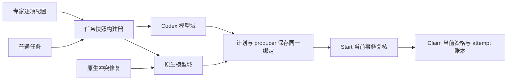

# 普通任务、专家团队与修复的模型选择链路

状态：1.0.0 当前实现，T-P4-102，2026-10-28。本文维护控制面入口之间的共用关系；具体协议分别以[原生模型合同](../../contracts/model-execution.md)、[Codex 合同](../../contracts/codex-app-server.md)、[专家模型合同](../../contracts/expert-team-model-execution.md)和[修复模型合同](../../contracts/repair-model-execution.md)为准。完整 P0–P7 与需求 1–22 范围继续实施。

## 一次选择，一份固定绑定

| 入口 | 请求与调用链 | 固定结果 |
| --- | --- | --- |
| 普通任务 | `TaskDispatchPreviewRequest` → `buildTaskDispatchSnapshotWithSourceTx` → `taskDispatchSourceModelTx`／`taskDispatchSourceCodexTx` | `TaskDispatchPlan.ModelExecution` 或 `CodexExecution`，与复制后的 agent 节点完全相同 |
| 专家团队 Create／未开始项 Revise | 每项 `ExpertTeamPlanItemRequest` → `expertTeamSourceItemTx` → 同一任务派发构建器 | 每项独立的 `TaskDispatchPlan`；模型与额度属于任务，角色配置只固定职责、工具与依据 |
| 冲突修复 Create／合格 Revise | `CandidateCompositionRepairCreateRequest`／`CandidateCompositionRepairRevisionRequest` → 原生 `buildModelExecutionTx` → `compositionRepairWorkflowTx` | `CandidateCompositionPlan.ModelExecution` 与修复 producer 节点相同；原任务、冲突与来源仍由保护记录解析 |

普通与专家入口的 `model_execution_selection`、`codex_execution_selection` 互斥。原生选择固定部署 ID／修订／摘要、允许参数、可选预算及匹配费率；Codex 选择固定目录摘要、模型、推理强度及可选 Token 提醒。支持独立模型协议的工具必须明确选择；未声明该能力的固定工具可以省略选择，不能据此为支持独立选择的工具补默认模型。

关键实现：[任务构建](../../internal/platform/task_dispatch.go)、[专家来源](../../internal/platform/expert_team_plan_source.go)、[修复构建](../../internal/platform/candidate_composition_repair.go)、[原生模型域](../../internal/platform/model_execution.go)、[Codex 模型域](../../internal/platform/codex_execution.go)。复制后的流程先包含固定 `TaskContext` 与最终 goal，再注入绑定；不改发布模板。模型 producer 的自动重试为 0。修复定义摘要还覆盖完整上下文、流程、绑定、顺序来源及原冲突身份。

## DTO、传输与生成合同

上述请求的选择指针使用 `json:"...,omitempty" wire:"nonnull"`：字段可以省略，出现时必须是对象，不能显式传 `null`。响应绑定不加该请求标记。Go DTO 是 OpenAPI／TypeScript 生成来源；生成合同不代替运行时检查。

[共享 HTTP 检查](../../internal/platform/model_execution_http.go)在类型解码前读取原始 map：拒绝双选择、选择字段的大小写别名，并按合同 DTO 的 JSON 标签递归检查选择内部的规范键名。`modelcontract.DecodeSelection`／`codexcontract.DecodeSelection`负责值、范围与封闭字段语义。随后各入口保留严格 DTO、必填字段和项目／路径检查；公共解码保留 JSON 数字词法并拒绝重复键。专家 Create／Revise 对每项执行相同检查；修复接口不接受 Codex 选择。不能仅依靠 Go 的 `DisallowUnknownFields` 拒绝大小写别名。

## 冻结内容与当前资格分别验证

新预览或显式修订选择当前允许的部署／目录。等待依赖、Read、Start 和后续新派发复核原绑定，不重新挑选或重报价。专家 pending 来源通过 `source=&item.Plan` 重建同一快照并比较摘要；只在明确修订时传空 source 创建新绑定。修复通过[最小任务计划投影](../../internal/platform/candidate_composition_repair_model.go)复用 `validateModelExecutionPlanTx`，并在新领取／读取来源前核对实际 producer 与冻结规格完全相同。

Start 在 managed run 的事务回调中再次检查当前身份、任务／配置版本、固定依据、工具、路由与模型资格；Claim 的私有／Pool 路径继续校验当前库存。原生按历史费率 ID／版本读准确报价，后来新增费率不替换原计划。保守预留仍是 `context_window × max_steps + max_output_tokens`，当前派发上限为 16 步、32768 输出 Token，并复用[attempt 账本](../../internal/platform/usage_accounting_hooks.go)原子准入、结算及未知用量核对。

Codex 固定 `observe_only` 和 `configuration_ack_only`。当前目录／本地配置摘要改变或组织／项目任一策略进入 `enforce` 都阻止新工作；Token 提醒不是硬额度，配置 ACK 不是提供方实际模型身份证明。不得套用原生预算承诺或把未定价／partial 用量记成零。

## 事务回执与当前 GET

写命令先取得当前项目权限，再在同一事务中核对稳定 key、完整请求与版本，保存原效果。相同 key 配不同输入不能形成新操作；不确定响应沿原路径／请求／key 恢复。回执证明原操作，不能授予已撤销权限，也不能作为新 Start 的依据。

修复 Create 的原回执尤其不能被当前计划替换：例如原 Create 返回版本 1、空 `run_id`；另一视图 Start 后当前计划成为版本 2 并关联运行，原 key 恢复仍返回版本 1、原绑定与空 `run_id`，只重新投影当前资格，过期回执清空动作。另行 GET 原计划 ID 才读取当前运行。已启动操作的 Start 回执仍指向它自己的原运行。实现见[修复 Create](../../internal/platform/candidate_composition_repair.go)与[专家原回执](../../internal/platform/expert_team_plan_receipt.go)。

同一冲突已有 reservation 时，不同模型／参数／预算的 Create 返回冲突，要求显式修订。Ready 或具真实、完整 before-workspace 启动失败证明的修复才可修订；旧计划、运行和 attempt 不改写，独立测试、人工验收及来源接受门禁保留。

## AI 实现与排障 SOP

1. 先读仓库 `AGENTS.md`、`memory/current_state.json`、当前交付状态和对应合同，确认文件责任范围；保持产品版本 1.0.0，不增加历史别名、回填或第二套模型引擎。
2. 修改入口时逐层核对请求 DTO／`wire` 标记、原始字段检查、共享绑定构建与当前重验证、回执恢复及实际响应消费者。生成合同后比较 API 与 UI 请求形状，不能通过删除校验让旧输入通过。
3. 使用受影响的离线精确回归，优先覆盖原选择保持、当前撤权、库存／策略变化、原 key 恢复及坏响应保留。CLI 解析测试、协议夹具、真实模型调用和生产验收分别记入[验证文档](../quality/verification.md)；不因改入口重复无关完整模型旅程。临时数据放 `.cache/`，不覆盖活动预览或用户数据库。

| 现象 | 核对与处理 |
| --- | --- |
| 选择无效、双选择或字段错误 | 比对原始请求与 DTO：规范键名、对象非空、精确整数和公开字段；不添加 provider／密钥／环境覆盖 |
| 部署不可用、目录或配置改变 | 对照准确工具版本、当前 worker／Pool 库存及原绑定摘要；修正当前依据或显式新预览／修订，不能自动换模型 |
| Codex 遇预算拒绝 | 检查组织和项目 `enforce` 策略；选择具备所需能力的工具，不暗改策略或把提醒说成硬限制 |
| 已启动后 Create 恢复仍显示未开始 | 先核对原回执的 ID／版本／模型，再 GET 当前计划；空原 `run_id` 不代表当前未执行，不换 key 重建任务 |
| 401／403、未知结果、partial 用量 | 权限失效停止受保护读取／新工作；未知结果保留原 attempt 与回执核对，不自动重试、resume 或清零预留 |

本次入口复用没有新增 DDL、数据库表、SDK、Runner 协议或依赖。`candidateConflictRepairProfile`仍限定原生 suma JSONL 专用修复工作区生命周期；Codex 冲突修复不受支持。界面应明确该边界，不能仅因普通／专家入口支持 Codex 就扩大修复能力。
