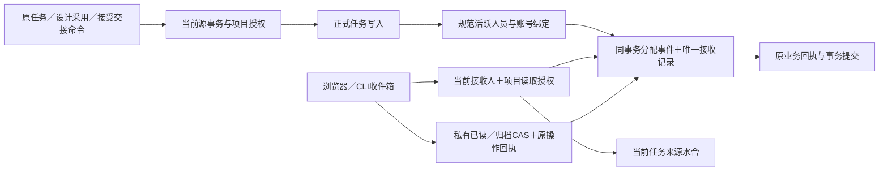

# 任务事件到个人收件箱

状态：T-INBOX-138实施中；负责人：协作领域／主集成；产品1.0.0。关联Multica M24／M25／M27、原需求团队协作／自动上报及统一权限。正式字段以[收件箱合同](../../contracts/notification-inbox.md)和同源生成的OpenAPI为准；界面见[交互规范](../design/notification-inbox.md)。源事件、个人投影和消息通道不合并为一种状态。

## 领域边界

业务负责人仍是人员／Agent／工具资源；接收人只是真实账号。`suma_human_resources`、活跃human资源及其data.user_id必须一致，且账号当前具备组织／项目读取资格。仅有同名、邮箱或资源标签不产生接收权。绑定缺失、资源不活跃或非human时跳过人员投影；之后补绑定不推断历史通知。

原任务创建统一经过insertCommandRecord；普通负责人变更、设计采用更新及已接受交接各有明确事务接点。不能只在浏览器保存表单后发通知，也不能把公开活动表当完整接收人投递系统。

## 原子性、排序与幂等

源事务在正式任务写入后、原回执提交前调用内部投影，重核已保存来源。唯一源事件由任务ID／提交版本／新负责人组成，同一接收人只出现一次。通知表写入失败使原事务回滚；不会出现任务已完成而收件记录静默丢失的独立网络窗口。

租户／项目持久化序号计数器与事件同事务提交。序号为有界BIGINT，API使用十进制字符串；行分页以不可变sequence降序，避免把已读更新时间或变长小数时间戳当收件顺序。新增事件通过刷新进入当前窗口；个人状态或来源变化后的分页仍是活数据，不能声称冻结导出。

个人动作使用同库受保护操作回执，命令包含当前通知版本。重放前重新核验当前身份和项目，再恢复原确认状态；回执不存任务标题。另一标签的新版本冲突需明确重新读取，不替用户自动覆盖。

## 权限与数据最小化

- 源投影利用原组织授权事务的一致性读取接收资格，不在持有组织锁后新增接收人用户锁，避免与撤权事务形成反向锁序。
- GET和个人命令分别重核当前凭据；不能通过传user_id查看他人收件箱。Runner、Agent和伪造投影作者不获得人员入口。
- 个人viewer能管理自己的通知，但仍不能写任务、指派、启动、审批或验收。
- 标题只来自当前同项目任务；来源删除或不可用时不返回历史标题。通知仍保留自身事件引用，当前来源链接为空。
- 已读／归档不写团队公开动态，不作为人员工时、开发进度、测试通过或人工验收事实。

## 扩展与部署

同一业务数据库提供单机与分布式控制面的一致收件记录；SQLite先完成真实验证，OceanBase／可选PostgreSQL各自SQL和事务仍需实际矩阵。新增域初始化只安装空的当前结构；发现局部／不兼容域时在写入前拒绝，不回填旧活动或重置用户库。

将来接入讨论提及、审核请求、可靠告警或消息通道时，须逐项声明源事件、真实接收关系、当前权限、唯一键和投递回执。邮件／企业微信／钉钉投递另用outbox和发送状态；通知已读不能推断外部消息送达。本阶段不创建对外消息发送或伪造系统提醒接口。

## 组织读取与项目写入

组织收件箱是同一投影上的查询。以当前浏览器组织授权事务读取项目可见关系，在该范围内计算个人计数并读取有界页面，复用原通知来源核对。每页返回可读集合的等值标识；访问资格变化使旧分页失效。事件时间和 ID 只用于跨项目排序，不能用某个项目的序号推导组织全局顺序。

组织内范围不会进入项目命令授权。每次个人生命周期操作仍以通知本身的项目为边界，沿当前身份、对象归属和原回执核对。此阶段沿用当前投影表和原初始化，不增加组织级通知状态或通道。

## 正式失败事件与个人通知

原执行引擎持久化 `run_failed` 后，既有失败投影核对组织、项目和原运行。非部署的正式绑定任务在首个 `failure-<run>` 问题回执事务中同时产生个人通知。当前有读取资格的关注者和当前规范人员负责人去重后写入同一通知表。问题、通知和原回执一起提交，任一写入失败时由原持久事件重试。

精确来源绑定到持久失败事件、任务运行来源及绑定版本。列表在当前账号授权范围内验证来源才返回原运行定位。任务换绑不改变历史失败的来源。以原问题回执隔离重放与新投影，阻止重试时新增关注者收到历史通知。本阶段沿用当前结构与调度循环。

## 必须保留的验收

真实创建／重新分配／设计采用／交接、原事务回滚及重放、同源去重、未知／Agent资源不推断账号、viewer私有动作、他人ID拒绝、撤权后读及回执拒绝、来源删除／重命名、独立序号分页、旧版本冲突和原操作恢复分别留证。界面需覆盖中英、390px、失权清除、读失败与结果未知；证据未取得的数据库、通道和规模不得标为完成。
