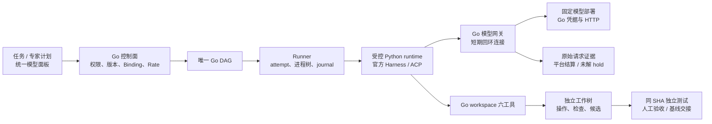

# Octop Harness 受控开发执行架构

状态：suma 1.0.0／T-MODEL-118 当前架构。责任：控制面、Runner、模型网关、Octop runtime 与工作台。关联：[执行合同](../../contracts/octop-harness-acp.md)、[统一模型网关](model-gateway.md)、[操作指南](../integrations/octop.md)、[交互规范](../design/octop-execution.md)。实际证据与未验范围以[本轮专项报告](../quality/model-gateway-verification.md)为准，不由本设计预先宣布通过。

## 架构与成熟 SDK

平台复用公开 `octop-harness 1.0.5`、Python ACP SDK `0.12.1` 与现有 MCP、Go DAG、工作区日志、候选和质量门禁。Python runtime 只处理受控 Harness／ACP 生命周期和六工具交互。Go 独占供应商凭据、模型 HTTP、逐请求额度与持久账本；Octop 和原生编码共享同一冻结模型 Binding、Rate 和预算准入。

这不是启动完整 Octop CLI 并信任其 cwd。个人 Agent 数据库、默认工具、历史 session 与长期状态不进入平台 attempt。每次运行创建新鲜私有状态目录，文件效果由 Go 六工具宿主决定。

## 配置到真实执行

1. 管理员保护绝对 Python、固定 `.pyz`、同目录 manifest 和检查允许列表；工具声明 `octop-harness-acp-v1`、`octop-acp-jsonl`、`suma-model-execution-v1`。
2. 管理员在 Runner `model_deployments` 维护公开部署与本地完整端点／凭据引用，供应商秘密不进入 Python 环境或工具配置。
3. 实际离线 probe 核对锁定 SDK、协议和入口；成功后库存才可声明 workspace 与共同模型能力。配置存在不代表可用或模型健康。
4. 普通／专家任务在共用模型面板选择准确部署、参数与预算。计划和唯一 agent 生产节点保存完全相同的 Binding，runtime 身份由固定工具摘要及真实执行证据承载，不另造 Octop 模型快照。
5. Start、私有／Pool Claim 与 Runner 重核原计划、当前授权、工具摘要、部署和预算；无 binding 不退回直接供应商编码。节点不自动重试。
6. Runner 建立独立工作树、Go 模型网关和 workspace bridge，SDK 只获各自短期 token 与回环端点。模型请求走 Go，代码操作走六工具宿主。
7. 模型响应事实、ACP lifecycle、Go 停止事实和代码检查共同核验；候选封存后按同 SHA 独立测试、人工验收和后续基线门禁交付。

参数只开放模型请求次数与 attempt 总输出额度，选项服务提供动态 bounds。输入按 `context_window × max_steps` 保守预留，原费率按整数固定；没有精确 tokenizer 或供应商最终金额保证，不能用配置标记代替账务。

## 流式、原操作与重启

真实模型 SSE 内容逐事件转发；终态、usage、DONE 后缀等 Go 持久回执及 Runner journal 检查点落盘后再发送，避免 SDK 依据未持久完成事实结束。每步索引和正文绑定原请求，已完成同正文只返可用原缓存；未知、不同正文或缓存缺失不再调用供应商。

journal 保存原 assignment／fence、工具、Binding、请求状态和已知计数，不保存秘密、prompt 或原响应。重启保留已知费用依据，未完成请求转 unknown，不造新 session、process stopped 或 gateway closed。恢复原操作而非再次发 prompt；未解 hold 仍待核对。

## 停止、费用与质量

取消意图、ACP stop reason、Agent 父进程退出、Go 进程树停止、Go 网关关闭及模型请求覆盖各自记录。`ToolEvidence.octop_execution.binding_sha256` 必须对上共用 ModelEvidence；runtime 不再用 provider/model 配置确认替代真实请求身份。

取消不清零已知用量，模型请求完成不等于账本 settled，代码检查失败也不删除已发生的费用。工作台共用模型／网关事实卡，明细渐进展开；未读账本处链接既有用量页，不重复轮询或推算 hold。代码结果、模型计量、独立测试、人工验收和生产发布始终分开。

## 隔离与交付范围

模型工具目录与调用层同时仅允许 Go `list/read/write/edit/remove/check`；check 只接受管理员登记 ID。操作编号来自 request、真实 tool_call_id 和工具名，Go 持久日志防止重传产生第二次效果。ACP cwd 不证明工作树隔离。

固定运行包和 manifest 不是完整 Python 环境、签名或 OS／网络沙箱证明。管理员需保护解释器和依赖，更强隔离由部署边界独立实现与验证。公开来源保持[Harness 固定提交](https://github.com/TencentCloud/octop-harness/tree/68b5423bb80ecef7fca57ba5a37d9a2bdcbf12d2)、[Python ACP 0.12.1](https://pypi.org/project/agent-client-protocol/0.12.1/)及其许可证来源。

本入口不接管完整 Octop 控制台、个人专家、记忆、IM、办公和桌面。只读模型 purpose、OpenCode 和 Codex 保留其独立合同，不能因本链路接入称所有 CLI 预算已统一。实际本地协议、官方 SDK、厂商、跨平台、多机和生产范围分列于专项报告；旧 Octop 报告仅说明其原阶段来源。

## English architecture summary

The controlled Octop Harness/ACP runtime shares native coding’s model binding, rate and attempt budget. Go remains the only dispatcher, provider-secret/HTTP authority, durable request ledger and workspace effect authority. SDKs receive attempt loopback endpoints with short-lived credentials, never provider secrets.

SSE tokens remain streamed while terminal/usage suffixes wait for durable receipts. Duplicate completed steps return only an available original cache; uncertain requests are not replayed. Restart preserves known usage and unresolved holds without inventing process-stop or session evidence. Source checks, model usage, ledger settlement, independent same-SHA tests and human acceptance remain separate. Actual verification is recorded in the linked current report.
