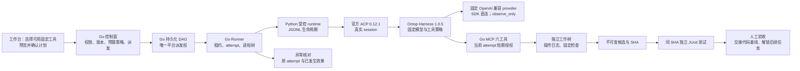
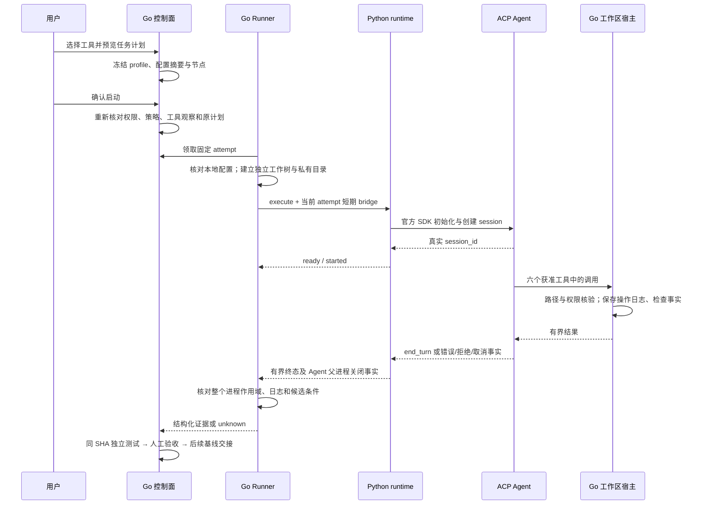

# Octop Harness 受控开发执行架构

| 元数据 | 内容 |
| --- | --- |
| 平台版本 | suma 1.0.0 |
| 状态 | T-OCTOP-117 阶段实现设计；实际验证范围以证据报告为准 |
| 维护责任 | 控制面、Runner、工具合同与 Octop runtime 模块负责人 |
| 关联需求 | 配置到真实执行、独立工作区开发、异常核对、独立测试与代码基线交接 |
| 执行合同 | [Octop Harness ACP 合同](../../contracts/octop-harness-acp.md) |
| 证据入口 | [Octop 执行验证报告](../quality/octop-execution-verification.md) |

## 1. 设计目标与选型

速码复用公开 `octop-harness 1.0.5` 与官方 Python `agent-client-protocol 0.12.1`，将模型开发能力接到已有任务派发、Go 工作区宿主、操作日志、代码候选、独立测试和人工验收链路。使用成熟 SDK 处理 ACP session 与消息，平台继续掌握任务、权限、进程、代码和交付事实。

本阶段提供受控 Harness SDK 入口，而不是启动完整 Octop CLI 后把其工作目录当作隔离保证。官方 CLI 的 Agent 数据库、默认工具和个人 workspace 不进入本次执行。每个 attempt 有新鲜私有状态目录，源码访问由现有 Go MCP 宿主承担。

## 2. 模块边界

| 模块 | 负责 | 不负责 |
| --- | --- | --- |
| `internal/toolcontract` | 闭合公开能力、证据、固定配置与停止条件 | 信任模型自报身份或成功 |
| `internal/platform` | 预览、启动、领取时核对原配置、权限和预算策略 | 第二套 Octop dispatcher |
| `internal/dag` | 复用既有节点、attempt、门禁和可靠结果处理 | 自动 resume 或无条件重试 |
| `internal/runner` | 固定入口、受控环境、进程树、工作区、候选封存 | 将 ACP `cwd` 作为文件隔离证明 |
| `packages/octop-runtime` | 官方 SDK 接入、真实 session、六工具策略、受控事件 | 独立批准验收、改变平台计划或任意命令执行 |

## 3. 固定配置贯穿执行

管理员设置本地 provider、模型、OpenAI 兼容地址、凭据环境变量引用、`max_steps` 与 `max_output_tokens`，并保护固定 Python/zipapp 入口。公开能力只暴露版本、provider/model、服务来源、配置摘要及 `observe_only` / `configuration_ack_only` 语义。密钥值不会进入公开 profile、任务、模型上下文或 stdout。

预览冻结所选 profile 与节点 `octop_execution`。启动再次核对审阅快照与当前可用工具；领取和 Runner 执行继续核对同一摘要。变更模型、参数或入口需要重新形成可审阅计划。节点固定 `MaxRetries=0`，不接受任务覆盖 provider、模型、cwd、专家、工具目录、凭据、启动命令或 session。

预算采用明确能力门禁。当前 SDK 直接请求固定 provider，不走原 Go 模型网关；输出长度与模型轮次限制不等于总 Token/金额硬预算。组织或项目要求强制预算时拒绝此适配器，不能自动放宽。仅记录已有用量事实，缺失保持未知或未上报，不使用配置确认推断厂商认证、完整计量或准确计费模型。

## 4. 工作区与代码效果控制

Runner 创建独立 attempt 工作树及全新 Octop home，并重定向私有配置、临时状态与缓存位置。短期 bridge 只授权当前 attempt 的 Go 工作区宿主；它不是用户、项目管理或运行全局 API 凭据。

模型只看见 `list`、`read`、`write`、`edit`、`remove`、`check` 六种工作区能力，对应 `suma_workspace_*` MCP 工具。runtime 在模型工具目录和实际调用两层限制 SDK 内置文件、shell、联网和委派工具。Go 独立核对工具参数、策略、权限、路径及操作身份。模型生成内容不拥有进程或文件宿主的最终决定权。

操作编号从原请求、真实工具调用 ID 与工具名生成。真实修改及固定检查进入 Go 操作日志，之后沿用已有封存流程，生成不可变候选及提交 SHA。候选必须在相同 SHA 上独立生成 JUnit 测试证据，再进入人工验收。Agent 自报通过、工作区内临时报告或 ACP 成功回复不能替代独立测试。验收后才按原有门禁交接代码基线并推进后续任务。

## 5. 取消与恢复状态

取消是请求，停止是事实，代码交付是另一组证据。以下事实分别保留：

| 层次 | 可观察事实 | 处理方式 |
| --- | --- | --- |
| 控制面 | 取消意图 | 记录 `cancel_requested`，停止后续派发，通知当前执行 |
| ACP | `end_turn`、拒绝、轮次/输出限制、取消通知 | 作为原始阶段事实，不直接完成任务 |
| runtime | Agent 父进程关闭 | 私有生命周期证据，不单独代表后代进程已停止 |
| Go Runner | 整个受控进程作用域已停止 | 与 runtime 事实合并推导 `process_stopped` |
| 平台核对 | 无有效终态、断线、停止不足、结果未知 | 保留原 attempt、操作日志和证据，先核对已发生效果 |

只有配置与真实 session 一致、`end_turn`、无错误/拒绝/取消/未知、Go 确证停止等条件同时满足，才能记录执行阶段的 `completed`。代码候选、测试和人工验收仍有各自门禁。ACP 没有被本合同虚构的 abort ACK；发送取消或观察到父进程退出都不能替代完整停止核对。

任何可能已经发生效果的中断都不自动重发模型、不盲目恢复 session、不复制修改。`MaxRetries=0` 阻止调度器直接自动重试当前节点；它不能单独证明外部请求没有生效。核对完成后，后续执行须依照现有恢复流程形成新 attempt 与可审阅输入。

## 6. 依赖、分发与安全边界

runtime 使用 `packages/octop-runtime/requirements.lock` 管理 venv 的 96 项依赖，构建 zipapp 与 manifest。当前依赖锁基于 Windows/Python 3.13；跨平台可移植性与安装成功需在对应系统分别验证。probe 仅检查公开 SDK/API、安装版本和固定配置，不触发模型调用。

manifest 提供 runtime 字节与依赖版本来源，不等于全部第三方包字节均受完整证明。venv、环境收敛和工具策略不是操作系统沙箱或网络沙箱，不能约束遭篡改的 Python 解释器或原生扩展。管理员必须保护解释器、venv、zipapp、manifest 及 Runner 配置；需要更强隔离的部署应另配受管操作系统/容器边界并单独验收。

公开来源：[Octop Harness 固定源代码](https://github.com/TencentCloud/octop-harness/tree/68b5423bb80ecef7fca57ba5a37d9a2bdcbf12d2)、[Python ACP 0.12.1](https://pypi.org/project/agent-client-protocol/0.12.1/)、[官方 Python SDK](https://github.com/agentclientprotocol/python-sdk)。保留第三方许可证，不将未启用的官方办公技能或个人数据复制到平台。

## 7. 当前交付范围与证据

本阶段覆盖固定模型到 Harness SDK 的受控开发纵向链路，并复用平台已存在的代码候选、独立测试和人工验收。完整 Octop CLI、个人专家/历史数据库、IM、多渠道、长期记忆、办公能力、完整桌面端和厂商账户认证不在该适配器的已实现声明中。已有项目业务只读 MCP 与此 attempt 工作区 MCP 分开授权，不能互换凭据或把六工具扩展为任意管理入口。

检查结果按源码实现、确定性本地模型、真实供应商账户和生产环境分别登记到[验证报告](../quality/octop-execution-verification.md)。本设计不预先声明真实供应商运行、跨平台安装或生产验收通过；图中的门禁表示必须遵守的交付关系，具体已验证部分以报告及原始证据为准。
