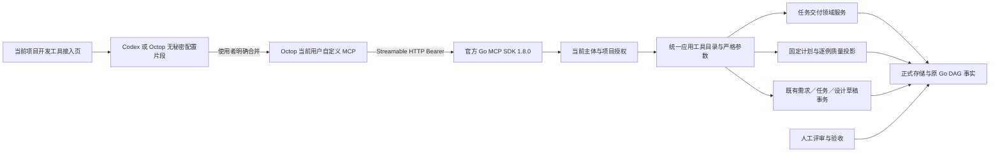
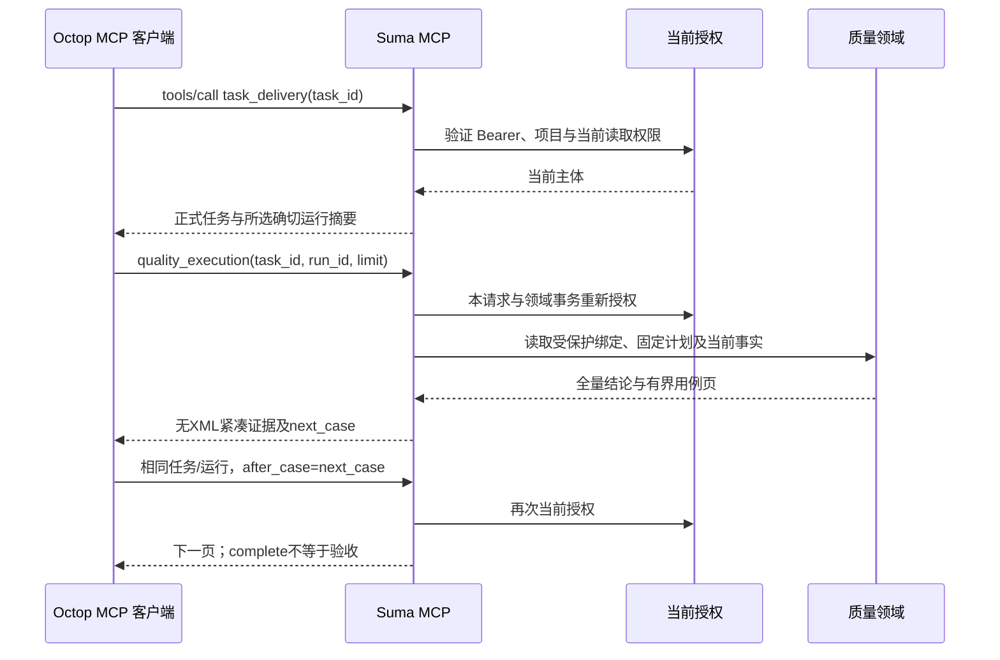

# Octop 集成架构与安全执行边界

状态：1.0.0，T-OCTOP-116 设计与当前实现合同。负责人：平台集成／应用工具／Runner／工作台。关联需求：外部 CLI 与 Agent 协作、质量闭环、MCP／ACP、统一可视配置。实现与操作分别见[应用 MCP 合同](../../contracts/application-tools-mcp.md)和[Octop 指南／AI SOP](../integrations/octop.md)；实际检查以[专项报告](../quality/octop-integration-verification.md)与[摘要](../quality/octop-integration-summary.json)为准。

## 架构决定

先复用 Octop 已有的自定义 MCP 客户端能力，把速码当前的项目、任务、质量与草稿应用服务作为可调用端口。Octop 不成为速码的另一个控制面；速码不嵌入 Octop 的 FastAPI、APScheduler、数据库迁移或用户身份。完整平台继续按既定 React／Go／Runner／多存储领域边界实施，保留58项有限实现／34待办／92总范围。

配置片段生成是本地界面行为，不是连接状态；官方探测、真实调用、草稿采用和正式验收各有独立证据。服务产品元信息为 suma 1.0.0，MCP 协议协商版本与产品版本分别管理，不为了本次接入引入历史兼容产品行为。

## 领域与模块责任

| 模块 | 责任 | 不持有的权力 |
| --- | --- | --- |
| DeveloperConnection 工作台 | 同面板选择客户端、按当前项目／主体／语言生成模板、明确复制与人工合并 | 不自动签发或填入秘密，不 PUT Octop 配置，不宣称连接成功 |
| MCP 传输 | 官方 SDK 处理协议与请求；现有端点每请求验证当前 Bearer | 不将初始化元数据、名称或预期主体头变成授权 |
| 应用工具目录 | 同源 canonical／MCP 名、封闭输入 Schema、权限筛选及输出边界 | 不为 Octop 或其他客户端复制业务状态机 |
| 任务交付 | 当前 task／run、测试节点、正式验收、团队与问题关联 | 不自动派发、创建问题或采纳需求 |
| 质量领域 | 读取受保护 task/run/plan 关系、固定修订、当前依据及真实逐例状态 | 不让普通参数、报告文字或模型结论写成 passed |
| 原 DAG／Runner | 已有执行、候选、attempt、fence、进程与结果语义 | MCP 查询没有独立调度权或停止证明 |
| 既有草稿服务 | 当前权限、expected versions、原操作回执及正式草稿写入 | 草稿不等于发布、设计采用、验收或生产授权 |

当前新增 `project.task_delivery` 和 `project.quality_execution` 仅对真实 API 及当前 ProjectRead 开放；Agent 仍精确原四个读取，Runner 不取得管理工具。MCP wire 名沿原规则为 `suma_project_task_delivery`、`suma_project_quality_execution`。原生 Agent 工具表与已有草稿动作复用原合同，不因 Octop 字段名称或模型内部角色扩权。

## 紧凑交付与质量读取合同

任务交付输入只包含 `task_id`；项目和组织来自当前传输上下文。质量读取输入为 `ApplicationQualityExecutionInput{task_id,run_id,limit?,after_case?}`；省略limit为10，显式limit仅1–20，游标必须是所选固定修订中的真实case key。拒绝未知字段、null、跨任务／项目、未受保护绑定和不存在的游标，不把同项目任意运行当作该任务质量。

`ApplicationQualityExecutionPage` 保留 `project_id`、`task_id`、`plan_id`、`run_id`、revision、plan/source SHA、代码提交、运行／质量状态、basis_current、全量状态计数、limit、complete、next_case和当前cases。状态与总计来自既有质量投影，分页只限制返回用例范围，不重新计算一个“当前页通过即全计划通过”的结论。

每个 `ApplicationQualityCase` 提供稳定key、标题、状态、covers、issue_id、至多3个证据引用及 `evidence_total/evidence_complete`。引用仅含报告ID、代码SHA、节点、attempt、fence、Worker与该证据状态，不携带报告XML、断言正文、日志、命令、环境、文件路径或凭据。覆盖索引继续指当前固定任务验收条目的1起始序号。

`complete` 只表示此次分页已达用例末尾；`evidence_complete` 只表示该例引用是否全量返回。两者均不授予验收资格，也不让unknown／skipped／ambiguous或过期依据变成通过。报告全文仍由有权人员在质量页面按需读取；模型与办公助手默认得到紧凑事实，避免无关原文进入每轮上下文。

质量状态不另存 MCP 副本。当前读取仍可能在领域内部解析完整私有 attempt result 以取得工作树证明，因此只承诺接口与模型上下文的紧凑边界，不声称完全消除了数据库 XML 读取；该性能缺口保持在质量设计中。

## Octop 配置与秘密边界

Octop 当前自定义 MCP 使用 `{servers:{<name>:<spec>}}`；Streamable HTTP spec 包含transport、url、headers及可选元字段。生成项目私有key `suma_<project_id>`，显式 `shared:false/default_open:false`，固定当前预期用户／组织和选定语言头。HTTP Authorization为字面占位符，使用者在Octop私有凭据编辑器中填入专用项目API秘密；不假设 `${ENV}` 在 HTTP headers 中展开。

Octop 自定义配置按用户保存并加密，PUT 是整份替换并可重载Agent。界面只给人工合并片段，不建立跨平台管理员代理，也不自动写入外部账户。输入服务器地址来自速码可信部署配置；容器、远端、反向代理与回环地址必须由实际拓扑核验。Octop 官方支持本地／LAN HTTP(S)及公网HTTPS，不等于速码改变自己的公开地址准入规则。

已有令牌只展示一次和原回执／撤权规则保持。普通身份头用于防止误用当前视图，不是可修改的角色委托。复制、日志、错误和遥测不输出真实秘密；配置示例只含占位符。Octop 当前普通凭据API并不隐藏全部header/env，加密不能替代用户隔离、最小权限、过期和撤销。

## ACP 现状：设计可复用，编码派发尚未接通

官方 Octop 支持双向stdio ACP：入站 `octop acp --agent main` 由外部编辑器驱动Octop Agent；出站`acp_runner`由Octop委派OpenCode／CodeBuddy／Claude／Codex等。它不是本阶段的MCP客户端链路，不能把连接器存在或普通命令许可说成ACP编码执行。

以下判断依据已读取的固定官方源码，而非仅凭命令名或文档宣传：

| 事实 | 固定来源 | 集成含义 |
| --- | --- | --- |
| 入站启动独立 OctopServer、解析已有Agent、最后停止 | [CLI acp.py](https://github.com/TencentCloud/Octop/blob/890111b7879665840414ca28ab168b05b0db0921/src/octop/cli/commands/acp.py#L11) | 不要求已有octop run，但会初始化／恢复状态，不是只读连接已有服务 |
| `OCTOP_HOME` 可进程局部覆盖整个状态根 | [PathLayout](https://github.com/TencentCloud/Octop/blob/890111b7879665840414ca28ab168b05b0db0921/src/octop/infra/utils/paths.py#L14) | 可以设计隔离状态目录；空HOME不自动具备可启动Agent/provider，也不能复制用户私有状态来填补 |
| workspace_dir与backend.root_dir是两个维度，创建时显式workspace_dir优先并持久化 | [workspace/dir.py](https://github.com/TencentCloud/Octop/blob/890111b7879665840414ca28ab168b05b0db0921/src/octop/infra/agents/workspace/dir.py#L1)、[创建seed](https://github.com/TencentCloud/Octop/blob/890111b7879665840414ca28ab168b05b0db0921/src/octop/infra/agents/workspace/dir.py#L254) | 可以设计专用Agent后端绑定Suma attempt工作树；必须真实创建、读取并核验实际范围 |
| 部分不可写scoped root会退为host root `/` | [root fallback](https://github.com/TencentCloud/Octop/blob/890111b7879665840414ca28ab168b05b0db0921/src/octop/infra/agents/workspace/dir.py#L100) | 不能把配置值当操作系统隔离或实际根证明；失败应闭合，禁止静默扩大范围 |
| ACP new/load只记cwd；prompt给harness的request不含cwd | [Harness server](https://github.com/TencentCloud/octop-harness/blob/68b5423bb80ecef7fca57ba5a37d9a2bdcbf12d2/src/octop_harness/acp/server.py#L171) | session/new.cwd不足以证明代码任务在Suma工作树中执行 |
| initialize只声明load_session且agent_info.version为0.0.0；cancel只设事件，循环等待chunk时观察，prompt仍返回end_turn | [initialize](https://github.com/TencentCloud/octop-harness/blob/68b5423bb80ecef7fca57ba5a37d9a2bdcbf12d2/src/octop_harness/acp/server.py#L151)、[cancel](https://github.com/TencentCloud/octop-harness/blob/68b5423bb80ecef7fca57ba5a37d9a2bdcbf12d2/src/octop_harness/acp/server.py#L236) | 不能把0.0.0当安装版本，也不能把cancel或end_turn当所有子进程／外部效果已停止的证明 |

### 后续完整 ACP 接入设计与准入

1. 定义与当前工具合同一致的能力发现、安装版本、协议、配置摘要、执行路由和权限请求模型。优先成熟ACP SDK，锁定实际发布版和许可证；不手写另一套无限制JSON-RPC或任务调度。
2. Runner 为每attempt创建独立工作树与进程局部OctopHOME，使用明确授权的专用Agent／provider配置，限制秘密和插件／通道。工作树与Octop状态、系统文件、记忆分开；核验实际backend root、链接、工作目录及进程边界。未知或退回host-root时阻止执行。
3. 将会话、prompt、工具事件、输出、等待输入、权限选择及终态绑定原dispatch／attempt／fence。远端正文或Agent角色不能授予本机文件、terminal、网络或生产权限；需要新权限时进入可审阅门禁。
4. 模型选择、参数、预算与速码冻结依据贯通，实际provider／模型与用量另有证明。只收到参数ACK或文本结束不表示硬预算、正确模型或任务完成。
5. 取消先发协议请求，再由Go Runner核对进程树实际停止；结果不明保留原operation与副作用状态，不重复prompt。只有已确认未执行或幂等保护才允许恢复／重派。
6. 代码结果进入现有候选封存、另一Runner同SHA独立测试、当前逐例门禁及人工Review；不让Octop内部成功直接改业务验收。完整跨机、断线、审批、撤权、未知效果与故障注入分别取得证据后，才标为编码适配已接通。

上述为后续准入设计，不是本阶段实现或验收声明。当前未安装或运行真实Octop实例／模型，未验其文件、terminal、记忆、插件、IM、桌面或ACP任务；MCP的实际协议和工具检查也应以专项报告的真实环境为准。

## 来源、复用与架构约束

- Octop 当前main核验为 [`890111b7879665840414ca28ab168b05b0db0921`](https://github.com/TencentCloud/Octop/commit/890111b7879665840414ca28ab168b05b0db0921)，1.0.3b1；[README_CN](https://github.com/TencentCloud/Octop/blob/890111b7879665840414ca28ab168b05b0db0921/README_CN.md)、[MCP自定义配置](https://github.com/TencentCloud/Octop/blob/890111b7879665840414ca28ab168b05b0db0921/src/octop/infra/connectors/custom_mcp.py)、[官方保存路由](https://github.com/TencentCloud/Octop/blob/890111b7879665840414ca28ab168b05b0db0921/src/octop/api/routers/connectors.py#L644)。
- Octop为 [MIT、Copyright (c) 2026 Octop](https://github.com/TencentCloud/Octop/blob/890111b7879665840414ca28ab168b05b0db0921/LICENSE)。若后续直接复制源码，须保留许可通知并更新第三方清单；本阶段复用正式协议和合同，不将整套Python控制面复制进Go项目。
- 两份新分享的可见正文、摘要与截断见[采用映射](../integrations/shared-roadmap-adoption.md)。采用任务驱动、渐进披露、当前权限、稳定版本／证据和有上限自动化；不按参考中的FastAPI／Celery／Alembic示例更换已批准的Go体系，不把插件版本合同扩成产品历史兼容层。
- 完整生命周期、智能路由／重规划、通用配置中心、ACP／A2A、知识／记忆／技能、远端安装和生产验收仍按当前P0–P7与需求1–26推进。本次没有新建完成项、自动执行策略或第二派发中心。
